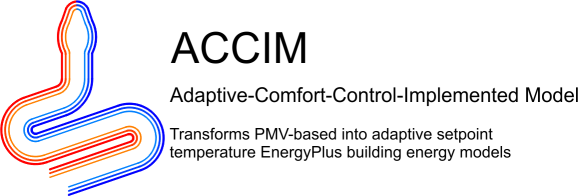
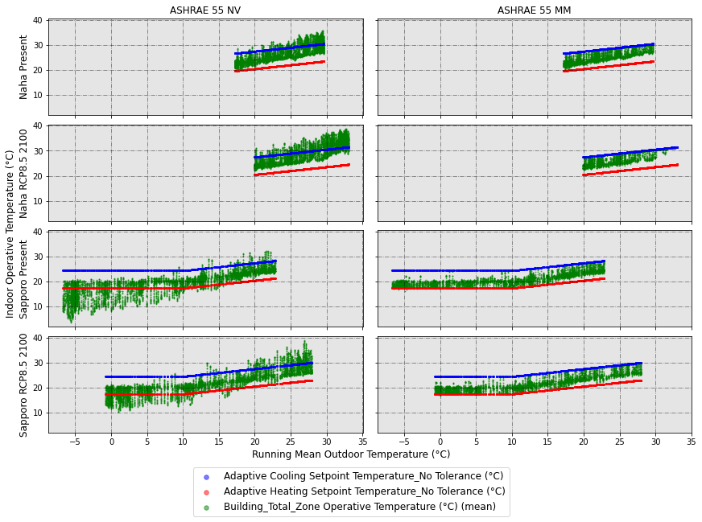

 .png?raw=true)

			

ACCIM stands for Adaptive-Comfort-Control-Implemented Model.

In research terms, this is a proposal for a paradigm shift, from using fixed PMV-based to adaptive setpoint temperatures, based on adaptive thermal comfort algorithms and it has been widely studied and published on scientific research journals (for more information, refer to https://orcid.org/0000-0002-3080-0821).

In terms of code, this is a python package that transforms fixed setpoint temperature building energy models into adaptive setpoint temperature energy models by adding the Adaptive Comfort Control Implementation Script (ACCIS). This package has been developed to be used in EnergyPlus building energy performance simulations.

The figure below clearly explains the aim of adaptive setpoint temperatures: introducing hourly temperature values into the adaptive comfort zone. On the left column, you can see the simulation results of a naturally ventilated building, while on the right column, the same building in mixed-mode operation with adaptive setpoint temperatures.

# 1. Citation

If you use this package, please cite us:

[1] D. Sánchez-García, David Bienvenido-Huertas, Carlos Rubio-Bellido, Computational approach to extend the air-conditioning usage to adaptive comfort: Adaptive-Comfort-Control-Implementation Script, Automation in Construction 131 (2021) 103900. doi:10.1016/j.autcon.2021.103900. https://doi.org/10.1016/j.autcon.2021.103900

[2] Daniel Sánchez-García, Jorge Martínez-Crespo, Ulpiano Ruiz-Rivas Hernando, Carmen Alonso, A detailed view of the Adaptive-Comfort-Control-Implementation Script (ACCIS): The capabilities of the automation system for adaptive setpoint temperatures in building energy models, Energy and Buildings 288 (2023) 113019. doi:10.1016/j.enbuild.2023.113019. https://doi.org/10.1016/j.enbuild.2023.113019

[3] Daniel Sánchez-García, David Bienvenido-Huertas, William O’Brien, accim: a Python library for adaptive setpoint temperatures in building performance simulations, Journal of Building Performance Simulation (2025) 1–13. doi:10.1080/19401493.2025.2472305. https://doi.org/10.1080/19401493.2025.2472305

[4] Daniel Sánchez-García, David Bienvenido-Huertas, Alberto Cerezo-Narváez, Mc. Delgado Guerrero, José Sánchez Ramos, A methodological framework and computational tool for adaptive predicted mean vote setpoints in EnergyPlus building simulations, Journal of Building Engineering. 119 (2026) 115273. doi:10.1016/j.jobe.2026.115273. https://doi.org/10.1016/j.jobe.2026.115273

# 2. How to use

## 2.0 Requirements
To use accim, the following must be installed:
- Python 3.9 or newer
- EnergyPlus (any version between 9.1 and 26.2 those included). To run the simulations through the Python API of EnergyPlus (section 2.2.3), EnergyPlus 24.2 or later

## 2.1 Installation
First of all, you need to install the package. There are two options:

**Library only** (lightweight). Use this option if you don't need the sample files:

    pip install accim

**Library + sample files** (Jupyter notebooks, IDFs, EPWs, CSVs, figures and scripts):

    pip install "accim[samples]"

The sample files are published as the separate package `accim-samples`, with the same version as accim, and are installed into the `accim/sample_files` folder within your site-packages path. You can add them later with `pip install "accim[samples]"` and remove them with `pip uninstall accim-samples`; accim itself is not affected. To print the path of the installed sample files, run:

    python -c "import accim.sample_files, os; print(os.path.dirname(accim.sample_files.__file__))"

### 2.1.1 Running the example notebooks

The Jupyter notebooks mentioned in section 2.2 are part of the sample files, in the folder `jupyter_notebooks`. Each example has its own folder, with the notebook and the input files it uses (IDFs, EPWs...):

| Folder | Content |
| --- | --- |
| `addAccis` | Adaptive setpoint temperatures with `AddAccis()` (`addAccis()` before accim 1.0.0, section 2.2.1) |
| `rename_epw_files` | Renaming EPW files (section 2.2.2) |
| `runEp` | Running simulations (section 2.2.3) |
| `Table` | Data analysis, figures and tables (section 2.2.4) |
| `full_example_IBPSA` | Full example, from the input files to the figures (section 2.2.5) |
| `example_apmv_setpoints_paper` | aPMV setpoints (section 2.2.6) |
| `research_paper_case_study_v0-7-3` | Case study of a research paper |
| `parametric_and_optimisation_examples` | Parametric simulation and optimisation: tutorials `00`-`10` and complete workflows `wf1`-`wf5` |

To run them on your computer:

1. Install accim with the sample files, and Jupyter if you do not have it:

       pip install "accim[samples]" notebook

   If accim is already installed, this adds the sample files of the same version. When you upgrade accim, upgrade the sample files with it: `pip install --upgrade "accim[samples]"`.

2. Find the folder of the sample files with the command above:

       python -c "import accim.sample_files, os; print(os.path.dirname(accim.sample_files.__file__))"

3. Copy the folder of the example (for instance, `jupyter_notebooks/addAccis`) to a working folder, such as your Desktop. Run the notebooks there rather than in site-packages: they write their results next to them, and the installed sample files should not be modified.

4. Open a terminal (e.g. cmd) in the copied folder and run `jupyter notebook`. An internet browser will pop up, where you can open the .ipynb file.

The notebooks that run simulations need EnergyPlus. The sample models of `parametric_and_optimisation_examples` are in the format of EnergyPlus 25.2; the documentation explains how to run these notebooks and in which order: https://accim.readthedocs.io/en/master/jupyter_notebooks/parametric_and_optimisation_examples/index.html

You can also read the notebooks, with their outputs, without running them: in the documentation (https://accim.readthedocs.io/en/master/) or on GitHub (https://github.com/dsanchez-garcia/accim/tree/master/accim/sample_files/jupyter_notebooks). GitHub shows the development version, which may be ahead of the version you installed; the installed sample files always match your version of accim.

## 2.2 Usage

Since accim 1.0.0, the names of the classes, functions and arguments follow the naming conventions of Python (PEP 8): `addAccis` is `AddAccis`, `ScriptType` is `script_type`, `ComfStand` is `comfort_standard`, `runEp` is `run_ep`, and so on. Each argument has the same name in the whole package, also in the aPMV functions and in `accim.parametric_and_optimisation`, whose parameters are named as the arguments of `AddAccis` (`comfort_standard`, `custom_slope`...). The names of previous versions still work, with a `DeprecationWarning` that gives the new name, so the scripts written for them run without changes; the EMS variables of the output IDFs (`ComfStand`...) and the columns of `Table` keep their names. The migration guide lists all the new names: https://accim.readthedocs.io/en/master/9_migration_guide.html

### 2.2.1 Transforming PMV-based into adaptive setpoint temperatures

This is a very brief explanation of the usage. Therefore, if you don't get the results you expected or get some error, I would recommend reading the 'Detailed use' section at the documentation in the link https://accim.readthedocs.io/en/master/

accim will take as input IDF files those located at the same path as the script. You only need to run the following code:

#### 2.2.1.1 Short version

    from accim.sim import accis
    accis.AddAccis()

Once you run this code, you will be asked to enter some information at the terminal or python console to generate the output IDF files.

#### 2.2.1.2 Longer version

    from accim.sim import accis
    accis.AddAccis(
        script_type=str, # 'vrf_mm', 'vrf_ac', 'ex_mm', 'ex_ac'. For instance: script_type='vrf_ac',
        supply_air_temp_input_method=str, # 'supply air temperature', 'temperature difference'. For instance: supply_air_temp_input_method='supply air temperature',
        keep_existing_outputs=bool, # True or False. For instance: keep_existing_outputs=False,
        output_type=str, # 'simplified', 'standard', 'detailed' or 'custom'. For instance: output_type='standard',
        output_frequencies=list, # ['timestep', 'hourly', 'daily', 'monthly', 'runperiod']. For instance: output_frequencies=['hourly', 'runperiod'],
        make_outputs_dataframe=bool, # True to keep a DataFrame with the Output:Variable objects in the attribute df_outputs. For instance: make_outputs_dataframe=False,
        outputs_dataframe=pandas Dataframe,
        energyplus_version=str, # '9.1', '9.2', '9.3', '9.4', '9.5', '9.6', '22.1', '22.2', '23.1', '23.2', '24.1', '24.2', '25.1', '25.2', '26.1', '26.2' or 'auto'. For instance: energyplus_version='auto',
        setpoint_type=str, # 'temperature' or 'temp', or 'pmv'. For instance: setpoint_type='temp',
        comfort_standard=list, # it is the Comfort Standard. Can be any integer from 0 to 22, or 99. For instance: comfort_standard=[0, 1, 2, 3],
        category=list, # it is the Category. Can be 1, 2, 3, 80, 85 or 90. For instance: category=[3, 80],
        comfort_mode=list, # it is Comfort Mode. Can be 0, 1, 2 or 3. For instance: comfort_mode=[0, 3],
        setpoint_accuracy=float, # it is the accuracy of the setpoint temperatures
        cooling_season_start=dd/mm date in string format or integer to represent the day of the year, # it is the start date for the cooling season
        cooling_season_end=dd/mm date in string format or integer to represent the day of the year, # it is the end date for the cooling season
        hvac_mode=list, # it is the HVAC mode. 0 for Full AC, 1 for NV and 2 for MM. For instance: hvac_mode=[0, 2],
        ventilation_control=list, # it is the Ventilation Control. Can be 0, 1, 2 or 3. For instance: ventilation_control=[0, 1],
        opening_factor_max_temp_diff=float, # When the difference of operative and outdoor temperature exceeds opening_factor_max_temp_diff, windows will be opened the fraction of min_opening_factor. For instance: opening_factor_max_temp_diff=20,
        opening_factor_min_temp_diff=float, # When the difference of operative and outdoor temperature is smaller than opening_factor_min_temp_diff, windows will be fully opened. Between min and max, windows will be linearly opened. For instance: opening_factor_min_temp_diff=1,
        min_opening_factor=float, # Fraction of window to be opened when temperature difference exceeds opening_factor_max_temp_diff. For instance: min_opening_factor=0.2,
        ventilation_setpoint_offset=list, # it is the offset for the ventilation setpoint. Can be any number, float or int. For instance: ventilation_setpoint_offset=[-1.5, -1, 0, 1, 1.5],
        min_outdoor_temp_offset=list, # it is the offset for the minimum outdoor temperature to ventilate. Can be any positive number, float or int. For instance: min_outdoor_temp_offset=[0.5, 1, 2],
        max_wind_speed=list, # it is the maximum wind speed allowed for ventilation. Can be any positive number, float or int. For instance: max_wind_speed=[2.5, 5, 10],
        setpoint_tolerance_start=float, # it is the start of the tolerance sequence. For instance: setpoint_tolerance_start=0,
        setpoint_tolerance_end=float, # it is the end of the tolerance sequence. For instance: setpoint_tolerance_end=2,
        setpoint_tolerance_step=float, # these are the steps of the tolerance sequence. For instance: setpoint_tolerance_step=0.25,
        name_suffix=str, # some text you might want to add at the end of the output IDF file name. For instance: name_suffix='whatever',
        verbose=bool, # True to print all process in screen, False to not to print it. Default is True. For instance: verbose=True,
        confirm=bool, # True to confirm automatically the generation of IDFs; if omitted, you'll be asked to confirm in command prompt. For instance: confirm=True,
    )

Since accim 1.1.0, `AddAccis()` prints the estimated size of the results of the simulations of the output IDFs before writing them (also kept in its attribute `results_size`), so that other outputs can be chosen, and each output IDF only has the EMS code of the comfort standards of its zones: `accim.sim.accis.modify_accis()` changes the arguments of an output IDF, also its comfort standard. To read the EMS code with which the ACCIS calculates the setpoints of a comfort standard, category and comfort mode before adding it to a model (which setpoints apply, and what they are out of the applicability limits), see https://accim.readthedocs.io/en/master/4_detailed%20use.html#setpoint-ems-code

    from accim.utils import print_setpoint_ems_code
    print_setpoint_ems_code(comfort_standard=1, category=2, comfort_mode=3)

You can see a Jupyter Notebook in the link below:  
https://github.com/dsanchez-garcia/accim/blob/master/accim/sample_files/jupyter_notebooks/addAccis/using_addAccis.ipynb  

To run it on your computer, copy the folder `jupyter_notebooks/addAccis` of the sample files to a working folder (see section 2.1.1).

### 2.2.2 Renaming epw files for later data analysis

You can see a Jupyter Notebook in the link below:  
https://github.com/dsanchez-garcia/accim/blob/master/accim/sample_files/jupyter_notebooks/rename_epw_files/using_rename_epw_files.ipynb

To run it on your computer, copy the folder `jupyter_notebooks/rename_epw_files` of the sample files to a working folder (see section 2.1.1).

### 2.2.3 Running simulations

You can see a Jupyter Notebook in the link below:  
https://github.com/dsanchez-garcia/accim/blob/master/accim/sample_files/jupyter_notebooks/runEp/using_runEp.ipynb

To run it on your computer, copy the folder `jupyter_notebooks/runEp` of the sample files to a working folder (see section 2.1.1).

The function `run_ep` (`runEp` before accim 1.0.0) runs each IDF of the working folder with each EPW:

    from accim.run import run
    run.run_ep(only_accim_idfs=True, confirm=True, processes=2, energyplus_version='auto')

With `backend='api'`, the EMS programs of the output IDFs run in Python through the Python API of EnergyPlus (EnergyPlus 24.2 or later), with the same results as the EMS of EnergyPlus; Python functions can then read and change the variables of the programs during the simulation (`accim.sim.energyplus_api`). See https://accim.readthedocs.io/en/master/4_detailed%20use.html#python-api-backend

    results = run.run_ep(only_accim_idfs=True, confirm=True, processes=2, backend='api')

Since accim 1.1.0, `estimate_results_size` gives the size of the results of the simulations of the IDFs and EPWs of the working folder before running them, estimated from the outputs of the IDFs in a few seconds, or measured in a simulation with `simulate=True`. See https://accim.readthedocs.io/en/master/4_detailed%20use.html#running-simulations

    from accim.run import estimate_results_size
    estimate_results_size(only_accim_idfs=True)

### 2.2.4 Functions and methods for data analysis; making figures and tables

You can see a Jupyter Notebook in the link below:  
https://github.com/dsanchez-garcia/accim/blob/master/accim/sample_files/jupyter_notebooks/Table/using_Table.ipynb

To run it on your computer, copy the folder `jupyter_notebooks/Table` of the sample files to a working folder (see section 2.1.1).

Since accim 1.0.0, the tables can be saved to resume the session later without reading the CSV files again: `table.save('name')` writes a pickle file, which `Table.load('name.pkl')` reads, and a JSON file that can be read; `save_session` and `load_session` of `accim.utils` do the same with several objects at once. See https://accim.readthedocs.io/en/master/4_detailed%20use.html#saving-sessions

### 2.2.5 Full example: from preparation of the input IDFs and EPWs, to simulation and data analysis and visualization

You can see a Jupyter Notebook in the link below:  
https://github.com/dsanchez-garcia/accim/blob/master/accim/sample_files/jupyter_notebooks/full_example_IBPSA/full_example_IBPSA.ipynb

This Notebook was used in the IBPSA webinar (although for accim version 0.7.1), which you can watch at the following YouTube link:
https://www.youtube.com/watch?v=PQ34Pl7t4HA&t=3393s

To run it on your computer, copy the folder `jupyter_notebooks/full_example_IBPSA` of the sample files to a working folder (see section 2.1.1).

### 2.2.6 Using aPMV setpoints

You can see a Jupyter Notebook in the link below:  
https://github.com/dsanchez-garcia/accim/blob/master/accim/sample_files/jupyter_notebooks/example_apmv_setpoints_paper/using_apmv_setpoints.ipynb

To run it on your computer, copy the folder `jupyter_notebooks/example_apmv_setpoints_paper` of the sample files to a working folder (see section 2.1.1).

You can apply aPMV setpoints to a building using the following function:

    from accim.sim import apmv  # accim.sim.apmv_setpoints before accim 1.0.0
    apmv.apply_apmv_setpoints(
        building=IDF_object, # building: the comprehensive eppy or besos IDF object
        output_frequencies=list, # output_frequencies: ['timestep', 'hourly', 'daily', 'monthly', 'runperiod']. For instance: output_frequencies=['hourly', 'runperiod'],
        other_pmv_related_outputs=bool, # other_pmv_related_outputs (other_PMV_related_outputs before accim 1.0.0): True to include other PMV related outputs (e.g. Fanger PMV, PPD, etc). Default is True.
        adaptive_coefficient_cooling=float or dict, # adaptive_coefficient_cooling: Adaptive coefficient (lambda) for cooling. Can be a single float (applied globally) or a dict {TargetName: Value}. Default is 0.293.
        adaptive_coefficient_heating=float or dict, # adaptive_coefficient_heating: Adaptive coefficient (lambda) for heating. Float or Dict {TargetName: Value}. Default is -0.293.
        pmv_cooling_setpoint=float or dict, # pmv_cooling_setpoint: Target aPMV setpoint for cooling. Float or Dict. Default is 0.5.
        pmv_heating_setpoint=float or dict, # pmv_heating_setpoint: Target aPMV setpoint for heating. Float or Dict. Default is -0.5.
        cooling_setpoint_tolerance_cooling_season=float or dict, # cooling_setpoint_tolerance_cooling_season: Tolerance to widen the cooling setpoint band during cooling season. Float or Dict. Default is -0.1.
        cooling_setpoint_tolerance_heating_season=float or dict, # cooling_setpoint_tolerance_heating_season: Tolerance to widen the cooling setpoint band during heating season. Float or Dict. Default is -0.1.
        heating_setpoint_tolerance_cooling_season=float or dict, # heating_setpoint_tolerance_cooling_season: Tolerance to widen the heating setpoint band during cooling season. Float or Dict. Default is 0.1.
        heating_setpoint_tolerance_heating_season=float or dict, # heating_setpoint_tolerance_heating_season: Tolerance to widen the heating setpoint band during heating season. Float or Dict. Default is 0.1.
        cooling_season_start=int or str, # cooling_season_start: Start day of the cooling season. Can be an integer (Day of Year) or string ('dd/mm'). Default is 121 (May 1st).
        cooling_season_end=int or str, # cooling_season_end: End day of the cooling season, not included in it. Can be an integer (Day of Year) or string ('dd/mm'). Default is 274 (October 1st).
        default_adaptive_coefficient_cooling=float, # default_adaptive_coefficient_cooling: Default value for cooling adaptive coefficient if key is missing in dict input. Default is 0.4.
        default_adaptive_coefficient_heating=float, # default_adaptive_coefficient_heating: Default value for heating adaptive coefficient if key is missing in dict input. Default is -0.4.
        default_pmv_cooling_setpoint=float, # default_pmv_cooling_setpoint: Default value for cooling PMV setpoint if key is missing in dict input. Default is 0.5.
        default_pmv_heating_setpoint=float, # default_pmv_heating_setpoint: Default value for heating PMV setpoint if key is missing in dict input. Default is -0.5.
        default_cooling_setpoint_tolerance_cooling_season=float, # default_cooling_setpoint_tolerance_cooling_season: Default tolerance value if key is missing. Default is -0.1.
        default_cooling_setpoint_tolerance_heating_season=float, # default_cooling_setpoint_tolerance_heating_season: Default tolerance value if key is missing. Default is -0.1.
        default_heating_setpoint_tolerance_cooling_season=float, # default_heating_setpoint_tolerance_cooling_season: Default tolerance value if key is missing. Default is 0.1.
        default_heating_setpoint_tolerance_heating_season=float, # default_heating_setpoint_tolerance_heating_season: Default tolerance value if key is missing. Default is 0.1.
        verbose=bool # verbose: True to print detailed progress messages (added objects) and warnings to the console. Default is True.
    )

### 2.2.7 Graphical user interface

Since accim 1.0.0, a graphical user interface, in English, adds the ACCIS (with different arguments for some zones if needed) or the aPMV setpoints (also different for some zones) to the IDF files of a folder, shows the EMS code of the setpoints, renames the EPW files, estimates the size of the results and runs the simulations, measures the occupied hours within the setpoints, makes tables and figures of the results and runs a basic parametric study, without writing Python; its sessions can be saved and opened again. Open it with the command:

    accim-gui

or with `python -m accim.gui` (it uses tkinter, which comes with Python on Windows and macOS). See section 4.10 of the detailed use in the documentation.

# 3. Documentation

Detailed documentation, including the explanation of the different arguments, is at: https://accim.readthedocs.io/en/master/

# 4. Project Funding
This software has been funded by the following projects, which include the following research articles as research outputs:
- "NAIPE - Nuevo Análisis Integral de la Pobreza Energética en Andalucía. Predicción, evaluación y adaptación al cambio climático de hogares vulnerables desde una perspectiva económica, ambiental y social" (US- 125546) funded by the European Regional Development Fund (ERDF) and by the “Consejería de Economía y Conocimiento de la Junta de Andalucía (Spain)”. **Research outputs: [1, 2, 3, 4, 5]**
- "RIPEBA - Red Iberoamericana de Pobreza Energética y Bienestar Ambiental" (Thematic Network 722RT0135) financed by the call for Thematic Networks of the CYTED Program for 2021. **Research outputs: [7, 8, 9, 10, 11, 12, 13]**
- "IBERESE - Red Iberoamericana de Eficiencia y Salubridad en Edificios" (Thematic Network 723RT0151) financed by the call for Thematic Networks of the CYTED Program for 2022. **Research outputs: [10, 12, 13, 14]**
- "EPIU - Energy Poverty Intelligence Unit" (UIA04-212) by the Urban Innovative Actions initiative (European Commission). **Research outputs: [6, 9, 10, 12]**
- "+ENERPOT - Positive Energy Buildings Potential for Climate Change Adaptation and Energy Poverty Mitigation" (PID2021-122437OA-I00) by the Spanish Ministry of Science, Innovation and Universities. **Research outputs: [7, 8, 9, 10, 11, 12]**
- "ImplicAdapt - Implicaciones en la mitigación del cambio climático y de la pobreza energética mediante nuevo modelo de confort adaptativo para viviendas sociales" (US.22-02) by the Andalusian Ministry of Development, Articulation of the Territory and Housing. **Research outputs: [7, 8, 9, 11, 12]**
- "CONSTANCY - Resilient urbanisation methodologies and natural conditioning using imaginative nature-based solutions and cultural heritage to recover the street life" (Grant Agreement PID2020-118972RB-I00) by the Spanish Ministry of Science, Innovation and Universities. **Research outputs: [14]**
- "COSMIC - Combined AI and Data Solutions for Large Scale Resource Optimization with Green Deal Impact" (Grant Agreement GA-101189676) by the European Commission.  **Research outputs: [14, 15]**
- Vitality – Project Code ECS00000041, CUP I33C22001330007 - funded under the National Recovery and Resilience Plan (NRRP), Mission 4 Component 2 Investment 1.5 - 'Creation and strengthening of innovation ecosystems,' construction of 'territorial leaders in R&D' – Innovation Ecosystems - Project 'Innovation, digitalization and sustainability for the diffused economy in Central Italy – VITALITY' Call for tender No. 3277 of 30/12/2021, and Concession Decree No. 0001057.23-06-2022 of Italian Ministry of University funded by the European Union – NextGenerationEU. **Research outputs: [14]**
- "LIFE BUILD-OSS: OSS Training Programa Leading Energy Efficiency for BUILDing" (LIFE24-CET-BUILD-OSS), by the European Commission.   **Research outputs: [15]**

References:
- [1] D. Bienvenido-Huertas, D. Sánchez-García, C. Rubio-Bellido, Analysing natural ventilation to reduce the cooling energy consumption and the fuel poverty of social dwellings in coastal zones, Appl. Energy. 279 (2020) 115845. doi:10.1016/j.apenergy.2020.115845. https://www.doi.org/10.1016/j.apenergy.2020.115845
- [2] D. Bienvenido-Huertas, D. Sánchez-García, C. Rubio-Bellido, J.A. Pulido-Arcas, Applying the mixed-mode with an adaptive approach to reduce the energy poverty in social dwellings: The case of Spain, Energy. 237 (2021) 121636. doi:10.1016/j.energy.2021.121636. https://www.doi.org/10.1016/j.energy.2021.121636
- [3] D. Bienvenido-Huertas, D. Sánchez-García, C. Rubio-Bellido, Adaptive setpoint temperatures to reduce the risk of energy poverty? A local case study in Seville, Energy Build. 231 (2021) 110571. doi:10.1016/j.enbuild.2020.110571. https://www.doi.org/10.1016/j.enbuild.2020.110571
- [4] D. Bienvenido-Huertas, D. Sánchez-García, C. Rubio-Bellido, D. Marín-García, Potential of applying adaptive strategies in buildings to reduce the severity of fuel poverty according to the climate zone and climate change: The case of Andalusia, Sustain. Cities Soc. 73 (2021) 103088. doi:10.1016/j.scs.2021.103088. https://www.doi.org/10.1016/j.scs.2021.103088
- [5] D. Bienvenido-Huertas, D. Sánchez-García, C. Rubio-Bellido, Influence of the RCP scenarios on the effectiveness of adaptive strategies in buildings around the world, Build. Environ. 208 (2022) 108631. doi:10.1016/j.buildenv.2021.108631. https://www.doi.org/10.1016/j.buildenv.2021.108631
- [6] D. Sánchez-García, J. Martínez-Crespo, U.R.-R. Hernando, C. Alonso, A detailed view of the Adaptive-Comfort-Control-Implementation Script (ACCIS): The capabilities of the automation system for adaptive setpoint temperatures in building energy models, Energy Build. 288 (2023) 113019. doi:10.1016/j.enbuild.2023.113019. https://www.doi.org/10.1016/j.enbuild.2023.113019
- [7] D. Bienvenido-Huertas, D. Sánchez-García, D. Marín-García, C. Rubio-Bellido, Analysing energy poverty in warm climate zones in Spain through artificial intelligence, J. Build. Eng. 68 (2023) 106116. doi:10.1016/j.jobe.2023.106116. https://www.doi.org/10.1016/j.jobe.2023.106116
- [8] D. Bienvenido-Huertas, D. Sánchez-García, D. Marín-García, C. Rubio-Bellido, Is the analysis scale crucial to assess energy poverty? analysis of yearly and monthly assessments using the 2 M indicator in the south of Spain, Energy Build. 285 (2023) 112889. doi:10.1016/j.enbuild.2023.112889. https://www.doi.org/10.1016/j.enbuild.2023.112889
- [9] D. Sánchez-García, D. Bienvenido-Huertas, J.A. Pulido-Arcas, C. Rubio-Bellido, Extending the use of adaptive thermal comfort to air-conditioning: The case study of a local Japanese comfort model in present and future scenarios, Energy Build. 285 (2023) 112901. doi:10.1016/j.enbuild.2023.112901. https://www.doi.org/10.1016/j.enbuild.2023.112901
- [10] D. Sánchez-García, D. Bienvenido-Huertas, J. Martínez-Crespo, R. de Dear, Using setpoint temperatures based on adaptive thermal comfort models: The case of an Australian model considering climate change, Build. Environ. 258 (2024) 111647. doi:10.1016/j.buildenv.2024.111647. https://www.doi.org/10.1016/j.buildenv.2024.111647
- [11] D. Bienvenido-Huertas, D. Sánchez-García, C. Rubio-Bellido, D. Marín-García, Holistic analysis to reduce energy poverty in social dwellings in southern Spain considering envelope, systems, operational pattern, and income levels, Energy. 288 (2024) 129796. doi:10.1016/j.energy.2023.129796. https://www.doi.org/10.1016/j.energy.2023.129796
- [12] D. Sánchez-García, D. Bienvenido-Huertas, C. Rubio-Bellido, R.F. Rupp, Assessing the energy saving potential of using adaptive setpoint temperatures: The case study of a regional adaptive comfort model for Brazil in both the present and the future, Build. Simul. 17 (2024) 459–482. doi:10.1007/s12273-023-1084-3. https://www.doi.org/10.1007/s12273-023-1084-3
- [13] D. Sánchez-García, D. Bienvenido-Huertas, W. O’Brien, accim: a Python library for adaptive setpoint temperatures in building performance simulations, J. Build. Perform. Simul. (2025) 1–13. doi:10.1080/19401493.2025.2472305. https://www.doi.org/10.1080/19401493.2025.2472305
- [14] D. Sánchez-García, D. Bienvenido-Huertas, J. Kim, A.L. Pisello, Exploring the energy implications of human thermal adaptation to hot temperatures in present and future scenarios: a parametric simulation study, Energy. 325 (2025) 136029. doi:10.1016/j.energy.2025.136029. https://www.doi.org/10.1016/j.energy.2025.136029
- [15] D. Sánchez-García, D. Bienvenido-Huertas, A. Cerezo-Narváez, Mc. Delgado Guerrero, J. Sánchez Ramos, A methodological framework and computational tool for adaptive predicted mean vote setpoints in EnergyPlus building simulations, Journal of Building Engineering. 119 (2026) 115273. doi:10.1016/j.jobe.2026.115273. https://doi.org/10.1016/j.jobe.2026.115273

# 5. Credits

It wouldn't have been possible to develop this python package without eppy and besos, so thank you for such an awesome work.
