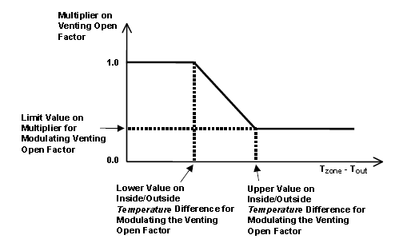
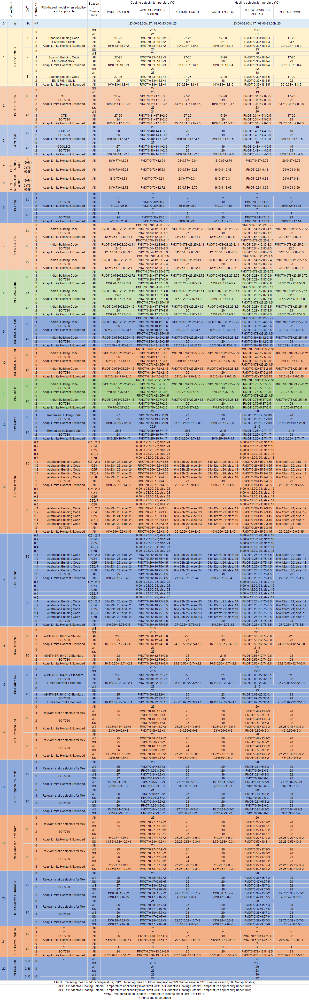

# 4. Detailed use and explanation of arguments

## 4.1 First steps

Four main branches of functions have been developed, which are:

-   VRF system with full air-conditioning mode (ScriptType='vrf_ac'): This mode has been developed mainly to support models originated with OpenStudio, which up to date does not support Airflow Network objects and subsequently Calculated Natural Ventilation. It adds standard VRF systems for each occupied zone and applies the adaptive or PMV-based setpoint temperatures, but only works with full air-conditioning mode.
-   VRF system with mixed mode (ScriptType='vrf_mm'): It adds standard VRF systems for each occupied zone and applies the adaptive or PMV-based setpoint temperatures. Works with Calculated Natural Ventilation, although full air-conditioning mode can also be used. If mixed mode is used, the model must be generally developed with DesignBuilder.
-   Existing HVAC system only with full air-conditioning mode (ScriptType='ex_ac'): Keeps the existing HVAC systems and modify the existing setpoint temperatures to adaptive or PMV-based setpoint temperatures. However, mixed-mode and naturally ventilated modes are not available in this mode.
-   Existing HVAC system with mixed mode (ScriptType='ex_mm'): UNDER DEVELOPMENT. IT IS NOT ADVISABLE TO USE IT YET. Keeps the existing HVAC systems and modify the existing setpoint temperatures to adaptive or PMV-based setpoint temperatures, considering mixed-mode. In order to properly work, there must be only one object for heating and another for cooling that can be used to monitor if these are turned on at any timestep (such as `Coil:Cooling:Water` and `Coil:Heating:Water`). For instance, if there are `Coil:Heating:Electric` and `Coil:Heating:DX:SingleSpeed` objects in the same model, simulation will crash. Also, if there is just an `ZoneHVAC:Baseboard:RadiantConvective:Water` used for heating, and cooling is not monitored, simulation will also crash. accim also needs to know the zone served by each of these objects. It takes the zone from the zone field of the object, from the zone equipment lists and connections that contain it, or from the air loop that serves the zones; if none of these works, from the name of the object, which must then start with the zone name (for instance, `Block1:Zone1 PTAC Heating Coil`, given that `Block1:Zone1` is a valid zone name), and it shows a warning. Equipment shared by several zones, such as a `Coil:Cooling:Water` object named `Main Cooling Coil 1`, cannot be assigned to a zone automatically: in that case, give the zone of each object with the argument `hvac_zone_map`, for instance `hvac_zone_map={'Main Cooling Coil 1': 'Block1:Zone1'}`.

Therefore, if you are going to use the VRF system script, you’re supposed to have one or multiple IDFs with fixed setpoint temperature, or even without any HVAC objects at all (it doesn’t matter, since the module is going to add a standard VRF system for each zone, and the simulation is going to be calculated with these VRF systems), and with Calculated Natural Ventilation if you’re going to use the Mixed Mode. On the other hand, if you are going to use any ExistingHVAC script, again you’re supposed to have one or multiple IDFs, however in this case there must be a fully functional HVAC system. Therefore, you must be able to successfully run a simulation with fixed setpoint temperatures in order for the accim package to work. The main difference between ExistingHVAC only with full air-conditioning and with mixed mode is that in the latter, the existing HVAC system needs to be mapped in order to monitor if it needs to be activated or not, and windows need to be actuated in case conditions for natural ventilation are favourable. In both cases, when you export the IDF, please do not request ASHRAE 55 or CEN 15251 results. accim will do so by adding the relevant fields to the People objects (or to the `People:Definition` objects of the `People:Instance` objects, in EnergyPlus 26.2).

By using any ExistingHVAC script you might not get the results that you expect, even if there are no errors in the accim and simulation processes. The reason lies on the HVAC system itself, and that is why the VRFsystem script has been developed, because it has been tested that it works.

No matter what type or functions are you going to use, the language of the software used to create the input IDF should be English (for example, if you use Designbuilder in Spanish, accim won’t work properly), and it’s not recommended to use any non-standard characters in the input IDF, just like written accents or “ñ”.

Said that, by default accim will transform all the IDF files located in the working folder (the folder where Python is run), except those whose names contain `[` or `_pymod`, which are the files generated by accim; the argument `idfs` takes a list of IDF files instead. Therefore, the quickest way to run the script is opening a prompt command dialog in the folder where the IDF files are located (you can do this by holding Shift and right-click inside the folder, and click on ‘Open PowerShell window here’, or ‘Open in Terminal’ in Windows 11). Then run Python by typing ‘python’ in the command prompt.

First you need to import the module ‘accis’ (stands for Adaptive-Comfort-Control-Implementation Script):

```python
>>> from accim.sim import accis
```

And then, you just need to call the accis function:

```python
>>> accis.addAccis()
```

Then you’ll be asked in the prompt to enter some information so that python knows how do you want to set up the output IDFs (the values after the colons are the answers of this example):

```
--------------------------------------------------------
Adaptive-Comfort-Control-Implemented Model (ACCIM) v0.8.0
--------------------------------------------------------

This tool allows to apply adaptive setpoint temperatures. 
For further information, please read the documentation: 
https://accim.readthedocs.io/en/master/
For a visual understanding of the tool, please visit the following jupyter notebooks:
-    Using addAccis() to apply adaptive setpoint temperatures
https://accim.readthedocs.io/en/master/jupyter_notebooks/addAccis/using_addAccis.html
-    Using rename_epw_files() to rename the EPWs for proper data analysis after simulation
https://accim.readthedocs.io/en/master/jupyter_notebooks/rename_epw_files/using_rename_epw_files.html
-    Using runEp() to directly run simulations with EnergyPlus
https://accim.readthedocs.io/en/master/jupyter_notebooks/runEp/using_runEp.html
-    Using the class Table() for data analysis
https://accim.readthedocs.io/en/master/jupyter_notebooks/Table/using_Table.html
-    Full example
https://accim.readthedocs.io/en/master/jupyter_notebooks/full_example_IBPSA/full_example_IBPSA.html

Starting with the process.

Now, you are going to be asked to enter some information for different arguments to generate the output IDFs with adaptive setpoint temperatures. 
If you are not sure about how to use these parameters, please take a look at the documentation in the following link: 
https://accim.readthedocs.io/en/master/4_detailed%20use.html

Please, enter the following information:

Enter the ScriptType (
for VRFsystem with full air-conditioning mode: vrf_ac;
for VRFsystem with mixed-mode: vrf_mm;
for ExistingHVAC with mixed mode: ex_mm;
for ExistingHVAC with full air-conditioning mode: ex_ac
): vrf_mm

Enter the SupplyAirTempInputMethod (
for Supply Air Temperature: supply air temperature;
for Temperature Difference: temperature difference;
): temperature difference

Do you want to keep the existing outputs (true or false)?: false

Enter the Output type (standard, simplified, detailed or custom): standard

Enter the Output frequencies separated by space (timestep, hourly, daily, monthly, runperiod): hourly runperiod

Do you want to generate a dataframe to see all outputs? (true or false): false

Enter the EnergyPlus version (9.1 to 26.2, or auto): auto

Enter the Temperature Control method (temperature or pmv): temperature
```

where:

*   ScriptType can be ‘vrf_mm’, ‘vrf_ac’, ‘ex_mm’ or ‘ex_ac’, and it refers to the type of functions as explained above
*   SupplyAirTempInputMethod can be ‘supply air temperature’ or ‘temperature difference’, and it is the supply air temperature input method for the VRF systems.
*   Existing outputs in the IDF can be kept if entered ‘true’. Otherwise, if entered ‘false’, it will be removed for clarity purposes at results stage.
*   Output_type can be ‘standard’, ‘detailed’, ‘simplified’ or ‘custom’ and it refers to the simulation results: ‘standard’ means that results will contain the full selection relevant to accim;‘detailed’ is mainly used for testing the software tool; ‘simplified’ means that results are just going to be the hourly operative temperature and VRF consumption of each zone, mainly used when you need the results not to be heavy files, because you are going to run a lot of simulations and capacity is limited; and finally, ‘custom’ allows the user to specify the outputs to be kept or removed by entering them in the python console.
*   Output_freqs (Output frequencies) can be timestep, hourly, daily, monthly and/or runperiod, and these must be entered separated by space. It will add the specified output type (standard or simplified) in all entered frequencies.
*   Also, a pandas DataFrame instance can be created containing all Output:Variable objects. This allows the user to filter the DataFrame as needed, so that it only contains the needed Output:Variable objects, and then it can be entered in the argument `Output_take_dataframe`
*   EnergyPlus_version can be ‘auto’ or a version from ‘9.1’ to ‘26.2’. With ‘auto’ (the default when the arguments are given in the function call), accim reads the version of each IDF and uses the IDD file of that version of EnergyPlus, which must be installed in its default path (for instance, “C:\EnergyPlusV26-2-0” for an IDF of EnergyPlus 26.2). If you enter a version, for instance ‘9.1’, accim will look for the E+9.1.0 IDD file in path “C:\EnergyPlusV9-1-0”.
*   Temperature Control method can be ‘temperature’ or ‘temp’, or ‘pmv’. If ‘temp’ is used, the setpoint will be the operative temperature, otherwise if ‘pmv’ is used, the setpoint will be the PMV index.

accis will show on the prompt command dialog all the objects it adds, and those that doesn’t need to be added because were already in the IDF, and finally ask you to enter some values to set up the IDFs as you desire. Please refer to the section titled ‘Setting up the target IDFs’.

Once you run the simulations, check the EnergyPlus warnings and errors in the `.err` file of each simulation.

(setting-up-the-target-idfs)=
## 4.2 Setting up the target IDFs

If you have run `accis.addAccis()`, you will be asked in the prompt to enter a few more values separated by space to set up the desired IDFs. However, you can also skip the command prompt process by running accis directly including the arguments in the function. Give them as keyword arguments (`ScriptType='vrf_mm'`, and so on): the order of the arguments is not the one of the prompts, and the first one is `idfs`. The table below lists all the arguments; "asked" means that, if the argument is not given, accim asks for it in the prompt.

| Argument | Values | Default |
| :--- | :--- | :--- |
| `idfs` | list of IDF files | all the IDFs of the working folder |
| `ScriptType` | `'vrf_ac'`, `'vrf_mm'`, `'ex_ac'` or `'ex_mm'` | asked |
| `SupplyAirTempInputMethod` | `'supply air temperature'` or `'temperature difference'` (only used by the VRF systems) | asked with `vrf_ac` and `vrf_mm` |
| `Output_keep_existing` | `True` or `False` | asked |
| `Output_type` | `'standard'`, `'simplified'`, `'detailed'` or `'custom'` | asked |
| `Output_freqs` | list of `'timestep'`, `'hourly'`, `'daily'`, `'monthly'` and `'runperiod'` | asked |
| `Output_gen_dataframe` | `True` or `False` | asked with the prompts; otherwise, no DataFrame |
| `Output_take_dataframe` | pandas DataFrame | `None` |
| `EnergyPlus_version` | `'auto'`, or from `'9.1'` to `'26.2'` | `'auto'` |
| `TempCtrl` | `'temperature'` (or `'temp'`) or `'pmv'` | asked |
| `ComfStand` | list of numbers from 0 to 22, or 99 (custom model) | asked |
| `CustAST_m`, `CustAST_n`, `CustAST_ACSToffset`, `CustAST_AHSToffset`, `CustAST_ACSTaul`, `CustAST_ACSTall`, `CustAST_AHSTaul`, `CustAST_AHSTall` | numbers (only used with `ComfStand=[99]`) | 0 |
| `CAT` | list of 1, 2, 3, 80, 85 and 90 | asked |
| `CATcoolOffset`, `CATheatOffset` | numbers (K) | 0 |
| `ComfMod` | list of 0, 0.X, 1, 1.X, 2 and 3 | asked |
| `SetpointAcc` | number greater than 0 | 10000 |
| `CoolSeasonStart`, `CoolSeasonEnd` | date `'dd/mm'` or day of the year | 121 (1 May), 274 (1 October) |
| `HVACmode` | list of 0, 1 and 2 | asked with `vrf_mm` and `ex_mm` |
| `VentCtrl` | list of 0, 1, 2 and 3 | asked with `vrf_mm` and `ex_mm` |
| `MaxTempDiffVOF`, `MinTempDiffVOF`, `MultiplierVOF` | numbers | 6, 1, 0.25 |
| `VSToffset` | list of numbers | `[0]` |
| `MinOToffset` | list of positive numbers | `[50]` |
| `MaxWindSpeed` | list of positive numbers | `[50]` |
| `ASTtol_start`, `ASTtol_end_input`, `ASTtol_steps` | numbers | 0.1, 0.1, 0.1 |
| `NameSuffix` | text | `''` |
| `VRFschedule` | name of the availability schedule of the VRF systems | `'On 24/7'` |
| `eer`, `cop` | energy efficiency ratio and coefficient of performance of the VRF systems | 2, 2.1 |
| `hvac_zone_map` | dictionary `{'HVAC object name': 'Zone name'}` (only used by `ex_ac` and `ex_mm`) | `None` |
| `make_averages` | `True` to make averages of the hour-counting variables | `False` |
| `debugging` | `True` to generate the EDD file of the Energy Management System | `False` |
| `verboseMode` | `True` or `False` | `True` |
| `confirmGen` | `True` to generate the IDFs without asking for confirmation | asked |

The prompts work in two stages. If any of `ScriptType`, `Output_keep_existing`, `Output_type`, `Output_freqs` or `TempCtrl` (and, with `vrf_ac` and `vrf_mm`, `SupplyAirTempInputMethod`) is missing, accim asks for all the values of the first stage (those of section 4.1), and these values are used instead of those specified in the function call. Likewise, if any of `ComfStand`, `CAT` or `ComfMod` (and, with `vrf_mm` and `ex_mm`, `HVACmode` or `VentCtrl`) is missing, accim asks for all the values of the second stage, from `ComfStand` to `ASTtol_steps` (see section 4.4).

Some example of the usage could be:

```python
from accim.sim import accis
accis.addAccis(
    ScriptType='vrf_mm',                              # 'vrf_mm', 'vrf_ac', 'ex_mm' or 'ex_ac'
    SupplyAirTempInputMethod='supply air temperature',
    Output_keep_existing=False,
    Output_type='standard',                           # 'standard', 'simplified', 'detailed' or 'custom'
    Output_freqs=['hourly', 'runperiod'],
    Output_gen_dataframe=False,
    # we just omit Output_take_dataframe
    EnergyPlus_version='auto',                        # the EnergyPlus version of each IDF
    TempCtrl='temp',                                  # 'temperature' or 'temp', or 'pmv'
    ComfStand=[0, 1, 2, 3],                           # Comfort Standards
    CAT=[1, 2, 3, 80, 90],                            # Categories
    ComfMod=[0, 1, 2, 3],                             # Comfort Modes
    SetpointAcc=10,                                   # setpoints will be rounded to the first decimal
    # we just omit CoolSeasonStart, since the default date is May 1st
    # we just omit CoolSeasonEnd, since the default date is October 1st
    HVACmode=[0, 1, 2],                               # HVAC modes
    VentCtrl=[0, 1],                                  # Ventilation Controls
    MaxTempDiffVOF=20,                                # above a difference of 20°C between operative and outdoor temperature, windows open the fraction MultiplierVOF
    MinTempDiffVOF=1,                                 # below a difference of 1°C, windows open fully; in between, linearly
    MultiplierVOF=0.2,                                # fraction of window opened above MaxTempDiffVOF
    VSToffset=[0, 1, 2],                              # Ventilation Setpoint Temperature offsets
    MinOToffset=[0, 1, 2],                            # Minimum Outdoor Temperature offsets
    MaxWindSpeed=[10, 20, 30],                        # Maximum Wind Speeds
    ASTtol_start=0,                                   # start of the tolerance sequence
    ASTtol_end_input=2,                               # end of the tolerance sequence
    ASTtol_steps=0.25,                                # steps of the tolerance sequence
    NameSuffix='standard',                            # for example, just in case you want to clarify the outputs
)
```

Each argument is explained below:

-   ComfStand: refers to the thermal comfort standard or model to be applied. Enter any number from 0 to 22 or 99 to select the comfort standard or model to be used; you can see which model is each number in the table below. For example, if you enter ‘0 1 2 3’, you’ll get IDFs for CTE, EN16798-1, ASHRAE 55 and the local model developed by Rijal et al for Japanese dwellings. If you enter 99, that means you want to use some custom adaptive model. Therefore, you'll be asked to enter the slope, y-intercept among other parameters; in the function call, these are the arguments `CustAST_m` (slope of the neutral temperature against the running mean outdoor temperature), `CustAST_n` (y-intercept), `CustAST_ACSToffset` and `CustAST_AHSToffset` (offsets of the cooling and heating setpoints from the neutral temperature, positive and negative respectively), and `CustAST_ACSTaul`, `CustAST_ACSTall`, `CustAST_AHSTaul` and `CustAST_AHSTall` (upper and lower limits of the running mean outdoor temperature in which the adaptive cooling and heating setpoints are applicable). If you don’t enter any number, it’ll ask you to enter the numbers again.

| ComfStand No. | ComfStand Name | Area | Reference |
| :--- | :--- | :--- | :--- |
| 0 | ESP CTE | Spain | The Government of Spain. Royal Decree 314/2006. Approving the Spanish Technical Building Code CTE-DB-HE-1 2013:1–43. https://www.boe.es/eli/es/rd/2006/03/17/314 (accessed August 6, 2021). |
| 1 | INT EN16798 | Europe | European committee for standardization. EN 16798-1:2019 Energy performance of buildings. Ventilation for buildings. Indoor environmental input parameters for design and assessment of energy performance of buildings addressing indoor air quality, thermal environment, lighting and acoustics. 2019. https://en.tienda.aenor.com/norma-bsi-bs-en-16798-1-2019-000000000030297474 (accessed August 6, 2021). |
| 2 | INT ASHRAE55 | Worldwide | ASHRAE Standard 55-2020 Thermal Environmental Conditions for Human Occupancy, ASHRAE Standard (2020). |
| 3 | JPN Rijal | Japan | Rijal, H. B., Humphreys, M. A., & Nicol, J. F. (2019). Adaptive model and the adaptive mechanisms for thermal comfort in Japanese dwellings. Energy and Buildings, 202, 109371. https://doi.org/10.1016/j.enbuild.2019.109371 |
| 4 | CHN GBT50785 Cold | China | MOHURD, Evaluation Standard for Indoor Thermal Environment in Civil Buildings (GB/T 50785-2012), Ministry of Housing and Urban-Rural Development (MOHURD), Beijing, China, 2012. |
| 5 | CHN GBT50785 HotMild | China | MOHURD, Evaluation Standard for Indoor Thermal Environment in Civil Buildings (GB/T 50785-2012), Ministry of Housing and Urban-Rural Development (MOHURD), Beijing, China, 2012. |
| 6 | CHN Yang | China | Yang, L., Fu, R., He, W., He, Q., & Liu, Y. (2020). Adaptive thermal comfort and climate responsive building design strategies in dry–hot and dry–cold areas: Case study in Turpan, China. Energy and Buildings, 209, 109678. https://doi.org/10.1016/j.enbuild.2019.109678 |
| 7 | IND IMAC C NV | India | Manu, S., Shukla, Y., Rawal, R., Thomas, L. E., & de Dear, R. (2016). Field studies of thermal comfort across multiple climate zones for the subcontinent: India Model for Adaptive Comfort (IMAC). Building and Environment, 98, 55–70. https://doi.org/10.1016/j.buildenv.2015.12.019 |
| 8 | IND IMAC C MM | India | Manu, S., Shukla, Y., Rawal, R., Thomas, L. E., & de Dear, R. (2016). Field studies of thermal comfort across multiple climate zones for the subcontinent: India Model for Adaptive Comfort (IMAC). Building and Environment, 98, 55–70. https://doi.org/10.1016/j.buildenv.2015.12.019 |
| 9 | IND IMAC R 7DRM | India | Rawal, R., Shukla, Y., Vardhan, V., Asrani, S., Schweiker, M., de Dear, R., Garg, V., Mathur, J., Prakash, S., Diddi, S., Ranjan, S. V., Siddiqui, A. N., & Somani, G. (2022). Adaptive thermal comfort model based on field studies in five climate zones across India. Building and Environment, 219, 109187. https://doi.org/10.1016/J.BUILDENV.2022.109187 |
| 10 | IND IMAC R 30DRM | India | Rawal, R., Shukla, Y., Vardhan, V., Asrani, S., Schweiker, M., de Dear, R., Garg, V., Mathur, J., Prakash, S., Diddi, S., Ranjan, S. V., Siddiqui, A. N., & Somani, G. (2022). Adaptive thermal comfort model based on field studies in five climate zones across India. Building and Environment, 219, 109187. https://doi.org/10.1016/J.BUILDENV.2022.109187 |
| 11 | IND Dhaka | India | Dhaka, S., Mathur, J., Brager, G., & Honnekeri, A. (2015). Assessment of thermal environmental conditions and quantification of thermal adaptation in naturally ventilated buildings in composite climate of India. Building and Environment, 86, 17–28. https://doi.org/10.1016/J.BUILDENV.2014.11.024 |
| 12 | ROM Udrea | Romania | Udrea, I., Croitoru, C., Nastase, I., Crutescu, R., & Badescu, V. (2018). First adaptive thermal comfort equation for naturally ventilated buildings in Bucharest, Romania. International Journal of Ventilation, 17(3), 149–165. https://doi.org/10.1080/14733315.2017.1356057 |
| 13 | AUS Williamson | Australia | Williamson, T., & Daniel, L. (2020). A new adaptive thermal comfort model for homes in temperate climates of Australia. Energy and Buildings, 210, 109728. https://doi.org/10.1016/j.enbuild.2019.109728 |
| 14 | AUS DeDear | Australia | de Dear, R., Kim, J., & Parkinson, T. (2018). Residential adaptive comfort in a humid subtropical climate—Sydney Australia. Energy and Buildings, 158, 1296–1305. https://doi.org/10.1016/j.enbuild.2017.11.028 |
| 15 | BRA Rupp NV | Brazil | Rupp, R. F., de Dear, R., & Ghisi, E. (2018). Field study of mixed-mode office buildings in Southern Brazil using an adaptive thermal comfort framework. Energy and Buildings, 158, 1475–1486. https://doi.org/10.1016/J.ENBUILD.2017.11.047 |
| 16 | BRA Rupp AC | Brazil | Rupp, R. F., de Dear, R., & Ghisi, E. (2018). Field study of mixed-mode office buildings in Southern Brazil using an adaptive thermal comfort framework. Energy and Buildings, 158, 1475–1486. https://doi.org/10.1016/J.ENBUILD.2017.11.047 |
| 17 | MEX Oropeza Arid | Mexico | I. Oropeza-Perez, A.H. Petzold-Rodriguez, C. Bonilla-Lopez, Adaptive thermal comfort in the main Mexican climate conditions with and without passive cooling, Energy and Buildings. 145 (2017) 251–258. https://doi.org/10.1016/j.enbuild.2017.04.031. |
| 18 | MEX Oropeza DryTropic | Mexico | I. Oropeza-Perez, A.H. Petzold-Rodriguez, C. Bonilla-Lopez, Adaptive thermal comfort in the main Mexican climate conditions with and without passive cooling, Energy and Buildings. 145 (2017) 251–258. https://doi.org/10.1016/j.enbuild.2017.04.031. |
| 19 | MEX Oropeza Temperate | Mexico | I. Oropeza-Perez, A.H. Petzold-Rodriguez, C. Bonilla-Lopez, Adaptive thermal comfort in the main Mexican climate conditions with and without passive cooling, Energy and Buildings. 145 (2017) 251–258. https://doi.org/10.1016/j.enbuild.2017.04.031. |
| 20 | MEX Oropeza HumTropic | Mexico | I. Oropeza-Perez, A.H. Petzold-Rodriguez, C. Bonilla-Lopez, Adaptive thermal comfort in the main Mexican climate conditions with and without passive cooling, Energy and Buildings. 145 (2017) 251–258. https://doi.org/10.1016/j.enbuild.2017.04.031. |
| 21 | CHL Perez-Fargallo | Chile | A. Pérez-Fargallo, J.A. Pulido-Arcas, C. Rubio-Bellido, M. Trebilcock, B. Piderit, S. Attia, Development of a new adaptive comfort model for low income housing in the central-south of chile, Energy Build. 178 (2018) 94–106. https://doi.org/10.1016/j.enbuild.2018.08.030. |
| 22 | INT ISO7730 | Worldwide | ISO, 2005. ISO 7730: Ergonomics of the thermal environment Analytical determination and interpretation of thermal comfort using calculation of the PMV and PPD indices and local thermal comfort criteria. Management 3, 605–615. https://doi.org/10.1016/j.soildyn.2004.11.005 |
| 99 | CUSTOM | - | Custom adaptive model, defined by the arguments `CustAST_*` |

-   CAT: refers to the category of the thermal comfort model applied. Most of the Comfort Standards work with 80 and 90% acceptability levels, except the European EN 16798-1 (works with Categories 1, 2 and 3), the Chinese GB/T 50785 (works with categories 1 and 2), and the India Model for Adaptive Comfort - Commercial (which works with 80, 85 and 90% acceptability levels). So, for example, if you are going to use the EN16798-1 (ComfStand = 1), you can enter ‘1 2 3’ to generate setpoint temperatures for Categories 1, 2 and 3. Or, if you are going to use the IMAC Commercial in naturally ventilated mode (ComfStand = 7), you can enter ‘80 85 90’ to generate setpoint temperatures for these acceptability levels. All categories are referenced in the [full list of setpoint temperatures](https://htmlpreview.github.io/?https://github.com/dsanchez-garcia/accim/blob/master/docs/source/html_files/full_setpoint_table.html) at the end of this section. Please note that the Category values must be consistent with the Comfort Standard values previously entered. If, for instance, you enter ‘1’ in the Comfort Standard value (means you’re asking for EN16798 model), but then enter ‘80’ or ‘90’ in the Category value (which are categories used in ASHRAE55), you won’t get the results you want.
-   CATcoolOffset: it is an offset in celsius degrees summed to the upper comfort limit. For instance, ASHRAE 55 80% acceptability is +-3.5K; if 1 was entered in CATcoolOffset, then the upper comfort limit would be raised to 4.5K
-   CATheatOffset: it is an offset in celsius degrees summed to the lower comfort limit. For instance, ASHRAE 55 80% acceptability is +-3.5K; if -1 was entered in CATheatOffset, then the lower comfort limit would be lowered to 4.5K
-   ComfMod: is the Comfort Mode, and refers to the setpoint behaviour. It controls if the setpoints are static (when ComfMod = 0 or 0.X) or adaptive (when ComfMod = 1 or 1.X, 2 or 3). When they are adaptive, it also controls the comfort model applied when the adaptive model is not applicable (that is, when the running mean outdoor temperature limits are exceeded), in which case a PMV-based model is applied. Each ComfMod for each ComfStand and CAT is referenced at the [full list of setpoint temperatures](https://htmlpreview.github.io/?https://github.com/dsanchez-garcia/accim/blob/master/docs/source/html_files/full_setpoint_table.html). Please refer to the research article https://www.mdpi.com/1996-1073/12/8/1498 for more information. Figure below shows the variation of setpoint temperatures when ComfMod 0 (upper left), 1 (upper right), 2 (lower left) and 3 (lower right), when ComfStand is 1 (EN 16798-1, although figure shows the superseded standard, but the setpoint behaviour is similar)


-   SetpointAcc: refers to the accuracy of the setpoint temperatures. Any number, integer or float, can be entered in this argument. For instance, if 1 was entered, the cooling setpoint would be rounded to the nearest integer below adaptive upper comfort limit minus tolerance (ASTtol), and the heating setpoint would be rounded to the nearest integer above adaptive lower comfort limit plus tolerance. If 27.46 and 20.46 were the upper and lower comfort limits and its tolerances were respectively -0.1 and +0.1, then the nearest integers to 27.36 and 20.56 would be 27 and 21, and therefore, these would be the cooling and heating setpoint temperatures. If 2 was used instead, then the rounding would be done to the nearest half. If 10 were used, the rounding would be done to the first decimal. If 0.5 or 0.1 were used, the rounding would be done respectively every 2 or 10 celsius degrees.
-   CoolSeasonStart: it is the start of the cooling season, only used when EN16798-1, ASHRAE 55 or ISO7730 are entered in ComfStand (respectively, ComfStand = 1, 2 and 22) and setpoint behaviour is set to static (i.e. ComfMod = 0). This argument can take the number of the day in the year (i.e. an integer) or a string containing a date in format dd/mm (for instance, “01/05”). Values of CoolSeasonStart greater than CoolSeasonEnd can be used, therefore denoting the location of the EPW file should be in the south hemisphere. The default value is 121 (May 1st).
-   CoolSeasonEnd: Similar to CoolSeasonStart, but it is the end of the cooling season. Again, only used when EN16798-1, ASHRAE 55 or ISO7730 are entered in ComfStand (respectively, ComfStand = 1, 2 and 22) and setpoint behaviour is set to static (i.e. ComfMod = 0). Again, this argument can take the number of the day in the year (i.e. an integer) or a string containing a date in format dd/mm (for instance, “01/05”). Values of CoolSeasonEnd smaller than CoolSeasonStart can be used, therefore denoting the location of the EPW file should be in the south hemisphere. The default value is 274 (October 1st).
-   HVACmode: refers to the HVAC mode applied. Enter 0 for Fully Air-conditioned (AC), 1 for Naturally ventilated (NV) and/or 2 for Mixed Mode (MM). Please note that Calculated natural ventilation must be enabled so that Mixed Mode works. So, for example, if you enter ‘0 1 2’ you’ll be getting all HVAC modes, or if you just enter ‘0 1’ you’ll be getting just Fully Air-conditioned and Naturally ventilated.
-   VentCtrl: refers to the ventilation control, only used in for NV and MM. When using NV, If you enter ‘0’, ventilation will be allowed if operative temperature exceeds neutral temperature (also known as comfort temperature); if you enter ‘1’, ventilation will be allowed if operative temperature exceeds the upper comfort limit. In other words, sets the value of the neutral temperature or the upper comfort limit to the Ventilation Setpoint Temperature (VST). When using MM, 0 = Ventilates above neutral temperature and fully opens doors and windows; 1 = Ventilates above lower comfort limit and fully opens doors and windows; 2 = Ventilates above neutral temperature and opens doors and windows based on the customised venting opening factor; and 3 = Ventilates above lower comfort limit and opens doors and windows based on the customised venting opening factor. Either way, if you enter ‘0 1’ you’ll be getting both ventilation control modes.
-   MaxTempDiffVOF: Maximum Temperature Difference for Venting Opening Factor. Maximum temperature difference between indoor operative and outdoor temperatures, which when exceeded, windows and doors are opened only the fraction specified in the MultiplierVOF argument. If temperature difference oscillates between maximum and minimum, the windows and doors are opened based on the linear equation. Follows the same operation as explained in [Designbuilder help website](https://designbuilder.co.uk/helpv7.0/Content/CalculatedNatVent.htm). The default value is 6.
-   MinTempDiffVOF: Minimum Temperature Difference for Venting Opening Factor. Minimum temperature difference between indoor operative and outdoor temperatures, which when smaller, windows and doors are fully opened. If temperature difference oscillates between maximum and minimum, the windows and doors are opened based on the linear equation. Follows the same operation as explained in [Designbuilder help website](https://designbuilder.co.uk/helpv7.0/Content/CalculatedNatVent.htm). The default value is 1.
-   MultiplierVOF: Multiplier for modulating the Venting Opening Factor. The fraction of the windows that will be opened when temperature difference exceeds MaxTempDiffVOF, between 0 and 1. Follows the same operation as explained in [Designbuilder help website](https://designbuilder.co.uk/helpv7.0/Content/CalculatedNatVent.htm). The default value is 0.25. 
-   VSToffset: stands for Ventilation Setpoint Temperature (VST) offset, again only used in Mixed Mode (HVAC Mode ‘2’). Applies the entered values as an offset to the VST, in Celsius degrees. Values entered can be positive or negative float or integers, and must be space-separated. For example, if you enter ‘-2 -1 0 1 2’ you’ll be getting offsets of -2°C, -1°C, 0°C, 1°C and 2°C to the VST. If you don’t enter any number, it’ll be used ‘0’ as the default value.
-   MinOToffset: stands for Minimum Outdoor Temperature offset, again only used in Mixed Mode (HVAC Mode ‘2’). Sets the minimum outdoor temperature an offset to the heating setpoint temperature. For example, if you enter ‘1’ (please, note that the numbers must be positive), ventilation won’t be allowed if outdoor temperature falls below 1°C below the heating setpoint, in order to prevent from entering excessive cold. Therefore, below said limit, windows are closed and, if needed, air conditioning starts to work. Entered values can be float or integers, but always positive numbers, and must be space-separated. For example, if you enter ‘0 1 2’ you’ll be getting offsets of 0°C, 1°C and 2°C to the heating setpoint temperature. If you don’t enter any number, it’ll be used ‘50’ as the default value (that is 50°C below heating setpoint temperature, and therefore no limit is applied).
-   MaxWindSpeed: stands for maximum wind speed, again only used in Mixed Mode (HVAC Mode ‘2’). Sets the maximum wind speed in which ventilation is allowed, in m/s. Therefore, if you enter ‘20’, ventilation won’t be allowed if wind speed is greater than 20 m/s. Entered values can be float or integers, but always positive numbers, and must be space-separated. For example, if you enter ‘5 10 15 20’ you’ll be getting different IDFs with maximum wind speeds of 5 m/s, 10 m/s, 15 m/s and 20 m/s. If you don’t enter any number, it’ll be used ‘50’ as the default value (that is 50 m/s, and therefore no limit is applied).
-   ASTtol: stands for Adaptive Setpoint Temperature tolerance. It applies the number that you enter as a tolerance for the adaptive heating and cooling setpoint temperatures. The original problem was that, if we assigned the adaptive setpoint straight to the comfort limit (i.e. you enter ‘0’ for ASTtol), there were a few hours that fell outside the comfort zone because of the error in some decimals in the simulation of the operative temperature. Therefore, the original purpose of this feature is to control that all hours are comfortable hours (i.e. operative temperature falls within the comfort zone), and we can make that sure by considering a little tolerance of 0.10 °C. For example, say that adaptive cooling and heating setpoints are originally 29.5 and 21.5°C at some day; if you enter ‘1’ for ASTtol, then the setpoints would be modified to 28.5 and 22.5°C (1°C below original cooling setpoint, and 1°C above original heating setpoint). The function will create a sequence of numbers based on the entered values. So, numbers must be entered in 3 stages: first, the start of the sequence; second, the end of the sequence, and third, the steps. So for example, if you enter ‘0’ for the start, ‘1’ for the end, and ‘0.25’ for the steps, you would be getting ASTtol values of 0°C, 0.25°C, 0.5°C, 0.75°C and 1°C. If you don’t enter any number, it’ll be used ‘0.1’ as the default value (as previously said, to make sure all hours are comfortable hours), and you would be getting only one variation of 0.1°C.
-   NameSuffix: the text you would like to add at the end of the file name.
-   verboseMode: True to print all process in screen, False to not to print it. Default is True.
-   confirmGen: if omitted, accim lists the output IDFs and asks you to confirm in command prompt before generating them. True to confirm automatically the generation of IDFs, and False to stop before generating them (for instance, to get only the DataFrame of `Output_gen_dataframe`). So, if you are going to set it True, be sure about the number of IDFs you are going to generate, because these might be thousands.
-   idfs: a list of the IDF files to use as input, instead of all the IDF files of the working folder.
-   Output_gen_dataframe and Output_take_dataframe: with `Output_gen_dataframe=True`, accim stores a pandas DataFrame with all the Output:Variable objects in the attribute `df_outputs` of the returned object; you can filter it and enter it in `Output_take_dataframe` to keep only those outputs (see {doc}`jupyter_notebooks/addAccis/using_addAccis`).
-   VRFschedule, eer and cop: the availability schedule (‘On 24/7’ by default), the energy efficiency ratio (2) and the coefficient of performance (2.1) of the VRF systems added by the scripts ‘vrf_ac’ and ‘vrf_mm’.
-   hvac_zone_map: only used by the scripts ‘ex_ac’ and ‘ex_mm’; a dictionary with the zone served by the HVAC objects that accim cannot assign to a zone automatically (see section 4.1).
-   make_averages: True to make averages of the hour-counting variables. Default is False.
-   debugging: True to add an Output:EnergyManagementSystem object, so that EnergyPlus writes the EDD file with the details of the Energy Management System programs. Default is False.

So, below you can see a sample name of an IDF created by using accim’s VRFsystem functions. The package takes the original IDF file as a reference, saves a copy, run all the functions so that setpoint temperatures are transformed from static to adaptive, an changes its name based on the values previously entered:

**TestModel_onlyGeometryForVRFsystem[CS_INT EN16798[CA_1[CM_3[HM_2[VC_0[VO_0.0[MT_50.0[MW_50.0[AT_0.1[NS_standard**

where:

-   ‘TestModel_onlyGeometryForVRFsystem’ is the name of the original IDF.
-   CS refers to the Comfort Standard, and it’s followed by the thermal comfort standard applied (could be ‘ESP CTE’, ‘INT EN16798’, ‘INT ASHRAE55’, ‘JPN Rijal’, etc).
-   CA refers to the Category, which could be 1, 2 or 3 if CS is EN16798, 80 or 90 if CS is ASHRAE55 or other models, or 80, 85 or 90 in case of the IMAC C.
-   CM refers to the Comfort Mode, which could be 0 (Static), 1, 2, or 3 (Adaptive modes).
-   HM refers to the HVAC Mode, which could be 0 (Full air conditioning), 1 (Naturally ventilated), or 2 (Mixed Mode).
-   VC refers to the Ventilation Control, which could be 0, 1, 2 or 3.
-   VO refers to the Ventilation setpoint temperature offset, which could be any number, float or integer, positive or negative.
-   MT refers to the Minimum Outdoor Temperature offset, which could be any number, float or integer, but always positive number.
-   MW refers to the Maximum Wind Speed, which could be any number, float or integer, but always positive number.
-   AT refers to the Adaptive Setpoint Temperature tolerance (ASTtol), which could be any number, float or integer, but always positive number. Please remember this number comes from a 3-stage process (refer to the explanation above).
-   NS refers to the Name Suffix, here ‘standard’, which can be whatever you want; it is ‘X’ if no suffix is given. For example, this allows you to make a for loop with ‘standard’, ‘simplified’ and ‘timestep’ and run the simulations with all type of outputs.

The numbers of the name keep the format in which they were entered: when they are entered in the prompt, they are read as decimal numbers, so the name contains, for instance, ‘CM_3.0’; with `ComfMod=[3]` in the function call, it contains ‘CM_3’.

If some inputs are not used or don’t make sense, you’ll be able to se an ‘X’ in the output IDF file. For example, if you use CTE as Comfort Standard, then the inputs for Category and Comfort Mode (which are only for EN16798-1 and ASHRAE 55) are not used in the process, and the output IDF would contain in its name ‘CS_ESP CTE[CA_X[CM_X’. Another similar case occurs if you use Full air-conditioning HVAC Mode (i.e. enter ‘0’ for HVAC Mode), or if you use the ‘ex_ac’ ScriptType, where the output IDF would contain in its name ‘[HM_0[VC_X[VO_X[MT_X[MW_X’.

## 4.3 Full list of setpoint temperatures

Depending on the arguments ComfStand, CAT and ComfMod, cooling and heating setpoint temperatures will be the following:

(If it is too small, you can look at it also at the [Github repository](https://htmlpreview.github.io/?https://github.com/dsanchez-garcia/accim/blob/master/docs/source/html_files/full_setpoint_table.html))



## 4.4 Putting it into practice: Adaptive setpoint temperatures step by step

You can see a Jupyter Notebook in the How-to Guides section of this documentation: {doc}`jupyter_notebooks/addAccis/using_addAccis`. To run it on your computer, copy the folder `jupyter_notebooks/addAccis` of the sample files to a working folder (see {ref}`running-example-notebooks`).

You can also see an example below. The input file is included in the folder `sample IDFs/input_IDFs` of the sample files, and it was originally named `TestModel_onlyGeometryForVRFsystem_2zones_CalcVent_V2510.idf` (a model of EnergyPlus 25.1), but for clarity purposes in this case has been renamed to “TestModel.idf”.

So, say you have an IDF in some folder, called ‘TestModel.idf’. So, you can either open an IDE or simply a CMD dialog pointing at that path and execute python. Let’s run the functions to get the energy models with adaptive setpoint temperatures.

```python
>>> from accim.sim import accis
>>> accis.addAccis()
```

When we hit enter, we’ll be asked to enter some information regarding the ScriptType, the Outputs and the EnergyPlus version (the values after the colons are the answers of this example):

```

--------------------------------------------------------
Adaptive-Comfort-Control-Implemented Model (ACCIM) v0.8.0
--------------------------------------------------------

This tool allows to apply adaptive setpoint temperatures.
For further information, please read the documentation:
https://accim.readthedocs.io/en/master/
For a visual understanding of the tool, please visit the following jupyter notebooks:
-    Using addAccis() to apply adaptive setpoint temperatures
https://accim.readthedocs.io/en/master/jupyter_notebooks/addAccis/using_addAccis.html
-    Using rename_epw_files() to rename the EPWs for proper data analysis after simulation
https://accim.readthedocs.io/en/master/jupyter_notebooks/rename_epw_files/using_rename_epw_files.html
-    Using runEp() to directly run simulations with EnergyPlus
https://accim.readthedocs.io/en/master/jupyter_notebooks/runEp/using_runEp.html
-    Using the class Table() for data analysis
https://accim.readthedocs.io/en/master/jupyter_notebooks/Table/using_Table.html
-    Full example
https://accim.readthedocs.io/en/master/jupyter_notebooks/full_example_IBPSA/full_example_IBPSA.html

Starting with the process.

Now, you are going to be asked to enter some information for different arguments to generate the output IDFs with adaptive setpoint temperatures.
If you are not sure about how to use these parameters, please take a look at the documentation in the following link:
https://accim.readthedocs.io/en/master/4_detailed%20use.html

Please, enter the following information:

Enter the ScriptType (
for VRFsystem with full air-conditioning mode: vrf_ac;
for VRFsystem with mixed-mode: vrf_mm;
for ExistingHVAC with mixed mode: ex_mm;
for ExistingHVAC with full air-conditioning mode: ex_ac
): vrf_mm

Enter the SupplyAirTempInputMethod (
for Supply Air Temperature: supply air temperature;
for Temperature Difference: temperature difference;
): temperature difference

Do you want to keep the existing outputs (true or false)?: false

Enter the Output type (standard, simplified, detailed or custom): standard

Enter the Output frequencies separated by space (timestep, hourly, daily, monthly, runperiod): hourly runperiod

Do you want to generate a dataframe to see all outputs? (true or false): false

Enter the EnergyPlus version (9.1 to 26.2, or auto): auto

Enter the Temperature Control method (temperature or pmv): temperature
```

When we hit enter, it’s going to add all the EnergyPlus objects needed:

```
Basic input data:
ScriptType is: vrf_mm
Supply Air Temperature Input Method is: temperature difference
Output type is: standard
Output frequencies are:
['hourly', 'runperiod']
Temperature Control method is: temperature

=======================START OF GENERIC IDF FILE GENERATION PROCESS=======================

Starting with file:
TestModel
IDD location is: C:\EnergyPlusV25-1-0\Energy+.idd
The occupied zones in the model TestModel are:
Block1:Zone1
Block1:Zone2
The windows and doors in the model TestModel are:
Block1_Zone2_Wall_3_0_0_0_0_0_Win
.
.
.
Added Output:Meter for Cooling:EnergyTransfer (runperiod)
Added Output:Meter for Heating:Electricity (runperiod)
Added Output:Meter for Cooling:Electricity (runperiod)
Modified - SimulationControl object: enabled Zone, System, and Plant Sizing Calculations
IDF has been saved
Ending with file:
TestModel

=======================END OF GENERIC IDF FILE GENERATION PROCESS=======================

The following IDFs will not work, and therefore these will be deleted:
None

```

And then ask us to enter the required information to generate the output IDF files (you can omit some by hitting enter without entering any value):

```
=======================START OF OUTPUT IDF FILES GENERATION PROCESS=======================

The information you will be required to enter below will be used to generate the customised output IDFs:
Enter the Comfort Standard numbers separated by space (
0 = ESP CTE;
1 = INT EN16798-1;
2 = INT ASHRAE55;
3 = JPN Rijal;
4 = CHN GBT50785 Cold;
5 = CHN GBT50785 HotMild;
6 = CHN Yang;
7 = IND IMAC C NV;
8 = IND IMAC C MM;
9 = IND IMAC R 7DRM;
10 = IND IMAC R 30DRM;
11 = IND Dhaka;
12 = ROM Udrea;
13 = AUS Williamson;
14 = AUS DeDear;
15 = BRA Rupp NV;
16 = BRA Rupp AC;
17 = MEX Oropeza Arid;
18 = MEX Oropeza DryTropic;
19 = MEX Oropeza Temperate;
20 = MEX Oropeza HumTropic;
21 = CHL Perez-Fargallo;
22 = INT ISO7730;
99 = CUSTOM;
Please refer to the full list of setpoint temperatures at https://htmlpreview.github.io/?https://github.com/dsanchez-garcia/accim/blob/master/docs/source/html_files/full_setpoint_table.html
): 1 2 7
          Are you sure the numbers are correct? [y or [] / n]:


For the comfort standard 1 = INT EN16798, the available categories you can choose are:
1 = EN16798 Category I
2 = EN16798 Category II
3 = EN16798 Category III
For the comfort standard 2 = INT ASHRAE55, the available categories you can choose are:
80 = ASHRAE 55 80% acceptability
90 = ASHRAE 55 90% acceptability
For the comfort standard 7 = IND IMAC C NV, the available categories you can choose are:
80 = 80% acceptability
85 = 85% acceptability
90 = 90% acceptability
Enter the Category numbers separated by space (
1 = CAT I / CAT A;
2 = CAT II / CAT B;
3 = CAT III / CAT C;
80 = 80% ACCEPT;
85 = 85% ACCEPT;
90 = 90% ACCEPT;
Please refer to the full list of setpoint temperatures at https://htmlpreview.github.io/?https://github.com/dsanchez-garcia/accim/blob/master/docs/source/html_files/full_setpoint_table.html
):2 3 85 90
          Are you sure the numbers are correct? [y or [] / n]:


For the comfort standard 1 = INT EN16798, the available ComfMods you can choose are:
0 = EN16798 Static setpoints
1 = EN16798 Adaptive setpoints when applicable, otherwise CTE
2 = EN16798 Adaptive setpoints when applicable, otherwise EN16798 Static setpoints
3 = EN16798 Adaptive setpoints when applicable, otherwise EN16798 Adaptive setpoints horizontally extended
For the comfort standard 2 = INT ASHRAE55, the available ComfMods you can choose are:
0 = ISO 7730 Static setpoints
1 = ASHRAE 55 Adaptive setpoints when applicable, otherwise CTE
2 = ASHRAE 55 Adaptive setpoints when applicable, otherwise ISO 7730 Static setpoints
3 = ASHRAE 55 Adaptive setpoints when applicable, otherwise ASHRAE 55 Adaptive setpoints horizontally extended
For the comfort standard 7 = IND IMAC C NV, the available ComfMods you can choose are:
0 = Indian Building Code Static setpoints
1 = IMAC C NV Model Adaptive setpoints when applicable, otherwise Indian Building Code Static setpoints
2 = IMAC C NV Model Adaptive setpoints when applicable, otherwise ISO 7730 Static setpoints
3 = IMAC C NV Model Adaptive setpoints when applicable, otherwise Adaptive setpoints horizontally extended
Enter the Comfort Mode numbers separated by space (
0 or 0.X = Static;
1, 1.X, 2, 3 = Adaptive;
Please refer to the full list of setpoint temperatures at https://htmlpreview.github.io/?https://github.com/dsanchez-garcia/accim/blob/master/docs/source/html_files/full_setpoint_table.html
): 0 3
          Are you sure the numbers are correct? [y or [] / n]:

Enter the setpoint accuracy number (any number greater than 0, if omitted will be 10000): 100
          Are you sure the number is correct? [y or [] / n]:

Enter the number for the CAT cooling offset modifier (value will be summed to the ACST, if omitted will be 0):
          Are you sure the number is correct? [y or [] / n]:

Enter the number for the CAT heating offset modifier (value will be summed to the AHST, if omitted will be 0):
          Are you sure the number is correct? [y or [] / n]:

Enter the start of the cooling season in numeric date format dd/mm or the day of the year: 01/05
          Are you sure the number is correct? [y or [] / n]:

Enter the end of the cooling season in numeric date format dd/mm or the day of the year: 01/10
          Are you sure the number is correct? [y or [] / n]:

Enter the HVAC Mode numbers separated by space (
0 = Fully Air-conditioned;
1 = Naturally ventilated;
2 = Mixed Mode;
): 2
          Are you sure the numbers are correct? [y or [] / n]:

Enter the Ventilation Control numbers separated by space (
If HVACmode = 1:
   0 = Ventilates above neutral temperature;
   1 = Ventilates above upper comfort limit;
If HVACmode = 2:
   0 = Ventilates above neutral temperature and fully opens doors and windows;
   1 = Ventilates above lower comfort limit and fully opens doors and windows;
   2 = Ventilates above neutral temperature and opens doors and windows based on the customised venting opening factor;
   3 = Ventilates above lower comfort limit and opens doors and windows based on the customised venting opening factor;
): 2 3
          Are you sure the numbers are correct? [y or [] / n]:
Enter the maximum temperature difference number for Ventilation Opening Factor (any number larger than 0): 15
          Are you sure the number is correct? [y or [] / n]:
Enter the minimum temperature difference number for Ventilation Opening Factor (any number larger than 0 and smaller than the maximum temperature difference number): 1
          Are you sure the number is correct? [y or [] / n]:
Enter the multiplier number for Ventilation Opening Factor (any number between 0 and 1): 0.2
          Are you sure the number is correct? [y or [] / n]:

Enter the VSToffset numbers separated by space (if omitted, will be 0):
          Are you sure the numbers are correct? [y or [] / n]:

Enter the MinOToffset numbers separated by space (if omitted, will be 50):
          Are you sure the numbers are correct? [y or [] / n]:

Enter the MaxWindSpeed numbers separated by space (if omitted, will be 50):
          Are you sure the numbers are correct? [y or [] / n]:

Enter the ASTtol value from (if omitted, will be 0.1):
          Are you sure the numbers are correct? [y or [] / n]:
Enter the ASTtol value to (if omitted, will be 0.1):
          Are you sure the numbers are correct? [y or [] / n]:
Enter the ASTtol value steps (if omitted, will be 0.1):
```

Afterwards, ACCIS will let us know which the output IDFs are going to be, the total number of them and will ask for our confirmation to proceed:

```
The list of output IDFs is going to be:
TestModel[CS_INT EN16798[CA_2[CM_0.0[HM_2[VC_2[VO_0.0[MT_50.0[MW_50.0[AT_0.1[NS_X.idf
TestModel[CS_INT EN16798[CA_2[CM_0.0[HM_2[VC_3[VO_0.0[MT_50.0[MW_50.0[AT_0.1[NS_X.idf
TestModel[CS_INT EN16798[CA_2[CM_3.0[HM_2[VC_2[VO_0.0[MT_50.0[MW_50.0[AT_0.1[NS_X.idf
TestModel[CS_INT EN16798[CA_2[CM_3.0[HM_2[VC_3[VO_0.0[MT_50.0[MW_50.0[AT_0.1[NS_X.idf
TestModel[CS_INT EN16798[CA_3[CM_0.0[HM_2[VC_2[VO_0.0[MT_50.0[MW_50.0[AT_0.1[NS_X.idf
TestModel[CS_INT EN16798[CA_3[CM_0.0[HM_2[VC_3[VO_0.0[MT_50.0[MW_50.0[AT_0.1[NS_X.idf
TestModel[CS_INT EN16798[CA_3[CM_3.0[HM_2[VC_2[VO_0.0[MT_50.0[MW_50.0[AT_0.1[NS_X.idf
TestModel[CS_INT EN16798[CA_3[CM_3.0[HM_2[VC_3[VO_0.0[MT_50.0[MW_50.0[AT_0.1[NS_X.idf
TestModel[CS_INT ASHRAE55[CA_90[CM_0.0[HM_2[VC_2[VO_0.0[MT_50.0[MW_50.0[AT_0.1[NS_X.idf
TestModel[CS_INT ASHRAE55[CA_90[CM_0.0[HM_2[VC_3[VO_0.0[MT_50.0[MW_50.0[AT_0.1[NS_X.idf
TestModel[CS_INT ASHRAE55[CA_90[CM_3.0[HM_2[VC_2[VO_0.0[MT_50.0[MW_50.0[AT_0.1[NS_X.idf
TestModel[CS_INT ASHRAE55[CA_90[CM_3.0[HM_2[VC_3[VO_0.0[MT_50.0[MW_50.0[AT_0.1[NS_X.idf
TestModel[CS_IND IMAC C NV[CA_85[CM_0.0[HM_2[VC_2[VO_0.0[MT_50.0[MW_50.0[AT_0.1[NS_X.idf
TestModel[CS_IND IMAC C NV[CA_85[CM_0.0[HM_2[VC_3[VO_0.0[MT_50.0[MW_50.0[AT_0.1[NS_X.idf
TestModel[CS_IND IMAC C NV[CA_85[CM_3.0[HM_2[VC_2[VO_0.0[MT_50.0[MW_50.0[AT_0.1[NS_X.idf
TestModel[CS_IND IMAC C NV[CA_85[CM_3.0[HM_2[VC_3[VO_0.0[MT_50.0[MW_50.0[AT_0.1[NS_X.idf
TestModel[CS_IND IMAC C NV[CA_90[CM_0.0[HM_2[VC_2[VO_0.0[MT_50.0[MW_50.0[AT_0.1[NS_X.idf
TestModel[CS_IND IMAC C NV[CA_90[CM_0.0[HM_2[VC_3[VO_0.0[MT_50.0[MW_50.0[AT_0.1[NS_X.idf
TestModel[CS_IND IMAC C NV[CA_90[CM_3.0[HM_2[VC_2[VO_0.0[MT_50.0[MW_50.0[AT_0.1[NS_X.idf
TestModel[CS_IND IMAC C NV[CA_90[CM_3.0[HM_2[VC_3[VO_0.0[MT_50.0[MW_50.0[AT_0.1[NS_X.idf
And the total number of output IDFs is going to be 20
Do you still want to run ACCIS? [y/n]: y
```

If we entered `n`, the whole process would shut down. Otherwise, if we entered ‘y’, the generation of output IDF files would start, and ACCIS would print on screen each output IDF name as it generates it. As you can see, we are going to use the EN16798-1, ASHRAE 55 and IMAC Commercial for naturally ventilated buildings, categories 2 and 3 for EN16798, 90% acceptability levels for ASHRAE 55, 85 and 90% acceptability levels for IMAC C NV, all with ComfMod 0 (with static setpoint temperatures) and 3 (with adaptive setpoint temperatures when the model is applicable, otherwise horizontally extending the adaptive setpoint temperatures), Mixed Mode, and we just went ahead with the remaining default values.

```
Generating the following output IDF files:
TestModel[CS_INT EN16798[CA_2[CM_0.0[HM_2[VC_2[VO_0.0[MT_50.0[MW_50.0[AT_0.1[NS_X.idf
TestModel[CS_INT EN16798[CA_2[CM_0.0[HM_2[VC_3[VO_0.0[MT_50.0[MW_50.0[AT_0.1[NS_X.idf
TestModel[CS_INT EN16798[CA_2[CM_3.0[HM_2[VC_2[VO_0.0[MT_50.0[MW_50.0[AT_0.1[NS_X.idf
TestModel[CS_INT EN16798[CA_2[CM_3.0[HM_2[VC_3[VO_0.0[MT_50.0[MW_50.0[AT_0.1[NS_X.idf
TestModel[CS_INT EN16798[CA_3[CM_0.0[HM_2[VC_2[VO_0.0[MT_50.0[MW_50.0[AT_0.1[NS_X.idf
TestModel[CS_INT EN16798[CA_3[CM_0.0[HM_2[VC_3[VO_0.0[MT_50.0[MW_50.0[AT_0.1[NS_X.idf
TestModel[CS_INT EN16798[CA_3[CM_3.0[HM_2[VC_2[VO_0.0[MT_50.0[MW_50.0[AT_0.1[NS_X.idf
TestModel[CS_INT EN16798[CA_3[CM_3.0[HM_2[VC_3[VO_0.0[MT_50.0[MW_50.0[AT_0.1[NS_X.idf
TestModel[CS_INT ASHRAE55[CA_90[CM_0.0[HM_2[VC_2[VO_0.0[MT_50.0[MW_50.0[AT_0.1[NS_X.idf
TestModel[CS_INT ASHRAE55[CA_90[CM_0.0[HM_2[VC_3[VO_0.0[MT_50.0[MW_50.0[AT_0.1[NS_X.idf
TestModel[CS_INT ASHRAE55[CA_90[CM_3.0[HM_2[VC_2[VO_0.0[MT_50.0[MW_50.0[AT_0.1[NS_X.idf
TestModel[CS_INT ASHRAE55[CA_90[CM_3.0[HM_2[VC_3[VO_0.0[MT_50.0[MW_50.0[AT_0.1[NS_X.idf
TestModel[CS_IND IMAC C NV[CA_85[CM_0.0[HM_2[VC_2[VO_0.0[MT_50.0[MW_50.0[AT_0.1[NS_X.idf
TestModel[CS_IND IMAC C NV[CA_85[CM_0.0[HM_2[VC_3[VO_0.0[MT_50.0[MW_50.0[AT_0.1[NS_X.idf
TestModel[CS_IND IMAC C NV[CA_85[CM_3.0[HM_2[VC_2[VO_0.0[MT_50.0[MW_50.0[AT_0.1[NS_X.idf
TestModel[CS_IND IMAC C NV[CA_85[CM_3.0[HM_2[VC_3[VO_0.0[MT_50.0[MW_50.0[AT_0.1[NS_X.idf
TestModel[CS_IND IMAC C NV[CA_90[CM_0.0[HM_2[VC_2[VO_0.0[MT_50.0[MW_50.0[AT_0.1[NS_X.idf
TestModel[CS_IND IMAC C NV[CA_90[CM_0.0[HM_2[VC_3[VO_0.0[MT_50.0[MW_50.0[AT_0.1[NS_X.idf
TestModel[CS_IND IMAC C NV[CA_90[CM_3.0[HM_2[VC_2[VO_0.0[MT_50.0[MW_50.0[AT_0.1[NS_X.idf
TestModel[CS_IND IMAC C NV[CA_90[CM_3.0[HM_2[VC_3[VO_0.0[MT_50.0[MW_50.0[AT_0.1[NS_X.idf

=======================END OF OUTPUT IDF FILES GENERATION PROCESS=======================
```

Afterwards, you just need to run the simulation. Once you have run the simulations you need, you’ll get the files you usually get when you run any simulation, including the hourly results on a CSV file.

## 4.5 Renaming epw files for later data analysis

You can see a Jupyter Notebook in the How-to Guides section of this documentation: {doc}`jupyter_notebooks/rename_epw_files/using_rename_epw_files`.

To run it on your computer, copy the folder `jupyter_notebooks/rename_epw_files` of the sample files to a working folder (see {ref}`running-example-notebooks`).

`rename_epw_files` takes the country and city from the coordinates of each EPW file, which needs an internet connection (it uses the package `geopy`, installed with accim), unless `rename_city_dict` and `country_to_city_dict` give them.

## 4.6 Running simulations

You can see a Jupyter Notebook in the How-to Guides section of this documentation: {doc}`jupyter_notebooks/runEp/using_runEp`.

To run it on your computer, copy the folder `jupyter_notebooks/runEp` of the sample files to a working folder (see {ref}`running-example-notebooks`).

This script has been created by eppy’s development team (https://eppy.readthedocs.io/en/latest/runningeplus.html, specifically from section ‘Running in parallel processes using Generators’), however I did some changes. Anyway, you probably should check out eppy package, since it’s absolutely awesome.

By using this script, the EnergyPlus version used to simulate the IDFs will be the IDF’s version. Therefore, if your IDF is in version 25.1, but you don’t have EnergyPlus 25.1 installed, you’ll get an error.

The main difference is that this one allows to run simulations with several EPW files. It takes all EPW files and IDF files located in the working folder, and runs them. So for example, say you have 2 no. IDFs (1.idf and 2.idf) and 2 no. EPW files (a.epw and b.epw). Then, this script will run the following simulations: 1[a; 1[b; 2[a; 2[b, and the output files will be named after them (for instance, `1[a.csv` for the hourly results). The character ‘[’ has been used as separator in order to not to be in conflict with other programs, and the class `Table` (section 4.7) uses it to read the results.

So, how to use it? Say you have already run `addAccis()`, and therefore you have a folder with the output IDFs and the EPW files. Then you can run the simulations:

```python
from accim.run import run
run.runEp(
    runOnlyAccim=True,          # True to run only the IDFs generated by accim (with '[' in the name), False to run all IDFs
    confirmRun=True,            # True to run without asking for confirmation
    num_CPUs=2,                 # number of simulations run at the same time
    EnergyPlus_version='auto',  # EnergyPlus version of the IDFs, or 'auto' to read it from them
)
```

If you omit `runOnlyAccim`, `confirmRun` or `EnergyPlus_version`, `runEp()` asks for them in the prompt. Before running, it lists the IDFs, the EPWs and the simulations, and their number, and asks for your confirmation (unless `confirmRun=True`), because you might start thousands of simulations by mistake. `EnergyPlus_version` is the version of the IDFs, from ‘9.1’ to ‘26.2’, or ‘auto’ to read it from the IDFs, which must then be of the same version; `num_CPUs` is 2 by default.

Afterwards, you’ll see the calculations progress, and you’ll get the usual simulation files of each simulation: `.audit`, `.eio`, `.err`, `.eso`, `.csv`, `Table.csv`, `Table.htm` and so on, all of them named `IDF name[EPW name`. You might need to keep these in order to debug some error, or any other reason, but if you only need the CSV files with the hourly results, you can run the `removefiles()` function:

```python
run.removefiles()
```

`removefiles()` deletes the simulation files of the working folder, that is, the files with ‘[’ in the name, except the `.py`, `.idf`, `.epw`, `.csv` and `.eso` files, and it also deletes the `Table.csv`, `Meter.csv` and `Zsz.csv` files of the simulations. It does not delete subfolders or files without ‘[’ in the name, such as a Jupyter notebook; files of other programs whose names contain ‘[’ would be deleted.

## 4.7 Functions and methods for data analysis; making figures and tables

You can see a Jupyter Notebook in the How-to Guides section of this documentation: {doc}`jupyter_notebooks/Table/using_Table`.

To run it on your computer, copy the folder `jupyter_notebooks/Table` of the sample files to a working folder (see {ref}`running-example-notebooks`).

## 4.8 Setpoints based on the adaptive predicted mean vote (aPMV)

Besides adaptive setpoint temperatures, accim can apply setpoints based on the adaptive predicted mean vote (aPMV), which corrects the PMV for the adaptation of the occupants: aPMV = PMV / (1 + λ·PMV), where λ is the adaptive coefficient, with one value for the cooling season and another for the heating season. The thermostats keep the aPMV of each zone between the heating and cooling setpoints, instead of keeping the operative temperature between two temperatures.

The function `apply_apmv_setpoints()` of the module `accim.sim.apmv_setpoints` adds this control, with Energy Management System programs, to a besos or eppy IDF object. Each zone needs an HVAC system; `apply_apmv_setpoints()` adds the thermal comfort thermostats that control it, and `add_vrf_system()` adds a VRF system to the zones if the model has none:

```python
from besos import eppy_funcs as ef
from accim.sim.apmv_setpoints import add_vrf_system, apply_apmv_setpoints, set_pmv_input_parameters

building = ef.get_building('TestModel.idf')
add_vrf_system(building)
apply_apmv_setpoints(
    building,
    outputs_freq=['hourly'],
    adap_coeff_cooling=0.293,       # λ of the cooling season
    adap_coeff_heating=-0.293,      # λ of the heating season
    pmv_cooling_sp=0.5,             # aPMV setpoint for cooling
    pmv_heating_sp=-0.5,            # aPMV setpoint for heating
    cooling_season_start='01/05',   # dd/mm, or the day of the year
    cooling_season_end='01/10',
)
set_pmv_input_parameters(building, air_velocity=0.1, work_efficiency=0.0)
building.saveas('TestModel_aPMV.idf')
```

- By default, the setpoints are 0.5 for cooling and −0.5 for heating, λ is 0.293 in the cooling season and −0.293 in the heating season, and the cooling season goes from day 121 (1 May) to day 274 (1 October), which is not included, as in `addAccis()`. Give them explicitly, as above, so that the results do not depend on the defaults: up to accim 0.7.7, the default setpoints were inverted and the cooling season ended on 29 July.
- The coefficients, setpoints and tolerances take one value for the whole model, or a dictionary with a value for each occupied zone: `get_available_target_names(building)` lists the valid names, and `get_input_template_dictionary(building)` returns a template of the dictionary. The name of a zone is the zone name if its People object is assigned to a zone without Space objects, and `<Space Name> <People Name>` otherwise (the space of a zone without Space objects has the name of the zone), except in the zones described below.
- A zone whose occupants EnergyPlus splits among several spaces (People assigned to a zone of several spaces, or to a list that covers several spaces of the zone) or that has several People objects is controlled as a whole: its name is the zone name, it is occupied while any of its occupants is, and its PMV is the average PMV of its occupants, weighted by their number. If some surfaces of a zone with Space objects have no Space Name, EnergyPlus creates a space named `<Zone Name>-Remainder` for them, which takes part of the occupants assigned to the zone; accim warns about it.
- The tolerances widen or narrow the setpoints: by default, the heating setpoint is raised by 0.1 and the cooling setpoint is lowered by 0.1, in both seasons.
- The PMV depends on the inputs of the People objects (activity level, clothing insulation, air velocity and work efficiency), which do not affect temperature setpoints but do affect aPMV setpoints. `set_pmv_input_parameters()` sets them for all the People objects, or for each zone with dictionaries. In models of EnergyPlus 26.2 with `People:Instance` objects, these inputs are in the `People:Instance` objects, and the Fanger model in their `People:Definition` objects.
- The cooling season is given by dates: for a location in the southern hemisphere, swap them.

You can see a Jupyter Notebook in the How-to Guides section of this documentation: {doc}`jupyter_notebooks/example_apmv_setpoints_paper/using_apmv_setpoints`. Parametric studies and optimisations of these setpoints are explained in {doc}`parametric_and_optimisation`.
