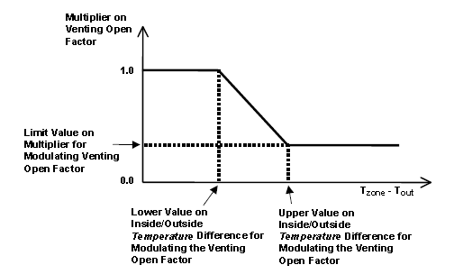
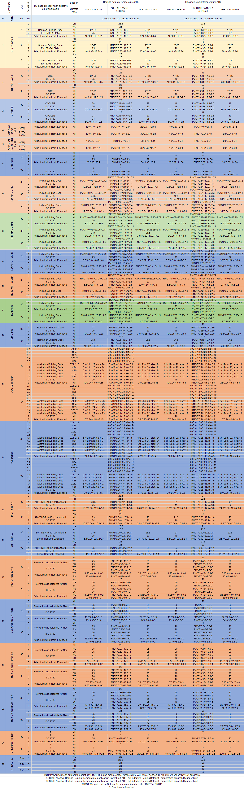

# 4. Detailed use and explanation of arguments

## 4.1 First steps

Four main branches of functions have been developed, which are:

-   VRF system with full air-conditioning mode (script_type='vrf_ac'): This mode has been developed mainly to support models originated with OpenStudio, which up to date does not support Airflow Network objects and subsequently Calculated Natural Ventilation. It adds standard VRF systems for each occupied zone and applies the adaptive or PMV-based setpoint temperatures, but only works with full air-conditioning mode. It does not change the natural ventilation of the model: `ZoneVentilation` objects and AirflowNetwork openings keep the control of the input model, so the windows that are open in it stay open. To simulate such a model fully air-conditioned with its windows closed, use `vrf_mm` with `hvac_mode=[0]`, or close them in the model.
-   VRF system with mixed mode (script_type='vrf_mm'): It adds standard VRF systems for each occupied zone and applies the adaptive or PMV-based setpoint temperatures. Works with Calculated Natural Ventilation (AirflowNetwork), although full air-conditioning mode can also be used. In models without AirflowNetwork, it controls the natural ventilation of the `ZoneVentilation:WindandStackOpenArea` and `ZoneVentilation:DesignFlowRate` objects of the occupied zones (except those whose names contain "infiltration"): each zone gets a schedule `Vent_Sch_<zone>`, which accim opens and closes as the windows of the AirflowNetwork, so models made with OpenStudio can also use mixed mode. On the design days (the days of the types `SummerDesignDay` and `WinterDesignDay`), the zones are air-conditioned with the windows closed, whether they are occupied or not, so that EnergyPlus sizes the VRF systems for the setpoints: before accim 1.1.0, the VRF systems were off on the design days without occupants (often the winter design day) and while the windows were open, so EnergyPlus sized them without those timesteps (the heating design loads of the zones of the sample model were 0). Section 4.1.2 explains which windows accim opens and closes in mixed mode.
-   Existing HVAC system only with full air-conditioning mode (script_type='ex_ac'): Keeps the existing HVAC systems and modify the existing setpoint temperatures to adaptive or PMV-based setpoint temperatures. However, mixed-mode and naturally ventilated modes are not available in this mode. As with `vrf_ac`, the natural ventilation of the model keeps the control of the input model. By default, the thermostats of the occupied zones control the operative temperature, as those of the VRF systems; other arguments make the existing HVAC systems always available, widen their outdoor temperature limits or add backup ideal loads air systems (see section 4.1.1).
-   Existing HVAC system with mixed mode (script_type='ex_mm'): Keeps the existing HVAC systems and modify the existing setpoint temperatures to adaptive or PMV-based setpoint temperatures, considering mixed-mode. As with `vrf_mm`, it opens the windows (or the `ZoneVentilation` objects, in models without AirflowNetwork) of each zone only when its HVAC system is off: with the existing HVAC systems, accim reads it from the thermostat of the zone, whatever its equipment (zone equipment, air loops, baseboards, radiant systems, beams...): the HVAC system is off when the thermostat asks it for no load, that is, when the temperature of the zone is between its heating and cooling setpoints (the EnergyPlus output `Zone Predicted Sensible Load to Setpoint Heat Transfer Rate` of the previous timestep is 0). So each occupied zone needs a thermostat (`ZoneControl:Thermostat`), as with `ex_ac`. Before accim 1.0.0, `ex_mm` read the coils of one heating and one cooling object of each zone, so it rejected the models with several kinds of coils and stopped EnergyPlus with zones without cooling (or heating) equipment; the argument `hvac_zone_map`, which gave the zones of these objects, is no longer needed. In a zone whose thermostat has a cooling setpoint but no equipment that cools (radiators only, for instance), the windows stay closed while the thermostat asks for cooling, as with a system that cools; HVAC mode 2 only opens them below the cooling setpoint anyway. On the design days (the days of the types `SummerDesignDay` and `WinterDesignDay`), the zones are air-conditioned with the windows closed, whether they are occupied or not, so that EnergyPlus sizes the HVAC systems for the setpoints: before accim 1.1.0, the HVAC systems were off on the design days without occupants (often the winter design day), and EnergyPlus sized them for no load and stopped, or they could not heat. The arguments of section 4.1.1 also apply to `ex_mm`, and section 4.1.2 explains which windows accim opens and closes.

Therefore, if you are going to use the VRF system script, you’re supposed to have one or multiple IDFs with fixed setpoint temperature, or even without any HVAC objects at all (it doesn’t matter, since the module is going to add a standard VRF system for each zone, and the simulation is going to be calculated with these VRF systems), and with natural ventilation (Calculated Natural Ventilation, or `ZoneVentilation` objects) if you’re going to use the Mixed Mode. The VRF systems replace the zone equipment of the model, so accim removes its `ZoneHVAC:IdealLoadsAirSystem` objects, which no zone would use (before accim 1.0.0 they were kept, and EnergyPlus reported a severe error for each of them). The VRF systems are autosized, so accim enables the sizing calculations of the model, which needs sizing periods (design days, or `SizingPeriod:WeatherFileDays` objects): if it has none, accim warns, since EnergyPlus would stop. On the other hand, if you are going to use any ExistingHVAC script, again you’re supposed to have one or multiple IDFs, however in this case there must be a fully functional HVAC system. Therefore, you must be able to successfully run a simulation with fixed setpoint temperatures in order for the accim package to work. The HVAC system can be any: accim 1.1.0 was tested with 618 example files of EnergyPlus 25.1 (VAV, PTAC, fan coils, furnaces, heat pumps, VRF, radiant systems, chilled beams, dual ducts...), with and without the arguments of section 4.1.1. If the model has `HVACTemplate` objects, `AddAccis` expands them first (`accim.energyplus.expand_objects()`, which runs the program ExpandObjects of EnergyPlus), since their thermostats and HVAC objects only exist once expanded; `add_accis_to_idf` stops with a `ValueError` for them (expand the file first). The main difference between ExistingHVAC only with full air-conditioning and with mixed mode is that in the latter, accim reads whether the existing HVAC system of each zone is on (from the load that its thermostat asks for), and windows need to be actuated in case conditions for natural ventilation are favourable. In both cases, when you export the IDF, please do not request ASHRAE 55 or CEN 15251 results. accim will do so by adding the relevant fields to the People objects (or to the `People:Definition` objects of the `People:Instance` objects, in EnergyPlus 26.2).

By using any ExistingHVAC script you might not get the results that you expect, even if there are no errors in the accim and simulation processes: the operative temperature may be out of the setpoints in some hours. The reason lies on the HVAC system itself, and that is why the VRFsystem script was developed, which keeps the operative temperature between the setpoints. Section 4.1.1 explains the reasons and the arguments that make the existing HVAC systems keep it between them too.

No matter what type or functions are you going to use, the language of the software used to create the input IDF should be English (for example, if you use Designbuilder in Spanish, accim won’t work properly), and it’s not recommended to use any non-standard characters in the input IDF, just like written accents or “ñ”.

Said that, by default accim will transform all the IDF files located in the working folder (the folder where Python is run), except those whose names contain `[` or `_pymod`, which are the files generated by accim; the argument `idfs` takes a list of IDF files instead. Therefore, the quickest way to run the script is opening a prompt command dialog in the folder where the IDF files are located (you can do this by holding Shift and right-click inside the folder, and click on ‘Open PowerShell window here’, or ‘Open in Terminal’ in Windows 11). Then run Python by typing ‘python’ in the command prompt.

First you need to import the module ‘accis’ (stands for Adaptive-Comfort-Control-Implementation Script):

```python
>>> from accim.sim import accis
```

And then, you just need to call the class `AddAccis`:

```python
>>> accis.AddAccis()
```

```{note}
In accim 1.0.0, `addAccis` became `AddAccis`, and its arguments follow the naming conventions of Python
(PEP 8): `script_type` instead of `ScriptType`, `comfort_standard` instead of `ComfStand`, and so on. The old
names still work, with a `DeprecationWarning` that gives the new name, so the scripts written for previous
versions run without changes. The prompts still show the old names. See {doc}`9_migration_guide`.
```

Then you’ll be asked in the prompt to enter some information so that python knows how do you want to set up the output IDFs (the values after the colons are the answers of this example):

```
--------------------------------------------------------
Adaptive-Comfort-Control-Implemented Model (ACCIM) v1.1.0
--------------------------------------------------------

This tool allows to apply adaptive setpoint temperatures. 
For further information, please read the documentation: 
https://accim.readthedocs.io/en/master/
For a visual understanding of the tool, please visit the following jupyter notebooks:
-    Using AddAccis() to apply adaptive setpoint temperatures
https://accim.readthedocs.io/en/master/jupyter_notebooks/addAccis/using_addAccis.html
-    Using rename_epw_files() to rename the EPWs for proper data analysis after simulation
https://accim.readthedocs.io/en/master/jupyter_notebooks/rename_epw_files/using_rename_epw_files.html
-    Using run_ep() to directly run simulations with EnergyPlus
https://accim.readthedocs.io/en/master/jupyter_notebooks/runEp/using_runEp.html
-    Using the class Table() for data analysis
https://accim.readthedocs.io/en/master/jupyter_notebooks/Table/using_Table.html
-    Full example
https://accim.readthedocs.io/en/master/jupyter_notebooks/full_example_IBPSA/full_example_IBPSA.html

Starting with the process.

Now, you are going to be asked to enter some information for different arguments to generate the output IDFs with adaptive setpoint temperatures. 
If you are not sure about how to use these parameters, please take a look at the documentation in the following link: 
https://accim.readthedocs.io/en/master/4_detailed%20use.html

Please, enter the following information:

Enter the ScriptType (
for VRFsystem with full air-conditioning mode: vrf_ac;
for VRFsystem with mixed-mode: vrf_mm;
for ExistingHVAC with mixed mode: ex_mm;
for ExistingHVAC with full air-conditioning mode: ex_ac
): vrf_mm

Enter the SupplyAirTempInputMethod (
for Supply Air Temperature: supply air temperature;
for Temperature Difference: temperature difference;
): temperature difference

Do you want to keep the existing outputs (true or false)?: false

Enter the Output type (standard, simplified, detailed or custom): standard

Enter the Output frequencies separated by space (timestep, hourly, daily, monthly, runperiod): hourly runperiod

Do you want to generate a dataframe to see all outputs? (true or false): false

Enter the EnergyPlus version (9.1 to 26.2, or auto): auto

Enter the Temperature Control method (temperature or pmv): temperature
```

where:

*   script_type (ScriptType in the prompts) can be ‘vrf_mm’, ‘vrf_ac’, ‘ex_mm’ or ‘ex_ac’, and it refers to the type of functions as explained above
*   supply_air_temp_input_method (SupplyAirTempInputMethod) can be ‘supply air temperature’ or ‘temperature difference’, and it is the supply air temperature input method for the VRF systems.
*   keep_existing_outputs (Do you want to keep the existing outputs): existing outputs in the IDF can be kept if entered ‘true’. Otherwise, if entered ‘false’, they will be removed for clarity purposes at results stage.
*   output_type (Output type) can be ‘standard’, ‘detailed’, ‘simplified’ or ‘custom’ and it refers to the simulation results: ‘standard’ means that results will contain the full selection relevant to accim;‘detailed’ is mainly used for testing the software tool; ‘simplified’ means that results are just going to be the hourly operative temperature and VRF consumption of each zone, mainly used when you need the results not to be heavy files, because you are going to run a lot of simulations and capacity is limited; and finally, ‘custom’ allows the user to specify the outputs to be kept or removed by entering them in the python console.
*   output_frequencies (Output frequencies) can be timestep, hourly, daily, monthly and/or runperiod, and these must be entered separated by space. It will add the specified output type (standard or simplified) in all entered frequencies. The outputs decide the size of the results of the simulations: before writing the output IDFs, accim prints its estimate for each simulation and for all the output IDFs (section 4.4), so that you can choose other outputs; `accim.run.estimate_results_size()` estimates or measures it for the IDFs and EPWs of a folder (section 4.6).
*   make_outputs_dataframe (Do you want to generate a dataframe): a pandas DataFrame instance can be created containing all Output:Variable objects. This allows the user to filter the DataFrame as needed, so that it only contains the needed Output:Variable objects, and then it can be entered in the argument `outputs_dataframe`
*   energyplus_version (EnergyPlus version) can be ‘auto’ or a version from ‘9.1’ to ‘26.2’. With ‘auto’ (the default when the arguments are given in the function call), accim reads the version of each IDF and uses the IDD file of that version of EnergyPlus, which must be installed in its default path (for instance, “C:\EnergyPlusV26-2-0” for an IDF of EnergyPlus 26.2). If you enter a version, for instance ‘9.1’, accim will look for the E+9.1.0 IDD file in path “C:\EnergyPlusV9-1-0”, or in the folder given by the environment variable `ACCIM_ENERGYPLUS_DIR` if it has that version.
*   setpoint_type (Temperature Control method) can be ‘temperature’ or ‘temp’, or ‘pmv’. If ‘temp’ is used, the setpoint will be the operative temperature, otherwise if ‘pmv’ is used, the setpoint will be the PMV index.

accis will show on the prompt command dialog all the objects it adds, and those that doesn’t need to be added because were already in the IDF, and finally ask you to enter some values to set up the IDFs as you desire. Please refer to the section titled ‘Setting up the target IDFs’.

Once you run the simulations, check the EnergyPlus warnings and errors in the `.err` file of each simulation.

### 4.1.1 Keeping the operative temperature between the setpoints with the existing HVAC systems

The adaptive setpoints are setpoints of the operative temperature, but the thermostats of EnergyPlus (`ZoneControl:Thermostat`) control the air temperature, unless a `ZoneControl:Thermostat:OperativeTemperature` object makes them control the operative temperature: the VRF systems of accim have one, and so do the models made with DesignBuilder, but few others (3 of the 619 example files of EnergyPlus 25.1). Besides, the existing HVAC systems may not be available while the zones are occupied (a schedule of HVAC operation, night cycle managers, systems that switch off with the outdoor temperature...), may not work with some outdoor temperatures (the VRF systems of EnergyPlus do not cool above 43 °C or heat above 16 °C by default, the heat pumps do not heat below a minimum outdoor temperature, the supplemental heaters do not heat above a maximum one...), or may lack capacity or equipment that heats or cools, or have controls that do not reach the setpoints (the supply air temperature of an air loop, the minimum air flow of the VAV terminals...). The VRF systems of accim avoid all of this: they control the operative temperature, are always available (`'On 24/7'`), work between -20 and 80 °C, and are autosized.

With `ex_ac` and `ex_mm`, five arguments adapt the existing HVAC systems. Only the first two change the model by default; with all of them `False` (or `None`), the existing HVAC systems are simulated as in the input model, with only their setpoints changed:

-   `existing_hvac_operative_temperature_control` (`True` by default, with `setpoint_type='temperature'`): the thermostat of each occupied zone controls the operative temperature of the zone between its setpoints at all times, as those of the VRF systems. It gets a `ThermostatSetpoint:DualSetpoint` object of its own with the setpoint schedules of the zone (`AHST_Sch_<zone>` and `ACST_Sch_<zone>`, which the EMS actuates), the control type schedule `Control type schedule: Always 4` (always dual setpoint), and a `ZoneControl:Thermostat:OperativeTemperature` object if it has none, with the radiative fraction of `TypOperativeTempControlSch` (0.5, as in the output `Zone Operative Temperature`, and 0 on the design days, so that the sizing of the HVAC systems does not change), as with the VRF systems. If it has one, its radiative fraction does not change, but an adaptive comfort model of EnergyPlus in it is removed (it would replace the cooling setpoint of accim). The thermostats of the zones without occupants do not change, and so do the models whose thermostats already work so (those of DesignBuilder). `False` keeps the thermostats of the model, which control the air temperature, and gives the setpoints only to the setpoint object of the first control of each thermostat, as accim 0.x did: with the thermostats of the example files of EnergyPlus (a single cooling, a single heating and a dual setpoint object, shared by all the zones), the zones then keep the setpoints of the model in most of the year, and EnergyPlus may stop. accim needs a thermostat for each occupied zone: the thermostats of ZoneLists are replaced with one thermostat per zone of the list (`<zone> <thermostat>`, as EnergyPlus names them, with copies of the objects that name the thermostat), and a warning lists the occupied zones without a thermostat (except those whose radiant systems follow the setpoints, see the next argument). The thermal comfort thermostats (`ZoneControl:Thermostat:ThermalComfort`, with setpoints of the PMV of Fanger) of the occupied zones, which EnergyPlus uses instead of the temperature thermostats while their control type schedules are not 0, are removed with a warning; the staged thermostats (`ZoneControl:Thermostat:StagedDualSetpoint`), with which the multispeed and unitary systems with staged control heat and cool, get the setpoint schedules of their zones (those of ZoneLists are split as the other thermostats). With `False`, accim only warns about them.
-   `existing_hvac_radiant_setpoints` (`True` by default, with `setpoint_type='temperature'`): the radiant systems (`ZoneHVAC:LowTemperatureRadiant:*`, `ZoneHVAC:HighTemperatureRadiant`), the ventilated slabs (`ZoneHVAC:VentilatedSlab`) and the cooling panels (`ZoneHVAC:CoolingPanel:RadiantConvective:Water`) do not follow the thermostats of the zones, but setpoint schedules of their own, so they would keep the setpoints of the model. Those of the occupied zones get the setpoint schedules of their zones, `AHST_Sch_<zone>` (heating) and `ACST_Sch_<zone>` (cooling), which the EMS of accim actuates, in the setpoint fields that they have in the model (so they heat, cool or both, as in the model), and the operative temperature as their control temperature: the variable flow systems, in their heating and cooling control temperatures (in their `:Design` object since EnergyPlus 9.6, which is copied for each zone if the systems of several zones share it), with their throttling ranges; the constant flow systems and the ventilated slabs, in both the high and the low control temperatures of each mode, so they work at their highest (heating) or lowest (cooling) water or air temperature beyond the setpoint and stop between the setpoints; the electric and high temperature radiant systems, in their heating setpoint. The cooling panels of a zone with a thermostat get instead the control type `ZoneTotalLoad`, so they follow the thermostat (with the operative temperature as their control temperature, EnergyPlus reported plant flow errors), and those of a zone without one, the cooling setpoint schedule; the panels whose control type is `ZoneTotalLoad` or `ZoneConvectiveLoad` already follow the thermostat, and do not change. The objects of the zones without occupants do not change. `False` keeps them as in the model, and warns about them.
-   `existing_hvac_availability_schedule` (`None` by default): the name of a schedule of the model, or `'On 24/7'` (added if the model does not have it), which becomes the availability schedule of the HVAC objects that heat or cool the zones (zone equipment, air terminals, unitary systems, fans, coils, coil systems, VRF systems and evaporative coolers; not the exhaust fans, the units that supply outdoor air and the dehumidifiers), of their air and plant loops, whose availability managers are replaced with an `AvailabilityManager:Scheduled` object with that schedule, and of the plant and condenser operation schemes objects with one scheme (those with several schemes, for different times, do not change). `None` keeps their availability, and warns if a schedule (0 at some time of the run period) or an availability manager can switch them off. In full air-conditioning mode (`ex_ac`), the setpoints apply also when the zones are not occupied, so with `'On 24/7'` the HVAC systems keep the zones between them all day (as `vrf_ac`); in mixed mode (`ex_mm`), they switch off when the zones are not occupied. With `ex_ac`, the outdoor air systems then also work while the zones are empty: with those of the sample OSM office, EnergyPlus warns in each of these timesteps that the minimum outdoor air fraction is greater than the one that the mechanical ventilation asks for (it supplies the minimum; the warnings do not stop the simulation).
-   `existing_hvac_widen_outdoor_temperature_limits` (`False` by default): `True` widens the outdoor temperature limits of the HVAC objects (the fields `Minimum/Maximum Outdoor ... Temperature ...` and `Minimum/Maximum Condenser Inlet Node Temperature in ... Mode`, except those of the defrost, the crankcase heaters and the heat recovery mode) to those of the VRF systems of accim, -20 and 80 °C, or to the bounds of the IDD, if they are narrower (the supplemental heaters of some packaged heat pumps cannot work above 21 °C). Only the narrower limits change. `False` keeps them, and warns about those that are narrower.
-   `existing_hvac_ideal_loads_backup` (`False` by default): `True` adds to each occupied zone with zone HVAC equipment a backup ideal loads air system (`<zone> ACCIS Backup Ideal Loads`), the last equipment of the zone in its cooling and heating sequences (with the load distribution scheme `SequentialLoad`), so the existing equipment supplies the load to the setpoints that it can, and the backup supplies the rest, whatever the HVAC system and the reason (capacity, controls, operating limits, availability, no equipment that cools or heats...). The backup has no limits of capacity and no outdoor air, only meets the sensible load, and has inlet and exhaust nodes of its own (in NodeLists of accim, `<zone> ACCIS Inlet Nodes` and `<zone> ACCIS Exhaust Nodes`, with the nodes of the zone: the NodeLists of the model do not change, since other objects can use them as single nodes). No backup is added to the models whose AirflowNetwork simulates the air distribution system (EnergyPlus needs all the air nodes of their zones in the AirflowNetwork), nor to the zones of the RoomAir model AirflowNetwork (whose `RoomAir:Node:AirflowNetwork:HVACEquipment` objects must have all the equipment of the zone), with a warning. EnergyPlus reports its energy as district heating and cooling, apart from that of the existing HVAC system, and accim adds the outputs `Zone Ideal Loads Zone Sensible Heating Rate` and `Zone Ideal Loads Zone Sensible Cooling Rate` of the backups to the output types `'simplified'` and `'standard'`: they are the loads that the existing HVAC system does not meet, a measure of how far it is from keeping the operative temperature between the setpoints.

The radiant systems (`ZoneHVAC:LowTemperatureRadiant:*`, `ZoneHVAC:HighTemperatureRadiant`), the ventilated slabs and the cooling panels follow the setpoints of accim only with `existing_hvac_radiant_setpoints` (above); other HVAC objects with setpoints of their own (the setpoint managers of the supply air temperature of the air loops, for instance) keep them, and can limit how close the zones get to the setpoints: `existing_hvac_ideal_loads_backup` measures it.

In a year in Seville, the sample OSM office (packaged heat pumps whose thermostats control the air temperature, and an HVAC operation schedule from 6 to 19 h while the zones are occupied until 23 h) had 53 to 77 % of its occupied hours within the setpoints with `ex_ac`; with the operative temperature control, 86 to 93 %; and also always available, or with the backup, 100 %. The sample models of DesignBuilder (PTACs, cooled beams), whose thermostats already controlled the operative temperature, had 99.9 to 100 % (31 to 79 % without the operative temperature control); the one with electric radiators, which cannot cool, 27 to 32 %, and 99.9 to 100 % with the backup; and the example file `5ZoneAirCooled` of EnergyPlus (VAV with reheat), which accim could not simulate before (EnergyPlus stopped), 93 to 100 %, and 100 % with the backup. With the radiant setpoints, the example file `RadLoHydrHeatCoolAuto` of EnergyPlus (variable flow radiant systems that heat and cool) had 99.5 to 100 % of its occupied hours within the setpoints, and 65 to 82 % without them; in the example files whose radiant systems or ventilated slabs heat (`RadLoTempCFloHeatCool`, `RadLoTempElecTermReheat`, `RadHiTempElecTermReheat` and `VentilatedSlab`), the degree-hours below the heating setpoint fell from 49 to 479 K·h in the year in each zone to 0 to 64 K·h, and the hours above the cooling setpoint that remain come from the models (radiant systems that only heat, with air loops that do not reach the setpoints; constant flow systems and a ventilated slab without enough cooling, or that react slowly); and a zone of `5ZoneCoolingPanelBaseboard` (cooling panels) went from 98.9 to 99.9 %. In mixed mode, the operative temperature can still be out of the setpoints in a few hours, while the windows are open or right after them (the windows open for a whole timestep, and the outdoor air can cool the zone below the heating setpoint before they close: `ventilation_control` 2 or 3 and `min_outdoor_temp_offset` limit this), and when the zones become occupied, since the HVAC systems are off while they are not.

### 4.1.2 The windows that accim opens and closes in mixed mode

In mixed mode (`vrf_mm` and `ex_mm`), accim opens the windows of each occupied zone with the EMS when natural ventilation can keep the zone comfortable and its HVAC system is off, and closes them otherwise (section 4.2 describes the conditions, with `hvac_mode` and `ventilation_control`). Which windows these are depends on how the model simulates its natural ventilation (`accim.sim.windows`):

-   With an AirflowNetwork that simulates the multizone airflows (the field `AirflowNetwork Control` of `AirflowNetwork:SimulationControl` is `MultizoneWithoutDistribution` or `MultizoneWithDistribution`): the windows, doors and glass doors of the exterior surfaces of the occupied zones whose `AirflowNetwork:MultiZone:Surface` objects have an opening (`AirflowNetwork:MultiZone:Component:DetailedOpening`, `SimpleOpening` or `HorizontalOpening`), whatever their names. The EMS actuates their venting opening factor, which replaces their own venting control (ventilation control mode, venting availability schedule...). The openings of the interior surfaces (the doors between zones) keep the control of the model. Before accim 1.1.0, accim only found the windows named as in DesignBuilder (`..._Win` and `..._Door`).
-   Otherwise (no AirflowNetwork, or one with `NoMultizoneOrDistribution` or `MultizoneWithDistributionOnlyDuringFanOperation`, with which EnergyPlus simulates the `ZoneVentilation` objects instead): the `ZoneVentilation:WindandStackOpenArea` objects and the `ZoneVentilation:DesignFlowRate` objects of the type `Natural` of the occupied zones, except those whose names contain "infiltration". The other types of `ZoneVentilation:DesignFlowRate` (`Exhaust`, `Intake` and `Balanced`) are fans, not windows, and keep the control of the model. Each occupied zone gets a schedule `Vent_Sch_<zone>`, which the EMS actuates (a virtual window `<zone>_Win`). The objects of spaces count for their zones, and those of ZoneLists and SpaceLists with occupied zones are replaced with one object per zone or space of the list (`<zone or space> <name>`). Their own limits (minimum and maximum indoor and outdoor temperatures, delta temperature and maximum wind speed, and their schedules) are removed, since the EMS decides when they ventilate (with `min_outdoor_temp_offset` and `max_wind_speed`, among others): otherwise they would keep the windows closed when the EMS opens them. Before accim 1.1.0 they were kept: the first window of the sample OSM residential model never ventilated, since its maximum indoor temperature was a schedule of 1 °C.

Other objects of EnergyPlus also open and close the windows, and would override the EMS, so accim removes them, with a warning: the occupant ventilation controls (`AirflowNetwork:OccupantVentilationControl`) of the AirflowNetwork windows (EnergyPlus gives that of a zone, in its `AirflowNetwork:MultiZone:Zone` object, to all the windows and doors of the zone without one of their own: accim removes it from the zone and gives it to the windows and doors that it does not control, such as the doors between zones), and the hybrid ventilation managers (`AvailabilityManager:HybridVentilation`), if accim controls some windows (they act on the AirflowNetwork windows, or on all the `ZoneVentilation` objects of the zones of their air loops, not only on the one they name). The hybrid ventilation managers stay when the AirflowNetwork simulates the air distribution system together with the windows (`MultizoneWithDistribution`): EnergyPlus may fail to solve the airflows of open windows while the fans of the air loops run (it stopped with the example file `AirflowNetwork_MultiZone_SmallOffice_VAV`), and these managers switch the air loops off when they let the windows open; the windows then open only when both the EMS and the managers let them. With `MultizoneWithDistributionOnlyDuringFanOperation`, EnergyPlus simulates the `ZoneVentilation` objects only while the fans of the distribution system are off, so the windows do not ventilate while the fans run (a warning says so). The EMS actuators of the model on the opening factors of the windows that accim controls get a warning: in each timestep, the opening is that of the last EMS program that sets it. A warning lists the occupied zones without windows, which are only air-conditioned.

The windows are those of the model, with their geometry and their physics: for instance, EnergyPlus gives no wind-driven airflow to a `ZoneVentilation:WindandStackOpenArea` object when the wind blows from behind its opening (at more than 90° from its effective angle), and no stack airflow if its height difference is 0, so such a window does not ventilate then, although the EMS opens it. In the tests with the example files of EnergyPlus (`DEVLOG.md`), the windows ventilated when the EMS opened them, and only then, except in the cases above (the hybrid ventilation managers that stay, the fans of the distribution systems that run), and the airflows of the fans (`ZoneVentilation:DesignFlowRate` objects of the types `Exhaust`, `Intake` and `Balanced`), which keep the control of the model.

(setting-up-the-target-idfs)=
## 4.2 Setting up the target IDFs

If you have run `accis.AddAccis()`, you will be asked in the prompt to enter a few more values separated by space to set up the desired IDFs. However, you can also skip the command prompt process by running accis directly including the arguments in the function. Give them as keyword arguments (`script_type='vrf_mm'`, and so on): the order of the arguments is not the one of the prompts, and the first one is `idfs`. The table below lists all the arguments, and their names in accim 0.x, which still work; "asked" means that, if the argument is not given, accim asks for it in the prompt.

| Argument | Name in accim 0.x | Values | Default |
| :--- | :--- | :--- | :--- |
| `idfs` | `idfs` | list of IDF files | all the IDFs of the working folder |
| `script_type` | `ScriptType` | `'vrf_ac'`, `'vrf_mm'`, `'ex_ac'` or `'ex_mm'` | asked |
| `supply_air_temp_input_method` | `SupplyAirTempInputMethod` | `'supply air temperature'` or `'temperature difference'` (only used by the VRF systems) | asked with `vrf_ac` and `vrf_mm` |
| `keep_existing_outputs` | `Output_keep_existing` | `True` or `False` | asked |
| `output_type` | `Output_type` | `'standard'`, `'simplified'`, `'detailed'` or `'custom'` | asked |
| `output_frequencies` | `Output_freqs` | list of `'timestep'`, `'hourly'`, `'daily'`, `'monthly'` and `'runperiod'` | asked |
| `make_outputs_dataframe` | `Output_gen_dataframe` | `True` or `False` | asked with the prompts; otherwise, no DataFrame |
| `outputs_dataframe` | `Output_take_dataframe` | pandas DataFrame | `None` |
| `energyplus_version` | `EnergyPlus_version` | `'auto'`, or from `'9.1'` to `'26.2'` | `'auto'` |
| `setpoint_type` | `TempCtrl` | `'temperature'` (or `'temp'`) or `'pmv'` | asked |
| `comfort_standard` | `ComfStand` | list of numbers from 0 to 23 (23, JPN Aqilah 2025, new in 1.2.0), or 99 (custom model), or those of the comfort standards defined by their data (100 or more, new in 1.2.0, section {ref}`comfort-standard-registry`) | asked |
| `custom_slope`, `custom_intercept`, `custom_cooling_offset`, `custom_heating_offset`, `custom_cooling_upper_limit`, `custom_cooling_lower_limit`, `custom_heating_upper_limit`, `custom_heating_lower_limit` | `CustAST_m`, `CustAST_n`, `CustAST_ACSToffset`, `CustAST_AHSToffset`, `CustAST_ACSTaul`, `CustAST_ACSTall`, `CustAST_AHSTaul`, `CustAST_AHSTall` | numbers (only used with `comfort_standard=[99]`) | 0 |
| `custom_outdoor_metric`, `custom_alpha`, `custom_days` (new in 1.2.0) | — (`CustAST_metric`, `CustAST_alpha`, `CustAST_days` in the EMS) | the outdoor metric of the custom model, its alpha and its days (section {ref}`custom-outdoor-metric`) | `'pmot'`, 0.8, 30 |
| `epw` (new in 1.2.0) | — | the weather file of the simulations, with which the outdoor metric of the custom model begins (and that of the comfort standards defined by their data that the EMS calculates, and the mean of the 7 previous days of IND IMAC R 7DRM, 9: {ref}`section 4.2 <ind-imac-r>`); with it, JPN Aqilah 2025 (23) uses the running mean of EN 16798-1 with α = 0.8 that the EMS calculates from it instead of the RMOT of EnergyPlus ({ref}`section 4.2 <jpn-aqilah-2025>`) | `None` |
| `custom_regimes` (new in 1.2.0) | — | list of `CustomRegime`: the regimes of the custom model, each one with its coefficients and the condition under which they apply (section {ref}`custom-regimes`) | `None` |
| `category` | `CAT` | list of 1, 2, 3, 80, 85 and 90 | asked |
| `category_cooling_offset`, `category_heating_offset` | `CATcoolOffset`, `CATheatOffset` | numbers (K) | 0 |
| `comfort_mode` | `ComfMod` | list of 0, 0.X, 1, 1.X, 2 and 3 | asked |
| `setpoint_accuracy` | `SetpointAcc` | number greater than 0 | 10000 |
| `cooling_season_start`, `cooling_season_end` | `CoolSeasonStart`, `CoolSeasonEnd` | date `'dd/mm'` or day of the year | 121 (1 May), 274 (1 October) |
| `hvac_mode` | `HVACmode` | list of 0, 1 and 2 | asked with `vrf_mm` and `ex_mm` |
| `ventilation_control` | `VentCtrl` | list of 0, 1, 2 and 3 | asked with `vrf_mm` and `ex_mm` |
| `opening_factor_max_temp_diff`, `opening_factor_min_temp_diff`, `min_opening_factor` | `MaxTempDiffVOF`, `MinTempDiffVOF`, `MultiplierVOF` | numbers | 6, 1, 0.25 |
| `ventilation_setpoint_offset` | `VSToffset` | list of numbers | `[0]` |
| `min_outdoor_temp_offset` | `MinOToffset` | list of positive numbers | `[50]` |
| `max_wind_speed` | `MaxWindSpeed` | list of positive numbers | `[50]` |
| `setpoint_tolerance_start`, `setpoint_tolerance_end`, `setpoint_tolerance_step` | `ASTtol_start`, `ASTtol_end_input`, `ASTtol_steps` | numbers (`setpoint_tolerance_step` greater than 0) | 0.1, 0.1, 0.1 |
| `heating_setpoint_minimum`, `cooling_setpoint_maximum` (new in 1.2.0) | — (`AHSTmin`, `ACSTmax` in the EMS) | numbers (°C), or `None` for none: the minimum heating setpoint and the maximum cooling setpoint, with `setpoint_type='temperature'` (section {ref}`setpoint-limits`) | `None`, `None` |
| `report_hours_below` (new in 1.2.0) | — | list of temperatures (°C), such as `[18, 17, 16]`: the occupied hours below each one, as the outputs `HoursBelow_<T>_<zone>` (section {ref}`setpoint-limits`) | `None` |
| `report_long_term_discomfort` (new in 1.2.0) | — | `True` to report the long-term discomfort of the occupied hours of each zone and of the building, Methods A and B of CEN/TR 16798-2 (section {ref}`long-term-discomfort-outputs`), with `setpoint_type='temperature'` | `False` |
| `long_term_range` (new in 1.2.0) | — | With `report_long_term_discomfort`, the range of the long-term discomfort: `None` for the setpoints without the tolerance, `('en16798', category)` or `('en16798', category, building_type)` for the constant limits of EN 16798-1, Table B.2, or `('en16798_seasonal', category, building_type)` for the ranges of the heating and cooling seasons of its Table B.5, by the running mean outdoor temperature of each timestep (section {ref}`long-term-discomfort-outputs`) | `None` |
| `static_heating_setpoint`, `static_cooling_setpoint` (new in 1.2.0) | — (`StaticAHST`, `StaticACST` in the EMS) | numbers (°C), the heating one lower: the static setpoints of JPN Aqilah 2025 (23) in comfort mode 0, and out of the applicability limits in comfort mode 1, whose paper gives none; the other comfort standards ignore them ({ref}`section 4.2 <jpn-aqilah-2025>`) | 20.0, 28.0 |
| `name_suffix` | `NameSuffix` | text | `''` |
| `vrf_availability_schedule` | `VRFschedule` | name of the availability schedule of the VRF systems | `'On 24/7'` |
| `vrf_eer`, `vrf_cop` | `eer`, `cop` | energy efficiency ratio and coefficient of performance of the VRF systems | 2, 2.1 |
| `existing_hvac_operative_temperature_control` | (new in 1.0.0) | `True` to make the thermostat of each occupied zone control its operative temperature between the setpoints at all times (`ex_ac` and `ex_mm`, see section 4.1.1) | `True` |
| `existing_hvac_radiant_setpoints` | (new in 1.0.0) | `True` to make the radiant systems, ventilated slabs and cooling panels of the occupied zones follow the setpoints, with the operative temperature (`ex_ac` and `ex_mm`, see section 4.1.1) | `True` |
| `existing_hvac_availability_schedule` | (new in 1.0.0) | name of a schedule (or `'On 24/7'`) that makes the existing HVAC systems available, or `None` to keep their availability | `None` |
| `existing_hvac_widen_outdoor_temperature_limits` | (new in 1.0.0) | `True` to widen the outdoor temperature limits of the existing HVAC systems to those of the VRF systems (-20 and 80 °C) | `False` |
| `existing_hvac_ideal_loads_backup` | (new in 1.0.0) | `True` to add a backup ideal loads air system to each occupied zone, which supplies the load that the existing HVAC system does not meet | `False` |
| `hvac_zone_map` | `hvac_zone_map` | deprecated since 1.0.0, without effect (`ex_mm` no longer needs the zone of each HVAC object) | `None` |
| `zone_arguments` | (new in 1.0.0) | dictionary `{zone: {argument: value}}` with the arguments of some zones (see section 4.2.1) | `None` |
| `add_building_averages` | `make_averages` | `True` to add the building averages of the hour-counting variables and some outputs | `False` |
| `debug_ems` | `debugging` | `True` to generate the EDD file of the Energy Management System | `False` |
| `verbose` | `verboseMode` | `True` or `False` | `True` |
| `confirm` | `confirmGen` | `True` to generate the IDFs without asking for confirmation | asked |

The prompts work in two stages. If any of `script_type`, `keep_existing_outputs`, `output_type`, `output_frequencies` or `setpoint_type` (and, with `vrf_ac` and `vrf_mm`, `supply_air_temp_input_method`) is missing, accim asks for all the values of the first stage (those of section 4.1), and these values are used instead of those specified in the function call. Likewise, if any of `comfort_standard`, `category` or `comfort_mode` (and, with `vrf_mm` and `ex_mm`, `hvac_mode` or `ventilation_control`) is missing, accim asks for all the values of the second stage, from `comfort_standard` to `setpoint_tolerance_step` (see section 4.4); `name_suffix`, `verbose` and `confirm` keep the values of the call.

Some example of the usage could be:

```python
from accim.sim import accis
job = accis.AddAccis(
    script_type='vrf_mm',                     # 'vrf_mm', 'vrf_ac', 'ex_mm' or 'ex_ac'
    supply_air_temp_input_method='supply air temperature',
    keep_existing_outputs=False,
    output_type='standard',                   # 'standard', 'simplified', 'detailed' or 'custom'
    output_frequencies=['hourly', 'runperiod'],
    make_outputs_dataframe=False,
    # we just omit outputs_dataframe
    energyplus_version='auto',                # the EnergyPlus version of each IDF
    setpoint_type='temperature',              # 'temperature' (or 'temp') or 'pmv'
    comfort_standard=[0, 1, 2, 3],            # Comfort Standards
    category=[1, 2, 3, 80, 90],               # Categories
    comfort_mode=[0, 1, 2, 3],                # Comfort Modes
    setpoint_accuracy=10,                     # setpoints will be rounded to the first decimal
    # we just omit cooling_season_start, since the default date is May 1st
    # we just omit cooling_season_end, since the default date is October 1st
    hvac_mode=[0, 1, 2],                      # HVAC modes
    ventilation_control=[0, 1],               # Ventilation Controls
    opening_factor_max_temp_diff=20,          # above a difference of 20°C between operative and outdoor temperature,
                                              # windows open the fraction min_opening_factor
    opening_factor_min_temp_diff=1,           # below a difference of 1°C, windows open fully; in between, linearly
    min_opening_factor=0.2,                   # fraction of window opened above opening_factor_max_temp_diff
    ventilation_setpoint_offset=[0, 1, 2],    # Ventilation Setpoint Temperature offsets
    min_outdoor_temp_offset=[0, 1, 2],        # Minimum Outdoor Temperature offsets
    max_wind_speed=[10, 20, 30],              # Maximum Wind Speeds
    setpoint_tolerance_start=0,               # start of the tolerance sequence
    setpoint_tolerance_end=2,                 # end of the tolerance sequence
    setpoint_tolerance_step=0.25,             # steps of the tolerance sequence
    name_suffix='standard',                   # for example, just in case you want to clarify the outputs
    confirm=True,                             # generate the IDFs without asking
)
job.output_idfs.paths                                 # {'output IDF name': path of the file}
```

The returned object keeps the arguments (`job.arguments`), the occupied zones and the windows of each input IDF (`job.occupied_zones`, `job.windows_and_doors`), and the output IDFs (`job.output_idfs`, a dictionary whose IDF objects are read when they are used). The order of the output IDFs and of the objects of each file does not change from one run to another, and the combinations of comfort standard and comfort mode without setpoints (for instance, the static comfort modes of the Chinese models) are skipped with a warning, instead of generating IDFs that EnergyPlus cannot run.

accim reads, changes and writes the models with [eppy](https://eppy.readthedocs.io/) (the input IDFs, `job.input_idfs`, and the output IDFs are IDF objects of eppy). eppy reads each IDF with the IDD of its EnergyPlus version (with `energyplus_version='auto'`, that of its `Version` object), and it reads all the models of a Python session with the same IDD: to work with the models of another EnergyPlus version, use a new Python session (or restart the kernel of the notebook). `accim.sim.accis.load_idf()` reads an IDF file in the same way.

Each argument is explained below:

-   comfort_standard (ComfStand): refers to the thermal comfort standard or model to be applied. Enter any number from 0 to 23 or 99 to select the comfort standard or model to be used; you can see which model is each number in the table below. For example, if you enter ‘0 1 2 3’, you’ll get IDFs for CTE, EN16798-1, ASHRAE 55 and the local model developed by Rijal et al for Japanese dwellings. If you enter 99, that means you want to use some custom adaptive model. Therefore, you'll be asked to enter the slope, y-intercept among other parameters; in the function call, these are the arguments `custom_slope` (slope of the neutral temperature against the running mean outdoor temperature), `custom_intercept` (y-intercept), `custom_cooling_offset` and `custom_heating_offset` (offsets of the cooling and heating setpoints from the neutral temperature, positive and negative respectively), and `custom_cooling_upper_limit`, `custom_cooling_lower_limit`, `custom_heating_upper_limit` and `custom_heating_lower_limit` (upper and lower limits of the running mean outdoor temperature in which the adaptive cooling and heating setpoints are applicable). If you don’t enter any number, it’ll ask you to enter the numbers again.

| comfort_standard | Name | Area | Reference |
| :--- | :--- | :--- | :--- |
| 0 | ESP CTE | Spain | The Government of Spain. Royal Decree 314/2006. Approving the Spanish Technical Building Code CTE-DB-HE-1 2013:1–43. https://www.boe.es/eli/es/rd/2006/03/17/314 (accessed August 6, 2021). |
| 1 | INT EN16798 | Europe | European committee for standardization. EN 16798-1:2019 Energy performance of buildings. Ventilation for buildings. Indoor environmental input parameters for design and assessment of energy performance of buildings addressing indoor air quality, thermal environment, lighting and acoustics. 2019. https://en.tienda.aenor.com/norma-bsi-bs-en-16798-1-2019-000000000030297474 (accessed August 6, 2021). |
| 2 | INT ASHRAE55 | Worldwide | ASHRAE Standard 55-2020 Thermal Environmental Conditions for Human Occupancy, ASHRAE Standard (2020). |
| 3 | JPN Rijal | Japan | Rijal, H. B., Humphreys, M. A., & Nicol, J. F. (2019). Adaptive model and the adaptive mechanisms for thermal comfort in Japanese dwellings. Energy and Buildings, 202, 109371. https://doi.org/10.1016/j.enbuild.2019.109371 |
| 4 | CHN GBT50785 Cold | China | MOHURD, Evaluation Standard for Indoor Thermal Environment in Civil Buildings (GB/T 50785-2012), Ministry of Housing and Urban-Rural Development (MOHURD), Beijing, China, 2012. |
| 5 | CHN GBT50785 HotMild | China | MOHURD, Evaluation Standard for Indoor Thermal Environment in Civil Buildings (GB/T 50785-2012), Ministry of Housing and Urban-Rural Development (MOHURD), Beijing, China, 2012. |
| 6 | CHN Yang | China | Yang, L., Fu, R., He, W., He, Q., & Liu, Y. (2020). Adaptive thermal comfort and climate responsive building design strategies in dry–hot and dry–cold areas: Case study in Turpan, China. Energy and Buildings, 209, 109678. https://doi.org/10.1016/j.enbuild.2019.109678 |
| 7 | IND IMAC C NV | India | Manu, S., Shukla, Y., Rawal, R., Thomas, L. E., & de Dear, R. (2016). Field studies of thermal comfort across multiple climate zones for the subcontinent: India Model for Adaptive Comfort (IMAC). Building and Environment, 98, 55–70. https://doi.org/10.1016/j.buildenv.2015.12.019 |
| 8 | IND IMAC C MM | India | Manu, S., Shukla, Y., Rawal, R., Thomas, L. E., & de Dear, R. (2016). Field studies of thermal comfort across multiple climate zones for the subcontinent: India Model for Adaptive Comfort (IMAC). Building and Environment, 98, 55–70. https://doi.org/10.1016/j.buildenv.2015.12.019 |
| 9 | IND IMAC R 7DRM | India | Rawal, R., Shukla, Y., Vardhan, V., Asrani, S., Schweiker, M., de Dear, R., Garg, V., Mathur, J., Prakash, S., Diddi, S., Ranjan, S. V., Siddiqui, A. N., & Somani, G. (2022). Adaptive thermal comfort model based on field studies in five climate zones across India. Building and Environment, 219, 109187. https://doi.org/10.1016/J.BUILDENV.2022.109187 |
| 10 | IND IMAC R 30DRM | India | Rawal, R., Shukla, Y., Vardhan, V., Asrani, S., Schweiker, M., de Dear, R., Garg, V., Mathur, J., Prakash, S., Diddi, S., Ranjan, S. V., Siddiqui, A. N., & Somani, G. (2022). Adaptive thermal comfort model based on field studies in five climate zones across India. Building and Environment, 219, 109187. https://doi.org/10.1016/J.BUILDENV.2022.109187 |
| 11 | IND Dhaka | India | Dhaka, S., Mathur, J., Brager, G., & Honnekeri, A. (2015). Assessment of thermal environmental conditions and quantification of thermal adaptation in naturally ventilated buildings in composite climate of India. Building and Environment, 86, 17–28. https://doi.org/10.1016/J.BUILDENV.2014.11.024 |
| 12 | ROM Udrea | Romania | Udrea, I., Croitoru, C., Nastase, I., Crutescu, R., & Badescu, V. (2018). First adaptive thermal comfort equation for naturally ventilated buildings in Bucharest, Romania. International Journal of Ventilation, 17(3), 149–165. https://doi.org/10.1080/14733315.2017.1356057 |
| 13 | AUS Williamson | Australia | Williamson, T., & Daniel, L. (2020). A new adaptive thermal comfort model for homes in temperate climates of Australia. Energy and Buildings, 210, 109728. https://doi.org/10.1016/j.enbuild.2019.109728 |
| 14 | AUS DeDear | Australia | de Dear, R., Kim, J., & Parkinson, T. (2018). Residential adaptive comfort in a humid subtropical climate—Sydney Australia. Energy and Buildings, 158, 1296–1305. https://doi.org/10.1016/j.enbuild.2017.11.028 |
| 15 | BRA Rupp NV | Brazil | Rupp, R. F., de Dear, R., & Ghisi, E. (2018). Field study of mixed-mode office buildings in Southern Brazil using an adaptive thermal comfort framework. Energy and Buildings, 158, 1475–1486. https://doi.org/10.1016/J.ENBUILD.2017.11.047 |
| 16 | BRA Rupp AC | Brazil | Rupp, R. F., de Dear, R., & Ghisi, E. (2018). Field study of mixed-mode office buildings in Southern Brazil using an adaptive thermal comfort framework. Energy and Buildings, 158, 1475–1486. https://doi.org/10.1016/J.ENBUILD.2017.11.047 |
| 17 | MEX Oropeza Arid | Mexico | I. Oropeza-Perez, A.H. Petzold-Rodriguez, C. Bonilla-Lopez, Adaptive thermal comfort in the main Mexican climate conditions with and without passive cooling, Energy and Buildings. 145 (2017) 251–258. https://doi.org/10.1016/j.enbuild.2017.04.031. |
| 18 | MEX Oropeza DryTropic | Mexico | I. Oropeza-Perez, A.H. Petzold-Rodriguez, C. Bonilla-Lopez, Adaptive thermal comfort in the main Mexican climate conditions with and without passive cooling, Energy and Buildings. 145 (2017) 251–258. https://doi.org/10.1016/j.enbuild.2017.04.031. |
| 19 | MEX Oropeza Temperate | Mexico | I. Oropeza-Perez, A.H. Petzold-Rodriguez, C. Bonilla-Lopez, Adaptive thermal comfort in the main Mexican climate conditions with and without passive cooling, Energy and Buildings. 145 (2017) 251–258. https://doi.org/10.1016/j.enbuild.2017.04.031. |
| 20 | MEX Oropeza HumTropic | Mexico | I. Oropeza-Perez, A.H. Petzold-Rodriguez, C. Bonilla-Lopez, Adaptive thermal comfort in the main Mexican climate conditions with and without passive cooling, Energy and Buildings. 145 (2017) 251–258. https://doi.org/10.1016/j.enbuild.2017.04.031. |
| 21 | CHL Perez-Fargallo | Chile | A. Pérez-Fargallo, J.A. Pulido-Arcas, C. Rubio-Bellido, M. Trebilcock, B. Piderit, S. Attia, Development of a new adaptive comfort model for low income housing in the central-south of chile, Energy Build. 178 (2018) 94–106. https://doi.org/10.1016/j.enbuild.2018.08.030. |
| 22 | INT ISO7730 | Worldwide | ISO, 2005. ISO 7730: Ergonomics of the thermal environment Analytical determination and interpretation of thermal comfort using calculation of the PMV and PPD indices and local thermal comfort criteria. Management 3, 605–615. https://doi.org/10.1016/j.soildyn.2004.11.005 |
| 23 | JPN Aqilah2025 | Japan | Aqilah, Rijal, Yoshida & Nicol (2025). Energy & Buildings, 335, 115469. https://doi.org/10.1016/j.enbuild.2025.115469 |
| 99 | CUSTOM | - | Custom adaptive model, defined by the arguments `custom_*` (`custom_slope`, `custom_intercept`...) |

(ind-imac-r)=
Comfort standards 9 and 10, IND IMAC R 7DRM and 30DRM, are models A and B of Rawal et al. (2022) for the Indian dwellings in natural ventilation or mixed mode (their section 4.4 and Fig. 15): Tneut = 0.39·Tout-7DRM + 18.42 and Tneut = 0.42·Tout-30DRM + 17.60, with the 7-day and 30-day running means of the outdoor temperature (simple means: the paper tells them apart from their exponentially weighted versions, which it only uses to compare the model with others), applicable from 5.5 to 33 °C, with the comfort bands of ±2.15 K (90 % of acceptability) and ±3.6 K (80 %). Comfort standard 10 reads the running mean of 30 days that EnergyPlus calculates (PMOT). EnergyPlus has no arithmetic mean of 7 days, so the EMS calculates that of comfort standard 9: its zones always get the EMS code of the outdoor metric (section {ref}`custom-outdoor-metric`) with the metric `'ndrm'` and 7 days (the inputs `CustAST_metric = 5` and `CustAST_days = 7`, and the outputs `Tout_metric_<zone>`), whatever the arguments `custom_outdoor_metric` and `custom_days` are, which are those of the custom model. With the weather file of the simulation (argument `epw` of `AddAccis` or `modify_accis`), the mean begins on the first day of the run period with the daily means of the 7 days before it in the weather file; without it, with the running mean of 30 days of EnergyPlus (PMOT), which the daily means of the simulated days replace in 7 days, with a warning. A zone that leaves comfort standard 9 in `modify_accis` (or with the parameter `comfort_standard` of the parametric module) gets the outdoor metric `'pmot'` again, unless the call gives it another one, so that the custom model does not inherit the mean of 7 days. `AddAccis`, `modify_accis` and the parametric module add that EMS code to the models that get comfort standard 9; in a model without it (those of `add_accis_to_idf`, which have the code of all the comfort standards, or the output IDFs of other comfort standards), a zone whose comfort standard is changed to 9 by editing its program `SetInputData_<zone>` stops EnergyPlus with the error of a variable that is not initialised (`Tout_metric`), instead of reading another running mean: use `modify_accis` for it. The static setpoints of their comfort modes 0 and 1 (the line 0.078·T + 23.25, with ±1.5 K for 90 % and ±2.72 K for 80 %: that of the air-conditioned buildings of the National Building Code of India 2016, with the 30-day outdoor running mean, according to secondary sources; accim could not check it in the code) read PMOT in both, as those of IND IMAC C (7 and 8).

Until accim 1.2.0, the running means of 9 and 10 were swapped: 9 read PMOT, the mean of 30 days, and the setpoints of 10 read the exponential running mean of CEN 15251 of EnergyPlus (RMOT, α = 0.8); and the heating setpoint of comfort mode 1 of 9 out of the applicability limits was that line plus 2.72 or 1.5 K, the values of the cooling setpoint, instead of minus them, so both setpoints were equal but for their tolerances (the decisions of 2026-11-12, `notes/decisions.md`; `tests/core/test_imac_r.py`). Their results with accim 1.2.0 therefore differ from those of accim 1.1.0 and earlier, which are reproduced with those versions: with `Seville_Present.epw` and a run period of a year, the mean of the 7 previous days is up to 5.2 K away from PMOT (1.6 K on average), so the comfort temperature of 9 changes by up to 2.0 K (0.6 K on average), and PMOT is up to 4.1 K away from RMOT from day 22 of the run period (1.5 K on average in the year), so the setpoints of 10 change by up to 1.7 K (0.6 K on average). The models of earlier versions of accim (one program `SetInputData` for all the zones) keep their code of 9 and 10 when `modify_accis` changes them. `Table.format_table(type_of_table='temperature')` takes the column `Tout_metric (°C)` for the simulations of 9 in comfort modes 1 to 3, and the running mean of ASHRAE 55 for those of 10.

(jpn-aqilah-2025)=
Comfort standard 23, JPN Aqilah 2025 (new in accim 1.2.0), is the adaptive comfort model of 64 Japanese dwellings in free-running mode of Aqilah et al. (2025), from 32 988 votes in two years: the comfort temperature Tc = 0.38·Trm + 16.9 (their equation 8; N = 11 566, R² = 0.67), where Trm = α·Trm−1 + (1 − α)·Tod−1, with α = 0.8, is the running mean outdoor temperature of McCartney and Nicol (their equation 7), applicable from 5 to 30 °C, with the comfort bands of the paper (its conclusions 5 and 6): ±1.5 K with 90 % of acceptability and ±2.0 K with 80 %. Without the weather file of the simulation, accim uses the running mean of CEN 15251 that EnergyPlus calculates with α = 0.8 (RMOT), as for INT EN16798 (1): the same definition for practical purposes (Aqilah et al. begin their running mean a week before, their equation 7, and EnergyPlus sums 7 days, equation 19.82 of its Engineering Reference), but its first value in a run period is the sum of equation 19.82, (1 − α)·{Tod−1 + α·Tod−2 + … + α⁶·Tod−7}, not divided by 1 − α⁷ (about 21 % below the running mean), a difference that decays by α each day. With the weather file of the simulation (argument `epw` of `AddAccis` or `modify_accis`), accim uses the running mean of EN 16798-1 (B.1) with α = 0.8 that the EMS calculates from it (`rmot_alpha`, section {ref}`custom-outdoor-metric`, with the outputs `Tout_metric_<zone>`), which begins on the first day of the run period with the values of the days before it in the weather file: its setpoints are then those of the comfort standard 101 of the YAML file `jpn_aqilah2025_fr.yaml` of the sample files (section {ref}`comfort-standard-registry`), which has the same data with `rmot_alpha`. Without it, `AddAccis` and `modify_accis` warn. A model keeps the values of the weather file with which its programs begin, so a later call of `modify_accis` without `epw` keeps the running mean of the weather file, unless the call writes the programs of the outdoor metric again (it gives an outdoor metric, also to another zone): they then begin with PMOT, the zones of JPN Aqilah 2025 read RMOT again, and `modify_accis` gives the same warning (finding A25 of the self-audit of the session of 2026-11-11, which found that change without it); give `epw` in that call to keep the running mean of the weather file. With `Seville_Present.epw`, its comfort temperature with RMOT is 0.92, 1.47 and 1.93 K lower than with the weather file on the first day of run periods that begin on 1 January, 1 April and 1 July (hours 2 to 24), and less than 0.03 K lower from day 21 (finding B4-1 of the review of accim 1.2.0, `tests/core/test_jpn_aqilah2025.py`); in the first timestep of each day, the EMS still reads the RMOT of the previous day, which EnergyPlus updates after the EMS programs (section {ref}`setpoints-without-energyplus`), while the running mean of the EMS changes in that timestep. The setpoints of that timestep are thus one day late: those of the day before, a delay of the running means of EnergyPlus that also affects INT EN16798 (1), with RMOT, and, less, the comfort standards with PMOT. With `Seville_Present.epw` from 1 January, the comfort temperature of the first timestep of each day of INT EN16798 (1) and of JPN Aqilah 2025 (23) without the weather file is that of the day before, up to 0.44 and 0.51 K away from that of the rest of the day (on 2 May; 0.12 and 0.13 K on average, from day 9), and up to 0.13 K with PMOT (INT ASHRAE55, 2); so the comparison of the transient of 23 with 101 leaves out the first hour of each day (up to 0.10 K in the hourly means, on 2 May; decision 22 of the review, `notes/decisions.md`). Its comfort modes are 0 (static setpoints), 1 (adaptive setpoints when applicable, otherwise the static setpoints), 2 (otherwise the static setpoints of ISO 7730 of the other comfort standards with the categories 80 and 90) and 3 (otherwise the adaptive setpoints of the limits, horizontally extended). The paper gives no static setpoints: those of comfort modes 0 and 1 are the arguments `static_heating_setpoint` and `static_cooling_setpoint` of `AddAccis` and `modify_accis` (20 °C for heating and 28 °C for cooling by default, a choice of the user), also for each zone in `zone_arguments` and as parameters of the parametric module, which its zones have as the inputs `StaticAHST` and `StaticACST`; the other comfort standards, which have the static setpoints of their standards, ignore them (the zones of other comfort standards of a model with the EMS code of 23, such as those of `add_accis_to_idf`, have these inputs with the defaults, so that a zone can be changed to 23 by editing its program: section {ref}`zone-arguments`). JPN Rijal (3), whose published results do not change, is the model of Rijal et al. (2019) from the same database in another period; JPN Aqilah 2025 differs from it in:

| | JPN Rijal (3) | JPN Aqilah 2025 (23) |
| :--- | :--- | :--- |
| Comfort temperature | 0.48·Tpma + 14.4 | 0.38·Trm + 16.9 |
| Outdoor temperature of reference | the prevailing mean outdoor temperature (PMOT of EnergyPlus) | the running mean with α = 0.8 (RMOT of EnergyPlus; with the weather file, that of EN 16798-1 that the EMS calculates) |
| Comfort bands (90 % / 80 %) | ±2.5 / ±3.5 K, those of ASHRAE 55 | ±1.5 / ±2.0 K, those of the paper |
| Applicability | 5 to 30 °C | 5 to 30 °C (its comfort temperature, 14.5 to 30 °C) |
| Mode | dwellings in mixed mode (Aqilah et al., 2025, Table 1) | dwellings in free-running mode |
| Static setpoints of comfort modes 0 and 1 | COOLBIZ: 28 and 27 °C for cooling, 18 and 19 °C for heating (80 and 90) | `static_heating_setpoint` and `static_cooling_setpoint`, 20 and 28 °C by default, a choice of the user |

`print_setpoint_ems_code(comfort_standard=23, ...)` prints its source, its outdoor metric, its static setpoints and the statistics of the model, as those of the comfort standards defined by their data, since accim writes its EMS code from its data (`accim.sim.standards.built_in_definitions()`): its branches are at the end of the chains of `SetComfTemp`, `SetAppLimits`, `ApplyCAT`, `CountHours_<zone>` and `SetVST`, so the output IDFs of the other comfort standards do not change. The models of earlier versions of accim do not have its EMS code: `modify_accis` raises a `ValueError` (add the ACCIS with this version).

-   category (CAT): refers to the category of the thermal comfort model applied. Most of the Comfort Standards work with 80 and 90% acceptability levels, except the European EN 16798-1 (works with Categories 1, 2 and 3), the Chinese GB/T 50785 (works with categories 1 and 2), and the India Model for Adaptive Comfort - Commercial (which works with 80, 85 and 90% acceptability levels). So, for example, if you are going to use the EN16798-1 (comfort_standard = 1), you can enter ‘1 2 3’ to generate setpoint temperatures for Categories 1, 2 and 3. Or, if you are going to use the IMAC Commercial in naturally ventilated mode (comfort_standard = 7), you can enter ‘80 85 90’ to generate setpoint temperatures for these acceptability levels. All categories are referenced in the [full list of setpoint temperatures](https://htmlpreview.github.io/?https://github.com/dsanchez-garcia/accim/blob/master/docs/source/html_files/full_setpoint_table.html) at the end of this section. Please note that the Category values must be consistent with the Comfort Standard values previously entered. If, for instance, you enter ‘1’ in the Comfort Standard value (means you’re asking for EN16798 model), but then enter ‘80’ or ‘90’ in the Category value (which are categories used in ASHRAE55), you won’t get the results you want.
-   category_cooling_offset (CATcoolOffset): it is an offset in celsius degrees summed to the upper comfort limit. For instance, ASHRAE 55 80% acceptability is +-3.5K; if 1 was entered in category_cooling_offset, then the upper comfort limit would be raised to 4.5K
-   category_heating_offset (CATheatOffset): it is an offset in celsius degrees summed to the lower comfort limit. For instance, ASHRAE 55 80% acceptability is +-3.5K; if -1 was entered in category_heating_offset, then the lower comfort limit would be lowered to 4.5K
-   comfort_mode (ComfMod): is the Comfort Mode, and refers to the setpoint behaviour. It controls if the setpoints are static (when comfort_mode = 0 or 0.X) or adaptive (when comfort_mode = 1 or 1.X, 2 or 3). When they are adaptive, it also controls the comfort model applied when the adaptive model is not applicable (that is, when the running mean outdoor temperature limits are exceeded), in which case a PMV-based model is applied. Each comfort mode for each comfort standard and category is referenced at the [full list of setpoint temperatures](https://htmlpreview.github.io/?https://github.com/dsanchez-garcia/accim/blob/master/docs/source/html_files/full_setpoint_table.html). Please refer to the research article https://www.mdpi.com/1996-1073/12/8/1498 for more information. Figure below shows the variation of setpoint temperatures when comfort_mode is 0 (upper left), 1 (upper right), 2 (lower left) and 3 (lower right), when comfort_standard is 1 (EN 16798-1, although figure shows the superseded standard, but the setpoint behaviour is similar)


-   setpoint_accuracy (SetpointAcc): refers to the accuracy of the setpoint temperatures. Any number, integer or float, can be entered in this argument. For instance, if 1 was entered, the cooling setpoint would be rounded to the nearest integer below adaptive upper comfort limit minus tolerance (setpoint_tolerance), and the heating setpoint would be rounded to the nearest integer above adaptive lower comfort limit plus tolerance. If 27.46 and 20.46 were the upper and lower comfort limits and its tolerances were respectively -0.1 and +0.1, then the nearest integers to 27.36 and 20.56 would be 27 and 21, and therefore, these would be the cooling and heating setpoint temperatures. If 2 was used instead, then the rounding would be done to the nearest half. If 10 were used, the rounding would be done to the first decimal. If 0.5 or 0.1 were used, the rounding would be done respectively every 2 or 10 celsius degrees.
-   cooling_season_start (CoolSeasonStart): it is the start of the cooling season, only used when EN16798-1, ASHRAE 55 or ISO7730 are entered in comfort_standard (respectively, comfort_standard = 1, 2 and 22) and setpoint behaviour is set to static (i.e. comfort_mode = 0). This argument can take the number of the day in the year (i.e. an integer) or a string containing a date in format dd/mm (for instance, “01/05”). Values of cooling_season_start greater than cooling_season_end can be used, therefore denoting the location of the EPW file should be in the south hemisphere. The default value is 121 (May 1st).
-   cooling_season_end (CoolSeasonEnd): Similar to cooling_season_start, but it is the end of the cooling season. Again, only used when EN16798-1, ASHRAE 55 or ISO7730 are entered in comfort_standard (respectively, comfort_standard = 1, 2 and 22) and setpoint behaviour is set to static (i.e. comfort_mode = 0). Again, this argument can take the number of the day in the year (i.e. an integer) or a string containing a date in format dd/mm (for instance, “01/05”). Values of cooling_season_end smaller than cooling_season_start can be used, therefore denoting the location of the EPW file should be in the south hemisphere. The default value is 274 (October 1st).
-   hvac_mode (HVACmode): refers to the HVAC mode applied. Enter 0 for Fully Air-conditioned (AC), 1 for Naturally ventilated (NV) and/or 2 for Mixed Mode (MM). Please note that Calculated natural ventilation must be enabled so that Mixed Mode works. So, for example, if you enter ‘0 1 2’ you’ll be getting all HVAC modes, or if you just enter ‘0 1’ you’ll be getting just Fully Air-conditioned and Naturally ventilated.
-   ventilation_control (VentCtrl): refers to the ventilation control, only used in for NV and MM. When using NV, If you enter ‘0’, ventilation will be allowed if operative temperature exceeds neutral temperature (also known as comfort temperature); if you enter ‘1’, ventilation will be allowed if operative temperature exceeds the upper comfort limit. In other words, sets the value of the neutral temperature or the upper comfort limit to the Ventilation Setpoint Temperature (VST). When using MM, 0 = Ventilates above neutral temperature and fully opens doors and windows; 1 = Ventilates above lower comfort limit and fully opens doors and windows; 2 = Ventilates above neutral temperature and opens doors and windows based on the customised venting opening factor; and 3 = Ventilates above lower comfort limit and opens doors and windows based on the customised venting opening factor. Either way, if you enter ‘0 1’ you’ll be getting both ventilation control modes.
-   opening_factor_max_temp_diff (MaxTempDiffVOF): Maximum Temperature Difference for Venting Opening Factor. Maximum temperature difference between indoor operative and outdoor temperatures, which when exceeded, windows and doors are opened only the fraction specified in the min_opening_factor argument. If temperature difference oscillates between maximum and minimum, the windows and doors are opened based on the linear equation. Follows the same operation as explained in [Designbuilder help website](https://designbuilder.co.uk/helpv7.0/Content/CalculatedNatVent.htm). The default value is 6.
-   opening_factor_min_temp_diff (MinTempDiffVOF): Minimum Temperature Difference for Venting Opening Factor. Minimum temperature difference between indoor operative and outdoor temperatures, which when smaller, windows and doors are fully opened. If temperature difference oscillates between maximum and minimum, the windows and doors are opened based on the linear equation. Follows the same operation as explained in [Designbuilder help website](https://designbuilder.co.uk/helpv7.0/Content/CalculatedNatVent.htm). The default value is 1.
-   min_opening_factor (MultiplierVOF): the minimum Venting Opening Factor, that is, the fraction of the windows that will be opened when temperature difference exceeds opening_factor_max_temp_diff, between 0 and 1 (between the minimum and the maximum temperature differences, the fraction goes linearly from 1 to this value). Follows the same operation as explained in [Designbuilder help website](https://designbuilder.co.uk/helpv7.0/Content/CalculatedNatVent.htm). The default value is 0.25. 
-   ventilation_setpoint_offset (VSToffset): stands for Ventilation Setpoint Temperature (VST) offset, again only used in Mixed Mode (HVAC Mode ‘2’). Applies the entered values as an offset to the VST, in Celsius degrees. Values entered can be positive or negative float or integers, and must be space-separated. For example, if you enter ‘-2 -1 0 1 2’ you’ll be getting offsets of -2°C, -1°C, 0°C, 1°C and 2°C to the VST. If you don’t enter any number, it’ll be used ‘0’ as the default value.
-   min_outdoor_temp_offset (MinOToffset): stands for Minimum Outdoor Temperature offset, again only used in Mixed Mode (HVAC Mode ‘2’). Sets the minimum outdoor temperature an offset to the heating setpoint temperature. For example, if you enter ‘1’ (please, note that the numbers must be positive), ventilation won’t be allowed if outdoor temperature falls below 1°C below the heating setpoint, in order to prevent from entering excessive cold. Therefore, below said limit, windows are closed and, if needed, air conditioning starts to work. Entered values can be float or integers, but always positive numbers, and must be space-separated. For example, if you enter ‘0 1 2’ you’ll be getting offsets of 0°C, 1°C and 2°C to the heating setpoint temperature. If you don’t enter any number, it’ll be used ‘50’ as the default value (that is 50°C below heating setpoint temperature, and therefore no limit is applied).
-   max_wind_speed (MaxWindSpeed): stands for maximum wind speed, again only used in Mixed Mode (HVAC Mode ‘2’). Sets the maximum wind speed in which ventilation is allowed, in m/s. Therefore, if you enter ‘20’, ventilation won’t be allowed if wind speed is greater than 20 m/s. Entered values can be float or integers, but always positive numbers, and must be space-separated. For example, if you enter ‘5 10 15 20’ you’ll be getting different IDFs with maximum wind speeds of 5 m/s, 10 m/s, 15 m/s and 20 m/s. If you don’t enter any number, it’ll be used ‘50’ as the default value (that is 50 m/s, and therefore no limit is applied).
-   setpoint_tolerance_start, setpoint_tolerance_end and setpoint_tolerance_step (ASTtol): stand for Adaptive Setpoint Temperature tolerance. It applies the number that you enter as a tolerance for the adaptive heating and cooling setpoint temperatures. The original problem was that, if we assigned the adaptive setpoint straight to the comfort limit (i.e. you enter ‘0’ for the tolerance), there were a few hours that fell outside the comfort zone because of the error in some decimals in the simulation of the operative temperature. Therefore, the original purpose of this feature is to control that all hours are comfortable hours (i.e. operative temperature falls within the comfort zone), and we can make that sure by considering a little tolerance of 0.10 °C. For example, say that adaptive cooling and heating setpoints are originally 29.5 and 21.5°C at some day; if you enter ‘1’ for the tolerance, then the setpoints would be modified to 28.5 and 22.5°C (1°C below original cooling setpoint, and 1°C above original heating setpoint). The function will create a sequence of numbers based on the entered values. So, numbers must be entered in 3 stages: first, the start of the sequence; second, the end of the sequence, and third, the steps. So for example, if you enter ‘0’ for the start, ‘1’ for the end, and ‘0.25’ for the steps, you would be getting tolerances of 0°C, 0.25°C, 0.5°C, 0.75°C and 1°C. If you don’t enter any number, it’ll be used ‘0.1’ as the default value (as previously said, to make sure all hours are comfortable hours), and you would be getting only one variation of 0.1°C.
-   name_suffix (NameSuffix): the text you would like to add at the end of the file name.
-   verbose (verboseMode): True to print all process in screen, False to not to print it. Default is True.
-   confirm (confirmGen): if omitted, accim lists the output IDFs and asks you to confirm in command prompt before generating them. True to confirm automatically the generation of IDFs, and False to stop before generating them (for instance, to get only the DataFrame of `make_outputs_dataframe`). So, if you are going to set it True, be sure about the number of IDFs you are going to generate, because these might be thousands.
-   idfs: a list of the IDF files to use as input, instead of all the IDF files of the working folder.
-   make_outputs_dataframe and outputs_dataframe (Output_gen_dataframe and Output_take_dataframe): with `make_outputs_dataframe=True`, accim stores a pandas DataFrame with all the Output:Variable objects in the attribute `df_outputs` of the returned object; you can filter it and enter it in `outputs_dataframe` to keep only those outputs (see {doc}`jupyter_notebooks/addAccis/using_addAccis`).
-   vrf_availability_schedule (VRFschedule), vrf_eer and vrf_cop: the availability schedule (‘On 24/7’ by default), the energy efficiency ratio (2) and the coefficient of performance (2.1) of the VRF systems added by the scripts ‘vrf_ac’ and ‘vrf_mm’.
-   existing_hvac_operative_temperature_control, existing_hvac_radiant_setpoints, existing_hvac_availability_schedule, existing_hvac_widen_outdoor_temperature_limits and existing_hvac_ideal_loads_backup: how accim adapts the existing HVAC systems of the scripts ‘ex_ac’ and ‘ex_mm’ so that they keep the operative temperature between the setpoints (see section 4.1.1). Only the first two change the model by default; with all of them `False` (or `None`), the HVAC systems are simulated as in the input model, with only their setpoints changed.
-   hvac_zone_map: deprecated since accim 1.0.0, without effect (with a `DeprecationWarning`): it gave the zone served by the HVAC objects that `ex_mm` could not assign to a zone, and `ex_mm` now reads the loads of the thermostats instead (see section 4.1).
-   zone_arguments: the arguments of some occupied zones, which are the same in all the output IDFs; the other zones have those of each output IDF (see section 4.2.1).
-   add_building_averages: True to make averages of the hour-counting variables. Default is False.
-   debug_ems: True to add an Output:EnergyManagementSystem object, so that EnergyPlus writes the EDD file with the details of the Energy Management System programs. Default is False.

So, below you can see a sample name of an IDF created by using accim’s VRFsystem functions. The package takes the original IDF file as a reference, saves a copy, run all the functions so that setpoint temperatures are transformed from static to adaptive, an changes its name based on the values previously entered:

**TestModel_onlyGeometryForVRFsystem[CS_INT EN16798[CA_1[CM_3[HM_2[VC_0[VO_0.0[MT_50.0[MW_50.0[AT_0.1[NS_standard**

where:

-   ‘TestModel_onlyGeometryForVRFsystem’ is the name of the original IDF.
-   CS refers to the Comfort Standard, and it’s followed by the thermal comfort standard applied (could be ‘ESP CTE’, ‘INT EN16798’, ‘INT ASHRAE55’, ‘JPN Rijal’, etc).
-   CA refers to the Category, which could be 1, 2 or 3 if CS is EN16798, 80 or 90 if CS is ASHRAE55 or other models, or 80, 85 or 90 in case of the IMAC C.
-   CM refers to the Comfort Mode, which could be 0 (Static), 1, 2, or 3 (Adaptive modes).
-   HM refers to the HVAC Mode, which could be 0 (Full air conditioning), 1 (Naturally ventilated), or 2 (Mixed Mode).
-   VC refers to the Ventilation Control, which could be 0, 1, 2 or 3.
-   VO refers to the Ventilation setpoint temperature offset, which could be any number, float or integer, positive or negative.
-   MT refers to the Minimum Outdoor Temperature offset, which could be any number, float or integer, but always positive number.
-   MW refers to the Maximum Wind Speed, which could be any number, float or integer, but always positive number.
-   AT refers to the Adaptive Setpoint Temperature tolerance (setpoint_tolerance), which could be any number, float or integer, but always positive number. Please remember this number comes from a 3-stage process (refer to the explanation above).
-   NS refers to the Name Suffix, here ‘standard’, which can be whatever you want; it is ‘X’ if no suffix is given. For example, this allows you to make a for loop with ‘standard’, ‘simplified’ and ‘timestep’ and run the simulations with all type of outputs.

The numbers of the name keep the format in which they were entered: when they are entered in the prompt, they are read as decimal numbers, so the name contains, for instance, ‘CM_3.0’; with `comfort_mode=[3]` in the function call, it contains ‘CM_3’.

If some inputs are not used or don’t make sense, you’ll be able to se an ‘X’ in the output IDF file. For example, if you use CTE as Comfort Standard, then the inputs for Category and Comfort Mode (which are only for EN16798-1 and ASHRAE 55) are not used in the process, and the output IDF would contain in its name ‘CS_ESP CTE[CA_X[CM_X’. Another similar case occurs if you use Full air-conditioning HVAC Mode (i.e. enter ‘0’ for HVAC Mode), or if you use the ‘ex_ac’ script type, where the output IDF would contain in its name ‘[HM_0[VC_X[VO_X[MT_X[MW_X’.

(zone-arguments)=
### 4.2.1 Different arguments for each zone

By default, all the occupied zones of a model have the same arguments. Since accim 1.0.0, each zone can have its own: for instance, the offices with the adaptive model of EN 16798-1 and air conditioning, and the meeting rooms with that of ASHRAE 55 and natural ventilation. The argument `zone_arguments` of `AddAccis` and of `modify_accis` gives the arguments of some zones, as a dictionary `{zone: {argument: value}}`:

```python
from accim.sim import accis

accis.AddAccis(
    script_type='vrf_mm',
    supply_air_temp_input_method='temperature difference',
    output_type='standard',
    output_frequencies=['hourly'],
    keep_existing_outputs=False,
    setpoint_type='temperature',
    comfort_standard=[1, 2],      # The other zones: EN 16798-1 and ASHRAE 55, in two output IDFs
    category=[3, 80],
    comfort_mode=[3],
    hvac_mode=[2],
    ventilation_control=[0],
    zone_arguments={
        'Block1:Zone2': {'comfort_standard': 99, 'category': 80, 'comfort_mode': 3, 'hvac_mode': 0,
                         'custom_slope': 0.3, 'custom_intercept': 18, 'custom_cooling_offset': 3,
                         'custom_heating_offset': -3, 'custom_cooling_upper_limit': 30,
                         'custom_cooling_lower_limit': 10, 'custom_heating_upper_limit': 30,
                         'custom_heating_lower_limit': 10},
    },
    confirm=True,
)
```

-   The zones are the occupied zones of the models, given by their names (in upper or lower case), or by the keys of the dictionaries of the aPMV setpoints (‘<space> <people>’, see section 4.8, and `accim.sim.apmv.get_available_target_names()`). With several input IDFs, each zone is applied to the models that have it, and accim stops if a zone is in none of them.
-   The arguments are those of `modify_accis`, with one value each: `comfort_standard`, `category`, `comfort_mode`, `category_cooling_offset`, `category_heating_offset`, `setpoint_accuracy`, the arguments of the custom model (`custom_slope`, `custom_intercept`...), `cooling_season_start`, `cooling_season_end`, `hvac_mode`, `ventilation_control`, `ventilation_setpoint_offset`, `min_outdoor_temp_offset`, `max_wind_speed`, `opening_factor_max_temp_diff`, `opening_factor_min_temp_diff`, `min_opening_factor`, `setpoint_tolerance` (the tolerance of the setpoints), `heating_setpoint_minimum` and `cooling_setpoint_maximum` (section {ref}`setpoint-limits`), and `static_heating_setpoint` and `static_cooling_setpoint` (the static setpoints of JPN Aqilah 2025, {ref}`section 4.2 <jpn-aqilah-2025>`). The arguments that a zone does not give are those of each output IDF; when the output IDF has no natural ventilation (HVAC mode 0) and the zone has it, its ventilation arguments are the first values of `ventilation_control`, `ventilation_setpoint_offset`, `min_outdoor_temp_offset` and `max_wind_speed`.
-   With `AddAccis`, the zones of `zone_arguments` have the same arguments in all the output IDFs, whose names give the arguments of the other zones (use `name_suffix` to tell them apart). Each of these zones needs a comfort standard with setpoints for its category and comfort mode, and HVAC modes 1 and 2 only with ‘vrf_mm’ and ‘ex_mm’: accim checks it before writing any output IDF. `zone_arguments` needs `setpoint_type='temperature'`. The attribute `zone_arguments` of the returned object gives the zones found in each input IDF.

With an IDF object, `add_accis_to_idf` adds the ACCIS with the same arguments in all the zones, and `modify_accis` sets them for all the zones or, with `zone_arguments`, for some of them:

```python
accis.add_accis_to_idf(idf, script_type='vrf_mm', supply_air_temp_input_method='temperature difference',
                       output_type='standard', output_frequencies=['hourly'], keep_existing_outputs=False,
                       setpoint_type='temperature')
accis.modify_accis(idf, comfort_standard=1, category=3, comfort_mode=3, hvac_mode=2, ventilation_control=0,
                   zone_arguments={'Block1:Zone2': {'comfort_standard': 2, 'category': 80, 'hvac_mode': 0}})
```

The arguments of `modify_accis` that are `None` (`comfort_standard`, `category`, `comfort_mode`, `hvac_mode` and `ventilation_control`, by default) keep the values of each zone. The models of earlier versions of accim, whose zones share the program `SetInputData`, can only have the same arguments in all the zones.

In the output IDFs, each zone has all its arguments in the Energy Management System program `SetInputData_<zone>`, and its program `RunACCIS_<zone>` runs it, and then the programs that calculate and apply the setpoints of the zone (`SetAppLimits`, `ApplyCAT`, `SetComfTemp`, `SetAST`...). You can edit the arguments of a zone in its program `SetInputData_<zone>`, except the comfort standard: each output IDF of `AddAccis` only has the EMS code of the comfort standards of its zones (in `SetComfTemp`, `SetAppLimits`, `ApplyCAT`, `CountHours_<zone>`, `SetAST_Master` and the subprograms `SetAST_CS<n>_<chunk>`), so EnergyPlus stops with a comfort standard without its code. Change it with `modify_accis`, which adds the code of the comfort standards that it sets; the models of `add_accis_to_idf` have the code of all of them, so the comfort standard of their zones can be edited too: all the zones of a model with the code of JPN Aqilah 2025 (23) have the inputs of its static setpoints, `set StaticAHST = 20.0` and `set StaticACST = 28.0` (the defaults, which the other comfort standards ignore), so a zone edited to 23 runs with them (since finding A24 of the self-audit of the session of 2026-11-11, decided on 2026-11-12: before, only the zones of 23 had these inputs, and a zone edited to 23 stopped EnergyPlus during the warm-up, "Variable = 'STATICACST' used in expression has not been initialized"). The exception is IND IMAC R 7DRM (9): a zone that gets it by editing its program also needs the EMS code of its outdoor metric, the mean of the 7 previous days, which `AddAccis`, `modify_accis` and the parametric module add ({ref}`section 4.2 <ind-imac-r>`): without it, EnergyPlus stops ("Variable = 'TOUT_METRIC' used in expression has not been initialized"). The lines of the EMS programs are indented inside the blocks `IF` and `WHILE`, which EnergyPlus ignores. Besides the outputs of the whole model (`Comfort Temperature`, `Adaptive Cooling Setpoint Temperature`...), which have the values of the last zone (those of every zone if all the zones have the same arguments), the setpoints of each zone are reported as `Comfort Temperature_<zone>`, `Adaptive Cooling Setpoint Temperature_<zone>`, `Adaptive Heating Setpoint Temperature_<zone>`, their values without tolerance and, in mixed mode, `Ventilation Setpoint Temperature_<zone>` and `Minimum Outdoor Temperature for ventilation_<zone>`.

(custom-outdoor-metric)=
### 4.2.2 The outdoor metric of the custom model

The custom model (`comfort_standard` 99) calculates its comfort temperature (`custom_slope` · T + `custom_intercept`), its setpoints and its applicability with an outdoor temperature of reference T, which `custom_outdoor_metric` chooses since accim 1.2.0 (in `AddAccis`, in `modify_accis` and for each zone in `zone_arguments`):

| `custom_outdoor_metric` | Outdoor temperature of reference | Source |
| :--- | :--- | :--- |
| `'pmot'` (default) | the running mean of ASHRAE 55 that EnergyPlus calculates, as before accim 1.2.0 | EnergyPlus Engineering Reference, 19.1 |
| `'rmot'` | the running mean of CEN 15251 that EnergyPlus calculates (α = 0.8) | EnergyPlus Engineering Reference, 19.1 |
| `'rmot_alpha'` | Θrm = (1 − α)·Θed−1 + α·Θrm−1, with α = `custom_alpha` | EN 16798-1:2019, Annex B, formula (B.1) |
| `'rmot_7day'` | Θrm = (Θed−1 + 0.8·Θed−2 + 0.6·Θed−3 + 0.5·Θed−4 + 0.4·Θed−5 + 0.3·Θed−6 + 0.2·Θed−7)/3.8 | EN 16798-1:2019, Annex B, formula (B.2) |
| `'daily_mean'` | the daily mean of the previous day, Θed−1 | |
| `'ndrm'` | the arithmetic mean of the daily means of the `custom_days` previous days | ASHRAE 55-2020, 5.4.2.1 |
| `'monthly_mean'` | the monthly mean of the weather file `epw` | |
| `'te_ref_nl'` | Te,ref = (T0 + 0.8·T−1 + 0.4·T−2 + 0.2·T−3)/2.4, where Ti is the mean of the maximum and minimum of the day i (T0, of the day itself, from the weather file `epw`; without it, that of the previous day) | van der Linden et al. (2006), Energy and Buildings 38, 8–17 |

Θed−i is the daily mean outdoor temperature of the i-th previous day. `custom_alpha` (0.8 by default, the value that EN 16798-1 recommends) warns outside 0.6 to 0.9, and `custom_days` (30 by default) outside 7 to 30 days, the ranges of ASHRAE 55-2020 (5.4.2.1). For instance, EN 16798-1 with α = 0.8 in all the zones but `Block1:Zone2`, with the reference temperature of the ATG:

```python
accis.AddAccis(
    ...,
    comfort_standard=[99], category=[1], comfort_mode=[3],
    custom_slope=0.33, custom_intercept=18.8, custom_cooling_offset=2, custom_heating_offset=-3,
    custom_cooling_upper_limit=30, custom_cooling_lower_limit=10,
    custom_heating_upper_limit=30, custom_heating_lower_limit=10,
    custom_outdoor_metric='rmot_alpha', custom_alpha=0.8,
    epw='Seville_Present.epw',
    zone_arguments={'Block1:Zone2': {'custom_outdoor_metric': 'te_ref_nl'}},
)
```

With a metric other than `'pmot'`, the EMS of the output IDFs of the custom model calculates it from the outdoor dry-bulb temperature (*Site Outdoor Air Drybulb Temperature*), without `EnergyManagementSystem:TrendVariable` objects, so these models also run with the Python API of EnergyPlus (section 4.9):

-   The program `SetOutdoorMetric`, at the beginning of each timestep and before the programs of the zones, adds the hourly values of the day (those of the end of each hour, which are those of the weather file) and, at the first timestep of each day, keeps the daily means, and the means of the maximum and minimum, of the previous days (those of the warm-up days are not added).
-   The program `SetOutdoorMetric_<zone>`, which `RunACCIS_<zone>` runs after the inputs of the zone (`CustAST_metric`, `CustAST_alpha` and `CustAST_days` in `SetInputData_<zone>`), calculates `Tout_metric`, which `SetComfTemp`, the subprograms of the setpoints, the hour counters and, in mixed mode, `SetVST` use instead of PMOT for the custom model. It is reported as the outputs `Tout_metric_<zone>`, and `Tout_metric` (that of the zone that runs last; `Tout_metric (°C)` in `Table`, section {ref}`table-optional-outputs`).
-   The program `InitOutdoorMetric` restarts them at the beginning of each environment. With the weather file of the simulations (`epw`), the daily means of the previous days and the running means of the zones begin with its values on the first day of the RunPeriod of the input IDF (those of `outdoor_metrics`, section {ref}`setpoints-without-energyplus`); without it (with a warning), or if the run period begins on another day, they begin with the running mean of ASHRAE 55 of EnergyPlus, as soon as EnergyPlus has calculated it. `'monthly_mean'` keeps the 12 monthly means of the weather file in the programs, so it needs `epw`, and the output IDF is tied to that weather file.
-   `'te_ref_nl'` needs the mean of the maximum and minimum of the day itself, T0, which the outdoor temperature of the hours of the day that have ended does not give (since task H2 of the review of accim 1.2.0; before, T0 was that of the day so far, which drifted within the day). With `epw`, the output IDFs get the `Schedule:File` object `ACCIS Outdoor Mid Range`, whose CSV file (`<name of the weather file>_outdoor_mid_range_<hash>.csv`, with 8 characters of the SHA-1 of its values, as the files of the clothing insulation of section 4.8, so that weather files of the same name in other folders, such as those of the present and of 2050, have their own files: finding A21 of the self-audit of the session of 2026-11-11; written in the folder of the output IDFs, or in that of the model with `modify_accis`; the object has its absolute path, so keep the file where it is: an output IDF simulated on another computer, or after its folder is moved or renamed, does not find it, and EnergyPlus stops before the simulation with a severe error, `Schedule:File="ACCIS OUTDOOR MID RANGE", File Name: "..." not found` with EnergyPlus 25.1; copy the file to the same path there, or write it again with `modify_accis(..., epw=...)` on that computer; a relative path is a pending option, in `TODO.md`) has, for each hour of the year, the mean of the maximum and minimum of its day of the weather file (`accim.sim.ems.outdoor_metric.mid_range_values`), and the EMS sensor `OutdoorMidRangeToday` of its *Schedule Value*, which gives the value of the day from its first timestep (as EnergyPlus 25.1 did in the tests of accim), so `Te,ref` is constant within each day (with EnergyPlus 9.4 and 9.6, whose `Schedule:File` objects have no field *Adjust Schedule for Daylight Savings*, EnergyPlus shifts the schedule by one hour while the daylight saving time is active, so in that period the last hour of each day reads the T0 of the next day; findings A22 and A26 of the self-audit of the session of 2026-11-11); the output IDF is then tied to that weather file, as with `'monthly_mean'`. Without `epw`, T0 is the mean of the maximum and minimum of the previous day, with a warning. The programs read the sensor only if they begin with the values of a weather file: when a zone gets `'te_ref_nl'` without it in a model whose programs begin with the values of one and do not read it (such as a parameter of the parametric module), they are written again, beginning with PMOT, with the warnings.

The output IDFs of the other comfort standards, and those of the custom model with `'pmot'`, are those of accim 1.1.0: they have none of these objects, but for those of IND IMAC R 7DRM (9), whose zones always have them with `'ndrm'` and 7 days (the mean of the 7 previous days of its comfort model, {ref}`section 4.2 <ind-imac-r>`), and those of JPN Aqilah 2025 (23) with the weather file. `modify_accis` keeps the outdoor metric of each zone if `custom_outdoor_metric`, `custom_alpha` and `custom_days` are `None` (their default there); if one of them, or `epw`, is given, the model gets these objects (or loses them, if no zone needs them), and their programs begin again with the weather file or with PMOT. The models of earlier versions of accim only have `'pmot'`. `print_setpoint_ems_code` prints the programs of the outdoor metric (it takes `custom_outdoor_metric`, `custom_alpha`, `custom_days` and `epw`), `compute_setpoints` runs them (section {ref}`setpoints-without-energyplus`) and `verify_accim_simulation` checks `Tout_metric_<zone>` (section 4.6.1). In the parametric module, `custom_outdoor_metric` (with the codes of the metrics as options), `custom_alpha` and `custom_days` are parameters of the accim custom models (see {doc}`parametric_and_optimisation`).

With α = 0.8, `'rmot_alpha'` is not exactly the running mean of CEN 15251 of EnergyPlus (`'rmot'`): EnergyPlus begins it with a sum that is not divided by 1 − α⁷, and its daily means are those of the first timestep of each hour. With `Seville_Present.epw` from 1 January, they differ by 0.1 °C after two weeks and by less than 0.05 °C after three.

(setpoint-limits)=
### 4.2.3 The minimum and maximum of the setpoints, and the occupied hours below some temperatures

EN 16798-1:2019 (Annex B) gives in its Table B.2 the default design values of the indoor operative temperature of the buildings with mechanical cooling systems, the minimum for heating (in winter, with about 1.0 clo) and the maximum for cooling (in summer, with about 0.5 clo), by type of building and category, and B.2.2 applies them in winter also to the buildings without mechanical cooling, whose adaptive limits apply in summer and the mid-seasons. The applicability limits of the comfort models of accim change the equation of the setpoints (comfort modes 1, 2 and 3), but they do not bound them. Since accim 1.2.0, `heating_setpoint_minimum` and `cooling_setpoint_maximum` (in `AddAccis`, `modify_accis` and for each zone in `zone_arguments`) bound them, whatever the comfort standard and the comfort mode: the heating setpoint is not lower than the minimum, and the cooling setpoint is not higher than the maximum. `accim.constants.EN16798_TABLE_B2` has the values of Table B.2 for the living spaces of residential buildings and the offices, by category:

| Category | Residential: minimum / maximum (°C) | Office: minimum / maximum (°C) |
| :--- | :--- | :--- |
| I | 21.0 / 25.5 | 21.0 / 25.5 |
| II | 20.0 / 26.0 | 20.0 / 26.0 |
| III | 18.0 / 27.0 | 19.0 / 27.0 |
| IV | 16.0 / 28.0 | 18.0 / 28.0 |

```python
from accim.constants import EN16798_TABLE_B2

minimum, maximum = EN16798_TABLE_B2[('residential', 2)]
accis.AddAccis(
    ...,
    comfort_standard=[1], category=[2], comfort_mode=[3],
    heating_setpoint_minimum=minimum, cooling_setpoint_maximum=maximum,
    report_hours_below=[18, 17, 16],
)
```

The zones with a minimum or a maximum have the inputs `AHSTmin` and `ACSTmax` in their program `SetInputData_<zone>`, and the program `ApplySetpointLimits_<zone>`, which `RunACCIS_<zone>` runs right after `SetASTnoTol`. The minimum and the maximum are limits of the comfort band, that is, of the setpoints without the tolerance (`AHSTnoTol` and `ACSTnoTol`, with which the hour counters, the long-term discomfort of section {ref}`long-term-discomfort-outputs` and the hours below some temperatures count), and the thermostats get them with the tolerance of the setpoints (`setpoint_tolerance`), as every other setpoint of the ACCIS: the program bounds the setpoints that `SetAST` calculates (`AHST` and `ACST`, with the tolerance, which the thermostats get) with the minimum plus the tolerance and the maximum minus it (`AHSTmin+AHSTtol` and `ACSTmax+ACSTtol`), and rounds them again with `setpoint_accuracy`, as the subprograms of `SetAST` do, so the setpoints of the thermostats are those of bounding them before their rounding; and it bounds the setpoints without the tolerance with the minimum and the maximum themselves. With a minimum of 20 °C, a maximum of 26 °C and the default tolerance of 0.1 K, the thermostats heat to 20.1 °C and cool to 25.9 °C where the limits bound the setpoints, and the comfort band is 20 to 26 °C: the operative temperature that the thermostats hold stays within the band, so the hour counters and the hours below 20 °C do not count the decimals of the control as discomfort (during the development of 1.2.0 the thermostats got the minimum and the maximum themselves, and the heating setpoint without the tolerance was at first the minimum minus the tolerance: finding A19 of the self-audit of the session of 2026-11-11, decided on 2026-11-12; with `setpoint_tolerance=0` nothing changes). The rounding is strict (the cooling setpoint down and the heating setpoint up), so the program sets the setpoints that the minimum or the maximum bounds to exactly those values: otherwise, a cooling setpoint bounded by a maximum of 26 °C without tolerance would be one step of the accuracy below it (25.9999 °C with the default accuracy, 10000), and a heating setpoint bounded by some minimums one step above them (19.11 °C with a minimum of 19.1 °C, no tolerance and an accuracy of 100, since 19.1 × 100 is not exact in binary). The ventilation setpoint of mixed mode follows the minimum and the maximum only where it comes from the rounded setpoints (the mean of both, or the heating setpoint, plus `ventilation_setpoint_offset`): within the applicability limits, most comfort standards set it to the comfort temperature plus the offset (and ESP CTE, from 7 to 15 h, to 22.5 °C plus the offset), which the minimum and the maximum do not bound. The minimum only bounds the heating setpoint and the maximum the cooling setpoint, so a minimum above the cooling setpoint of the comfort model (or a maximum below its heating setpoint) gives a heating setpoint above the cooling setpoint: the minimum must be lower than the maximum, by at least twice the tolerance of the setpoints (a `ValueError` otherwise: the setpoints of the thermostats on both would cross), and, given the weather file of the simulations (`epw`), `AddAccis` and `modify_accis` warn of the zones whose minimum plus the tolerance (the heating setpoint of the thermostat on the minimum) is at or above the cooling setpoint of their comfort model, or whose maximum minus the tolerance is at or below its heating setpoint, in some timestep of the run period of the model (`accim.sim.ems.setpoint_limits.warn_crossed_setpoint_limits`). The setpoints of the comfort model of each zone are those that `compute_setpoints` (section {ref}`setpoints-without-energyplus`) gives with the arguments of the zone, in each timestep from the first day of the first `RunPeriod` of the model to its last day (the setpoints of the thermostats, with the tolerance; the first timestep has the running means of 0 that the EMS reads in EnergyPlus), and the warning of a zone gives the limit and the setpoint of the thermostat on it, the lowest cooling setpoint (or the highest heating setpoint) of the comfort model, the number of days with a crossing and the first of them. Without the weather file they do not warn, since the setpoints of most comfort models depend on the outdoor temperature; the zones whose setpoints a hook of the API backend gives (section 4.9) or that have the limiter of the drift of the setpoints (section {ref}`drift-limiter`) are not compared. The output IDFs without a minimum or a maximum are those of accim 1.1.0. The setpoints based on the PMV (`setpoint_type='pmv'`, and those of section 4.8) have neither minimum nor maximum, since their thermostats keep the PMV, not the temperature: `AddAccis` raises a `ValueError` if they are given with `setpoint_type='pmv'`, and the models with these setpoints do not use those of `modify_accis`.

`modify_accis` keeps the minimum and maximum of each zone if they are `None` (their default there), and adds them to the zones without them; the models of earlier versions of accim have neither. In the parametric module, `heating_setpoint_minimum` and `cooling_setpoint_maximum` are parameters of the accim predefined models and of the accim custom models (the classes `HeatingSetpointMinimum` and `CoolingSetpointMaximum` of `accim.parametric_and_optimisation.parameters`), which set them in all the zones. `print_setpoint_ems_code` and `compute_setpoints` take them too (sections 4.3 and {ref}`setpoints-without-energyplus`), and `verify_accim_simulation` checks them (check 5, section 4.6.1). During the development of accim 1.2.0, these arguments were named `heating_setpoint_floor` and `cooling_setpoint_ceiling` (the EMS inputs `AHSTfloor` and `ACSTceil`), which could be read as a physical floor: the old names of the arguments (also in `zone_arguments`), of the parameters of the parametric module, of their classes (`HeatingSetpointFloor`, `CoolingSetpointCeiling`) and of their modifiers (`param_accis.modify_AHSTfloor`, `modify_ACSTceil`) still work, with a `DeprecationWarning`, and the models made with the old EMS inputs must be made again.

`report_hours_below` adds to each zone the program `CountHoursBelow_<zone>`, which `RunACCIS_<zone>` runs after the other hour counters, and the outputs `HoursBelow_<T>_<zone>` (in hours, summed): in each timestep, the length of the timestep if the zone has occupants and its operative temperature is below the temperature T, as the other hour counters of the ACCIS count it (the EMS reads the occupants of the timestep and the operative temperature of the previous one). The names of the temperatures with decimals have a `p` instead of the point (`HoursBelow_17p5_<zone>` for 17.5 °C), and `Table` names them `<zone>_HoursBelow_<T> (h)` (section {ref}`table-optional-outputs`). They are added to the outputs of every `output_type` but `'custom'`, which keeps those chosen.

(custom-regimes)=
### 4.2.4 Several regimes of the custom model

Many comfort models are not a single line: EN 16798-1 applies fixed limits in winter (B.2.2), the Dutch ATG has other limits below some reference temperatures, and some studies give an equation for the buildings in free-running mode and another one for those with their HVAC systems on. Since accim 1.2.0, `custom_regimes` (in `AddAccis` and `modify_accis`) gives the custom model (`comfort_standard` 99) several sets of coefficients, each one with the condition under which it applies. Each regime is a `CustomRegime` (`from accim.sim import CustomRegime`) with the slope, the intercept, the offsets of the cooling and heating setpoints and the applicability limits of the custom model (lower and upper limits of cooling, and of heating), in this order, and a condition:

| Condition | The regime applies when |
| :--- | :--- |
| `'always'` (default) | always; only the last regime can have it |
| `'cooling_season'`, `'heating_season'` | the day is in the cooling season of the zone (from `cooling_season_start` to the day before `cooling_season_end`), or it is not |
| `'hvac_off'`, `'hvac_on'` | in mixed mode only (`vrf_mm` and `ex_mm`): the HVAC system of the zone neither heated nor cooled in the previous timestep (the condition with which accim opens the windows), or it did |
| `('metric_below', x)`, `('metric_above', x)` | the outdoor metric of the custom model of the zone (PMOT, or that of `custom_outdoor_metric`) is lower than x, or higher than x, whatever the outdoor metric of the regimes |
| `('metric_between', (x1, x2))` | the outdoor metric is from x1 to x2, both included |

The order of the list is the priority: in each timestep, the first regime whose condition holds applies. If none holds, the scalar arguments (`custom_slope`, `custom_intercept`...) apply, so they are the last regime unless the last regime is `'always'`. For instance (to show how the arguments are written, not a published model), the coefficients of ASHRAE 55 with 80 % acceptability while the outdoor metric is below 10 °C, and those of EN 16798-1 with category I otherwise:

```python
from accim.sim import CustomRegime

accis.AddAccis(
    ...,
    comfort_standard=[99], category=[1], comfort_mode=[3],
    custom_regimes=[
        CustomRegime(slope=0.31, intercept=17.8, cooling_offset=3.5, heating_offset=-3.5,
                     cooling_lower_limit=10, cooling_upper_limit=33.5, heating_lower_limit=10,
                     heating_upper_limit=33.5, condition=('metric_below', 10)),
        CustomRegime(0.33, 18.8, 2, -3, 10, 30, 10, 30),  # condition='always'
    ],
)
```

Each zone of the custom model gets the program `SelectCustomRegime_<zone>`, which `RunACCIS_<zone>` runs right before `SetAppLimits`: a chain `if ... elseif ... endif` sets the inputs of the custom model of the zone (`m`, `n`, `CustAST_ACSToffset`, `CustAST_AHSToffset`, `CustAST_ACSTall`, `CustAST_ACSTaul`, `CustAST_AHSTall` and `CustAST_AHSTaul`, which `SetInputData_<zone>` sets to the scalar arguments at the beginning of each timestep) to those of the regime, so the comfort temperature, the applicability limits, the offsets, the setpoints, the hour counters and the ventilation setpoint use them, and their programs do not change. The conditions of the seasons calculate the cooling season as `SetAST_Master` does; those of the HVAC system read, as the program `ApplyAST_<zone>` of mixed mode, the coils of the VRF system of the zone (`vrf_mm`) or the load to the setpoints of its thermostat (`ex_mm`) at the beginning of the timestep, so they are those of the previous timestep. The output `CustomRegime_<zone>` (at the frequencies of the comfort temperature) is the number of the regime of each timestep, from 1, and 0 when the scalar arguments apply (`<zone>_CustomRegime` in `Table`, which averages it over time, section {ref}`table-optional-outputs`). The output IDFs without regimes, and those of the other comfort standards, are those of accim 1.1.0. The regimes are the same in all the zones of the custom model (`zone_arguments` cannot give them).

Averaged over an hour (or a day), `CustomRegime_<zone>` is not a whole number when the regime changes within the hour (2.8333, for instance): only the outputs at timestep frequency give the regime of each timestep (finding B2-2 of the review of accim 1.2.0). The conditions `'hvac_off'` and `'hvac_on'` read the HVAC system of the previous timestep, and the regime they choose changes the setpoints that decide whether the HVAC system runs in the timestep, so the regimes can alternate from one timestep to the next (finding B2-1): check `CustomRegime_<zone>` at timestep frequency; a minimum time in a regime is not available.

Since accim 1.2.0 (task H5 of its review, decision 1 of section 6), each regime can have its own outdoor metric: the fields `outdoor_metric` (a name or code of those of `custom_outdoor_metric`, section {ref}`custom-outdoor-metric`), `alpha` (that of `'rmot_alpha'`) and `days` (those of `'ndrm'`) of `CustomRegime`, which take those of the zone when they are `None` (the default; `alpha` and `days` need `outdoor_metric`). The conditions compare the outdoor metric of the zone; the comfort temperature, the setpoints, the applicability and the hour counters of the regime use its own. The program of the outdoor metric of the zone (`SetOutdoorMetric_<zone>`) calculates in each timestep that of each regime with one, `ToutRegime_<regime>_<zone>`, from the same daily values (with its own running mean of EN 16798-1, `RMOTr_<regime>_<zone>`, if it has its own alpha, which begins with the weather file `epw`, as that of the zone), and the branch of the regime sets the inputs of its outdoor metric (`CustAST_metric`, and `CustAST_alpha` and `CustAST_days` if they are given; `SetInputData_<zone>` sets them again in the next timestep) and `Tout_metric` to it; after the chain, the output `Tout_metric_<zone>` is the outdoor metric of the regime of the timestep. The models with such regimes have the EMS code of the outdoor metric even if the zones have `'pmot'`, and its programs are written again whenever the outdoor metrics of the regimes change (without `epw`, beginning with PMOT, with a warning if they began with a weather file), and kept otherwise; `'monthly_mean'` needs `epw`. For instance, with the running mean of EN 16798-1 below 15 °C of the mean of the 7 previous days of the zone, and the mean of those days otherwise:

```python
accis.AddAccis(
    ...,
    comfort_standard=[99], category=[1], comfort_mode=[3],
    custom_outdoor_metric='ndrm', custom_days=7, epw='Seville.epw',
    custom_regimes=[
        CustomRegime(0.33, 18.8, 2, -3, 10, 30, 10, 30, condition=('metric_below', 15),
                     outdoor_metric='rmot_alpha', alpha=0.8),
        CustomRegime(0.31, 17.8, 3.5, -3.5, 10, 33.5, 10, 33.5),  # the metric of the zone
    ],
)
```

`modify_accis` keeps the regimes if `custom_regimes` is `None` (its default there); a list gives them to the zones whose comfort standard is 99 (it can be set in the same call), and an empty list removes them. A zone that `modify_accis` gives another comfort standard keeps its regimes, which only the custom model uses, unless a regime has its own outdoor metric, which would replace the outdoor metric of the zone (`Tout_metric`) that other comfort standards read: then they are removed. `print_setpoint_ems_code` prints the program (it takes `custom_regimes`, and `script_type`, `'vrf_mm'` or `'ex_mm'`, for the conditions of the HVAC system), `compute_setpoints` runs it and reports the regime (section {ref}`setpoints-without-energyplus`; not with the conditions of the HVAC system, which need EnergyPlus), and `verify_accim_simulation` checks the regime and the setpoints of each zone (check 4, section 4.6.1). In the parametric module, once the model has the regimes, their coefficients are parameters of the accim custom models: `custom_regime_<regime>_<field>`, such as `custom_regime_1_slope` or `custom_regime_2_heating_upper_limit`, and the classes of `accim.parametric_and_optimisation.parameters.custom_regime_parameters(n)` (`CustAST_m_1`, `CustAST_n_1`...), see {doc}`parametric_and_optimisation`; the regimes keep their conditions and outdoor metrics. In the GUI, the outdoor metric of a regime follows its coefficients, as `outdoor_metric=rmot_alpha alpha=0.7` (section 4.10).

(comfort-standard-registry)=
### 4.2.5 Comfort standards defined by their data

Adding a comfort model to accim used to need changes in its code: the chains of the EMS programs `SetComfTemp`, `SetAppLimits`, `ApplyCAT` and `CountHours_<zone>`, the subprograms of the setpoints, the list of the comfort standards and the GUI. Since accim 1.2.0, a comfort standard whose comfort temperature is a straight line of an outdoor metric can be defined by its data, in a YAML file or in Python, and registered for the rest of the Python session with a number of 100 or more (the lower numbers are those of the built-in comfort standards). `AddAccis`, `modify_accis`, `print_setpoint_ems_code`, `compute_setpoints`, `verify_accim_simulation`, the parametric module and the GUI then take it as a built-in one:

```python
from accim.sim import load_comfort_standards

# A YAML file, or a folder with YAML files (.yaml and .yml)
load_comfort_standards('jpn_aqilah2025_fr.yaml')
accis.AddAccis(
    ...,
    comfort_standard=[1, 101], category=[2, 80], comfort_mode=[3],
    epw='Seville_Present.epw',
)
```

The YAML file of JPN Aqilah 2025 (`comfort_standards/jpn_aqilah2025_fr.yaml` of the sample files of accim, `pip install accim[samples]`) shows the keys. Its data are those of Aqilah, Rijal, Yoshida & Nicol (2025), *Energy & Buildings* 335, 115469: the adaptive model of 64 Japanese dwellings in free-running mode (equation 8), the running mean outdoor temperature with α = 0.8 (equation 7), its applicability from 5 to 30 °C and its comfort bands of ±1.5 K (90 %) and ±2.0 K (80 %) (conclusions 5 and 6); the paper gives no static setpoints, so those of comfort modes 0 and 1 (20 and 28 °C) are a choice of the user. The same model is also the built-in comfort standard 23 ({ref}`JPN Aqilah 2025 in section 4.2 <jpn-aqilah-2025>`), with the running mean of CEN 15251 of EnergyPlus (RMOT) instead of that of the EMS without the weather file of the simulation, and the same setpoints with it:

```yaml
number: 101
label: JPN Aqilah2025 FR
title: 101 = JPN Aqilah 2025 (dwellings, free-running)
citation: "Aqilah, Rijal, Yoshida & Nicol (2025) Energy & Buildings 335, 115469, doi:10.1016/j.enbuild.2025.115469"
outdoor_metric: rmot_alpha
alpha: 0.8
comfort_temperature: {slope: 0.38, intercept: 16.9}
applicability: {metric_min: 5.0, metric_max: 30.0}
categories:
  90: {cooling_offset: 1.5, heating_offset: -1.5, description: "90 % comfort band"}
  80: {cooling_offset: 2.0, heating_offset: -2.0, description: "80 % comfort band"}
comfort_modes: [0, 1, 2, 3]
static_setpoints: {heating: 20.0, cooling: 28.0}   # user choice; the paper gives no static values
evidence: {N: 11566, R2: 0.67, SE: 0.003, p: "<0.001", houses: 64, votes_total: 32988, mode: FR,
           within_band: {90: 0.66, 80: 0.79}, comfort_temperature_range: [14.5, 30.0]}
```

| Key | Value |
| :--- | :--- |
| `number` | 100 or more |
| `label`, `title` | the name in the names of the output IDFs (`[CS_JPN Aqilah2025 FR`), without the characters `[]\/:*?"<>|` and different from those of the other comfort standards, and the name in the messages and the GUI |
| `citation` | the source of the comfort model |
| `outdoor_metric` | a metric of section {ref}`custom-outdoor-metric` (`pmot`, `rmot`, `rmot_alpha`...), with `alpha` (for `rmot_alpha`; 0.8 by default) and `days` (for `ndrm`; 30 by default), which are optional |
| `comfort_temperature` | `slope` and `intercept`: the comfort temperature is slope · metric + intercept |
| `applicability` | `metric_min` and `metric_max`: the applicability limits of the metric, for both setpoints |
| `regimes` | instead of `comfort_temperature` and `applicability`, several comfort temperatures and applicability limits, each one under a condition (see below) |
| `categories` | for each category, `cooling_offset` and `heating_offset` (the offsets of the setpoints from the comfort temperature, which can be asymmetric: the cooling setpoint is the comfort temperature plus `cooling_offset`, and the heating setpoint the comfort temperature plus `heating_offset`, so `cooling_offset` is usually positive or zero and `heating_offset` negative or zero, and accim warns otherwise) and a `description`; the EMS code has the categories in their numeric order, whatever their order in the file |
| `comfort_modes` | some of 0 (the static setpoints); 1 (the adaptive setpoints within the applicability limits, otherwise the static setpoints); 2 (otherwise the static setpoints of ISO 7730 that the built-in comfort standards use with the categories 80 and 90: 25 and 27 °C for cooling and 19 and 22 °C for heating, below and above the limits, with 80; 24 and 26 °C, and 20 and 23 °C, with 90; so only with these categories: comfort mode 2 is not defined for other categories, such as the categories I to IV of EN 16798-1, and a file with them and comfort mode 2 raises a `ValueError`); and 3 (otherwise the adaptive setpoints at the limits, horizontally extended) |
| `static_setpoints` | `heating` and `cooling` (°C), which comfort modes 0 and 1 need (optional otherwise) |
| `evidence` | the statistics of the comfort model (number of votes, R², standard error, range of the metric, type of building, mode of operation...), which cannot be empty: `print_setpoint_ems_code` prints them, since the reliability of the model depends on them |

`load_comfort_standards` checks the files, and raises a `ValueError` that names the file and the key; nothing of a file (or of a folder) that is not valid is registered. With `register=False` it only reads them, and `replace=True` replaces the comfort standards of the registry with the same numbers. In Python, `register_comfort_standard` registers a `ComfortStandardDefinition`: its `standard` (a `ComfortStandard` of `accim.sim.standards`, with the number, label, title, categories and comfort modes), `outdoor_metric`, `regimes` (one or several `CustomRegime`, the last one with the condition `'always'`, section {ref}`custom-regimes`, whose offsets are added to those of the categories), `category_offsets` (`{category: (cooling_offset, heating_offset)}`), `static_setpoints` (`(heating, cooling)`), `evidence`, `citation`, `alpha` and `days`. `definition_from_mapping` makes one from the keys of the YAML files, `registered_comfort_standards()` lists those of the registry and `unregister_comfort_standard(number)` removes one.

When a comfort standard is registered, accim adds a branch `elseif ComfStand == <n>` at the end of the chains of `SetComfTemp`, `SetAppLimits` and `ApplyCAT` and, if its metric is not PMOT, of `CountHours_<zone>` and of the program `SetVST` of mixed mode, and the subprograms `SetAST_CS<n>_<chunk>` with the setpoints of its comfort modes, written as those of the built-in comfort standards. The lines of the built-in comfort standards do not change, so their output IDFs are those of accim 1.1.0 (each output IDF of `AddAccis` only has the EMS code of the comfort standards of its zones); the models of `add_accis_to_idf` have the code of the comfort standards registered when they are made. A negative slope is written as `<intercept>-<metric>*<-slope>`, since Erl does not take a minus sign after a multiplication sign (EnergyPlus stops). `pmot` and `rmot` are the running means of EnergyPlus (PMOT and RMOT); the EMS code of the outdoor metric of section {ref}`custom-outdoor-metric` calculates the others (`Tout_metric`, with the inputs `CustAST_metric`, `CustAST_alpha` and `CustAST_days` of the zones of the comfort standard), and `epw` begins them with the values of the weather file, as for the custom model. These inputs are those of the outdoor metric of the custom model too: a zone keeps them when `modify_accis` gives it another comfort standard, so give `custom_outdoor_metric` to change the metric of a zone that passes to the custom model.

The registry is that of the Python session: register the comfort standards again in each session, before making, modifying or checking the models that have them. The parallel simulations of the parametric module, which run in other processes, get the comfort standards of the registry of the main process. The How-to Guide {doc}`jupyter_notebooks/comfort_standards_registry/using_comfort_standard_registry` registers JPN Aqilah 2025, compares its setpoints with those of JPN Rijal, and simulates and verifies a model with both.

The second sample file, `comfort_standards/qat_indraganti2018_hvac.yaml` (comfort standard 102), has the comfort temperature and the evidence of the offices with HVAC of Qatar of Indraganti & Boussaa (2018), equation 5: Tc = 0.049·Tr + 22.5, with N = 3742 and R² = 0.015, an almost flat line whose weakness only the evidence shows. Its running mean outdoor temperature (Tr) has the α = 0.8 of the article (its equation 4; finding A18 of the self-audit of the session of 2026-11-11: before, the file took it for a choice), but the article gives neither its applicability limits, nor a comfort band of its own, nor static setpoints, so the other keys of the file are choices of the author of accim, noted in its evidence: `rmot_alpha` with the α = 0.8 of the article; the applicability from 10 to 40 °C (the Tr of the study has a mean of 30.7 °C and a standard deviation of 6.4 K, so ±1.5 standard deviations are about 21 to 40 °C, opened to 10 °C to cover the winter of the offices with HVAC); the comfort bands of ASHRAE 55 (±2.5 K for 90 % and ±3.5 K for 80 %, with which the article compares its results; not its own); comfort modes 0 to 3; and the static setpoints of 20 and 26 °C, those of the offices of category II of EN 16798-1:2019, Table B.2 (`accim.constants.EN16798_TABLE_B2`; 25.5 °C, the cooling one of category I, until task S2 of the review of 1.2.0). Both sample files, and so their folder, load.

Since accim 1.2.0 (task H5 of its review, decision 4 of section 6), a comfort standard can have several regimes, as the custom model (section {ref}`custom-regimes`): the key `regimes`, instead of `comfort_temperature` and `applicability`, is a list of regimes with the fields of `CustomRegime` (`slope`, `intercept`, `cooling_offset`, `heating_offset`, `cooling_lower_limit`, `cooling_upper_limit`, `heating_lower_limit` and `heating_upper_limit`, which are required, and `condition`, `outdoor_metric`, `alpha` and `days`, which are optional), in their order of priority. The conditions with a value are lists (`[metric_below, 10]`, `[metric_between, [10, 20]]`) and compare the outdoor metric of the comfort standard (`outdoor_metric`); the last regime must have the condition `'always'` (its default), since a comfort standard has no other coefficients for the timesteps in which no condition holds; the conditions `'hvac_off'` and `'hvac_on'`, which read the HVAC system of the model in mixed mode, are those of the custom model only. A comfort temperature and an applicability are a single regime `'always'` without offsets, whose EMS code does not change. With several regimes, or a regime with its own outdoor metric, the EMS code of the comfort standard is that of the custom model: its branches read the inputs of the custom model (`set ComfTemp = Tout_metric*m+n`, `set ACSTaul = CustAST_ACSTaul`..., and the offsets of each category plus `CustAST_ACSToffset` and `CustAST_AHSToffset`), each of its zones gets the program `SelectCustomRegime_<zone>` with its regimes and the output `CustomRegime_<zone>`, and its outdoor metric is `Tout_metric` (the model has the EMS code of the outdoor metric also with `pmot` and `rmot`), so that a regime can have its own. Its zones get its regimes whatever `custom_regimes`, which is that of the custom model, and lose them when `modify_accis` (or the parameter `comfort_standard` of the parametric module) gives them another comfort standard; the parameters `custom_regime_<regime>_<field>` of the parametric module change those of the custom model only. `print_setpoint_ems_code` prints the regimes and their program, and `compute_setpoints` and `verify_accim_simulation` take them. For instance (to show how the keys are written, not a published model), the comfort temperature of the daily mean of the previous day while the mean of the 7 previous days (EN 16798-1, B.2) is below 16 °C, and another one otherwise:

```yaml
outdoor_metric: rmot_7day
regimes:
  - {slope: 0.5, intercept: 12.0, cooling_offset: 0, heating_offset: 0, cooling_lower_limit: 5.0,
     cooling_upper_limit: 40.0, heating_lower_limit: 5.0, heating_upper_limit: 40.0,
     condition: [metric_below, 16], outdoor_metric: daily_mean}
  - {slope: 0.33, intercept: 18.8, cooling_offset: 0, heating_offset: 0, cooling_lower_limit: 10.0,
     cooling_upper_limit: 30.0, heating_lower_limit: 10.0, heating_upper_limit: 30.0}
```

(long-term-discomfort-outputs)=
### 4.2.6 The long-term discomfort of the occupied hours

CEN/TR 16798-2:2019 (Annex D) defines the long-term indicators of the thermal comfort conditions of the occupied hours, which the functions of section {ref}`long-term-discomfort` calculate after the simulations. Since accim 1.2.0, with `report_long_term_discomfort=True` (in `AddAccis`, `add_accis_to_idf` and the classes of the parametric module), the ACCIS also counts those of Methods A and B in each timestep, with the range of its comfort model, between the setpoints without the tolerance (`AHSTnoTol` and `ACSTnoTol`, those of the other hour counters), so that the parametric and optimisation module can read them as objectives and constraints:

| Output (summed) | Units | In each occupied timestep |
| :--- | :--- | :--- |
| `Hours Above Upper Limit_<zone>` | H | Method A, the warm period: the length of the timestep, Δt, if the operative temperature Θo is above the cooling setpoint without the tolerance |
| `Hours Below Lower Limit_<zone>` | H | Method A, the cold period: Δt if Θo is below the heating setpoint without the tolerance |
| `Degree Hours Above Upper Limit_<zone>` | Kh | Method B, the warm period: (Θo − ACSTnoTol)·Δt if Θo is above the cooling setpoint without the tolerance |
| `Degree Hours Below Lower Limit_<zone>` | Kh | Method B, the cold period: (AHSTnoTol − Θo)·Δt if Θo is below the heating setpoint without the tolerance |

In the timesteps without occupants they are 0. Each zone gets the program `CountLongTermDiscomfort_<zone>`, which `RunACCIS_<zone>` runs right after `CountHoursNoApp_<zone>`, and the building gets the outputs `..._Building`, the sums of those of its zones, which the program `CountLongTermDiscomfort_Building` adds up after them (its program calling manager is after those of the zones, and the calling managers of the same calling point run in the order of the IDF). As in the other hour counters of the ACCIS, the EMS reads the occupants of the timestep and the operative temperature of the previous one, and the hours above and below add up to `Occupied Discomfortable Hours_No Applicability_<zone>` (unless a minimum heating setpoint is above the cooling setpoint, section {ref}`setpoint-limits`). EnergyPlus writes the units of the EMS output variables in capitals, so the degree hours are `[KH]` in its outputs. The percentages of Method A, and the acceptable deviations of Annex E, divide the hours by the occupied hours, the outputs `Occupied Hours_<zone>` (whose sum is that of the building). The outputs are added to those of every `output_type` but `'custom'`, which keeps those chosen; `accim.sim.ems.long_term_discomfort.set_long_term_discomfort_code` adds them to a model of `add_accis_to_idf`, with `Output:Variable` objects at the frequencies given. They need `setpoint_type='temperature'` (`AddAccis` raises a `ValueError` with `'pmv'`): the zones controlled by the thermostats of the PMV do not keep the setpoints of the ACCIS. Method C (the PPD-weighted hours) needs the PMV, which the models with temperature setpoints do not calculate, so it is not counted for them; the setpoints based on the PMV count it with `report_ppd_weighted_hours=True` (section {ref}`ppd-weighted-hours`). `verify_accim_simulation` checks them (check 6, section {ref}`verifying-simulations`), and the output IDFs without them are those of accim 1.1.0. `Table` names them `<zone>_Hours Above Upper Limit (h)`... and `Building_Hours Above Upper Limit (h)`... (section {ref}`table-optional-outputs`).

```python
accis.AddAccis(
    ...,
    comfort_standard=[1], category=[2], comfort_mode=[3],
    report_long_term_discomfort=True,
)
```

The setpoints of the ACCIS measure how well the control keeps its own band, which is not that of a standard with comfort mode 3, the static setpoints, the custom model or the minimum and maximum of the setpoints, so two models with different comfort standards are not compared with them (finding C2-1 of the review of accim 1.2.0). `long_term_range` (in `AddAccis`, `add_accis_to_idf`, `set_long_term_discomfort_code` and the classes of the parametric module) gives a constant range instead, the same in all the timesteps and for all the comfort standards: `('en16798', category)`, the minimum for heating and the maximum for cooling of the design values of the operative temperature of EN 16798-1:2019, Table B.2, for the buildings with mechanical cooling (`accim.constants.EN16798_TABLE_B2`), or `('en16798', category, building_type)`, with `building_type` `'residential'` or `'office'`, needed in categories III and IV, whose heating minimums differ (`ValueError` otherwise):

| Category | Residential (°C) | Office (°C) |
| :--- | :--- | :--- |
| 1 (I) | 21.0 – 25.5 | 21.0 – 25.5 |
| 2 (II) | 20.0 – 26.0 | 20.0 – 26.0 |
| 3 (III) | 18.0 – 27.0 | 19.0 – 27.0 |
| 4 (IV) | 16.0 – 28.0 | 18.0 – 28.0 |

The programs `CountLongTermDiscomfort_<zone>` then compare the operative temperature with these numbers instead of `ACSTnoTol` and `AHSTnoTol` (`None`, the default, keeps the setpoints and the output IDFs of before); the outputs, the hour counters of the ACCIS and the setpoints do not change, so the hours above and below no longer add up to `Occupied Discomfortable Hours_No Applicability_<zone>`. `AddAccis` raises a `ValueError` if `long_term_range` is given without `report_long_term_discomfort=True`.

```python
accis.AddAccis(
    ...,
    comfort_standard=[1, 2], category=[2], comfort_mode=[3],
    report_long_term_discomfort=True, long_term_range=('en16798', 2),  # 20.0 to 26.0 °C in both models
)
```

That constant range takes the minimum of the heating season (designed with about 1.0 clo) and the maximum of the cooling season (about 0.5 clo) in every timestep, so it counts as comfortable the summer hours that are too cold and the winter hours that are too warm within it: 21 °C in July, or 25.5 °C in January, in an office of category II (finding A15 of the self-audit of the session of 2026-11-11). The overcooling indicator of section {ref}`indoor-adaptation-indicators` measures the first ones after the simulation, and the seasonal range counts both (decided on 2026-11-12): `long_term_range=('en16798_seasonal', category, building_type)` takes the temperature ranges for the hourly calculation of the heating and cooling energy of EN 16798-1:2019, Table B.5 (`accim.constants.EN16798_TABLE_B5`): that of the heating season while the running mean outdoor temperature of the standard, θrm, is below 10 °C, that of the cooling season while it is above 15 °C, and between them the lower limit of the heating season and the upper limit of the cooling season, as the note of the table allows (limits that lie within the winter and summer values; the two thresholds of θrm are an inference from that note and from CEN/TR 16798-2:2019, 7.2.2: `accim.constants.EN16798_SEASON_RUNNING_MEANS`). The building type is needed in categories I to III, whose heating ranges differ:

| Category | Residential: heating season, cooling season (°C) | Office: heating season, cooling season (°C) |
| :--- | :--- | :--- |
| 1 (I) | 21.0 – 25.0, 23.5 – 25.5 | 21.0 – 23.0, 23.5 – 25.5 |
| 2 (II) | 20.0 – 25.0, 23.0 – 26.0 | 20.0 – 24.0, 23.0 – 26.0 |
| 3 (III) | 18.0 – 25.0, 22.0 – 27.0 | 19.0 – 25.0, 22.0 – 27.0 |
| 4 (IV) | 17.0 – 25.0, 21.0 – 28.0 | 17.0 – 25.0, 21.0 – 28.0 |

The programs `CountLongTermDiscomfort_<zone>` set the limits of each timestep (their local variables `LongTermLower` and `LongTermUpper`) from the running mean of CEN 15251 that EnergyPlus calculates (the sensor `RMOT` of the ACCIS, α = 0.8), which the EMS reads at the beginning of the timestep: that of the previous day in the first timestep of each day, and, on the first days of a run period, a running mean about 21 % low on the first day, a difference that decays by 0.8 each day ({ref}`section 4.2 <jpn-aqilah-2025>`), which can take those days for a colder season. The model declares and reports what it does with the constant range, and `verify_accim_simulation` checks its outputs with the running mean of the previous timestep (check 6). In two weeks of the sample model in Seville (INT EN16798, category II, comfort mode 3, EnergyPlus 25.1), with the ranges of the offices of category II: from 15 to 28 January (θrm from 6.7 to 11.3 °C, the heating season in ten of the days), 69.7 and 70.3 of the 120 occupied hours of each zone were above the upper limit of the seasonal range, 24 °C in the heating season, against 4.8 and 19.3 above the 26 °C of the constant one (the mean operative temperature of the occupied hours was 24.6 and 24.7 °C); from 12 to 25 March (θrm from 11.0 to 18.3 °C), both ranges gave the same hours (58.2 and 55.7 above 26 °C, and none below their lower limits).

```python
accis.AddAccis(
    ...,
    comfort_standard=[1, 2], category=[2], comfort_mode=[3],
    report_long_term_discomfort=True, long_term_range=('en16798_seasonal', 2, 'office'),
)
```

In the parametric module, the reducers `hours_outside_range` (Method A) and `degree_hours` (Method B) of `accim.parametric_and_optimisation.objectives` read these outputs, and `deviation_constraint_bound(occupied_hours, period, level)` gives the bound of a constraint with the acceptable deviations of Table E.1 of CEN/TR 16798-2 (`'<=126.0'` with 2100 occupied hours, `'yearly'` and `'6%'`), see {doc}`parametric_and_optimisation`.

(drift-limiter)=
### 4.2.7 The limiter of the drift of the setpoints

The occupants adapt to the mean indoor temperature they are exposed to, and the changes of the setpoints should be spread over days to weeks (Parkinson, de Dear and Brager, 2020, *Nudging the adaptive thermal comfort model*, Energy and Buildings 206, 109559, Fig. 6 and section 4.3.2). Since accim 1.2.0 (task F2 of block F), the argument `drift_mode` of `AddAccis`, `modify_accis` and `zone_arguments` adds to the zones a limiter of the drift of their setpoints, with these decisions of the author (`notes/decisions.md`):

| Argument | Default | |
| :--- | :--- | :--- |
| `drift_mode` | `None` | No limiter: the output IDFs are those without it (`AddAccis` warns if it gets other arguments of the limiter without `drift_mode` in any zone, which are not used: finding A11 of the self-audit of the session of 2026-11-11; `modify_accis` raises a `ValueError`). `'rate'`: the setpoints of each day within `max_drift_rate` of those applied the day before, \|setpoint(d) − applied(d − 1)\| ≤ `max_drift_rate`, where applied(d − 1) is the mean of the setpoints applied in the occupied timesteps of the last day with occupants; on the first occupied day, the targets are applied without limit. `'window'`: the setpoints within [T_rm_in − `delta_heat`, T_rm_in + `delta_cool`], T_rm_in being the exponentially weighted daily running mean of the operative temperature of the zone in its occupied hours, T_rm_in(d) = (1 − `alpha_indoor`)·T_occ_mean(d − 1) + `alpha_indoor`·T_rm_in(d − 1); inactive until one full occupied day, whose mean starts T_rm_in. `'rate'` is the recommended mode; `'window'` is an experimental one, with a warning (see below) |
| `max_drift_rate` | 0.5 | `'rate'`: K/day, greater than 0 (about 5 K "over a couple of weeks", Parkinson et al., 2020, section 4.3.2, is 0.36 to 0.5 K/day) |
| `alpha_indoor` | 0.8 | `'window'`: from 0 to 1 (1 excluded), the α of the running mean of EN 16798-1 (a time constant of about 4.5 days) |
| `delta_cool`, `delta_heat` | 1.0, 1.0 | `'window'`: K above and below T_rm_in; their sum must be at least twice the tolerance of the setpoints of the zone (`setpoint_tolerance`, the largest of the output IDFs of `AddAccis`), since the thermostats get the setpoints that reach the limits of the window with the tolerance (the heating one raised, the cooling one lowered), which would cross them: `AddAccis` and `modify_accis` raise a `ValueError`, and the plans of the parametric module drop those rows (finding A9 of the self-audit of the session of 2026-11-11) |
| `initial_T_rm_in` | `None` | `'window'`: the first T_rm_in (°C), with which the limiter is active from the first day |

The targets are the setpoints of the comfort standard of the zone (adaptive, static, those of a hook of the API backend such as those of the SET of comfort standard 24, section {ref}`sun2026-set`) without the tolerance, and the limiter applies to the heating and the cooling setpoint, each one; the minimum and maximum of the setpoints (section {ref}`setpoint-limits`) bound them after it. With `'window'`, both setpoints are clipped to the window, so the band between them is at most `delta_heat` + `delta_cool` wide (2 K by default) around T_rm_in: in the first 12 days of a run period from 1 April in Seville (the sample model, INT EN16798, category II, comfort mode 3, EnergyPlus 25.1), T_rm_in was 25.6 to 26.3 °C, and the heating setpoint 24.6 to 25.3 °C instead of 19 to 20.8 °C. The PMV-based setpoints have no limiter (their thermostats have setpoints of the PMV): `AddAccis` raises a `ValueError` with `setpoint_type='pmv'`.

`'rate'` is the recommended mode, and `'window'` an experimental one: `AddAccis` and `modify_accis` warn (a `UserWarning`, once in each call) when a zone gets it (finding A8 of the self-audit of the session of 2026-11-11, decided on 2026-11-12). T_rm_in is the running mean of the operative temperature of the zone itself, so clipping both setpoints to T_rm_in ± delta takes the setpoint that the comfort standard leaves far from the zone to its temperature: the band between the setpoints is `delta_heat` + `delta_cool` at most, and the heating or the cooling run to keep the zone within about 1 K of its own recent mean, also where the comfort standard would let it float. In the sample model in Seville (INT EN16798, category II, comfort mode 3, full air-conditioning, EnergyPlus 25.1; measured again on 2026-11-12), with `'window'` and its defaults in all the zones, against no limiter:

| Month | Heating coils (kWh) | Cooling coils (kWh) | Electricity of the VRF system (kWh) | Mean band between the setpoints in the occupied hours of Block1:Zone1 (K) |
| :--- | :--- | :--- | :--- | :--- |
| January | 19.7 → 42 814 | 12 878 → 7552 | 9918 → 32 654 | 7.00 → 1.26 |
| April | 125.9 → 32 488 | 9520 → 4678 | 7817 → 21 715 | 7.00 → 1.97 |
| July | 10.4 → 4464 | 8209 → 9464 | 8249 → 11 709 | 7.00 → 2.22 |

The bands include the first occupied day of each month, without the limiter. The mean heating setpoint of the occupied hours of that zone went from 20.0 to 24.9 °C in April and from 18.2 to 23.9 °C in January. While the zone is held within the window, its exposure can drift by about (1 − `alpha_indoor`)·delta per day only, 0.2 K/day with the defaults (T_rm_in changed by 0.05 K/day on average in January and April, and by 0.12 K/day, 0.32 K/day at most, in July): a much stricter control than that of `'rate'`, which with 0.5 K/day changed the setpoints by about 0.2 K on two Mondays of April and one of July (their targets were more than 0.5 K from the setpoints of the last occupied day) and on no day of January, with the energy of no limiter but for 27 kWh more of the heating coils and 21 kWh less of the cooling coils in April, and 7 kWh more of the cooling coils in July. The source of the limiter supports the rate (the changes of the setpoints spread over a couple of weeks: Parkinson et al., 2020, section 4.3.2); the window and its 1.0 K are values of the proposal of block F without a source, kept as the author decided them and not redefined in accim 1.2.0. `tests/core/test_drift_limiter.py` reproduces the measurement of April.

The EMS calculates it in the program `ApplyDriftLimiter_<zone>`, which `RunACCIS_<zone>` runs after `SetAST` (and after the program of the setpoints of a hook, `ApplyHookSetpoints_<zone>`) and before `SetASTnoTol`, out of the warm-up days of EnergyPlus (`WarmupFlag`), without `TrendVariable` objects, so that the backend of the Python API also runs it (both backends give identical results): in each timestep with occupants (`Occ_count_<zone>`), it adds the operative temperature of the zone (`<zone>_OpT`; as in the hour counters of the ACCIS, the EMS reads at the beginning of the timestep the occupants of the timestep and the operative temperature of the previous one) to the accumulators `sum_T_occ_<zone>` and `n_occ_<zone>`, and, after the limits, the setpoints applied to `DriftSumAHST_<zone>` and `DriftSumACST_<zone>`; at the change of `DayOfYear` it updates T_rm_in and the state of the rate, the mean of the setpoints applied in the occupied timesteps of the day (the days without occupants change neither). The state of the rate was the setpoint applied in the last timestep of the previous day until task S3 of the review of accim 1.2.0 (decision 13): the mean is the same when the setpoints are constant in the occupied timesteps of the day, as those of the ACCIS (whose first timestep of each day, with the running mean of the previous day, is not occupied in an office), and it represents better the setpoints of a hook, which change within the day (the SET of comfort standard 24 with the humidity and the mean radiant temperature of the zone). The limit applies in every timestep of the day, the unoccupied ones too: where the targets of a zone change within the day by more than twice `max_drift_rate` (those of a hook can, and more with an air velocity schedule that follows the hours of the fans), the limiter keeps both setpoints within `max_drift_rate` of that mean all day, so those of the unoccupied hours stay near those of the occupied ones, and it acts on the changes within the day more than on the drift between days (an open point of the validation study of section {ref}`indoor-adaptation-indicators`). Where the limiter changes the targets, `AHST` and `ACST` are its setpoints plus the tolerance, rounded again, so the thermostats, the setpoints without the tolerance, the hour counters and the outputs of the setpoints follow them. `InitDriftLimiter` resets its variables at the beginning of each environment. The inputs of the zone are `DriftMode` (1, `'rate'`; 2, `'window'`; 0, none), `MaxDriftRate`, `AlphaIndoor`, `DeltaCool`, `DeltaHeat` and `InitTrmIn`, and its outputs:

| Output | Units | |
| :--- | :--- | :--- |
| `T_rm_in_<zone>` | °C | The running mean of the operative temperature of the occupied hours (averaged) |
| `DriftTargetAHST_<zone>`, `DriftTargetACST_<zone>` | °C | The targets, without the tolerance (averaged) |
| `DriftAppliedAHST_<zone>`, `DriftAppliedACST_<zone>` | °C | The setpoints of the limiter, without the tolerance, before the minimum and maximum (averaged) |
| `DriftLimitedHours_<zone>` | H | The occupied hours in which the limiter changed a setpoint (summed) |

```python
accis.AddAccis(
    ...,
    comfort_standard=[1], category=[2], comfort_mode=[3],
    drift_mode='rate', max_drift_rate=0.5,
)
```

`modify_accis` keeps the arguments of the limiter that are `None`: `drift_mode` gives it to the zones (with the arguments given, those that they have, or the defaults), and the other arguments change those of the zones that have it. `print_setpoint_ems_code` prints its programs with `drift_mode`; `compute_setpoints` cannot calculate it (it depends on the indoor temperatures of the simulation), and `verify_accim_simulation` checks its targets against `compute_setpoints` (check 4), not the setpoints applied. In the parametric module, the parameters `drift_mode` (the codes 0, 1 and 2 as options; the code 2, the window, without the warning of `AddAccis` and `modify_accis`), `max_drift_rate`, `alpha_indoor`, `delta_cool`, `delta_heat` and `initial_T_rm_in` (see {doc}`parametric_and_optimisation`). `Table` names its outputs `<zone>_T_rm_in (°C)`, `<zone>_DriftTargetAHST (°C)`... and `<zone>_DriftLimitedHours (h)` (section {ref}`table-optional-outputs`).

(setpoint-ems-code)=
## 4.3 Full list of setpoint temperatures

Depending on the arguments comfort_standard, category and comfort_mode, cooling and heating setpoint temperatures will be the following:

(If it is too small, you can look at it also at the [Github repository](https://htmlpreview.github.io/?https://github.com/dsanchez-garcia/accim/blob/master/docs/source/html_files/full_setpoint_table.html))



The table does not have JPN Aqilah 2025 (23, {ref}`section 4.2 <jpn-aqilah-2025>`) nor the comfort standards defined by their data (section {ref}`comfort-standard-registry`): `print_setpoint_ems_code` gives their setpoints. Comfort standard 24, INT Sun2026 SET (section {ref}`sun2026-set`), has no EMS code: its setpoints are those of a hook of the Python API of EnergyPlus, so `AddAccis`, `modify_accis`, `print_setpoint_ems_code` and `compute_setpoints` raise a `ValueError` with it.

To see how the ACCIS calculates the setpoints of a comfort standard, category and comfort mode before adding it to a model (which setpoints apply, and what they are out of the applicability limits), print their EMS code with `print_setpoint_ems_code` (`get_setpoint_ems_code` gives it as text). They take the arguments of `modify_accis`, with one value each:

```python
>>> from accim.utils import print_setpoint_ems_code
>>> print_setpoint_ems_code(comfort_standard=1, category=2, comfort_mode=3)
```

The code is that of the output IDFs, indented, in the order in which the program `RunACCIS_<zone>` of each zone runs it in each timestep: the inputs of the zone (`SetInputData_<zone>`), the applicability limits (`SetAppLimits`), the offsets of the category (`ApplyCAT`), the comfort temperature (`SetComfTemp`), the cooling season (`SetAST_Master`), the setpoints of the comfort mode with their rounding (its lines in the subprogram `SetAST_CS<n>_<chunk>`) and the setpoints without tolerance (`SetASTnoTol`), with comments that explain the variables. For INT EN16798, category II and comfort mode 3, the setpoints are these: out of the applicability limits (a running mean outdoor temperature of 10 to 30 °C), they keep the value that they have at the limit.

```text
! --- SetAST_CS1_1, its lines for ComfMod == 3: the setpoints, and their rounding ---
if (RMOT >= ACSTall) && (RMOT <= ACSTaul)
    set ACST = RMOT*0.33+18.8+ACSToffset+ACSTtol
elseif RMOT < ACSTall
    set ACST = ACSTall*0.33+18.8+ACSToffset+ACSTtol
elseif RMOT > ACSTaul
    set ACST = ACSTaul*0.33+18.8+ACSToffset+ACSTtol
endif
if (RMOT >= AHSTall) && (RMOT <= AHSTaul)
    set AHST = RMOT*0.33+18.8+AHSToffset+AHSTtol
elseif RMOT < AHSTall
    set AHST = AHSTall*0.33+18.8+AHSToffset+AHSTtol
elseif RMOT > AHSTaul
    set AHST = AHSTaul*0.33+18.8+AHSToffset+AHSTtol
endif
```

Without `category` or `comfort_mode`, the code covers all of them (the offsets of every category, and the subprograms of the comfort standard, whole). The combinations that give no setpoints raise a `ValueError`, as in `AddAccis`. With `heating_setpoint_minimum` or `cooling_setpoint_maximum` (section {ref}`setpoint-limits`), the code has the inputs `AHSTmin` and `ACSTmax` and the program `ApplySetpointLimits_<zone>`, after `SetASTnoTol`. With `custom_regimes` (section {ref}`custom-regimes`), it has the program `SelectCustomRegime_<zone>`, before `SetAppLimits`; the conditions of the HVAC system need `script_type` (`'vrf_mm'` or `'ex_mm'`). With a comfort standard defined by its data (section {ref}`comfort-standard-registry`), the comments at the top give its citation, its outdoor metric, its static setpoints and its evidence (the statistics of the comfort model), and the code has the programs of its outdoor metric if the EMS calculates it (with `epw`, beginning with the values of the weather file). With JPN Aqilah 2025 (23), the code is that of the output IDFs without the weather file (RMOT), or, with `epw`, that of those with it (the programs of its running mean of EN 16798-1, with `Tout_metric`); its static setpoints are `static_heating_setpoint` and `static_cooling_setpoint` (the inputs `StaticAHST` and `StaticACST`).

(setpoints-without-energyplus)=
### 4.3.1 The setpoints without EnergyPlus

`accim.sim.preview` calculates the setpoints of a comfort standard, category and comfort mode for each hour of a weather file in a few seconds, without EnergyPlus, to choose the arguments before simulating the models:

```python
>>> from accim.sim.preview import compute_setpoints, plot_setpoints
>>> df = compute_setpoints('Seville_Present.epw', comfort_standard=1, category=2, comfort_mode=3)
>>> df.columns.tolist()
['datetime', 'Tout', 'RMOT', 'PMOT', 'Tout_metric', 'ComfTemp', 'ACST', 'AHST', 'ACSTnoTol', 'AHSTnoTol', 'applicable', 'cooling_season']
>>> ax = plot_setpoints(df)
```

`compute_setpoints` runs the EMS programs that calculate the setpoints in the output IDFs (those that `print_setpoint_ems_code` prints, which `accim.utils.get_setpoint_ems_programs` gives by name) with the Erl interpreter of accim, in each timestep, with the running mean outdoor temperatures that EnergyPlus calculates from the weather file. It takes the arguments of `print_setpoint_ems_code` (`setpoint_tolerance`, `setpoint_accuracy`, `cooling_season_start`, those of the custom model...), and `timesteps_per_hour` (6 by default), `start_date` (the first day of the run period, 1 January by default; the rows go until the end of the year) and `frequency` (`'hourly'` or `'timestep'`). The hourly values are the means of those of the timesteps, as in the hourly outputs of EnergyPlus: with the same weather file, run period and timesteps per hour, they are those of the hourly EMS outputs of an output IDF (the tests of accim compare them with simulations of EnergyPlus 25.1, within the accuracy of the setpoints). The columns are:

-   `datetime`: the end of the hour (or timestep), as EnergyPlus reports it; `Tout`: the outdoor dry-bulb temperature.
-   `RMOT` and `PMOT`: the running mean outdoor temperatures of EnergyPlus for the adaptive models of CEN 15251 and ASHRAE 55; `Tout_metric`: the one with which the comfort standard calculates the setpoints (empty for static setpoints).
-   `ComfTemp`: the comfort temperature; `ACST` and `AHST`: the cooling and heating setpoints that the EMS gives to the thermostats, with the tolerance, rounded with `setpoint_accuracy` (the outputs `Adaptive Cooling Setpoint Temperature` and `Adaptive Heating Setpoint Temperature`); `ACSTnoTol` and `AHSTnoTol`: the setpoints without the tolerance.
-   `applicable`: 1 if the running mean is within the applicability limits of the comfort model, as the hour counters of the ACCIS count it; `cooling_season`: 1 in the cooling season.

With the custom model and an outdoor metric other than `'pmot'` (`custom_outdoor_metric`, section {ref}`custom-outdoor-metric`), or a comfort standard defined by its data whose outdoor metric the EMS calculates (section {ref}`comfort-standard-registry`), `compute_setpoints` also runs the programs of the outdoor metric, and `Tout_metric` is the metric that they calculate (that of the outputs `Tout_metric_<zone>`). Its argument `outdoor_metric_start` tells how they begin: `'epw'` (by default), with the values of the weather file, as the output IDFs of `AddAccis` with `epw`; `'pmot'`, with the running mean of ASHRAE 55 of EnergyPlus, as those without it. With JPN Aqilah 2025 (23), `'epw'` gives the setpoints of the output IDFs with the weather file (its running mean of EN 16798-1 with α = 0.8 that the EMS calculates, `Tout_metric`) and `'pmot'` those without it (RMOT), as `AddAccis` writes them ({ref}`section 4.2 <jpn-aqilah-2025>`). With the regimes of the custom model (`custom_regimes`, section {ref}`custom-regimes`), it also runs the program of the regimes, and the column `custom_regime` is the number of the regime of each timestep (the mean of the hour, as the output `CustomRegime_<zone>`); the conditions `'hvac_off'` and `'hvac_on'`, which depend on the HVAC system of the simulation, raise a `ValueError`.

The running means of EnergyPlus are not exactly those of the standards (EnergyPlus Engineering Reference, section 19.1), and `compute_setpoints` reproduces them (`energyplus_running_means` gives them for each day):

-   `PMOT` is the simple mean of the daily means of the 30 previous days; with a `.stat` file next to the weather file, EnergyPlus takes it from the monthly means of the `.stat` file instead, which accim does not reproduce. With a run period that begins between the 2nd and the 30th of January, EnergyPlus 25.1 takes the daily mean of 31 December in place of that of the day before the run period, for 30 days (its code reads the days of January before the run period and then the last days of December, and writes the last day read over the previous day), and accim does the same: with `Seville_Present.epw` from 8 January, `PMOT` is 0.14 °C lower than the mean of the 30 previous days.
-   `RMOT` is the running mean with α = 0.8. On the first day of the run period, it is the weighted sum of the daily means of the 7 previous days, not divided by 1 − α⁷, so it is lower than the running mean of EN 16798-1 in the first days of the run period (with `Seville_Present.epw`, 2.4 °C lower on 1 January, and 0.5 °C lower a week later).
-   The daily means of the days before the run period are those of the weather file (the last days of the file for the first days of the year); those of the simulated days are the means of the outdoor temperatures of the first timestep of each hour, which EnergyPlus interpolates between the hourly values.
-   The EMS reads the running means of the previous day at the first timestep of each day (and 0 at the first timestep of the run period), so the setpoints of the comfort standards that read them are one day late in that timestep (those of the day before), as `compute_setpoints` reproduces: with `Seville_Present.epw`, the comfort temperature of INT EN16798 (1, RMOT) in the first timestep of each day is up to 0.44 K away from that of the rest of the day (0.12 K on average), and up to 0.13 K that of INT ASHRAE55 (2, PMOT); the running means that the EMS calculates (`Tout_metric`) change in that timestep ({ref}`section 4.2 <jpn-aqilah-2025>`).

The weather file must have a whole year of 365 days. `outdoor_metrics` gives the outdoor temperatures of reference of the adaptive comfort models as the standards define them, for each hour (or day, with `frequency='daily'`) of a weather file, taking the last days of the file before the first ones, as if the year repeated: the daily mean, maximum and minimum, the running mean of EN 16798-1 (formula B.1, with any `alpha`: `RMOT`), its approximate formula (B.2: `RMOT_7day`), the mean of the daily means of the `days` previous days (ASHRAE 55: `PMOT_n`), the reference temperature of the Dutch ATG (van der Linden et al., 2006: `Te_ref_nl`) and the monthly mean:

```python
>>> from accim.sim.preview import outdoor_metrics
>>> metrics = outdoor_metrics('Seville_Present.epw', alpha=0.8, days=7, frequency='daily')
```

## 4.4 Putting it into practice: Adaptive setpoint temperatures step by step

You can see a Jupyter Notebook in the How-to Guides section of this documentation: {doc}`jupyter_notebooks/addAccis/using_addAccis`. To run it on your computer, copy the folder `jupyter_notebooks/addAccis` of the sample files to a working folder (see {ref}`running-example-notebooks`).

You can also see an example below. The input file is included in the folder `sample IDFs/input_IDFs` of the sample files, and it was originally named `TestModel_onlyGeometryForVRFsystem_2zones_CalcVent_V2510.idf` (a model of EnergyPlus 25.1), but for clarity purposes in this case has been renamed to “TestModel.idf”.

So, say you have an IDF in some folder, called ‘TestModel.idf’. So, you can either open an IDE or simply a CMD dialog pointing at that path and execute python. Let’s run the functions to get the energy models with adaptive setpoint temperatures.

```python
>>> from accim.sim import accis
>>> accis.AddAccis()
```

When we hit enter, we’ll be asked to enter some information regarding the script type, the outputs and the EnergyPlus version (the values after the colons are the answers of this example):

```

--------------------------------------------------------
Adaptive-Comfort-Control-Implemented Model (ACCIM) v1.1.0
--------------------------------------------------------

This tool allows to apply adaptive setpoint temperatures.
For further information, please read the documentation:
https://accim.readthedocs.io/en/master/
For a visual understanding of the tool, please visit the following jupyter notebooks:
-    Using AddAccis() to apply adaptive setpoint temperatures
https://accim.readthedocs.io/en/master/jupyter_notebooks/addAccis/using_addAccis.html
-    Using rename_epw_files() to rename the EPWs for proper data analysis after simulation
https://accim.readthedocs.io/en/master/jupyter_notebooks/rename_epw_files/using_rename_epw_files.html
-    Using run_ep() to directly run simulations with EnergyPlus
https://accim.readthedocs.io/en/master/jupyter_notebooks/runEp/using_runEp.html
-    Using the class Table() for data analysis
https://accim.readthedocs.io/en/master/jupyter_notebooks/Table/using_Table.html
-    Full example
https://accim.readthedocs.io/en/master/jupyter_notebooks/full_example_IBPSA/full_example_IBPSA.html

Starting with the process.

Now, you are going to be asked to enter some information for different arguments to generate the output IDFs with adaptive setpoint temperatures.
If you are not sure about how to use these parameters, please take a look at the documentation in the following link:
https://accim.readthedocs.io/en/master/4_detailed%20use.html

Please, enter the following information:

Enter the ScriptType (
for VRFsystem with full air-conditioning mode: vrf_ac;
for VRFsystem with mixed-mode: vrf_mm;
for ExistingHVAC with mixed mode: ex_mm;
for ExistingHVAC with full air-conditioning mode: ex_ac
): vrf_mm

Enter the SupplyAirTempInputMethod (
for Supply Air Temperature: supply air temperature;
for Temperature Difference: temperature difference;
): temperature difference

Do you want to keep the existing outputs (true or false)?: false

Enter the Output type (standard, simplified, detailed or custom): standard

Enter the Output frequencies separated by space (timestep, hourly, daily, monthly, runperiod): hourly runperiod

Do you want to generate a dataframe to see all outputs? (true or false): false

Enter the EnergyPlus version (9.1 to 26.2, or auto): auto

Enter the Temperature Control method (temperature or pmv): temperature
```

When we hit enter, it’s going to add all the EnergyPlus objects needed:

```
Basic input data:
Script type is: vrf_mm
Supply Air Temperature Input Method is: temperature difference
Output type is: standard
Output frequencies are:
['hourly', 'runperiod']
Temperature Control method is: temperature

=======================START OF GENERIC IDF FILE GENERATION PROCESS=======================

Starting with file:
TestModel
IDD location is: C:\EnergyPlusV25-1-0\Energy+.idd
The occupied zones in the model TestModel are:
Block1:Zone2
Block1:Zone1
The windows and doors in the model TestModel are:
Block1_Zone2_Wall_3_0_0_0_0_0_Win
.
.
.
Added Output:Meter for Cooling:EnergyTransfer (runperiod)
Added Output:Meter for Heating:Electricity (runperiod)
Added Output:Meter for Cooling:Electricity (runperiod)
Modified - SimulationControl object: enabled Zone, System, and Plant Sizing Calculations
Ending with file:
TestModel

=======================END OF GENERIC IDF FILE GENERATION PROCESS=======================

The following IDFs will not work, so no output IDFs will be generated from them:
None

```

And then ask us to enter the required information to generate the output IDF files (you can omit some by hitting enter without entering any value):

```
=======================START OF OUTPUT IDF FILES GENERATION PROCESS=======================

The information you will be required to enter below will be used to generate the customised output IDFs:
Enter the Comfort Standard numbers separated by space (
0 = ESP CTE;
1 = INT EN16798-1;
2 = INT ASHRAE55;
3 = JPN Rijal;
4 = CHN GBT50785 Cold;
5 = CHN GBT50785 HotMild;
6 = CHN Yang;
7 = IND IMAC C NV;
8 = IND IMAC C MM;
9 = IND IMAC R 7DRM;
10 = IND IMAC R 30DRM;
11 = IND Dhaka;
12 = ROM Udrea;
13 = AUS Williamson;
14 = AUS DeDear;
15 = BRA Rupp NV;
16 = BRA Rupp AC;
17 = MEX Oropeza Arid;
18 = MEX Oropeza DryTropic;
19 = MEX Oropeza Temperate;
20 = MEX Oropeza HumTropic;
21 = CHL Perez-Fargallo;
22 = INT ISO7730;
23 = JPN Aqilah2025;
99 = CUSTOM;
Please refer to the full list of setpoint temperatures at https://htmlpreview.github.io/?https://github.com/dsanchez-garcia/accim/blob/master/docs/source/html_files/full_setpoint_table.html
): 1 2 7
          Are you sure the numbers are correct? [y or [] / n]:


For the comfort standard 1 = INT EN16798, the available categories you can choose are:
1 = EN16798 Category I
2 = EN16798 Category II
3 = EN16798 Category III
For the comfort standard 2 = INT ASHRAE55, the available categories you can choose are:
80 = ASHRAE 55 80% acceptability
90 = ASHRAE 55 90% acceptability
For the comfort standard 7 = IND IMAC C NV, the available categories you can choose are:
80 = 80% acceptability
85 = 85% acceptability
90 = 90% acceptability
Enter the Category numbers separated by space (
1 = CAT I / CAT A;
2 = CAT II / CAT B;
3 = CAT III / CAT C;
80 = 80% ACCEPT;
85 = 85% ACCEPT;
90 = 90% ACCEPT;
Please refer to the full list of setpoint temperatures at https://htmlpreview.github.io/?https://github.com/dsanchez-garcia/accim/blob/master/docs/source/html_files/full_setpoint_table.html
):2 3 85 90
          Are you sure the numbers are correct? [y or [] / n]:


For the comfort standard 1 = INT EN16798, the available ComfMods you can choose are:
0 = EN16798 Static setpoints
1 = EN16798 Adaptive setpoints when applicable, otherwise CTE
2 = EN16798 Adaptive setpoints when applicable, otherwise EN16798 Static setpoints
3 = EN16798 Adaptive setpoints when applicable, otherwise EN16798 Adaptive setpoints horizontally extended
For the comfort standard 2 = INT ASHRAE55, the available ComfMods you can choose are:
0 = ISO 7730 Static setpoints
1 = ASHRAE 55 Adaptive setpoints when applicable, otherwise CTE
2 = ASHRAE 55 Adaptive setpoints when applicable, otherwise ISO 7730 Static setpoints
3 = ASHRAE 55 Adaptive setpoints when applicable, otherwise ASHRAE 55 Adaptive setpoints horizontally extended
For the comfort standard 7 = IND IMAC C NV, the available ComfMods you can choose are:
0 = Indian Building Code Static setpoints
1 = IMAC C NV Model Adaptive setpoints when applicable, otherwise Indian Building Code Static setpoints
2 = IMAC C NV Model Adaptive setpoints when applicable, otherwise ISO 7730 Static setpoints
3 = IMAC C NV Model Adaptive setpoints when applicable, otherwise Adaptive setpoints horizontally extended
Enter the Comfort Mode numbers separated by space (
0 or 0.X = Static;
1, 1.X, 2, 3 = Adaptive;
Please refer to the full list of setpoint temperatures at https://htmlpreview.github.io/?https://github.com/dsanchez-garcia/accim/blob/master/docs/source/html_files/full_setpoint_table.html
): 0 3
          Are you sure the numbers are correct? [y or [] / n]:

Enter the setpoint accuracy number (any number greater than 0, if omitted will be 10000): 100
          Are you sure the number is correct? [y or [] / n]:

Enter the number for the CAT cooling offset modifier (value will be summed to the ACST, if omitted will be 0):
          Are you sure the number is correct? [y or [] / n]:

Enter the number for the CAT heating offset modifier (value will be summed to the AHST, if omitted will be 0):
          Are you sure the number is correct? [y or [] / n]:

Enter the start of the cooling season in numeric date format dd/mm or the day of the year: 01/05
          Are you sure the number is correct? [y or [] / n]:

Enter the end of the cooling season in numeric date format dd/mm or the day of the year: 01/10
          Are you sure the number is correct? [y or [] / n]:

Enter the HVAC Mode numbers separated by space (
0 = Fully Air-conditioned;
1 = Naturally ventilated;
2 = Mixed Mode;
): 2
          Are you sure the numbers are correct? [y or [] / n]:

Enter the Ventilation Control numbers separated by space (
If HVACmode = 1:
   0 = Ventilates above neutral temperature;
   1 = Ventilates above upper comfort limit;
If HVACmode = 2:
   0 = Ventilates above neutral temperature and fully opens doors and windows;
   1 = Ventilates above lower comfort limit and fully opens doors and windows;
   2 = Ventilates above neutral temperature and opens doors and windows based on the customised venting opening factor;
   3 = Ventilates above lower comfort limit and opens doors and windows based on the customised venting opening factor;
): 2 3
          Are you sure the numbers are correct? [y or [] / n]:
Enter the maximum temperature difference number for Ventilation Opening Factor (any number larger than 0): 15
          Are you sure the number is correct? [y or [] / n]:
Enter the minimum temperature difference number for Ventilation Opening Factor (any number larger than 0 and smaller than the maximum temperature difference number): 1
          Are you sure the number is correct? [y or [] / n]:
Enter the multiplier number for Ventilation Opening Factor (any number between 0 and 1): 0.2
          Are you sure the number is correct? [y or [] / n]:

Enter the VSToffset numbers separated by space (if omitted, will be 0):
          Are you sure the numbers are correct? [y or [] / n]:

Enter the MinOToffset numbers separated by space (if omitted, will be 50):
          Are you sure the numbers are correct? [y or [] / n]:

Enter the MaxWindSpeed numbers separated by space (if omitted, will be 50):
          Are you sure the numbers are correct? [y or [] / n]:

Enter the ASTtol value from (if omitted, will be 0.1):
          Are you sure the numbers are correct? [y or [] / n]:
Enter the ASTtol value to (if omitted, will be 0.1):
          Are you sure the numbers are correct? [y or [] / n]:
Enter the ASTtol value steps (if omitted, will be 0.1):
          Are you sure the number is correct? [y or [] / n]:
```

Afterwards, ACCIS will let us know which the output IDFs are going to be, the total number of them, and the estimated size of the results of their simulations, and will ask for our confirmation to proceed:

```
The list of output IDFs is going to be:
TestModel[CS_INT EN16798[CA_2[CM_0.0[HM_2[VC_2[VO_0.0[MT_50.0[MW_50.0[AT_0.1[NS_X.idf
TestModel[CS_INT EN16798[CA_2[CM_0.0[HM_2[VC_3[VO_0.0[MT_50.0[MW_50.0[AT_0.1[NS_X.idf
TestModel[CS_INT EN16798[CA_2[CM_3.0[HM_2[VC_2[VO_0.0[MT_50.0[MW_50.0[AT_0.1[NS_X.idf
TestModel[CS_INT EN16798[CA_2[CM_3.0[HM_2[VC_3[VO_0.0[MT_50.0[MW_50.0[AT_0.1[NS_X.idf
TestModel[CS_INT EN16798[CA_3[CM_0.0[HM_2[VC_2[VO_0.0[MT_50.0[MW_50.0[AT_0.1[NS_X.idf
TestModel[CS_INT EN16798[CA_3[CM_0.0[HM_2[VC_3[VO_0.0[MT_50.0[MW_50.0[AT_0.1[NS_X.idf
TestModel[CS_INT EN16798[CA_3[CM_3.0[HM_2[VC_2[VO_0.0[MT_50.0[MW_50.0[AT_0.1[NS_X.idf
TestModel[CS_INT EN16798[CA_3[CM_3.0[HM_2[VC_3[VO_0.0[MT_50.0[MW_50.0[AT_0.1[NS_X.idf
TestModel[CS_INT ASHRAE55[CA_90[CM_0.0[HM_2[VC_2[VO_0.0[MT_50.0[MW_50.0[AT_0.1[NS_X.idf
TestModel[CS_INT ASHRAE55[CA_90[CM_0.0[HM_2[VC_3[VO_0.0[MT_50.0[MW_50.0[AT_0.1[NS_X.idf
TestModel[CS_INT ASHRAE55[CA_90[CM_3.0[HM_2[VC_2[VO_0.0[MT_50.0[MW_50.0[AT_0.1[NS_X.idf
TestModel[CS_INT ASHRAE55[CA_90[CM_3.0[HM_2[VC_3[VO_0.0[MT_50.0[MW_50.0[AT_0.1[NS_X.idf
TestModel[CS_IND IMAC C NV[CA_85[CM_0.0[HM_2[VC_2[VO_0.0[MT_50.0[MW_50.0[AT_0.1[NS_X.idf
TestModel[CS_IND IMAC C NV[CA_85[CM_0.0[HM_2[VC_3[VO_0.0[MT_50.0[MW_50.0[AT_0.1[NS_X.idf
TestModel[CS_IND IMAC C NV[CA_85[CM_3.0[HM_2[VC_2[VO_0.0[MT_50.0[MW_50.0[AT_0.1[NS_X.idf
TestModel[CS_IND IMAC C NV[CA_85[CM_3.0[HM_2[VC_3[VO_0.0[MT_50.0[MW_50.0[AT_0.1[NS_X.idf
TestModel[CS_IND IMAC C NV[CA_90[CM_0.0[HM_2[VC_2[VO_0.0[MT_50.0[MW_50.0[AT_0.1[NS_X.idf
TestModel[CS_IND IMAC C NV[CA_90[CM_0.0[HM_2[VC_3[VO_0.0[MT_50.0[MW_50.0[AT_0.1[NS_X.idf
TestModel[CS_IND IMAC C NV[CA_90[CM_3.0[HM_2[VC_2[VO_0.0[MT_50.0[MW_50.0[AT_0.1[NS_X.idf
TestModel[CS_IND IMAC C NV[CA_90[CM_3.0[HM_2[VC_3[VO_0.0[MT_50.0[MW_50.0[AT_0.1[NS_X.idf
And the total number of output IDFs is going to be 20
The estimated size of the results of each simulation of the output IDFs, from their outputs (without simulating them):
    TestModel (20 output IDFs): 31.2 MB (ESO 16.4 MB, CSV 12.2 MB, MTR and Meter.csv 2.0 MB, other files 630.0 kB); 110 values every hour, 110 every run period
With each EPW, the 20 output IDFs: 625.0 MB (571.7 MB after accim.run.remove_files(), which keeps the ESO and CSV files).
The outputs decide it (output_type, output_frequencies, outputs_dataframe); accim.run.estimate_results_size(simulate=True) measures it in a simulation of an output IDF.
Do you still want to run ACCIS? [y/n]: y
```

If we entered `n`, the whole process would shut down. Otherwise, if we entered ‘y’, the generation of output IDF files would start, and ACCIS would print on screen each output IDF name as it generates it. The estimated size helps to choose the outputs before generating the output IDFs: with 6 EPWs, these 20 output IDFs would write about 3.7 GB, and with `output_type='simplified'` (the operative temperature and the coil rates of each zone, 6 values every hour) 2.7 MB per simulation, about 320 MB; it is also in the attribute `results_size` of `AddAccis` (a row for each input IDF, in MB). It is estimated from the outputs of each model, without simulating it (within about 10 % for results of more than 5 MB in the simulations of its calibration), and section 4.6 explains how to measure it with a simulation. As you can see, we are going to use the EN16798-1, ASHRAE 55 and IMAC Commercial for naturally ventilated buildings, categories 2 and 3 for EN16798, 90% acceptability levels for ASHRAE 55, 85 and 90% acceptability levels for IMAC C NV, all with comfort_mode 0 (with static setpoint temperatures) and 3 (with adaptive setpoint temperatures when the model is applicable, otherwise horizontally extending the adaptive setpoint temperatures), Mixed Mode, and we just went ahead with the remaining default values.

```
Generating the following output IDF files:
TestModel[CS_INT EN16798[CA_2[CM_0.0[HM_2[VC_2[VO_0.0[MT_50.0[MW_50.0[AT_0.1[NS_X.idf
TestModel[CS_INT EN16798[CA_2[CM_0.0[HM_2[VC_3[VO_0.0[MT_50.0[MW_50.0[AT_0.1[NS_X.idf
TestModel[CS_INT EN16798[CA_2[CM_3.0[HM_2[VC_2[VO_0.0[MT_50.0[MW_50.0[AT_0.1[NS_X.idf
TestModel[CS_INT EN16798[CA_2[CM_3.0[HM_2[VC_3[VO_0.0[MT_50.0[MW_50.0[AT_0.1[NS_X.idf
TestModel[CS_INT EN16798[CA_3[CM_0.0[HM_2[VC_2[VO_0.0[MT_50.0[MW_50.0[AT_0.1[NS_X.idf
TestModel[CS_INT EN16798[CA_3[CM_0.0[HM_2[VC_3[VO_0.0[MT_50.0[MW_50.0[AT_0.1[NS_X.idf
TestModel[CS_INT EN16798[CA_3[CM_3.0[HM_2[VC_2[VO_0.0[MT_50.0[MW_50.0[AT_0.1[NS_X.idf
TestModel[CS_INT EN16798[CA_3[CM_3.0[HM_2[VC_3[VO_0.0[MT_50.0[MW_50.0[AT_0.1[NS_X.idf
TestModel[CS_INT ASHRAE55[CA_90[CM_0.0[HM_2[VC_2[VO_0.0[MT_50.0[MW_50.0[AT_0.1[NS_X.idf
TestModel[CS_INT ASHRAE55[CA_90[CM_0.0[HM_2[VC_3[VO_0.0[MT_50.0[MW_50.0[AT_0.1[NS_X.idf
TestModel[CS_INT ASHRAE55[CA_90[CM_3.0[HM_2[VC_2[VO_0.0[MT_50.0[MW_50.0[AT_0.1[NS_X.idf
TestModel[CS_INT ASHRAE55[CA_90[CM_3.0[HM_2[VC_3[VO_0.0[MT_50.0[MW_50.0[AT_0.1[NS_X.idf
TestModel[CS_IND IMAC C NV[CA_85[CM_0.0[HM_2[VC_2[VO_0.0[MT_50.0[MW_50.0[AT_0.1[NS_X.idf
TestModel[CS_IND IMAC C NV[CA_85[CM_0.0[HM_2[VC_3[VO_0.0[MT_50.0[MW_50.0[AT_0.1[NS_X.idf
TestModel[CS_IND IMAC C NV[CA_85[CM_3.0[HM_2[VC_2[VO_0.0[MT_50.0[MW_50.0[AT_0.1[NS_X.idf
TestModel[CS_IND IMAC C NV[CA_85[CM_3.0[HM_2[VC_3[VO_0.0[MT_50.0[MW_50.0[AT_0.1[NS_X.idf
TestModel[CS_IND IMAC C NV[CA_90[CM_0.0[HM_2[VC_2[VO_0.0[MT_50.0[MW_50.0[AT_0.1[NS_X.idf
TestModel[CS_IND IMAC C NV[CA_90[CM_0.0[HM_2[VC_3[VO_0.0[MT_50.0[MW_50.0[AT_0.1[NS_X.idf
TestModel[CS_IND IMAC C NV[CA_90[CM_3.0[HM_2[VC_2[VO_0.0[MT_50.0[MW_50.0[AT_0.1[NS_X.idf
TestModel[CS_IND IMAC C NV[CA_90[CM_3.0[HM_2[VC_3[VO_0.0[MT_50.0[MW_50.0[AT_0.1[NS_X.idf

=======================END OF OUTPUT IDF FILES GENERATION PROCESS=======================
```

Afterwards, you just need to run the simulation. Once you have run the simulations you need, you’ll get the files you usually get when you run any simulation, including the hourly results on a CSV file.

## 4.5 Renaming epw files for later data analysis

You can see a Jupyter Notebook in the How-to Guides section of this documentation: {doc}`jupyter_notebooks/rename_epw_files/using_rename_epw_files`.

To run it on your computer, copy the folder `jupyter_notebooks/rename_epw_files` of the sample files to a working folder (see {ref}`running-example-notebooks`).

`rename_epw_files` takes the country and city from the coordinates of each EPW file, which needs an internet connection (it uses the package `geopy`, installed with accim), unless `rename_city_dict` and `country_to_city_dict` give them.

(future-weather-files)=
### 4.5.1 Future weather files

`accim.data.morphing.morph_epws(fwg_path, epw_filepaths='all', ...)` runs the global Future Weather Generator (<https://future-weather-generator.adai.pt/>, Rodrigues et al.), a Java tool whose jar file is `fwg_path`, on some EPW files (all those of the working folder by default), and keeps an EPW file for each scenario and timeframe of the tool, named after the original one: `<EPW>_<scenario>.epw`, with the scenarios SSP1-2.6, SSP2-4.5, SSP3-7.0 and SSP5-8.5 and the years 2050 and 2080 (`Granada_ssp126_2050.epw`... `Granada_ssp585_2080.epw`, `accim.data.morphing.SCENARIOS`). The arguments `fwg_options_*` are the options of the tool: the global climate models (`fwg_options_gcms`, separated by commas; those of `accim.data.morphing.DEFAULT_GCMS` by default), their ensemble, the hours of the transition between months, the computation in several threads, the interpolation method and the limits of the variables. Without the ensemble (`fwg_options_ensemble=0`), the tool writes an EPW file for each climate model and scenario, which `morph_epws` renames to the same `<EPW>_<scenario>.epw`, so only one of them is kept for each scenario: `morph_epws` warns (use pyfwg directly to keep the EPW file of each model).

By default (`engine='java'`), it runs the tool with Java from the command line, with the arguments that accim has always given it. Since accim 1.2.0, `engine='pyfwg'` runs it through pyfwg (`pyfwg.morph_epw_global`), which checks the parameters and supports the versions 3, 4 and 5 of the global tool; it is installed with `pip install "accim[weather]"` (section 2). With pyfwg, `epw_filepaths` also takes the paths of EPW files of other folders (each EPW stays where it is, and its future EPW files are written next to it), the output of the tool is shown as with Java, and `pyfwg_arguments` gives the other arguments of `pyfwg.morph_epw_global` (its `fwg_*` parameters, such as `fwg_version` or `fwg_add_uhi`), whose defaults are otherwise those of pyfwg, except the urban heat island: `morph_epws` gives `fwg_add_uhi=False` unless `pyfwg_arguments` gives it (pyfwg adds it by default with the versions 3 and 4 of the tool, from the local climate zone 14 to 1, and the command line of Java does not, so both engines give the same future EPW files); the other distributions of the tool (Europe, CORDEX...) are not run by `morph_epws` (use pyfwg directly). If the tool writes no future EPW for an EPW file, `morph_epws` raises a `RuntimeError` after morphing the others (`pyfwg.enable_console_logging()` shows the errors that pyfwg reports); if pyfwg finds the parameters not valid, it raises its `ValueError`. With `delete_morphing_files=True`, the folders of the morphing are removed after an error too.

```python
from accim.data.morphing import morph_epws

morph_epws(fwg_path='C:/FWG/FutureWeatherGenerator.jar', epw_filepaths=['Seville.epw'], engine='pyfwg',
           pyfwg_arguments={'fwg_version': 4})
```

pyweatherfiles, which `accim[weather]` also installs, generates typical meteorological years from historical weather data (`pyweatherfiles.TMYGenerator`) and writes EPW files from hourly weather data (`pyweatherfiles.hourly_epw_converter.HourlyEPWConverter`): `morph_epws(..., engine='pyfwg')` takes their paths. The future EPW files are then simulated as any other (`rename_epw_files`, section 4.5, and `run_ep`, section 4.6), and `Table(..., long_term_indicators=True)` compares their long-term discomfort (section {ref}`long-term-discomfort`).

(running-simulations)=
## 4.6 Running simulations

You can see a Jupyter Notebook in the How-to Guides section of this documentation: {doc}`jupyter_notebooks/runEp/using_runEp`.

To run it on your computer, copy the folder `jupyter_notebooks/runEp` of the sample files to a working folder (see {ref}`running-example-notebooks`).

This script has been created by eppy’s development team (https://eppy.readthedocs.io/en/latest/runningeplus.html, specifically from section ‘Running in parallel processes using Generators’), however I did some changes. Anyway, you probably should check out eppy package, since it’s absolutely awesome.

By using this script, the EnergyPlus version used to simulate the IDFs will be the IDF’s version. Therefore, if your IDF is in version 25.1, but you don’t have EnergyPlus 25.1 installed, you’ll get an error.

The main difference is that this one allows to run simulations with several EPW files. It takes all EPW files and IDF files located in the working folder, and runs them. So for example, say you have 2 no. IDFs (1.idf and 2.idf) and 2 no. EPW files (a.epw and b.epw). Then, this script will run the following simulations: 1[a; 1[b; 2[a; 2[b, and the output files will be named after them (for instance, `1[a.csv` for the hourly results). The character ‘[’ has been used as separator in order to not to be in conflict with other programs, and the class `Table` (section 4.7) uses it to read the results.

So, how to use it? Say you have already run `AddAccis()`, and therefore you have a folder with the output IDFs and the EPW files. Then you can run the simulations with `run_ep()` (`runEp()` in accim 0.x, whose name and arguments still work):

```python
from accim.run import run
run.run_ep(
    only_accim_idfs=True,       # True to run only the IDFs generated by accim (with '[' in the name), False to run all
    confirm=True,               # True to run without asking for confirmation
    processes=2,                # number of simulations run at the same time
    energyplus_version='auto',  # EnergyPlus version of the IDFs, or 'auto' to read it from them
    backend='ems',              # 'ems' (the EMS of EnergyPlus) or 'api' (the Python API of EnergyPlus, section 4.9)
)
```

If you omit `only_accim_idfs`, `confirm` or `energyplus_version`, `run_ep()` asks for them in the prompt. Before running, it lists the IDFs, the EPWs and the simulations, and their number, and asks for your confirmation (unless `confirm=True`), because you might start thousands of simulations by mistake. `energyplus_version` is the version of the IDFs, from ‘9.1’ to ‘26.2’, or ‘auto’ to read it from the IDFs, which must then be of the same version; `processes` is 2 by default. Since accim 1.2.0, `processes=0` runs the simulations one after another in the current process, with both backends (before, the EMS backend took 0 as all the processors of the computer, as eppy does); the tests of accim use it to compare the backends where the processes of `multiprocessing` cannot be used. With the API backend, the library of the API of EnergyPlus is then loaded in the current process, which keeps it (the hook of the SET with `method='bisection'` needs a process in which it has not been loaded yet, section {ref}`set-setpoints`).

Thousands of simulations can also fill the disk. Before running them, `estimate_results_size()` gives the size of their results, for the IDFs and EPWs of the working folder (or those of its arguments `idfs` and `epws`):

```python
from accim.run import estimate_results_size
sizes = estimate_results_size(
    simulate=False,        # False to estimate it from the outputs of the IDFs; True to measure it in a simulation
    only_accim_idfs=True,  # as in run_ep(): True for the IDFs generated by accim, False for all
)
```

```
The size of the results of run_ep, estimated from the outputs of the IDFs, without simulating them (simulate=True measures them in a simulation):
    TestModel[CS_IND IMAC C NV[CA_85[CM_0[HM_2[VC_2[VO_0.0[MT_50.0[MW_50.0[AT_0.1[NS_X.idf and 19 other IDFs with the same outputs: 31.2 MB (ESO 16.4 MB, CSV 12.2 MB, MTR and Meter.csv 2.0 MB, other files 630.0 kB) each simulation; 110 values every hour, 110 every run period
20 IDFs and 6 EPWs: 120 simulations, 3.7 GB (3.4 GB after accim.run.remove_files(), which keeps the ESO and CSV files); 1.9 GB of memory to read the values of their CSV files (8 bytes each).
```

Without simulation (the default, in a few seconds), the size of the files of each simulation is estimated from the outputs of its IDF: the values that its `Output:Variable` and `Output:Meter` objects report (each key of each variable, counted from the objects of the model when the key is `*`, at each frequency), the times they are reported in its run periods (and sizing periods, if it simulates them), and the bytes of each value in each file, measured with EnergyPlus 25.1. In 16 simulations of output IDFs of accim and of example files of EnergyPlus, it was within 10 % of the files for results of more than 5 MB (within 45 % for smaller ones, where the other files, estimated more roughly, are a larger part); it notes what it cannot count, such as the keys of variables it does not know (counted as one) or the EDD file of `debug_ems=True`. With `simulate=True`, it runs a simulation of the IDF with the first EPW, as `run_ep()` runs it, in a temporary folder, and measures its files: it takes as long as that simulation, but gives the size of the results of that IDF and EPW (other EPWs give about the same). In both cases, the IDFs whose output objects are the same (all the output IDFs of a model of `AddAccis`, which differ in the arguments of the ACCIS) are taken as a group, and only one of them is read or simulated. `estimate_results_size()` returns a table with a row for each IDF: the number of its simulations, how the size was found (`'estimate'` or `'simulation'`), the size in MB of each file of each simulation (`eso_mb`, `csv_mb`, `mtr_mb`, `meter_csv_mb`, `sql_mb`, `other_mb`) and of the whole simulation (`simulation_mb`), that of the files that `remove_files()` keeps (`kept_mb`), the memory to read the values of its CSV file (`csv_memory_mb`, 8 bytes each, as the estimate of the hourly tables of the parametric module) and the size of all its simulations (`total_mb`, `total_kept_mb`). `AddAccis` prints the same estimate before writing the output IDFs (section 4.4), so that you can choose other outputs.

Afterwards, you’ll see the calculations progress, and you’ll get the usual simulation files of each simulation: `.audit`, `.eio`, `.err`, `.eso`, `.csv`, `Table.csv`, `Table.htm` and so on, all of them named `IDF name[EPW name`. You might need to keep these in order to debug some error, or any other reason, but if you only need the CSV files with the hourly results, you can run the `remove_files()` function (`removefiles()` in accim 0.x):

```python
run.remove_files()
```

`remove_files()` deletes the simulation files of the working folder, that is, the files with ‘[’ in the name, except the `.py`, `.idf`, `.epw`, `.csv` and `.eso` files, and it also deletes the `Table.csv`, `Meter.csv` and `Zsz.csv` files of the simulations. It does not delete subfolders or files without ‘[’ in the name, such as a Jupyter notebook; files of other programs whose names contain ‘[’ would be deleted.

(verifying-simulations)=
### 4.6.1 Verifying the simulations

`verify_accim_simulation()` (in `accim.utils`) reads the ESO file of a simulation (with `ReadVarsESO` of EnergyPlus) and checks its outputs against the IDF that was simulated. It returns a table with a row for each value that does not pass a check (empty if all pass), with the timestep, the zone (or window), the check, a description, the value found and the value expected, and prints a summary of each check:

```python
from accim.utils import verify_accim_simulation
mismatches = verify_accim_simulation(
    'TestModel[CS_INT EN16798[CA_2[CM_3[HM_0[VC_X[VO_X[MT_X[MW_X[AT_0.1[NS_X[Seville_Present.eso',  # the ESO file
    'TestModel[CS_INT EN16798[CA_2[CM_3[HM_0[VC_X[VO_X[MT_X[MW_X[AT_0.1[NS_X.idf',                     # the IDF
    epw='Seville_Present.epw',  # the weather file of the simulation, for check 4
)
```

-   Check 1, in the output IDFs of `AddAccis()`: the operative temperature of each zone is not above the cooling setpoint while it is cooled, nor below the heating setpoint while it is heated (with `tolerance`, 0.1 °C by default).
-   Check 2, in mixed mode: the windows are open only when the EMS can open them (the HVAC system is off, the zone is occupied and cooler than the cooling setpoint, the outdoor temperature and the wind speed allow it...).
-   Check 3, in the models with setpoints based on the PMV (section 4.8): the index of each zone, which the EMS calculates at the beginning of each timestep from the PMV of the previous timestep (the *Zone Thermal Comfort Fanger Model PMV* of its People object; with several People objects, their mean weighted by their occupants of the timestep): aPMV = PMV/(1 + λ·PMV), with the adaptive coefficient of the output `Adaptive Coefficient_<zone>` (Yao et al., 2009); ePMV = e·PMV if the PMV is positive (also if it is negative, with `apply_to_heating=True`), with the expectancy factor of the output `Expectancy Factor_<zone>` (Fanger and Toftum, 2002); and the PMV of the PMV setpoints. With the metabolic correction of the ePMV, the factor of each People object is 1 − 0.067·PMV in the cooling season (with the PMV of the previous timestep between 0 and 3) and 1 in the heating season, and the corrected activity level is the activity level times that factor: the latter is checked if the outputs have the activity level without the correction (the output `Schedule Value` of the schedule of the sensor `Activity_base_<people>`). With `report_ppd_weighted_hours=True`, the PPD-weighted hours of each occupied timestep are PPD(PMV)/PPD(PMVlimit) (ISO 7730:2025, formula (5)) if the PMV of the previous timestep is at or above the upper limit, or below the lower limit, of the setpoints of the index without the tolerances on the scale of the PMV, times the occupied hours of the timestep (`Check3_PpdWeightedHours`, section {ref}`ppd-weighted-hours`). These checks need the outputs at timestep frequency (`output_frequencies=['timestep']`): with hourly ones, they are not done, with a warning.
-   Check 4, in the output IDFs of `AddAccis()`, with `epw`: the comfort temperature and the setpoints of each zone (the outputs `Comfort Temperature_<zone>`, `Adaptive Cooling Setpoint Temperature_<zone>`... with and without the tolerance) are those of `compute_setpoints()` (section {ref}`setpoints-without-energyplus`) with the arguments of the zone, the weather file, the first day of the run period and the timesteps per hour of the model; and the running mean outdoor temperatures of EnergyPlus are those of `energyplus_running_means()`. With the custom model and an outdoor metric other than `'pmot'` (section {ref}`custom-outdoor-metric`), the outdoor metric of each zone (`Tout_metric_<zone>`) is that of `compute_setpoints()` too (`Check4_Tout_metric`), which begins as the programs of the model do; and so is that of the comfort standards defined by their data whose outdoor metric the EMS calculates (section {ref}`comfort-standard-registry`, which must be registered). With its regimes (section {ref}`custom-regimes`), `compute_setpoints()` takes those of the program `SelectCustomRegime_<zone>` of each zone, and the regime of each timestep (`CustomRegime_<zone>`) is that of `compute_setpoints()` (`Check4_custom_regime`); the zones whose regimes have the conditions `'hvac_off'` or `'hvac_on'` are not checked, nor those whose setpoints a hook of the API backend sets (section {ref}`athb-setpoints`). It uses the outputs at timestep frequency, or else the hourly ones, of the run period. With a `.stat` file next to the weather file, EnergyPlus takes its running mean of ASHRAE 55 from the monthly means of the `.stat` file, which `energyplus_running_means()` does not reproduce: the summary says so.
-   Check 5, in the output IDFs of `AddAccis()` with a minimum heating setpoint or a maximum cooling setpoint (section {ref}`setpoint-limits`): the heating setpoint of the thermostat of each zone with a minimum (the input `AHSTmin` of its program `SetInputData_<zone>`) is not below the minimum plus the tolerance of the setpoints of the zone (`Check5_AHSTmin`), and the cooling setpoint of each zone with a maximum (`ACSTmax`) is not above the maximum minus it (`Check5_ACSTmax`), in the outputs at timestep frequency, or else hourly; and the setpoints without the tolerance (`Check5_AHSTmin_noTol` and `Check5_ACSTmax_noTol`, the outputs `..._No Tolerance`) are not beyond the minimum and the maximum themselves, the limits of the comfort band. Check 4 compares the bounded setpoints with those of `compute_setpoints()`, which also bounds them.
-   Check 6, in the output IDFs of `AddAccis()` with `report_long_term_discomfort=True` (section {ref}`long-term-discomfort-outputs`): in each timestep with occupants (the output `Occupied Hours_<zone>`), the hours and degree hours of each zone above the cooling setpoint and below the heating setpoint without the tolerance (or above and below the limits of `long_term_range` that its program has: the constant ones, or those of the season of the running mean outdoor temperature of the previous timestep, which needs its output) are those of its operative temperature of the previous timestep (`Check6_Hours Above Upper Limit`...), and 0 without occupants; those of the building are the sums of the zones. It needs the outputs at timestep frequency, and does not check the first timestep of each environment.

Checks 3, 4, 5 and 6 compare the values that the EMS calculates, so they allow a difference of `calculation_tolerance` (0.001 by default). The first timestep of each environment (each sizing period and the run period) is not checked by check 3, since the PMV of the previous timestep is that of the warm-up days.

## 4.7 Functions and methods for data analysis; making figures and tables

You can see a Jupyter Notebook in the How-to Guides section of this documentation: {doc}`jupyter_notebooks/Table/using_Table`.

To run it on your computer, copy the folder `jupyter_notebooks/Table` of the sample files to a working folder (see {ref}`running-example-notebooks`).

(hours-within-setpoints)=
### 4.7.1 Hours within the setpoints

The ACCIS reports EMS outputs that count hours in each occupied zone: in each timestep, their value is the length of the timestep (in hours) or 0, so their sums are hours. With `add_building_averages=True`, the outputs `<output>_Building_Average` are their averages over the zones.

| Output | Counts the timesteps... |
| --- | --- |
| `Comfortable Hours_No Applicability_<zone>` | with the operative temperature within the setpoints without tolerance (the comfort limits of the comfort model) |
| `Occupied Comfortable Hours_No Applicability_<zone>` | the same, while the zone is occupied |
| `Occupied Discomfortable Hours_No Applicability_<zone>` | out of the setpoints without tolerance, while the zone is occupied |
| `Occupied Hours_<zone>` | while the zone is occupied |
| `Comfortable Hours_Applicability_<zone>` | within the setpoints without tolerance, with the running mean outdoor temperature within the applicability limits of the comfort model |
| `Discomfortable Applicable Hot Hours_<zone>`, `Discomfortable Applicable Cold Hours_<zone>` | above the cooling setpoint or below the heating setpoint without tolerance, within the applicability limits |
| `Discomfortable Non Applicable Hot Hours_<zone>`, `Discomfortable Non Applicable Cold Hours_<zone>` | with the running mean outdoor temperature above or below the applicability limits |
| `Ventilation Hours_<zone>` (mixed mode) | in which accim ventilates the zone while it is occupied |

In each timestep, one of the five counters with applicability is the length of the timestep, and the occupied comfortable and discomfortable hours add up to the occupied hours (since accim 1.0.0, which corrected these counters; see section 9.3).

The percentage of the occupied hours within the setpoints shows whether the HVAC system or the natural ventilation keeps the setpoints, so that the simulations in which it does not (an undersized system, natural ventilation alone in a hot week...) can be left out of the analysis. The module `accim.data.postprocessing.setpoint_hours` computes it for each zone (the ratio of the sums of `Occupied Comfortable Hours_No Applicability_<zone>` and `Occupied Hours_<zone>`) and for the building (the ratio of their sums over all the zones), and filters the simulations by it:

```python
from accim.data.postprocessing.setpoint_hours import filter_by_hours_within_setpoints, hours_within_setpoints

# The CSV files of the simulations of run_ep in the working folder (or a CSV file, or a list of them)
summary = hours_within_setpoints('.')
print(summary[['Source', 'Occupied Hours Within Setpoints_Building [%]']])

# The simulations with at least 90 % of the occupied hours of the building within the setpoints
kept = filter_by_hours_within_setpoints(summary, min_percentage=90)
# ... of each zone: zones='all'; or of some zones: zones=['Block1_Zone1']

# Table with these simulations only (see the notebook of Table for its arguments)
from accim.data.postprocessing.main import Table
table = Table(datasets=list(kept['Source']), source_frequency='hourly', frequency='runperiod',
              frequency_agg_func='sum', standard_outputs=True, level=['building'], level_agg_func=['sum'],
              level_excluded_zones=[], idf_path='TestModel.idf')
```

- `hours_within_setpoints` returns one row for each CSV file: `Source` (the file), the sums of the two outputs of each zone, and the percentages, in the columns `Occupied Hours Within Setpoints_<zone> [%]` and `Occupied Hours Within Setpoints_Building [%]`. A zone without occupied hours has no percentage.
- The CSV files need these outputs (`output_type` 'standard', 'detailed' or 'custom' of `AddAccis`), at any frequency: their sums are the same. If the model simulates its sizing periods, their hours count too.
- It also takes a table with one row for each simulation and the sums of these outputs, such as the results of the parametric module (see {doc}`parametric_and_optimisation`, step 3), or the table of `Table` (`Table.df`, whose percentages are those of each row: a month, a day...), and returns it with the percentages.
- `filter_by_hours_within_setpoints` takes the same results, or the table of `hours_within_setpoints`, and keeps the rows that reach `min_percentage` in the building (`zones='building'`, the default), in every occupied zone (`zones='all'`) or in the zones of a list.

(saving-sessions)=
### 4.7.2 Saving the tables to resume the session

The CSV files of the simulations stay in the working folder, but the tables of `Table` are lost when the script ends or the kernel of the notebook restarts, and making them again reads all the CSV files, which takes a while with many hourly files. Since accim 1.0.0, they can be saved in files, to resume the session later without making them again:

```python
from accim.data.postprocessing.main import Table
from accim.utils import load_session, save_session

# One table: case_study_runperiod.pkl, which Table.load reads, and case_study_runperiod.json, to read it
dataset_runperiod.save('case_study_runperiod')
dataset_runperiod = Table.load('case_study_runperiod.pkl')

# Several objects at once (tables, lists of files, arguments...): case_study.pkl and case_study.json
save_session('case_study', dataset_runperiod=dataset_runperiod, dataset_hourly=dataset_hourly, csvs=csvs)
session = load_session('case_study.pkl')  # a dictionary: {'dataset_runperiod': <Table>, ..., 'csvs': [...]}
dataset_hourly = session['dataset_hourly']
# globals().update(session) gives them all back as variables
```

- The pickle file (`.pkl`) has the objects as they were: the methods of a table (`format_table`, `wrangled_table`, the figures...) work after loading it as before saving it. Open only the pickle files that you or someone you trust saved, since pickle files can run code when they are read; they also need a version of pandas that can read the objects of the version that saved them. The pickle files of hourly tables of many simulations are large, as their CSV files.
- The JSON file (`.json`), with the same name, is a copy to read with any text editor or with other programs; accim does not read it back. It has the version of accim, the date and the working folder, and, for each table, its arguments (`arguments`), its frequency, occupied zones and blocks, the variables whose values differ between the simulations and their values (`suggested_vars_dict`), the columns given by `format_table` (`type_of_table`, `custom_cols`, `indexcols`, `val_cols`), its rows (`df`, as it is after `format_table`) and the tables of `wrangled_table` (the names of their columns of several levels joined with `[`). Each of these tables, and each DataFrame of a session, shows its number of rows and the values of its first 1000 rows, as `{"number_of_rows": ..., "rows_shown": ..., "data": {column: [values]}}`: hourly tables of many simulations have hundreds of thousands of rows, which would make the JSON file large and slow to write. The argument `json_max_rows` of `save` and `save_session` changes this number (`None` shows all the rows); the pickle file always has all of them. The other objects of a session are written with their type: the lists, dictionaries, texts and numbers as they are (NaN as `null`, and infinity as `"Infinity"`), and other objects as their representation in Python.
- The parametric module saves its results in the same way: each run writes them in CSV, Excel, pickle and JSON files, which `load_outputs_parametric` and `load_outputs_optimisation` read ({doc}`parametric_and_optimisation`).
- The graphical user interface also saves its sessions and its tables in these files ({ref}`graphical-user-interface`).

The notebook of the research paper case study (How-to Guides) saves and resumes its tables in this way.

(table-pmv-setpoints)=
### 4.7.3 The results of the setpoints based on the PMV in `Table`

Since accim 1.2.0, `Table` also makes the tables of the simulations with the setpoints based on the PMV, the aPMV and the ePMV (section 4.8). Their IDFs are not output IDFs of `AddAccis()`, so `run_ep(only_accim_idfs=False)` names the CSV files of their simulations `<IDF>[<EPW>.csv` (for instance, `TestModel_aPMV[Seville.csv`): `Table` gives the name of the IDF to the column `Model` and the name of the EPW to the column `EPW`, and the arguments of `AddAccis()` in the other columns are not applicable (`CS_X`, `CA_X`... `NS_X`). Before, `Table` stopped with `ValueError: Columns must be same length as key` with these files; now it stops with a clear message with the names of other patterns, such as `eplusout.csv`. A folder can have the simulations of both kinds, to compare them in the same table (by `Model`).

With `rename_cols=True`, the outputs of each zone get the name of the zone, as those of the ACCIS (the zone `Block1:Zone1` and the index `aPMV` in the examples):

| Output of the setpoints | Column of `Table` |
| --- | --- |
| `aPMV_<zone>`, `ePMV_<zone>` (the index of the zone) | `Block1:Zone1_aPMV`, `Block1:Zone1_ePMV` |
| `Adaptive Coefficient_<zone>`, `Expectancy Factor_<zone>` | `Block1:Zone1_Adaptive Coefficient`, `Block1:Zone1_Expectancy Factor` |
| `aPMV Heating Setpoint_<zone>`, `aPMV Cooling Setpoint_<zone>` | `Block1:Zone1_Heating Setpoint (aPMV)`, `Block1:Zone1_Cooling Setpoint (aPMV)` |
| `aPMV Heating Setpoint No Tolerance_<zone>`... | `Block1:Zone1_Heating Setpoint_No Tolerance (aPMV)`... |
| `Comfortable Hours_<zone>`, `Discomfortable Hot Hours_<zone>`, `Discomfortable Cold Hours_<zone>`, `Discomfortable Total Hours_<zone>` | `Block1:Zone1_Comfortable Hours (h)`... |
| `PPD Weighted Hours_<zone>` (Method C, `report_ppd_weighted_hours`, section {ref}`ppd-weighted-hours`) | `Block1:Zone1_PPD Weighted Hours (h)` |
| The schedules `PMV_H_SP_<zone>` and `PMV_C_SP_<zone>` (the PMV setpoints of the thermostats) | `Block1:Zone1_Thermostat Heating Setpoint (PMV)`, `Block1:Zone1_Thermostat Cooling Setpoint (PMV)` |
| `Zone Mean Air Temperature` | `Block1:Zone1_Zone Mean Air Temperature (°C)` |
| `Metabolic Correction Factor_<people>`, `Corrected Activity Level_<people>` (the metabolic correction of the ePMV, section 4.8.1) | `Block1:Zone1_Metabolic Correction Factor`, `Block1:Zone1_Corrected Activity Level (W/person)` |

- The setpoints have the index in parentheses, as the setpoint temperatures have their units, so that no name contains another one: the figures of `Table` and `wrangled_table` take the columns whose names contain the names they are given, so `Block1:Zone1_aPMV` does not also take the setpoints. As the setpoint temperatures, the setpoints are drawn over the other data in the figures.
- The outputs of the metabolic correction are of each People object: those of a People object of one zone get the name of the zone (in a zone with several People objects, their mean), and those of a People object of several zones, such as a People object assigned to a SpaceList of the spaces of several zones (as in the sample residential model of the notebooks), keep their EMS names (`EMS:CORRECTED ACTIVITY LEVEL_RESIDENTIAL_LIVING_OCCUPANTS [W](HOURLY)`).
- The PMV of the zone of the PMV setpoints (`PMV_<zone>`, the PMV of the previous timestep, the mean of the occupants weighted by their number) and the occupied hours (`Occupied hours_<zone>`) keep the names of the EMS outputs (`EMS:PMV_BLOCK1:ZONE1 [](HOURLY)`), since `Block1:Zone1_PMV` is the PMV that EnergyPlus reports, and the occupied hours of the ACCIS (`Occupied Hours_<zone>`, the same column) keep theirs.
- The index, its coefficient, the setpoints, the hour counters and the mean air temperature also have block and building values (`level` and `level_agg_func`): for instance, `Building_Total_aPMV (mean)`, the mean of the aPMV of the zones, and `Building_Total_Comfortable Hours (h) (summed)`. The schedules of the thermostats have none (while a zone is empty, they are −100 and 100), nor do the outputs of the metabolic correction.
- Over time (`frequency`), the hour counters (and the PPD-weighted hours) are added up (with `frequency_agg_func='sum'`), and the other outputs, as the temperatures, the PMV and the PPD, are averaged: before, `frequency_agg_func='sum'` also added up the index, the coefficient (the daily expectancy factor was 16.8 instead of 0.7), the setpoints and the mean air temperature. The daily mean of the schedules of the thermostats mixes the setpoints of the occupied hours with the −100 and 100 of the empty hours. The corrected activity level of the ePMV (W/person) is not an energy: it keeps its units (before, `Table` converted it into kWh/m2).
- `standard_outputs=True` keeps these outputs, and `format_table(type_of_table='comfort hours')` takes the hour counters of the setpoints with those of the ACCIS.
- These simulations do not report the floor areas of the zones (the EMS outputs `Zone Floor Area` of the ACCIS), so, with `normalised_energy_units=True` (the default), their energy is not divided by any floor area (`Table` lists these columns), and the block and building totals of energy have no value (NaN; before, they were infinite). Make the tables of their energy with `normalised_energy_units=False`.

```python
from accim.data.postprocessing.main import Table

# The CSV files of run_ep in the working folder, such as TestModel_aPMV[Seville.csv
table = Table(source_frequency='hourly', frequency='daily', frequency_agg_func='sum', standard_outputs=True,
              level=['building'], level_agg_func=['mean'], level_excluded_zones=[], idf_path='TestModel_aPMV.idf')
table.time_plot(
    vars_to_gather_rows=['Model'], vars_to_gather_cols=['EPW'],
    data_on_y_main_axis=[['aPMV', ['Block1:Zone1_aPMV', 'Block1:Zone1_Heating Setpoint (aPMV)',
                                   'Block1:Zone1_Cooling Setpoint (aPMV)']]],
    colorlist_y_main_axis=[['aPMV', ['k', 'r', 'b']]],
    figname='aPMV_Block1_Zone1', confirm_graph=True,
)
```

(long-term-discomfort)=
### 4.7.4 Indicators of the long-term thermal discomfort

Since accim 1.2.0, `accim.data.postprocessing.long_term_discomfort` has the methods of CEN/TR 16798-2:2019 (Annex D) for the long-term evaluation of the thermal comfort conditions of the occupied hours, from simulated (or measured) data, as functions of pandas Series of each timestep or hour:

| Function | Indicator | Source |
| :--- | :--- | :--- |
| `hours_outside_range(top, lower, upper, occupied, timestep_h)` | Method A: the occupied hours above the upper limit (the warm period) and below the lower limit (the cold period) of a range of the operative temperature (or the PMV), and their percentages of the occupied hours (`hot_h`, `cold_h`, `hot_pct`, `cold_pct`, `occupied_h`) | CEN/TR 16798-2, Annex D |
| `degree_hours(top, lower, upper, occupied, timestep_h)` | Method B: the degree hours, the sums of wf = abs(Θo − Θo,limit) times the time outside the range, Θo,limit,lower ≤ Θo ≤ Θo,limit,upper (`hot_Kh`, `cold_Kh`) | CEN/TR 16798-2, Annex D |
| `ppd_weighted_hours(pmv, pmv_lower, pmv_upper, occupied, timestep_h)` | Method C: the sums of wf = PPD(PMV)/PPD(PMVlimit) times the time outside the range of the PMV, PMVlimit,lower ≤ PMV < PMVlimit,upper (`hot_h`, `cold_h`) | CEN/TR 16798-2, Annex D |
| `ppd_from_pmv(pmv)` | PPD = 100 − 95·exp(−0.03353·PMV⁴ − 0.2179·PMV²) | ISO 7730:2025, formula (5) |
| `deviation_check(hours_outside, occupied_hours, period, level)` | whether the hours outside the range are within the acceptable deviation of a week (20 % or 50 % of its occupied hours), a month (12 % or 25 %) or a year (3 % or 6 %), on the level `'3%'` or `'6%'` | CEN/TR 16798-2, Annex E, Table E.1 |
| `deviation_limit(occupied_hours, period, level)` | the largest number of hours outside the range within that deviation (new with proposal C2) | CEN/TR 16798-2, Annex E, Table E.1 |
| `hours_below(temp, thresholds, occupied, timestep_h)` | the occupied hours below each of some temperatures, as the outputs `HoursBelow_<T>_<zone>` of `report_hours_below` (section {ref}`setpoint-limits`) | |
| `range_limits(long_term_range, running_mean=None)` | the lower and upper limits of a range of the ACCIS (`long_term_range`, section {ref}`long-term-discomfort-outputs`), to give them to the functions of Methods A and B: two numbers with `('en16798', category, building_type)`, and those of each row with `('en16798_seasonal', category, building_type)`, by its running mean outdoor temperature (new with finding A15 of the self-audit of the session of 2026-11-11) | EN 16798-1:2019, Tables B.2 and B.5 |

`occupied` is None (all the rows), or a Series of booleans or of numbers (such as the occupants: occupied if more than 0), and `timestep_h` the hours of each row (a number, or a Series). The rows with missing values are left out. A PMV equal to the upper limit is outside the range of Method C, as the literal text of Annex D writes it (PMVlimit,lower ≤ PMV < PMVlimit,upper; verdict #20 of the review of accim 1.2.0), and so in its warm period, with wf = 1; the range of Method B includes both limits. Table E.1 gives the deviations as hours of the working time (40 h a week, 175 h a month and 2100 h a year): 126 h a year on the 6 % level, and 44 h a month for 25 % (43.75 h, which `deviation_check` uses). ISO 7730:2025 has left out its sections on the long-term evaluation, so CEN/TR 16798-2 is the reference of these indicators. For instance, with the PMV of a zone and the range of category II of EN 16798-1 (−0.5 < PMV < 0.5, Table B.1):

```python
from accim.data.postprocessing.long_term_discomfort import ppd_weighted_hours

ppd_weighted_hours(pmv, pmv_lower=-0.5, pmv_upper=0.5, occupied=occupants, timestep_h=1)
```

`Table(..., long_term_indicators=True)` calculates the indicators of Methods A and B of each simulation, for each occupied zone and the building, in the attribute `long_term_indicators`: a DataFrame with a row for each simulation (`Source`, `Model`, `ComfStand`... `EPW`) and the columns `<zone>_Occupied Hours (h)`, `<zone>_Hours Above Upper Limit (h)`, `<zone>_Hours Below Lower Limit (h)`, their percentages (`(%)`), `<zone>_Degree Hours Above Upper Limit (Kh)` and `<zone>_Degree Hours Below Lower Limit (Kh)`, and the same for `Building_` (the sums of the zones). The limits are the setpoints without the tolerance of the ACCIS of each zone (the outputs `Adaptive Cooling Setpoint Temperature_No Tolerance_<zone>` and `Adaptive Heating Setpoint Temperature_No Tolerance_<zone>`), the temperature is its operative temperature, and the time is the occupied hours of each row (the output `Occupied Hours_<zone>`), so it needs these outputs (the standard outputs of `AddAccis`) and `frequency='timestep'` or `'hourly'`: with hourly rows of timestep outputs, the temperatures and the limits are the means of each hour. The tables without it do not have the attribute, and their files do not change. `table_indicators(table.df, table.occupied_zone_list, long_term_range=('en16798_seasonal', 2, 'office'))` (in `accim.data.postprocessing.long_term_discomfort`) gives the same indicators with a range that does not depend on the comfort model of each simulation, so that simulations of different comfort standards are measured with the same one: the constant range of EN 16798-1, Table B.2, or the seasonal one of its Table B.5, with the running mean outdoor temperature of each row (the output *Zone Thermal Comfort CEN 15251 Adaptive Model Running Average Outdoor Air Temperature*, a standard output of `AddAccis`, or the column `running_mean`). Since accim 1.2.0 (finding D1-1 of its review), `Table` with `source_frequency='timestep'` keeps the outputs at timestep frequency with `standard_outputs=True` (before, it dropped them all, since it looked for the hourly ones), and with `frequency='hourly'` it gives each hour the rows of its timesteps, those whose time ends within it (the timestep that ends at 01:00 belongs to the hour 00:00–01:00; before, those of 00:10 to 00:50 were taken for the hour before).

These indicators are not the same as the outputs that the EMS of the ACCIS counts (`report_long_term_discomfort`, section {ref}`long-term-discomfort-outputs`), even with the same limits: the EMS compares, in each timestep, the operative temperature of the previous timestep (that which it reads at the beginning of the timestep) with the setpoints of the timestep, whereas `Table` compares the operative temperature of each row with the setpoints of the same row, and with hourly rows, the means of the hour, so a timestep outside the range within an hour whose mean is inside it is counted by the EMS and not by `Table`, and conversely. For instance, in the summer week of the tests of the counters (Seville, the sample model, category II, comfort mode 3, EnergyPlus 25.1, six timesteps per hour), the sums of the EMS outputs are those of the functions above with the operative temperature of the previous timestep and the rows of each timestep, which `verify_accim_simulation` checks (check 6). Use the outputs of the EMS for the objectives and constraints of the parametric module, and `Table` for the indicators of the results of any simulation with these outputs.

```python
table = Table(source_frequency='hourly', frequency='hourly', frequency_agg_func='sum', standard_outputs=True,
              level=['building'], level_agg_func=['sum'], level_excluded_zones=[], idf_path='TestModel.idf',
              long_term_indicators=True)
table.long_term_indicators
```

The EMS of the ACCIS can also count the indicators of Methods A and B during the simulations, with the same limits (or those of EN 16798-1, the constant ones of its Table B.2 or those of the seasons of its Table B.5, `long_term_range`), as the outputs `Hours Above Upper Limit_<zone>`, `Degree Hours Above Upper Limit_<zone>`... (`report_long_term_discomfort=True`, section {ref}`long-term-discomfort-outputs`), and the setpoints based on the PMV those of Method C (`report_ppd_weighted_hours=True`, section {ref}`ppd-weighted-hours`), which the parametric and optimisation module reads as objectives and constraints.

(table-optional-outputs)=
### 4.7.5 The optional outputs of the ACCIS and of the ATHB in `Table`

Since accim 1.2.0, `Table` also takes the EMS outputs that some arguments of `AddAccis()` and the setpoints of the ATHB add to the models: it averages them over time, or gives the hours and degree hours `frequency_agg_func` (adds them up with `'sum'`), keeps them with `standard_outputs=True`, and, with `rename_cols=True`, names them as its other outputs (the zone `Block1:Zone1` in the examples):

| Output | Added by | Column of `Table` | Over time | Block and building values |
| :--- | :--- | :--- | :--- | :--- |
| `Tout_metric` (°C) | `custom_outdoor_metric` (section {ref}`custom-outdoor-metric`) | `Tout_metric (°C)` | mean | — |
| `Tout_metric_<zone>` (°C) | `custom_outdoor_metric` | its EMS name (`EMS:TOUT_METRIC_BLOCK1:ZONE1 [C](HOURLY)`) | mean | — |
| `CustomRegime_<zone>` | `custom_regimes` (section {ref}`custom-regimes`) | `Block1:Zone1_CustomRegime` | mean | — |
| `HoursBelow_<T>_<zone>` (h) | `report_hours_below` (section {ref}`setpoint-limits`) | `Block1:Zone1_HoursBelow_18 (h)`, `Block1:Zone1_HoursBelow_17p5 (h)` | `frequency_agg_func` | yes |
| `Hours Above Upper Limit_<zone>`, `Hours Below Lower Limit_<zone>` (h) | `report_long_term_discomfort` (section {ref}`long-term-discomfort-outputs`) | `Block1:Zone1_Hours Above Upper Limit (h)`, `Block1:Zone1_Hours Below Lower Limit (h)` | `frequency_agg_func` | yes |
| `Degree Hours Above Upper Limit_<zone>`, `Degree Hours Below Lower Limit_<zone>` (Kh) | `report_long_term_discomfort` | `Block1:Zone1_Degree Hours Above Upper Limit (Kh)`, `Block1:Zone1_Degree Hours Below Lower Limit (Kh)` | `frequency_agg_func` | yes |
| `Hours Above Upper Limit_Building`... (the sums of the zones) | `report_long_term_discomfort` | `Building_Hours Above Upper Limit (h)`... | `frequency_agg_func` | — |
| `ATHB_PMV_<zone>`, `ATHB_clo_<zone>` (clo), `ATHB_met_<zone>` (met) | `apply_athb_setpoints()` (section {ref}`athb-setpoints`) | `Block1:Zone1_ATHB_PMV`, `Block1:Zone1_ATHB_clo (clo)`, `Block1:Zone1_ATHB_met (met)` | mean | yes |
| `ATHB_saturated_<zone>` (h, the hours with a setpoint of the ATHB at a limit of its range) | `apply_athb_setpoints()` | `Block1:Zone1_ATHB_saturated (h)` | `frequency_agg_func` | yes |
| `SET_<zone>` (°C) | `apply_set_setpoints(method='bisection')` (section {ref}`set-setpoints`) and `apply_sun2026_setpoints` (section {ref}`sun2026-set`) | `Block1:Zone1_SET (°C)` | mean | yes |
| `TSV_causal_<zone>` | `apply_sun2026_setpoints` (section {ref}`sun2026-set`) | `Block1:Zone1_TSV_causal` | mean | yes |
| `HoursInCausalBand_<zone>` (h) | `apply_sun2026_setpoints` (section {ref}`sun2026-set`) | `Block1:Zone1_HoursInCausalBand (h)` | `frequency_agg_func` | yes |
| `T_rm_in_<zone>`, `DriftTargetAHST_<zone>`, `DriftTargetACST_<zone>`, `DriftAppliedAHST_<zone>`, `DriftAppliedACST_<zone>` (°C) | `drift_mode` (section {ref}`drift-limiter`) | `Block1:Zone1_T_rm_in (°C)`, `Block1:Zone1_DriftTargetAHST (°C)`... | mean | yes |
| `DriftLimitedHours_<zone>` (h) | `drift_mode` (section {ref}`drift-limiter`) | `Block1:Zone1_DriftLimitedHours (h)` | `frequency_agg_func` | yes |

- The outdoor metric of each zone keeps its EMS name, as the comfort temperature and the setpoints of each zone of the ACCIS (`Comfort Temperature_<zone>`...), so that no name contains another one: the figures of `Table`, `format_table(type_of_table='custom')` and `wrangled_table` take the columns whose names contain the names they are given, so `Tout_metric (°C)` only takes the outdoor metric of the model (that of the zone that runs last, the same as those of the zones if all of them have the same arguments).
- The block and building values are those of the other outputs (`level`, `level_agg_func` and `level_excluded_zones`), such as `Building_Total_HoursBelow_18 (h) (summed)` and `Building_Total_ATHB_PMV (mean)`. As for the other outputs, `level_agg_func` gives every output both values, also those of the quantities that are not additive, such as the outdoor metric, the regime, the PMV of the ATHB, its clothing and metabolic rate and the SET: their sums over the zones (`... (summed)`) have no physical meaning, so use their means. The outputs of the building of `report_long_term_discomfort` (`Building_Hours Above Upper Limit (h)`...) are the sums of all the zones that the EMS adds up, also those of the excluded zones; without excluded zones, they are the same as `Building_Total_<name> (summed)`. The names of the hours and degree hours are those of the indicators of `Table(long_term_indicators=True)` (section {ref}`long-term-discomfort`), which are their sums over each simulation.
- `format_table(type_of_table='comfort hours')` also takes the hours below the temperatures and above and below the limits (not the degree hours), and, since task F3 of block F, the occupied hours within the causal SET band of comfort standard 24 (`HoursInCausalBand (h)`; not the hours limited by the limiter of the drift).
- With `rename_cols=False`, they keep their EMS names, and their block and building values have the names of the table above, as those of the other outputs.

```python
table = Table(source_frequency='hourly', frequency='daily', frequency_agg_func='sum', standard_outputs=True,
              level=['building'], level_agg_func=['sum', 'mean'], level_excluded_zones=[], idf_path='TestModel.idf')
table.format_table(type_of_table='custom',
                   custom_cols=['Tout_metric (°C)', 'Building_Total_HoursBelow_18 (h) (summed)',
                                'Building_Hours Above Upper Limit (h)'])
```

(indoor-adaptation-indicators)=
### 4.7.6 Indicators of the adaptation to the indoor climate (block F)

Since accim 1.2.0 (task F3 of block F), `Table` also measures the setpoints of every comfort model with the indicators of the adaptation of the occupants to the indoor climate of the proposal of block F (`notes/PROPUESTA_ADAPTACION_INTERIOR_v03.md`, section 4), for the comparison of the comfort standards, the causal SET model of comfort standard 24 (section {ref}`sun2026-set`) and the limiter of the drift of the setpoints (section {ref}`drift-limiter`) in the same terms.

**The outputs of EnergyPlus.** `add_thermal_comfort_outputs(building, models=('Pierce',), output_frequencies=None, occupant_inputs=False)` (in `accim.sim.people`) adds some thermal comfort models to the People objects of any model, with the ACCIS or not, in their first empty fields *Thermal Comfort Model n Type* (`add_thermal_comfort_model`), and requests their outputs for each occupant instance, at the frequencies of the EMS outputs of the model (those of the ACCIS) or those of `output_frequencies`; the outputs that the model requests already are not requested again (with `occupant_inputs=True`, it also requests the outputs of the inputs of the occupants of the SET of pythermalcomfort: see below):

| Model | Outputs of each People object (Input Output Reference 25.2, 1.14.2.2) | Column of `Table` |
| :--- | :--- | :--- |
| `'Fanger'` | *Zone Thermal Comfort Fanger Model PMV* and *... PPD* | `Block1:Zone1_PMV`, `Block1:Zone1_PPD (%)` |
| `'Pierce'` (the default) | *Zone Thermal Comfort Pierce Model Standard Effective Temperature* (the SET of the Pierce two-node model, Engineering Reference 25.2, 19.1.4) and *... Standard Effective Temperature PMV* (the PMV calculated with the SET, equation 19.41) | `Block1:Zone1_SET_Pierce (°C)`, `Block1:Zone1_SET_Pierce_PMV` |
| `'CoolingEffectASH55'` | *Zone Thermal Comfort ASHRAE 55 Elevated Air Speed Cooling Effect* (the temperature that, subtracted from the air and mean radiant temperatures, gives the same SET in still air, 0.1 m/s, as with the elevated air speed; Engineering Reference 25.2, 19.1.9, equation 19.94), and *... Cooling Effect Adjusted PMV* and *... Adjusted PPD* (1.14.2.2.45 to 1.14.2.2.47) | `Block1:Zone1_CoolingEffect (°C)`, `Block1:Zone1_CoolingEffect_PMV`, `Block1:Zone1_CoolingEffect_PPD` |

EnergyPlus calculates them with the activity level, work efficiency, clothing insulation and air velocity schedules of the People objects (the fans are the air velocity schedule) and the conditions of their zones, so the objects of the occupants need these schedules (the clothing insulation schedule is not read with the dynamic clothing model of ASHRAE 55, `set_clothing_method`); `add_thermal_comfort_outputs` raises a `ValueError` before changing anything if they lack one, if a People object has not enough empty fields, or if the IDD of the model has not the model (CoolingEffectASH55 is not in that of EnergyPlus 9.4; `add_thermal_comfort_model` takes it since this task). The cooling effect is an indicator, not a setpoint (decision of the review of accim 1.2.0 on A6). `Table` averages these outputs over time and over the occupant instances of each zone, keeps them with `standard_outputs=True`, gives them block and building values (`... (summed)` and `... (mean)`; use the means, since they are not additive) and, with `rename_cols=True`, names them as in the table above, so that no name contains another one (`SET (°C)` is the SET of the hook of the SET, section {ref}`set-setpoints`, and `PMV` and `PPD (%)` those of the Fanger model); with `rename_cols=False`, they keep the names of EnergyPlus. The SET of the Pierce model measures the setpoints of every comfort model with the same SET, without pythermalcomfort; the SET of reference of the causal band is that of pythermalcomfort, that of the hook of comfort standard 24 (see below), whose differences from that of EnergyPlus are in section {ref}`set-setpoints` and `notes/decisions.md` (task E-F1).

**The indicators.** `accim.data.postprocessing.indoor_adaptation` has them as functions of pandas Series of each timestep or hour, with `occupied` and `timestep_h` as the functions of the long-term discomfort (section {ref}`long-term-discomfort`):

| Function | Indicator | Source |
| :--- | :--- | :--- |
| `causal_band_hours(set_values, occupied, timestep_h, tsv_limit=None)` | the occupied hours with the SET within the band of TSV ±`tsv_limit` (0.5: 19.09 to 28.18 °C of SET, both included, as the hook of comfort standard 24 counts them), above it and below it, the percentage within it, and the mean SET and causal TSV (`in_h`, `above_h`, `below_h`, `in_pct`, `occupied_h`, `mean_set`, `mean_tsv`) | Sun, Brager & Schiavon (2026), Fig. 7a: TSV = 0.11·SET − 2.6 |
| `overcooling_hours(top, cooling_season, occupied, timestep_h, threshold=22.0)` | the occupied hours of the cooling season with the operative temperature below 22 °C, or below a reference heating setpoint given as `threshold` (`overcooling_h`, `cooling_season_h`, `overcooling_pct`) | the proposal of block F (a design decision): 22 °C is the typical summer setpoint of the air-conditioned offices that Parkinson, de Dear & Brager (2020), section 4.3.2, describe as overcooled ("current summertime practices (~22 °C)"); the proposal attributed it to Parkinson, Schiavon, de Dear & Brager (2021), *Overcooling of offices...*, Scientific Reports 11, a study of the overcooling that gives no threshold (finding A13 of the self-audit of the session of 2026-11-11) |
| `indoor_running_mean(top, day, occupied, timestep_h, alpha_indoor=0.8, initial_T_rm_in=None)` | T_rm_in of each row: T_rm_in(d) = (1 − α)·T_occ_mean(d − 1) + α·T_rm_in(d − 1), with the start of the limiter of the drift (missing until the end of the first occupied day, which starts it; the days without occupied hours do not change it) | the limiter of the drift of the setpoints (section {ref}`drift-limiter`) |
| `exposure_neutral_temperature(t_rm_in, building_type='AC')` | Tn_exp = 1.06 + 0.951·T_rm_in (`'AC'`), 2.91 + 0.879·T_rm_in (`'MM'`) or 2.23 + 0.897·T_rm_in (`'NV'`) | Parkinson, de Dear & Brager (2020), Fig. 6 (with the mean indoor temperature of each building, Tin) |
| `exposure_hours(top, t_rm_in, occupied, timestep_h, building_type='AC', difference=2.5)` | the occupied hours with abs(To − Tn_exp) > 2.5 K, and the means of T_rm_in, Tn_exp and To − Tn_exp (`outside_h`, `occupied_h`, `mean_t_rm_in`, `mean_tn`, `mean_difference`) | the proposal of block F: Tn_exp only as a diagnostic, never as a setpoint (it refers to itself: the setpoints set the exposure, and the exposure the neutrality); the 2.5 K are a value that the proposal infers, not of the paper |

`Table(..., indoor_adaptation_indicators=True)` calculates them for each simulation, for each occupied zone and the building, in the attribute `indoor_adaptation_indicators`: a DataFrame with a row for each simulation (`Source`, `Model`, `ComfStand`... `EPW`) and the columns `<zone>_Occupied Hours (h)`, `<zone>_Mean SET_Pierce (°C)`, `<zone>_Mean TSV_causal`, `<zone>_Hours In Causal Band (h)`, `<zone>_Hours Above Causal Band (h)`, `<zone>_Hours Below Causal Band (h)`, `<zone>_Hours In Causal Band (%)`, `<zone>_Overcooling Hours (h)` and `(%)`, `<zone>_Mean T_rm_in (°C)`, `<zone>_Mean Tn_exp (°C)`, `<zone>_Mean To - Tn_exp (K)`, `<zone>_Hours Outside Tn_exp Band (h)`, `<zone>_Mean CoolingEffect (°C)` and `<zone>_Drift Limited Hours (h)` (the sum of the output of the limiter of the drift), and the same for `Building_` (the sums of the hours of the zones, and their means weighted by their hours). The time is the occupied hours of each row (the output `Occupied Hours_<zone>` of the ACCIS) and the temperature the operative temperature of the zone, so it needs these outputs (the standard outputs of `AddAccis`) and `frequency='timestep'` or `'hourly'` (with hourly rows of timestep outputs, made with `frequency_agg_func='sum'`, the temperatures are the means of each hour); the indicators of the SET and of the cooling effect need the outputs of `add_thermal_comfort_outputs` (without them they are NaN, with a warning), and those of the limiter its output. The days of the running mean are the dates of the rows, in the order of the table, and the cooling season is that of the ACCIS (from 1 May to 30 September by default, `cooling_season_start` 121 and `cooling_season_end` 274, by the month and day of each row in a year of 365 days; a season that goes on in the next year, with `cooling_season_start` after `cooling_season_end`, as in the ACCIS of the southern hemisphere, since finding A12 of the self-audit of the session of 2026-11-11, which found it empty before; no season if they are equal). `Table(..., indoor_adaptation_indicators=True)` takes those defaults, whatever the cooling season of the simulations: give theirs to `table_indicators` if it is another one. T_rm_in is calculated in the same way for every simulation, with or without the limiter, from the rows of the table: with the rows of each timestep, it is that of the EMS of the limiter but for one timestep (the EMS reads the operative temperature of the previous timestep, and its own T_rm_in is the output `T_rm_in (°C)`), and with hourly rows, that of the hourly means. `table_indicators(table.df, table.occupied_zone_list, tsv_limit=None, overcooling_temperature=22.0, cooling_season_start=121, cooling_season_end=274, building_type='AC', alpha_indoor=0.8, exposure_difference=2.5, pythermalcomfort_set=None)` gives them with other arguments. The tables without it do not have the attribute, and their files do not change.

**The reference SET of the causal band: that of pythermalcomfort.** Sun, Brager & Schiavon (2026) build their model with the SET of the ASHRAE Global Thermal Comfort Database II, version 2.1, and describe no calculation of the SET of their own; the script that makes that version of the database (`v2.1.0/main.py` of the repository `CenterForTheBuiltEnvironment/ashrae-db-II` of GitHub) calculates it with `set_tmp` of pythermalcomfort, from the air and mean radiant temperatures, the air speed, the relative humidity, the metabolic rate and the clothing insulation of each record, with the defaults of the function (the posture, standing). So the SET of reference of the causal band is that of pythermalcomfort (decided on 2026-11-12, `notes/decisions.md`; the confirmation of the authors of the model is still to be asked, and nothing waits for it): that of the outputs of the hook of comfort standard 24 in its simulations (`SET_<zone>`, `TSV_causal_<zone>` and `HoursInCausalBand_<zone>`, section {ref}`sun2026-set`) and, in any simulation, that of `table_indicators(..., pythermalcomfort_set={'met': 1.1, 'clo': 0.5, 'air_speed': 0.1})` (off by default; task S4 of the review of accim 1.2.0), which adds the indicators of the causal band with the SET of pythermalcomfort: `<zone>_Mean SET_pythermalcomfort (°C)`, `<zone>_Mean TSV_causal_pythermalcomfort`, `<zone>_Hours In Causal Band_pythermalcomfort (h)`, `... Above Causal Band_pythermalcomfort (h)`, `... Below Causal Band_pythermalcomfort (h)` and `<zone>_Hours In Causal Band_pythermalcomfort (%)`, after the indicators of each zone and of the building (`PYTHERMALCOMFORT_SET_INDICATORS`); the other columns do not change. The indicators of `Table(indoor_adaptation_indicators=True)` keep the SET of the Pierce model of EnergyPlus, the indicator that every model has without pythermalcomfort, which approximates the reference SET with activity levels up to about 1.05 met only (see below). The SET is that of `set_of_results` of `accim.sim.comfort_hooks` (`set_tmp` of pythermalcomfort, the SET of the hooks of section {ref}`set-setpoints`) in each row of the CSV file of each simulation (the column `Source` with `.csv`, in the current folder, that of the table), with the outputs *Zone Mean Air Temperature*, *Zone Mean Radiant Temperature* and *Zone Air Relative Humidity* of each zone, keyed by its name in the table (those that `apply_set_setpoints` and `apply_sun2026_setpoints` request; request them in the other models with `Output:Variable` objects at the frequency of the other outputs; the zones without them, such as those that `Table` names after their spaces, have NaN, with a warning), and the metabolic rate, clothing insulation, air speed and posture given (`'position'`, by default sitting with 1.2 met or less and standing above it, as the hooks), or those of a hook of the SET (`pythermalcomfort_set=hook`, such as that of `apply_sun2026_setpoints` with its own inputs), averaged over the timesteps of each row of the table, as `Table` averages the SET of the Pierce model. The inputs of the occupants can also be those of the People objects of each zone in each row (task S4, option (ii), decided on 2026-11-12): `pythermalcomfort_set='people'`, or `'people'` as the metabolic rate, the clothing insulation or the air speed of the dict (`{'met': 'people', 'clo': 0.5, 'air_speed': 'people'}`), takes the values of their activity level schedule (divided by 104.76 W/met), of their air velocity schedule and of their clothing insulation schedule, or the clothing insulation of the dynamic clothing model of ASHRAE 55, as the hook of comfort standard 24 reads them in each timestep, and, without `'position'`, the posture of the metabolic rate of each row. `add_thermal_comfort_outputs(model, occupant_inputs=True)` requests the outputs that it needs before the simulation (the *Schedule Value* of those schedules, *Zone Thermal Comfort Clothing Value* with the dynamic clothing model, and the conditions of the zones), and `table_indicators` reads the schedules of the People objects from the model of each simulation, the IDF file of the current folder whose name is that of its CSV file up to its weather file (`'<model>[<weather file>.csv'`, as `run_ep` names them), or from the model of the key `'idf'`, for all the simulations; a `ValueError` says what is missing (the model, a zone of the table without People objects, or the outputs of their schedules). A hook that reads inputs from the People objects (that of `apply_sun2026_setpoints`) gives the schedules of those of its model. In a week of July of the sample model with comfort standard 24 in Seville (EnergyPlus 25.1, 6 timesteps per hour; 1.06 met, 0.5 clo and 0.137 m/s), the SET of each row with the inputs of the People objects was that of the hook within 0.013 K on average (0.14 K at most: the hook takes the air temperature and the humidity of the previous timestep), and the zones were within the causal band in the same 27.8 and 34.3 of their 60 occupied hours as with the outputs of the hook (28 and 35 with hourly rows), and in 24.7 and 31.2 with the SET of the Pierce model, 0.2 K higher (`tests/core/test_people_set_inputs.py`). The database calculated its SET standing, while the hooks of accim sit the occupants with 1.2 met or less (a decision of task G3), which gives a SET 0.03 to 0.07 K lower: `'position': 'standing'` gives it as the database calculated it. With numbers, the inputs of the occupants are constant, so the SET of pythermalcomfort and that of the Pierce model have the same inputs only where the schedules of the People objects give those values (not with a seasonal clothing insulation or the dynamic clothing model, as in cases (iii) and (iv) of the study below, which need `'people'`); with `'people'`, they are the inputs that task E-F1 compared (section {ref}`set-setpoints`). With the same inputs, in a year in Seville, E-F1 measured the SET of pythermalcomfort below that of EnergyPlus by 0.045 K on average (at most 0.20 K in the hourly means) standing and by 0.116 K (at most 0.34 K) sitting with 1.06 met, of the order of what moves the hours near the limits of the band of 19.1 to 28.2 °C, and by 0.33 to 0.40 K with 1.1 met and 0.94 to 1.02 K with 1.2 met (0.04 to 0.11 of the causal TSV), since the code of EnergyPlus has no term of the activity in the convective coefficient of the real environment (section {ref}`set-setpoints`). It needs pythermalcomfort (`pip install accim[comfort]`).

```python
from accim.data.postprocessing.indoor_adaptation import table_indicators
from accim.data.postprocessing.main import Table
from accim.sim.accis import load_idf
from accim.sim.people import add_thermal_comfort_outputs

# Before the simulations, in each output IDF of AddAccis (or in the model of apply_sun2026_setpoints)
model = load_idf('TestModel[CS_INT EN16798[CA_2[CM_3[HM_0[VC_X[VO_X[MT_X[MW_X[AT_0.1[NS_X.idf')
# occupant_inputs=True: also the outputs of the inputs of the occupants of the SET of pythermalcomfort
add_thermal_comfort_outputs(model, ['Fanger', 'Pierce', 'CoolingEffectASH55'], occupant_inputs=True)
model.save()
# ... run_ep ...
table = Table(source_frequency='hourly', frequency='hourly', frequency_agg_func='sum', standard_outputs=True,
              level=['building'], level_agg_func=['sum', 'mean'], level_excluded_zones=[], idf_path='TestModel.idf',
              indoor_adaptation_indicators=True)
table.indoor_adaptation_indicators
# The overcooling below a reference heating setpoint of 21 °C, and the coefficients of the mixed-mode buildings
table_indicators(table.df, table.occupied_zone_list, overcooling_temperature=21.0, building_type='MM')
# Also the indicators of the causal band with the SET of pythermalcomfort (with the outputs of the mean air
# temperature, mean radiant temperature and relative humidity of the zones), in the folder of the CSV files
table_indicators(table.df, table.occupied_zone_list, pythermalcomfort_set={'met': 1.1, 'clo': 0.5, 'air_speed': 0.1})
# The same, with the inputs of the occupants of the People objects of the model of each simulation in each row
table_indicators(table.df, table.occupied_zone_list, pythermalcomfort_set='people')
```

**The design of the validation study.** The proposal of block F (section 4, F3) designs a parametric study for the article of validation, with accim and the future weather files of section 4.5.1 (present, 2050 and 2080), whose cases accim runs as follows:

| Case of the proposal | With accim |
| :--- | :--- |
| (i) a static reference based on the PMV (24 to 26 °C for cooling and 20 to 22 °C for heating, in the proposal) | static setpoints: those of the PMV of `apply_pmv_setpoints` (section 4.8), or the static setpoints of the comfort mode 0 of a comfort standard (section 4.2) |
| (ii) ASHRAE 55 and EN 16798-1, category II, as today | `AddAccis(comfort_standard=[1, 2], ...)` |
| (iii) the causal SET model with the clothing insulation fixed by season | comfort standard 24 (`apply_sun2026_setpoints`, section {ref}`sun2026-set`) with a seasonal clothing insulation schedule (`set_clothing_method(model, 'ClothingInsulationSchedule', schedule=...)`) |
| (iv) the causal SET model with the dynamic clothing insulation and an air speed of 0.1, 0.6 or 1.0 m/s in the cooling season | comfort standard 24 with `set_clothing_method(model, 'DynamicClothingModelASHRAE55')` and the air velocity schedule of the People objects (the fans: no argument of their own, decision 5 of the author) |
| (v) (ii) and (iv) with the limiter of the drift, `max_drift_rate` 0.25, 0.5, 1.0 K/day or none | `drift_mode='rate'` and `max_drift_rate` (section {ref}`drift-limiter`; `None` for none) |

The metrics of the proposal are the heating and cooling energy (`format_table(type_of_table='energy demand')`), the hours out of the band of each model (`long_term_indicators=True`, section {ref}`long-term-discomfort`, and the hours outside the causal band of these indicators, with the reference SET and the inputs of the occupants of each model: `pythermalcomfort_set='people'`), the distributions of the SET and of the PMV (the columns `SET_Pierce (°C)` and `PMV`, with `add_thermal_comfort_outputs(model, ['Fanger', 'Pierce'])`), the overcooled hours, and the sensitivity of the savings to the rate of the drift, in the usual climates of the group (Seville and the cities of the articles on heat) and a humid one, where the SET departs from the operative temperature. Comfort standard 24 runs only with the backend of the Python API and its hook (`run_ep(backend='api', hooks=[hook])`), and the parametric and optimisation module (besos) does not run hooks, so its cases are simulated with `run_ep`.

The choices of the study that the proposal leaves open were decided on 2026-11-12 (`notes/decisions.md`: the position of the author, to be agreed with the authors of the causal SET model before its simulations): case (i) has both static references, the PMV setpoints of category II (±0.5) and fixed setpoints of 20 and 26 °C (EN 16798-1:2019, Table B.2, category II), the latter as the static setpoints of a comfort standard defined by its data in comfort mode 0 (section {ref}`comfort-standard-registry`); case (iii) takes 1.0 and 0.5 clo, with the cooling season from day 121 to 274, and the dynamic clothing model as a sensitivity; case (iv), the air speeds of EN 16798-1, Table B.4 (0.6, 0.9 and 1.2 m/s) in the occupied hours of the cooling season, besides 0.1 m/s; the climates are Seville and a hot and humid one; and the indicators of the causal band are those of the reference SET with the inputs of the occupants of each model (`pythermalcomfort_set='people'`), with those of the Pierce SET beside them. The script `tools/indoor_adaptation_study.py` of the repository makes the models of these cases from a model with the ACCIS (all but the PMV setpoints of case (i), whose models have no outputs of the ACCIS for these indicators), simulates them with the backend of the Python API and writes a table with their energy, their long-term discomfort with the seasonal range of EN 16798-1 (section {ref}`long-term-discomfort-outputs`) and these indicators; a year of a case of the causal SET model takes hours, so the simulations of the study are still to be run (`TODO.md`). Its try-runs (a winter and a summer week of the sample model in Seville) showed two things of cases (iv) and (v) that are open (`notes/questions.md`): the hook converts both limits of the causal band with the air speed of the People objects, so the air speed of the fans raises the heating setpoint as well as the cooling one, and the heating coils can work in the hours of the fans; and the limiter of the drift keeps the setpoints of the occupied hours in the unoccupied ones too (section {ref}`drift-limiter`), so the cases of the causal SET model with the limiter differ from those without it mostly in the unoccupied hours.

## 4.8 Setpoints based on the predicted mean vote (PMV) and the adaptive PMV (aPMV)

Besides adaptive setpoint temperatures, accim can apply setpoints based on the predicted mean vote (PMV) of Fanger and on indices derived from it: the adaptive PMV (aPMV), the PMV with the expectancy factor (ePMV, since accim 1.2.0) and the PMV itself. The adaptive predicted mean vote (aPMV) corrects the PMV for the adaptation of the occupants: aPMV = PMV / (1 + λ·PMV), where λ is the adaptive coefficient, with one value for the cooling season and another for the heating season. The thermostats keep the aPMV of each zone between the heating and cooling setpoints, instead of keeping the operative temperature between two temperatures.

The function `apply_apmv_setpoints()` of the module `accim.sim.apmv` (`accim.sim.apmv_setpoints` in accim 0.x, whose argument names, such as `adap_coeff_cooling` or `pmv_cooling_sp`, still work; see {doc}`9_migration_guide`) adds this control, with Energy Management System programs, to an eppy or besos IDF object. Each zone needs an HVAC system; `apply_apmv_setpoints()` adds the thermal comfort thermostats that control it, and `add_vrf_system()` adds a VRF system to the zones if the model has none:

```python
from accim.sim.accis import load_idf
from accim.sim.apmv import add_vrf_system, apply_apmv_setpoints, set_pmv_input_parameters

building = load_idf('TestModel.idf')    # an IDF object of eppy
add_vrf_system(building)
apply_apmv_setpoints(
    building,
    output_frequencies=['hourly'],
    adaptive_coefficient_cooling=0.293,     # λ of the cooling season
    adaptive_coefficient_heating=-0.293,    # λ of the heating season
    pmv_cooling_setpoint=0.5,               # aPMV setpoint for cooling
    pmv_heating_setpoint=-0.5,              # aPMV setpoint for heating
    cooling_season_start='01/05',           # dd/mm, or the day of the year
    cooling_season_end='01/10',
)
set_pmv_input_parameters(building, air_velocity=0.1, work_efficiency=0.0)
building.saveas('TestModel_aPMV.idf')
```

- By default, the setpoints are 0.5 for cooling and −0.5 for heating, λ is 0.293 in the cooling season and −0.293 in the heating season, and the cooling season goes from day 121 (1 May) to day 274 (1 October), which is not included, as in `AddAccis()`. Give them explicitly, as above, so that the results do not depend on the defaults: up to accim 0.7.7, the default setpoints were inverted and the cooling season ended on 29 July.
- The coefficients, setpoints and tolerances take one value for the whole model, or a dictionary with a value for each occupied zone: `get_available_target_names(building)` lists the valid names, and `get_input_template_dictionary(building)` returns a template of the dictionary. The name of a zone is the zone name if its People object is assigned to a zone without Space objects, and `<Space Name> <People Name>` otherwise (the space of a zone without Space objects has the name of the zone), except in the zones described below.
- A zone whose occupants EnergyPlus splits among several spaces (People assigned to a zone of several spaces, or to a list that covers several spaces of the zone) or that has several People objects is controlled as a whole: its name is the zone name, it is occupied while any of its occupants is, and its PMV is the average PMV of its occupants, weighted by their number. If some surfaces of a zone with Space objects have no Space Name, EnergyPlus creates a space named `<Zone Name>-Remainder` for them, which takes part of the occupants assigned to the zone; accim warns about it.
- The tolerances widen or narrow the setpoints: by default, the heating setpoint is raised by 0.1 and the cooling setpoint is lowered by 0.1, in both seasons.
- The PMV depends on the inputs of the People objects (activity level, clothing insulation, air velocity and work efficiency), which do not affect temperature setpoints but do affect aPMV setpoints. `set_pmv_input_parameters()` sets them for all the People objects, or for each zone with dictionaries. In models of EnergyPlus 26.2 with `People:Instance` objects, these inputs are in the `People:Instance` objects, and the Fanger model in their `People:Definition` objects. Since accim 1.2.0, the clothing insulation, the activity level and the air velocity are also parameters of the parametric module with the PMV-based setpoints (`clothing_insulation`, `activity_level` and `air_velocity`, see {doc}`parametric_and_optimisation`), which warn outside the ranges in which ISO 7730:2025 (section 4) uses the PMV.
- Since accim 1.2.0, the activity level and the clothing insulation can also take a value for each season, and the clothing insulation can follow the dynamic clothing model of ASHRAE 55 (see below).
- The cooling season is given by dates: for a location in the southern hemisphere, swap them.
- The aPMV of each zone (the output `aPMV_<zone>`) and the hours within the setpoints are calculated at the beginning of each timestep, from the last PMV that EnergyPlus has calculated, that of the previous timestep.
- `Table` makes the tables and figures of these simulations (section {ref}`table-pmv-setpoints`).
- `verify_accim_simulation()` checks the index of each zone, the metabolic correction of the ePMV and the PPD-weighted hours in the outputs at timestep frequency (section {ref}`verifying-simulations`).

Since accim 1.2.0, the adaptive coefficients can also be keys of the catalogue `accim.constants.APMV_ADAPTIVE_COEFFICIENTS` (`get_adaptive_coefficients(key)` of `accim.sim.apmv` returns an entry: `cooling`, the λ of warm sensations, PMV ≥ 0; `heating`, that of cool sensations, PMV < 0; `grade`; `source`; `notes`), and `adaptive_coefficient_by='pmv_sign'` chooses λ by the sign of the PMV instead of by the season:

```python
apply_apmv_setpoints(
    building,
    adaptive_coefficients='gbt50785_hscw_hsww_mild_general',   # 0.21 and -0.49
    adaptive_coefficient_by='pmv_sign',
)
```

| Key | λ, PMV ≥ 0 | λ, PMV < 0 | Grade | Source |
|---|---|---|---|---|
| `yao2009_chongqing_classrooms` | 0.293 | −0.125 | standard | Yao, Li and Liu (2009): free-running classrooms in Chongqing |
| `gbt50785_cold_general` | 0.24 | −0.50 | standard | GB/T 50785-2012 (in Zhang, Yao and Li, 2024, Table 1): severe cold and cold zones; residential, commercial, hotel and office buildings |
| `gbt50785_cold_education` | 0.21 | −0.29 | standard | GB/T 50785-2012: severe cold and cold zones; educational buildings |
| `gbt50785_hscw_hsww_mild_general` | 0.21 | −0.49 | standard | GB/T 50785-2012: hot summer and cold winter, hot summer and warm winter, and mild zones; residential, commercial, hotel and office buildings |
| `gbt50785_hscw_hsww_mild_education` | 0.17 | −0.28 | standard | GB/T 50785-2012: the same zones; educational buildings |
| `zhang2024_<zone>` | | | literature | Zhang, Yao and Li (2024), Table 6, λN of the Köppen zones Af, Am, Aw, BSh, BSk, BWh, Cfa, Cfb, Csa, Csb, Csc, Cwb, Dfb and Dwa, fitted to the naturally ventilated buildings of the ASHRAE Global Thermal Comfort Database II |

- `adaptive_coefficients=<key>` gives both coefficients of an entry (the catalogue is made of pairs); the arguments of the sides must then keep their defaults (a `ValueError` otherwise), and an entry without one of the coefficients raises a `ValueError`. A key in an argument of a side sets the coefficient of that argument only: the λ of warm sensations for `adaptive_coefficient_cooling` (and `default_adaptive_coefficient_cooling`), and that of cool sensations for the heating ones; with the default of the other side (0.293 or −0.293, which has no source), it warns. The dictionaries by zone take keys too. The keys of the grade 'literature' warn: many of their coefficients saturate at the limit ±0.66 of the fit of Zhang, Yao and Li, and some signs contradict the adaptive mechanism (a negative λ of warm sensations in Cfb, Csc, Dfb and Dwa, and a positive λ of cool sensations in Af and Cfa). Aw has no λ of cool sensations, so its key stops the heating arguments with a `ValueError`.
- By default (`adaptive_coefficient_by='season'`), accim uses `adaptive_coefficient_cooling` in the cooling season and `adaptive_coefficient_heating` in the heating season, by the dates of the season, while Yao et al. (2009) and GB/T 50785-2012 define λ by the sign of the PMV. With `'pmv_sign'`, the aPMV of each zone takes the λ of warm sensations when the PMV of the previous timestep is positive or zero, and that of cool sensations when it is negative (the output `Adaptive Coefficient_<zone>` reports it); the heating setpoint becomes the PMV setpoint of the thermostat with the λ of cool sensations, and the cooling setpoint with that of warm sensations, whatever the season, so the cooling setpoints must be positive or zero and the heating setpoints negative or zero (also those of the dictionaries by zone and the defaults; a `ValueError` otherwise). The tolerances still depend on the season.

Since accim 1.2.0, `apply_pmv_setpoints()` applies setpoints based on the PMV itself, such as those of the categories of ISO 7730 and EN 16798-1 (−0.2 and 0.2, −0.5 and 0.5, −0.7 and 0.7; ISO 7730:2025 adds category IV, −1.0 and 1.0, and gives the categories as PPD < 6, 10, 15 and 25 % in its Table A.1, so these are also the setpoints of the PPD, section {ref}`set-setpoints`). It takes the arguments of `apply_apmv_setpoints()` except the adaptive coefficients, and its setpoints are those of `apply_apmv_setpoints()` with adaptive coefficients of 0, with EMS objects named after the PMV: the programs `apply_PMV_<zone>` and `count_PMV_comfort_hours_<zone>`, and the outputs `PMV_<zone>` (the PMV of the zone), `PMV Heating Setpoint_<zone>`, `PMV Cooling Setpoint_<zone>`... and the hours within the setpoints.

```python
from accim.sim.apmv import apply_pmv_setpoints

apply_pmv_setpoints(building, pmv_cooling_setpoint=0.5, pmv_heating_setpoint=-0.5)   # category II
```

Since accim 1.2.0, `set_pmv_input_parameters()` also takes a value for each season of the activity level (W/person) and the clothing insulation (clo), with a dictionary such as `{'heating_season': 1.0, 'cooling_season': 0.5}`, the clothing insulation that EN 16798-1 (Table B.2) and ISO 7730 (A.4) assume in the heating and cooling seasons for their design criteria. The schedule of the People objects (`Sch_Act_<people>` or `Sch_Clo_<people>`) has the value of the cooling season from `cooling_season_start` to the day before `cooling_season_end`, as the cooling season of the setpoints (1 May and 1 October by default in both: give them the same dates), and that of the heating season the rest of the year. The clothing insulation can also be `'dynamic_ashrae55'`, the dynamic clothing model of ASHRAE 55 (Schiavon and Lee, 2013), which EnergyPlus calculates instead of reading the clothing insulation schedule (the method `DynamicClothingModelASHRAE55` of the field *Clothing Insulation Calculation Method* of the People objects): from the outdoor air temperature at 6 a.m., t, the clothing insulation of the day is 1 clo below −5 °C, 0.818 − 0.0364·t from −5 to 5 °C, 10^(−0.1635 − 0.0066·t) from 5 to 26 °C, and 0.46 clo from 26 °C (equation 10 of Schiavon and Lee, 2013, and Figure 5-1 of ASHRAE 55-2020). EnergyPlus 25.1 takes the temperature of the first timestep after 6 a.m., and keeps the clothing insulation until then on the next day. ASHRAE 55-2020 accepts this model in mechanically conditioned buildings, and notes that it is based on field studies and may not be appropriate for all cultures and occupancy types.

```python
from accim.sim.apmv import set_pmv_input_parameters

set_pmv_input_parameters(
    building,
    clothing_insulation={'heating_season': 1.0, 'cooling_season': 0.5},   # or 'dynamic_ashrae55'
    air_velocity=0.1,
    work_efficiency=0.0,
    cooling_season_start='01/05',     # the cooling season of the setpoints
    cooling_season_end='01/10',
)
```

- The dictionaries with a value for each zone take these values too, for instance `{'Block1:Zone1': 'dynamic_ashrae55', 'Block1:Zone2': {'heating_season': 1.0, 'cooling_season': 0.5}}`. A People object that applies to several zones has one schedule, with the value of its first zone (accim warns if its zones have different values).
- A number or a dictionary by season sets the method `ClothingInsulationSchedule`, the default of EnergyPlus, if the People object had another one. Each call writes the schedules of the parameters that it receives again: before accim 1.2.0, a new call kept the schedule of the first one, with its value.
- With the metabolic correction of the ePMV (section 4.8.1), set the activity level by season before applying the setpoints: the correction copies the schedule, with its values by season.
- Since accim 1.2.0 (task H6 of its review), the clothing insulation can also be a function of an outdoor temperature of the weather file of the simulation, which `epw` gives. The function receives a pandas Series with the hourly values of `clothing_outdoor_metric` of `accim.sim.preview.outdoor_metrics(epw)` (section {ref}`setpoints-without-energyplus`), indexed by the end of each hour: `'RMOT'` by default, the running mean of EN 16798-1 (formula B.1) with α = 0.8; also `'Tout'` (the dry-bulb temperature of each hour), `'daily_mean'`, `'daily_max'`, `'daily_min'`, `'RMOT_7day'` (formula B.2), `'PMOT_n'` (the mean of the 30 previous days of ASHRAE 55-2020), `'Te_ref_nl'` and `'monthly_mean'` (`CLOTHING_OUTDOOR_METRICS`). It returns the clothing insulation of each hour (clo), working on the whole series (with numpy, such as `np.where` or `np.clip`, or with `np.vectorize` for a function of one value). accim writes the values in a CSV file in the folder of the model (named after the schedule, the weather file and the values, so that other values do not replace it; the object has its absolute path, as that of the outdoor metric `'te_ref_nl'`, section {ref}`custom-outdoor-metric`: keep the file where it is, or EnergyPlus stops on another computer), which the People objects read with a `Schedule:File` object `Sch_Clo_<people>` instead of the `Schedule:Compact` object (module `accim.sim.schedule_files`: the values of the hours of the weather file, in standard time, without interpolation; with EnergyPlus 9.4 and 9.6 and daylight saving time, shifted by one hour in that period, since their `Schedule:File` objects have no field *Adjust Schedule for Daylight Savings*). The values must be numbers of at least 0 clo (a `ValueError` otherwise, before changing the model), and accim warns outside 0 to 2 clo (the range of ISO 7730:2025, section 4) and above 1.5 clo (ASHRAE 55-2020). `clothing_insulation_values(function, epw, outdoor_metric)` gives them without a model. The dictionaries with a value for each zone take functions too; the GUI takes numbers only. EnergyPlus 25.1 reports the clothing insulation of its comfort models (*Zone Thermal Comfort Clothing Value*) with the methods `DynamicClothingModelASHRAE55` and `CalculationMethodSchedule` only, and 0 with `ClothingInsulationSchedule`, whose PMV uses the schedule all the same: the output *Schedule Value* of `Sch_Clo_<people>` gives the clothing insulation of each timestep. For instance (to show how the arguments are written, not a published model):

```python
import numpy as np

set_pmv_input_parameters(
    building,
    clothing_insulation=lambda rmot: np.clip(1.2 - 0.03 * rmot, 0.4, 1.0),
    epw='Seville.epw',
    clothing_outdoor_metric='RMOT',   # the default
)
```

- With `clothing_outdoor_metric='Tout'`, the function can take the temperature of an hour of each day, as the models of the outdoor air temperature at 6:00 (decision 1 of the review of accim 1.2.0): that of Schiavon & Lee (2013), *Building and Environment* 59, 250–260, equation 4, log10(clo) = −0.1635 − 0.0066·ta6 (from values of ta6 between −27.2 and 26 °C), which ASHRAE 55-2020 (Figure 5-1) takes from 5 to 26 °C, with 1.00 clo below −5 °C, 0.818 − 0.0364·ta6 from −5 to 5 °C, and 0.46 clo from 26 °C. The Series has the 24 hours of each day in order, and the sixth one ends at 6:00, so the function below gives each day the clothing insulation of its temperature at 6:00 (also to the hours before it); with `Seville_Present.epw`, from 0.47 to 0.89 clo. EnergyPlus also has the model of Schiavon & Lee (2013), the method `DynamicClothingModelASHRAE55` of the People objects (`clothing_insulation='dynamic_ashrae55'`, with its own reading of the temperature at 6:00); a function writes the values of the schedule before the simulation (`clothing_insulation_values` gives them) and takes other models of that temperature, such as equation 4 without the limits of Figure 5-1:

```python
import numpy as np


def clothing_at_6am(tout):
    """ASHRAE 55-2020, Figure 5-1 (Schiavon & Lee, 2013, equation 4, from 5 to 26 °C), with the outdoor air
    temperature at 6:00 of each day."""
    ta6 = np.repeat(tout.to_numpy().reshape(-1, 24)[:, 5], 24)   # the sixth hour of each day ends at 6:00
    return np.select([ta6 < -5, ta6 < 5, ta6 < 26], [1.0, 0.818 - 0.0364 * ta6, 10 ** (-0.1635 - 0.0066 * ta6)], 0.46)


set_pmv_input_parameters(building, clothing_insulation=clothing_at_6am, epw='Seville.epw',
                         clothing_outdoor_metric='Tout')
```

- `set_clothing_method()` of the module `accim.sim.people` sets the method of all the People objects: `'ClothingInsulationSchedule'`, with `schedule`, the name of a clothing insulation schedule of the model (without it, each People object keeps its own); `'DynamicClothingModelASHRAE55'`; or `'CalculationMethodSchedule'`, with `calculation_method_schedule`, a schedule whose value chooses the method of each period: 1, the clothing insulation schedule, and 2, the dynamic model. For instance, with a schedule that is 1 in the heating season and 2 in the cooling season, the occupants wear the clothing insulation of their schedule in the heating season and that of the dynamic model in the cooling season:

```python
from accim.sim.people import set_clothing_method

set_clothing_method(building, 'CalculationMethodSchedule', calculation_method_schedule='Clothing method')
```

`apply_apmv_setpoints()`, `apply_epmv_setpoints()` (section 4.8.1) and `apply_pmv_setpoints()` call `apply_pmv_index_setpoints()` of the module `accim.sim.pmv_index`, with the index `'apmv'`, `'epmv'` or `'pmv'` and the parameters of the index in `index_parameters` (for instance, `{'adaptive_coefficient_cooling': 0.293}`). The indices share the thermostats and the EMS programs; only the lines that convert the setpoints of the index into the PMV setpoints of the thermostats (the inverse of the index) and those that calculate the index of each zone depend on the index (`PMV_INDICES`). A model has the setpoints of one index only: the functions stop with a `ValueError` if it has those of another one.

You can see a Jupyter Notebook in the How-to Guides section of this documentation: {doc}`jupyter_notebooks/example_apmv_setpoints_paper/using_apmv_setpoints`. Parametric studies and optimisations of these setpoints are explained in {doc}`parametric_and_optimisation`.

### 4.8.1 Setpoints based on the ePMV

Since accim 1.2.0, `apply_epmv_setpoints()` applies setpoints based on the PMV with the expectancy factor (ePMV) of Fanger and Toftum (2002), ePMV = e·PMV, which extends the PMV to the buildings without air-conditioning in warm climates, whose occupants feel the warmth as less severe than the PMV predicts. Fanger and Toftum give the expectancy factor e between 0.9 and 1 where air-conditioned buildings are common and the warm periods are brief, between 0.7 and 0.9 where some buildings are air-conditioned and the summer is warm, and between 0.5 and 0.7 where few buildings are air-conditioned and it is warm all the year (`accim.constants.EPMV_EXPECTANCY_RANGES`; in their validation, e was 0.6 in Bangkok, 0.7 in Singapore and Athens, and 0.9 in Brisbane); e is 1 in air-conditioned buildings.

```python
from accim.sim.apmv import apply_epmv_setpoints

apply_epmv_setpoints(
    building,
    output_frequencies=['hourly'],
    expectancy_factor=0.7,                  # e, between 0.5 and 1, or a dictionary with a value for each zone
    pmv_cooling_setpoint=0.5,               # ePMV setpoint for cooling
    pmv_heating_setpoint=-0.5,              # ePMV (PMV) setpoint for heating
    cooling_season_start='01/05',
    cooling_season_end='01/10',
)
```

- Only the upper limit of the comfort zone depends on the expectancy factor (Fanger and Toftum, 2002), so e applies in the cooling season and only to the warm sensations: the PMV setpoint of the cooling thermostat is the setpoint divided by e (0.5/0.7 = 0.714 above), and the heating setpoint is a PMV setpoint. In the heating season, e is 1. The ePMV of each zone (the output `ePMV_<zone>`) is e·PMV when the PMV is positive, and the PMV otherwise, and the hours within the setpoints are counted with it; the output `Expectancy Factor_<zone>` reports e. With `apply_to_heating=True`, e also divides the heating setpoint and multiplies the PMV of the cool sensations, and accim warns that Fanger and Toftum do not apply it to them.
- The expectancy factor must be between 0.5 and 1 (`ValueError`). The other arguments are those of `apply_apmv_setpoints()`, without the adaptive coefficients, and `default_expectancy_factor` gives the expectancy factor of the zones missing in a dictionary.
- Fanger and Toftum also reduce the activity level of the occupants by 6.7 % for each unit of PMV above neutral (`accim.constants.EPMV_MET_REDUCTION_PER_PMV`), because they slow down in the warmth: then they calculate the PMV again with the reduced activity level. With `metabolic_correction=True`, accim does it in the cooling season with EMS programs (`correct_activity_<people>`), with the PMV of the previous timestep, between 0 and 3, since EnergyPlus calculates the PMV once per timestep with the activity level of the People objects. That PMV was calculated with the corrected activity level, so the correction tends to the activity level whose PMV gives it, a slightly smaller reduction than that of Fanger and Toftum: with 1 to 1.2 met and 0.5 clo, for a PMV of 1 before the correction, they reduce the activity level by 6.7 % and accim by 5.5 to 6.1 %, and the PMV differs by 0.01 to 0.04 (calculated with the PMV of ISO 7730:2025, Annex D, with the air temperature equal to the mean radiant temperature, an air velocity of 0.1 m/s and a relative humidity of 50 %).
- The activity level also gives the heat gains of the occupants, so the correction reduces them too, from the next timestep (EnergyPlus calculates the internal gains of each timestep before the EMS programs of the setpoints run). The activity level schedule of each People object becomes a copy of it (`ePMV_Activity_<people>`) that the EMS sets, while the original schedule gives the activity level without the correction; the outputs `Metabolic Correction Factor_<people>` and `Corrected Activity Level_<people>` (W/person) report them. A People object that applies to several zones (for instance, to a SpaceList of the spaces of several zones, as in OpenStudio models) has one activity level, which is reduced with the mean PMV of its occupants in these zones, with a warning. Set the activity level with `set_pmv_input_parameters()` before applying the setpoints: afterwards, it stops with a `ValueError`, since the new schedule would replace the correction.

You can see a Jupyter Notebook in the How-to Guides section of this documentation, which compares the PMV setpoints, the ePMV setpoints and the ePMV setpoints with the metabolic correction in a residential model: {doc}`jupyter_notebooks/example_epmv_setpoints/using_epmv_setpoints`.

(ppd-weighted-hours)=
### 4.8.2 The PPD-weighted hours of the setpoints based on the PMV (Method C)

Since accim 1.2.0 (decision 5 of section 6 of its review), `report_ppd_weighted_hours=True` (in `apply_apmv_setpoints()`, `apply_epmv_setpoints()`, `apply_pmv_setpoints()` and `apply_pmv_index_setpoints()`) counts the PPD-weighted hours of each zone, Method C of CEN/TR 16798-2:2019 (Annex D), in the output `PPD Weighted Hours_<zone>` (summed, in hours): in each timestep with occupants, the weighting factor wf = PPD(PMV)/PPD(PMVlimit), with the PPD of ISO 7730:2025, formula (5), PPD = 100 − 95·exp(−0.03353·PMV⁴ − 0.2179·PMV²), in the warm period (PMV ≥ PMVlimit,upper) and in the cold period (PMV < PMVlimit,lower), and 0 within the range (a PMV equal to the upper limit is outside it, with wf = 1, as the literal text of Annex D writes it), times the length of the timestep. The range is that of the setpoints of the index without the tolerances (`pmv_heating_setpoint` and `pmv_cooling_setpoint`) on the scale of the PMV: the PMV whose index is each setpoint, with which the thermostats get their PMV setpoints (aPMV/(1 − λ·aPMV) with the λ of the timestep, or that of each side of the scale with `adaptive_coefficient_by='pmv_sign'`; ePMV/e on the side of the scale where e applies; the setpoints themselves with the PMV), so the PMV is outside it when the index is outside the setpoints. The PMV is that of the previous timestep, which the EMS reads, as in the hour counters of the index; the program `count_ppd_weighted_hours_<zone>` runs after them, and the output IDFs without the argument are those of before. Both periods add up in the output, whose sum over the simulated period is the indicator of the zone (`ppd_weighted_hours` of section {ref}`long-term-discomfort` gives each period from the outputs); the reducer `ppd_weighted_hours` of `accim.parametric_and_optimisation.objectives` reads it as an objective or a constraint (with `report_long_term_discomfort=True` in the plans of `'apmv setpoints'` and `'epmv setpoints'`), `Table` names it `<zone>_PPD Weighted Hours (h)` (section {ref}`table-pmv-setpoints`), and `verify_accim_simulation()` checks it (check 3). The models of the ACCIS with temperature setpoints have no PMV, so they do not count it (section {ref}`long-term-discomfort-outputs`).

```python
apply_pmv_setpoints(building, pmv_cooling_setpoint=0.5, pmv_heating_setpoint=-0.5, report_ppd_weighted_hours=True)
```

(python-api-backend)=
## 4.9 Running the simulations with the Python API of EnergyPlus

The output IDFs of accim control the setpoints with Energy Management System (EMS) programs, which EnergyPlus runs with its EMS. Since accim 1.0.0, they can also run in Python, through the Python API of EnergyPlus (the package `pyenergyplus` of each installation, EnergyPlus 24.2 or later): EnergyPlus runs the model without the EMS programs and actuators, and accim runs the programs in the callbacks of the API with the rules of the EMS (the order of the operators, the values Null and uninitialised, the errors, the variables reset at each new environment...). The results are the same as with the EMS: the tests of accim run the same model with both backends and compare their CSV files, which are identical. With the thermal comfort thermostats of the setpoints based on the PMV (section 4.8), the setpoints and the variables of the programs are identical, but the results of EnergyPlus differ by rounding errors (less than 1e-9 °C in the zone temperatures of the tests), as they did with accim 1.1.0.

To run the simulations of a folder with the API, use the argument `backend` of `run_ep()`:

```python
from accim.run import run
results = run.run_ep(only_accim_idfs=True, confirm=True, processes=4, backend='api')
[r.success for r in results]
```

Each simulation runs in its own process (a Python process can only load the API of one EnergyPlus version), and the output files have the same names as with the EMS. `run_simulation()` runs a single model, which it reads with eppy (so, in a Python session, it runs the models of one EnergyPlus version), and its hooks can read and change the variables of the programs during the simulation, for instance to test other controls with Python code:

```python
from accim.sim.energyplus_api import run_simulation

def raise_cooling_setpoint(controller, calling_point):
    # Called at each calling point, after the EMS programs and before the actuators are set
    if calling_point == 'BEGINTIMESTEPBEFOREPREDICTOR':
        controller.set('ACST', controller.get('ACST') + 0.5)

result = run_simulation('TestModel[CS_INT EN16798[CA_3[CM_3[HM_2[VC_0[VO_0.0[MT_50.0[MW_50.0[AT_0.1[NS_X.idf',
                        'Seville.epw', after_programs=[raise_cooling_setpoint])
```

The variables are those of the EMS programs (`controller.get(name, program)` reads the local variables of a program). The actuators are set as the EMS sets them: the integer ones (for instance, the status of a window shading control) to the number rounded down, and the logical ones to true only for 1, while the Python API itself would round the integers and take as true the numbers within 1e-5 of 1. The messages of `@WarnEP`, `@SevereWarnEP` and `@FatalHaltEP` go to the error file of EnergyPlus, and `@FatalHaltEP` stops the simulation. The API backend supports the EMS objects that accim writes, and most of those of other models; it does not support `EnergyManagementSystem:TrendVariable`, `EnergyManagementSystem:CurveOrTableIndexVariable`, `EnergyManagementSystem:ConstructionIndexVariable`, the external interface, Python plugins, the calling point `UserDefinedComponentModel` and the psychrometric and curve functions of the EMS, and it raises an error for them: run those models with the EMS backend.

Since accim 1.2.0, `run_ep(backend='api', hooks=[...])` runs the hooks in all the simulations of the folder: after the EMS programs (as `after_programs`), or before them (as `before_programs`) if their attribute `runs_before_programs` is True, as the hooks of the setpoints of the ATHB and of the SET below, whose setpoints the EMS programs of the timestep take; they must be objects that can be sent to the processes of the simulations (functions or instances of classes defined at the top level of a module). With `backend='ems'`, `hooks` raises a `NotImplementedError`. The hooks with a method `prepare()` get it called in the process of each simulation before the library of the API of EnergyPlus is loaded (`accim.sim.energyplus_api.prepare_hooks()`, which `run_simulation()` calls), as the hook of the SET with `method='bisection'` needs (section {ref}`set-setpoints`).

(athb-setpoints)=
### 4.9.1 The setpoints of the adaptive thermal heat balance (ATHB)

The adaptive thermal heat balance (ATHB) framework (Schweiker & Wagner, 2015; Schweiker, 2022) adds the physiological, behavioural and psychological adaptation of the occupants to the heat balance model of Fanger, with the running mean outdoor temperature trm. Since accim 1.2.0, `accim.sim.comfort_hooks` sets the setpoints of the operative temperature of the ATHB with the backend of the Python API, with the ATHB_PMV of pythermalcomfort (`pythermalcomfort.models.pmv_athb`, version 4.8.1, installed with `pip install "accim[comfort]"`, Python 3.11 or later):

| Adaptation | Equation (pythermalcomfort 4.8.1; Schweiker, 2022) |
| :--- | :--- |
| Physiological | met_adapted = met − 0.234·trm/58.2 (`athb_met`) |
| Behavioural | clo_adapted = 10^(−0.17168 − 0.000485·trm + 0.08176·met_adapted − 0.00527·trm·met_adapted) (`athb_clo`), unless the clothing insulation is given |
| Psychological | ATHB_PMV = 1.484 + 0.0276·L − 0.9602·met_adapted − 0.0342·trm + 0.0002264·L·trm + 0.018696·met_adapted·trm − 0.0002909·L·met_adapted·trm, with the thermal load L = PMV/ts of the PMV of Fanger with met_adapted and clo_adapted, and ts = 0.303·exp(−0.036·met_adapted·58.15) + 0.028 |

The EMS cannot calculate it, since it needs the whole PMV with the adapted clothing and metabolic rate in each timestep, while EnergyPlus calculates the PMV of the parameters of the People objects. `apply_athb_setpoints(building, ...)` prepares a model with the ACCIS (an output IDF of `AddAccis()` or a model of `add_accis_to_idf()`, with `setpoint_type='temperature'` and full air-conditioning, `vrf_ac` or `ex_ac`: in mixed mode, the windows follow the setpoints of the ACCIS) and returns the hook, an `AthbSetpointHook`: its zones get the sensors of their mean air temperature, mean radiant temperature and relative humidity (`ATHB_MAT_<zone>`, `ATHB_MRT_<zone>`, `ATHB_RH_<zone>`), the outputs `ATHB_PMV_<zone>`, `ATHB_clo_<zone>` and `ATHB_met_<zone>`, and the program `ApplyHookSetpoints_<zone>` (module `accim.sim.ems.hook_setpoints`), which `RunACCIS_<zone>` runs right after `SetAST`. At the beginning of each timestep, before the EMS programs, the hook finds by bisection (to `tolerance_k`, 0.1 K by default) the operative temperatures whose ATHB_PMV, with the air and mean radiant temperatures equal to them and the relative humidity of the zone, is `athb_heating_setpoint` and `athb_cooling_setpoint` (−0.5 and 0.5 by default), within `temperature_range` (10 to 30 °C by default, the air temperatures with which ISO 7730:2025 uses the PMV; out of it, its limits), and gives them to the ACCIS (the EMS variables `HookAHST_<zone>`, `HookACST_<zone>` and `HookSetpoints_<zone>`); it reports the ATHB_PMV of each zone, from its mean air and mean radiant temperatures and relative humidity, and the adapted clothing and metabolic rate. The other arguments are the metabolic rate `met` (1.1 met), the relative air speed `air_speed` (0.1 m/s) and `clo` (`'adaptive'`, or a clothing insulation without the behavioural adaptation). As the other sensors of the EMS at the beginning of a timestep, those of the air temperature and the relative humidity of the zone are those of the previous timestep (that of its mean radiant temperature, the one that EnergyPlus has calculated for the timestep: measured with the sensors of the hook of the SET, which read the same outputs, section {ref}`set-setpoints`), and trm is the running mean outdoor temperature of CEN 15251 of EnergyPlus (the sensor `RMOT` of the ACCIS, α = 0.8), which is 0 at the first timestep of each environment, as for the ACCIS.

Since task H4 of the review of accim 1.2.0 (findings A4-1 to A4-3):

- The setpoints out of `temperature_range` are its limits (with trm above about 33 °C, the cooling setpoint of the ATHB nears 30 °C). The output `ATHB_saturated_<zone>` (summed, h) gives the hours in which a setpoint of the zone was at a limit, and the hook warns of them at the end of the simulation, those of the run periods of the weather file out of their warm-up days (`saturated_hours`, from the API of EnergyPlus: not those of the warm-up days nor of the sizing periods, which it added up before finding A7 of the self-audit of the session of 2026-11-11; and the method `finish()`, which `run_simulation` calls; in the processes of `run_ep`, the warning goes to their console, and the outputs keep the hours).
- `output_frequencies=None` (the default; `('hourly',)` before) gives the outputs of the ATHB the reporting frequencies of the EMS outputs of the model, those of the ACCIS, so that `Table` reads them together.
- `met` must be greater than 0 (a `ValueError` otherwise), and the hook warns with a metabolic rate out of 0.8 to 4 met or an air speed above 1 m/s, the ranges within which ISO 7730:2025 (section 4) uses the PMV (`accim.constants.PMV_MET_RANGE` and `PMV_INPUT_RANGES`).
- `met` and `air_speed` are those of the hook, not those of the People objects, which EnergyPlus uses for the internal gains and its own thermal comfort outputs. The activity level of the People objects is in W/person: 1 met is 58.2 W/m² (ISO 7730:2025) times the body surface area of 1.8 m² with which EnergyPlus converts the activity levels (Input Output Reference, the field *Activity Level Schedule Name* of `People`), about 104.8 W/person (`accim.sim.comfort_hooks.MET_ACTIVITY_LEVEL`), so 1.1 met is about 115 W/person. `air_speed` is the relative air speed of pythermalcomfort (`vr` of `pmv_athb`): with an activity above 1 met, it is the air speed of the zone plus the speed of the movement of the body, 0.3·(met − 1) m/s (`pythermalcomfort.utilities.v_relative`, the equation of ASHRAE 55 and ISO 7730), so 0.1 m/s of air at 1.2 met is 0.16 m/s of relative air speed.

In a week of July of the sample model in Seville (EnergyPlus 25.1, the tests of accim), the cooling setpoints of the ATHB (0.5) were 27.4 to 28.4 °C, without saturation, and in all the occupied timesteps with the cooling coil on the ATHB_PMV of the zones was at most 0.68, at most 0.25 above the cooling setpoint of the ATHB (an upper bound, which the test checks in 95 % of those timesteps; finding A16 of the self-audit of the session of 2026-11-11); the ATHB_PMV that the hook reports, of the values that the sensors read at the beginning of each timestep, differs by up to 0.02 from that of the outputs of the previous timestep, the means of its system timesteps.

The program `ApplyHookSetpoints_<zone>` takes the setpoints of the hook as the limits of the comfort band, in place of the adaptive setpoints that `SetAST` has calculated: the heating and cooling setpoints of the ACCIS become those of the hook plus the tolerance of the setpoints of the zone (`setpoint_tolerance`, 0.1 K by default: 0.1 K above the heating setpoint and below the cooling setpoint), rounded with `setpoint_accuracy` as the adaptive ones. So everything that the ACCIS does after `SetAST` follows the ATHB: the minimum and maximum of the setpoints (section 4.2.3, whose program runs after it), the operative temperature thermostats, the setpoints without the tolerance (those of the hook), the hour counters (`Comfortable Hours_No Applicability_<zone>`..., the long-term discomfort of section 4.2.6) and the outputs of the setpoints of each zone (`Adaptive Cooling Setpoint Temperature_<zone>`, with and without the tolerance...). Only the comfort temperature of the zone (`Comfort Temperature_<zone>`) and the applicability limits with which `CountHours_<zone>` splits its hours stay those of the comfort standard of the zone. With `setpoint_tolerance=0`, the thermostats get the setpoints of the hook as they are.

```python
from accim.sim.comfort_hooks import apply_athb_setpoints
from accim.sim.accis import load_idf
from accim.run import run

building = load_idf('TestModel[CS_INT EN16798[CA_2[CM_3[HM_0[VC_X[VO_X[MT_X[MW_X[AT_0.1[NS_X.idf')
hook = apply_athb_setpoints(building, athb_cooling_setpoint=0.5, athb_heating_setpoint=-0.5, met=1.1,
                            air_speed=0.1, output_frequencies=['hourly'])
building.saveas('TestModel_ATHB[CS_INT EN16798[CA_2[CM_3[HM_0[VC_X[VO_X[MT_X[MW_X[AT_0.1[NS_X.idf')
results = run.run_ep(only_accim_idfs=True, confirm=True, backend='api', hooks=[hook])
```

The model must run with the hook: without it, its setpoints would be those of the comfort standard of its zones (those of the ACCIS) and the outputs of the ATHB would be 0. accim does not simulate it like that in silence (since finding A4 of the self-audit of the session of 2026-11-11): `run_ep` with the EMS backend (its default), which cannot run hooks, raises a `ValueError` that names the models of the folder prepared for a hook (those with the programs `ApplyHookSetpoints_<zone>`: those of `apply_athb_setpoints`, `apply_set_setpoints` and `apply_sun2026_setpoints`), before any simulation; and the backend of the API (`run_ep(backend='api')`, `run_simulation()` and `run_simulations()`) simulates them with a `MissingHookWarning` (`accim.sim.ems.hook_setpoints`) when no hook runs before their EMS programs. EnergyPlus itself (EP-Launch, or its command line) runs such a model without the hook and without any notice. To run it with `run_simulation()`, give the hook as `before_programs` (as `after_programs`, it stops the simulation with an error, since the programs of the timestep would not take its setpoints). `run_ep` runs the hooks in all the IDFs of the folder, so keep there only the models prepared with `apply_athb_setpoints` (in a model without its sensors, the hook does nothing). The hook computes about ten ATHB_PMV for each zone and timestep (a week of the sample model with two zones takes about 15 s). Check 4 of `verify_accim_simulation` does not check the setpoints of these zones (the model does not keep the arguments of the hook). `Table` averages the outputs of the ATHB over time and names them `<zone>_ATHB_PMV`, `<zone>_ATHB_clo (clo)` and `<zone>_ATHB_met (met)`, and gives `frequency_agg_func` to `<zone>_ATHB_saturated (h)` (section {ref}`table-optional-outputs`).

(set-setpoints)=
### 4.9.2 The setpoints of the standard effective temperature (SET)

In the same way, `apply_set_setpoints(building, set_cooling_setpoint, set_heating_setpoint, met=None, clo=None, air_speed=None, position=None, method='table', output_frequencies=None, tr_mode='equal_air', ...)` (since accim 1.2.0, in `accim.sim.comfort_hooks`, with `accim[comfort]`) prepares a model with the ACCIS (full air-conditioning) and returns a `SetSetpointHook`, whose setpoints are the operative temperatures whose standard effective temperature (the SET of pythermalcomfort, `pythermalcomfort.models.set_tmp`, Gagge et al., 1986: the temperature of an imaginary environment at 50 % of relative humidity, below 0.1 m/s and with the mean radiant temperature equal to the air temperature, in which the heat loss from the skin of an imaginary occupant is the same as in the actual environment), with the air and mean radiant temperatures equal to them, is `set_heating_setpoint` and `set_cooling_setpoint` (°C), within 10 to 40 °C (the limits of the inputs of the SET of pythermalcomfort). The setpoints of the SET have no default, nor the metabolic rate, the clothing insulation and the air speed, unless the hook reads them from the People objects (see below); the posture (`position`) is `'sitting'` with 1.2 met or less and `'standing'` above it, unless it is given. With them fixed, the setpoints depend on the relative humidity of each zone of the previous timestep (the sensor `SET_RH_<zone>`) only, so there are two methods:

-   `method='table'` (the default): the hook calculates them by bisection for each relative humidity from 0 to 100 % (every 1 %) when it is made (about 1.5 s), and interpolates them in each timestep, so pythermalcomfort does not run during the simulation.
-   `method='bisection'`: the hook calculates them by bisection in each timestep (about ten SET for each zone and timestep: in the tests of accim, two days of the sample model with two zones take about 45 s, while a week with the table takes about 10 s), and reports the SET of each zone, `SET_<zone>`, from the mean air temperature, mean radiant temperature and relative humidity that its sensors read (`SET_MAT_<zone>`, `SET_MRT_<zone>` and `SET_RH_<zone>`: the mean air temperature and the relative humidity of the previous timestep, and the mean radiant temperature that EnergyPlus has calculated for the timestep itself; measured on 2026-11-12, when the values of those sensors were those of the previous row of the outputs and, for the mean radiant temperature, that of the same row). `set_tmp` is compiled by numba: in the development environment of accim 1.2.0 (Python 3.14.3, numba 0.68.1, pythermalcomfort 4.8.1, EnergyPlus 25.1), its first call in a process stopped it with an access violation when the library of the API of EnergyPlus had been loaded before, in a callback or not, and worked when it was made before loading the library, after which it also works in the callbacks; the review of 1.2.0 ran it inside the callbacks with Python 3.12 and numba 0.68.1 without such a call, and `NUMBA_DISABLE_JIT=1` makes pythermalcomfort 4.8.1 fail. So `run_simulation()` (also through `run_ep(backend='api', hooks=[hook])`) calls the method `prepare()` of the hooks in the process of each simulation before it loads the library of the API, and the hook calculates the SET there. The first calculation of the SET in a computer compiles the functions of pythermalcomfort (16 s in that environment with an empty cache of numba, 13.6 s of them to import pythermalcomfort; 7 s in the environment of the review); numba keeps them in its cache on disk, so the next processes load them in a fraction of a second.

With `method='bisection'` (since the task F1 of block F), the inputs can also be those of each zone in each timestep:

-   `met`, `clo` or `air_speed` `None`: the hook reads them from the schedules of the People object of each zone, with the EMS sensors that `apply_set_setpoints` adds: `SET_Act_<zone>` (the *Schedule Value* of its activity level schedule, in W/person, divided by 104.76 W/met: 58.2 W/m² per met, Engineering Reference 25.2, equation 19.28, times the body surface area of 1.8 m² with which the Input Output Reference of EnergyPlus, 25.2, 1.14.2.1.10, gives the activity per person, that of its Fanger and KSU models; the code of its Pierce model divides the activity level by 1.8258 m², 1.4 % less met from the same schedule: see the comparison of both SET below), `SET_Vel_<zone>` (its air velocity schedule) and the clothing insulation as its *Clothing Insulation Calculation Method* says: `SET_Clo_<zone>` (its clothing insulation schedule) with `ClothingInsulationSchedule`, `SET_CloValue_<zone>` (the output *Zone Thermal Comfort Clothing Value* of its occupants, the clothing insulation of the dynamic clothing model of ASHRAE 55 of EnergyPlus, which EnergyPlus 25.1 reported with the Pierce model, and 0 with the clothing insulation schedule) with `DynamicClothingModelASHRAE55`, or one of them as its calculation method schedule (`SET_CloMethod_<zone>`, 1 or 2) says with `CalculationMethodSchedule` (`set_clothing_method()` of `accim.sim.people` sets the method). EnergyPlus reports *Zone Thermal Comfort Clothing Value* only for the People objects with the Fanger, Pierce or KSU model, and stops before the simulation if an EMS sensor reads it without one, so with `clo=None` and the dynamic clothing model, `apply_set_setpoints` adds the Pierce model to the People objects (as `apply_sun2026_setpoints` does always) unless they all have one of those models (finding A3 of the self-audit of the session of 2026-11-11; the Pierce model needs their work efficiency and air velocity schedules). The schedules are those of the timestep, and the clothing insulation of the dynamic model that of the previous timestep (the hook gives no setpoints until EnergyPlus has calculated it). The People objects of a zone must have the same schedules. Without `position`, the posture is that of the metabolic rate of each timestep. The work efficiency is not read: the external work of the SET is 0. `set_of_results` reads them from the outputs of those schedules in the results, if the model requests them (`add_thermal_comfort_outputs(building, occupant_inputs=True)`, or `add_people_input_outputs(building)` of `accim.sim.comfort_hooks`: section {ref}`indoor-adaptation-indicators`); otherwise it raises a `ValueError`, and the SET of the zones is the output `SET_<zone>`.
-   `tr_mode='zone'`: the mean radiant temperature is that of the zone (the sensor `SET_MRT_<zone>`, which reads that of the timestep itself), and the unknown of the bisection is the air temperature, so the hook gives the thermostats of the ACCIS, which control the operative temperature, the operative temperatures (air temperature + mean radiant temperature)/2 of the air temperatures whose SET is the setpoint of the SET (a decision of the author of 2026-11-10). With `tr_mode='equal_air'` (the default), the mean radiant temperature is the air temperature, as above. With a mean radiant temperature well above the air temperature, the heating air temperature can reach the lower limit of the bisection (10 °C): with 1.0 clo at 0.1 m/s and 1.1 met, it does with 22 °C of mean radiant temperature.

As the hook of the ATHB, it runs before the EMS programs and gives its setpoints to the ACCIS through the program `ApplyHookSetpoints_<zone>`, so the thermostats get them with the tolerance of the setpoints, and the minimum and maximum, the hour counters and the outputs of the setpoints of each zone follow them (section {ref}`athb-setpoints`). The model also requests the outputs *Zone Mean Air Temperature*, *Zone Mean Radiant Temperature* and *Zone Air Relative Humidity* of the zones (at the frequencies of the outputs of the ACCIS of the model, or those of `output_frequencies`), from which `set_of_results(results, hook)` calculates the SET of each zone in each row of the results (a DataFrame or the path of the CSV file of the simulation), with either method; as the outputs of a row are the means of its timestep or hour, it is not exactly the output `SET_<zone>`, whose sensors read the air temperature and the humidity of the previous timestep (0.013 K apart on average, and 0.14 K at most, in a week of July of the sample model with comfort standard 24). `Table` averages `SET_<zone>` over time and names it `<zone>_SET (°C)` (section {ref}`table-optional-outputs`). Both hooks set the same thermostats, so a model can only have one of them.

The SET of pythermalcomfort is that of the code of ASHRAE 55, which takes the air speed as at least 0.1 m/s and, above 0.85 met, a convective heat transfer coefficient of at least 5.66·(met − 0.85)^0.39, larger than that of the air speed, 8.6·v^0.53, below about 0.16 m/s at 1.1 met and 0.21 m/s at 1.2 met (pythermalcomfort 4.8.1, `two_nodes_gagge.py`): below those air speeds, the setpoints do not change with it (with 50 % of relative humidity, 0.5 clo and setpoints of 21 and 27 °C of the SET, those of 0.05, 0.1 and 0.15 m/s at 1.1 met are the same, and also those of 0.2 m/s at 1.2 met); this is the model, not an error. The posture changes the radiative area of the body (0.70 sitting, 0.73 standing): with those inputs, the setpoints sitting are up to 0.008 K (heating) and 0.05 K (cooling) above those standing. The SET of a zone weighs its air and mean radiant temperatures with its convective and radiative coefficients, while its thermostat controls their mean (the operative temperature): with those inputs at 1.1 met, sitting, and the mean radiant temperature 3 K above or below the air temperature, the SET of the zone at the setpoints is up to 0.10 K (heating) and 0.07 K (cooling) away from the setpoints of the SET.

EnergyPlus also calculates the SET, with the Pierce two-node model (Engineering Reference, 19.1.4), for the People objects with the model Pierce in their fields *Thermal Comfort Model n Type*: `add_thermal_comfort_model(building, 'Pierce')` (in `accim.sim.people`, since accim 1.2.0) adds it to the People objects, in their first empty field (keeping the models of the ACCIS), and the output *Zone Thermal Comfort Pierce Model Standard Effective Temperature* (`accim.sim.people.PIERCE_SET_OUTPUT`) of each People object reports it (`add_thermal_comfort_outputs` adds the model and requests its outputs, which `Table` names `<zone>_SET_Pierce (°C)`, section {ref}`indoor-adaptation-indicators`).

It is the SET of pythermalcomfort only up to about 1.05 met. The code of EnergyPlus (`ThermalComfort.cc` of EnergyPlus 25.1, whose function cites the program of ASHRAE 55-2017, Appendix D) takes the larger of 3.0 and 8.6·v^0.53 W/m²·K (both with the barometric pressure) as the convective coefficient of the real environment, and the term of the activity, 5.66·(met − 0.85)^0.39, only in that of the standard environment, while its Engineering Reference (19.1.4) gives the larger of 8.6·v^0.53 and that term as the convective coefficient of the model, and pythermalcomfort 4.8.1 has that term in both environments; and it converts the activity level of the People objects with a body surface area of 1.8258 m² (its Engineering Reference gives 1.8 m² for all the thermal comfort models; its Fanger and KSU models take it, as the hooks of accim). In a year of the sample model with the ACCIS (INT EN16798, category II, comfort mode 3, full air-conditioning) in Seville, with EnergyPlus 25.1 and 6 timesteps per hour, the Pierce model in its People objects, an air velocity of 0.137 m/s and a clothing insulation of 1.0 clo (until 1 April and from 1 October) and 0.5 clo, the hourly means of the SET of pythermalcomfort 4.8.1 (`set_tmp` of the mean air temperature, mean radiant temperature and relative humidity of each zone and of the schedules of its People object, with the metabolic rate of the hooks of accim, the activity level divided by 104.76 W/met) minus those of the Pierce model of EnergyPlus were (task E-F1, measured again on 2026-11-12 with three activity levels: the mean of the hours of the year and, in brackets, the largest absolute difference of the two zones):

| Activity level of the People objects | Standing (the posture of EnergyPlus, whose radiative area is 0.72 of the body) | Sitting (the posture of the hooks with 1.2 met or less) |
| :--- | :--- | :--- |
| 110.7 W/person (1.06 met), that of the sample model | −0.045 K (0.20 K) | −0.116 K (0.34 K) |
| 115 W/person (1.10 met) | −0.325 K (0.60 K) | −0.398 K (0.75 K) |
| 126 W/person (1.20 met) | −0.943 K (1.44 K) | −1.021 K (1.58 K) |

With the metabolic rate of the Pierce model (the activity level divided by 58.2 W/m² and 1.8258 m²: 1.04, 1.08 and 1.19 met), the same inputs for both models, the means are −0.058, −0.331 and −0.966 K standing and −0.128, −0.403 and −1.043 K sitting: the body surface area of the conversion changes the SET of pythermalcomfort by 0.01 to 0.02 K on average (0.08 K at most). Without the term of the activity in the convective coefficient of the real environment of pythermalcomfort (a copy of its source with that one condition disabled, standing), they are −0.058, −0.056 and −0.051 K (0.14 K at most): that term, the larger one from about 1.05 met at 0.137 m/s, is all the dependence on the activity level. The difference is larger with less clothing (at 126 W/person, −1.09 K with 0.5 clo and −0.84 K with 1.0 clo), and at 110.7 W/person it grows with the SET (standing, −0.007 to −0.014 K below 26 °C of SET, and −0.14 K above 30 °C). So the SET of the Pierce model of EnergyPlus is within 0.2 K of that of pythermalcomfort (standing) with activity levels up to about 1.05 met, and above them it is higher: by 0.3 K at 1.1 met and by 1 K at 1.2 met. The SET of reference of the causal band of comfort standard 24 is that of pythermalcomfort (section {ref}`indoor-adaptation-indicators`), so the indicators of that band with the SET of the Pierce model are comparable with those of reference only with activity levels of about 1 met. `tests/core/test_pierce_set.py` reproduces the measurement with the three activity levels, and `notes/decisions.md` (E-F1, 2026-11-12) has all its values.

The setpoints of the predicted percentage of dissatisfied (PPD) of the categories of ISO 7730:2025 (Table A.1: PPD < 6, 10, 15 and 25 % for categories I to IV) are those of the PMV of `apply_pmv_setpoints()` (section 4.8: −0.2 and 0.2, −0.5 and 0.5, −0.7 and 0.7, and −1.0 and 1.0), which the EMS controls.

(sun2026-set)=
### 4.9.3 The causal SET band of Sun, Brager and Schiavon (2026): comfort standard 24

Comfort standard 24, `INT Sun2026 SET` (title `24 = INT Sun, Brager & Schiavon 2026 (causal SET band)`, since accim 1.2.0), is the causal SET model of Sun, Brager and Schiavon (2026), Energy and Buildings 370, 118097: from the global Database II, the thermal sensation vote follows the SET as TSV = 0.11·SET − 2.6 (Fig. 7a), so the band of TSV ±0.5 is 19.1 to 28.2 °C of SET (SET = (±0.5 + 2.6)/0.11, which the paper rounds to 19 and 28 °C) and the neutral SET 23.6 °C. EnergyPlus has no thermostat of the SET, so its setpoints are those of a hook of the SET by bisection in the Python API of EnergyPlus, and it has no EMS code: `AddAccis` does not write it (generate the model with another comfort standard, whose comfort temperature and applicability limits stay in the outputs), and `apply_sun2026_setpoints()` prepares the model:

```python
from accim.run import run_ep
from accim.sim.accis import load_idf, modify_accis
from accim.sim.comfort_hooks import apply_sun2026_setpoints

model = load_idf('TestModel[CS_INT EN16798[CA_2[CM_3[HM_0[VC_X[VO_X[MT_X[MW_X[AT_0.1[NS_X.idf')
# The minimum heating setpoint of B5 bounds the heating setpoints of the SET (section 4.2.3)
modify_accis(model, heating_setpoint_minimum=18.0)
hook = apply_sun2026_setpoints(model, comfort_mode='SET band', category=80, tr_mode='zone')
model.saveas('TestModel_Sun2026.idf')
run_ep(backend='api', hooks=[hook], only_accim_idfs=False, confirm=True)
```

`apply_sun2026_setpoints(building, comfort_mode=1, category=80, tsv_limit=None, set_offset=None, tr_mode='zone', position=None, tolerance_k=0.05, max_iterations=20, temperature_range=None, output_frequencies=None)` (in `accim.sim.comfort_hooks`, with `accim[comfort]`) returns a `Sun2026SetpointHook`, the hook of the SET by bisection (section {ref}`set-setpoints`) with these decisions of the author (2026-11-10, `notes/decisions.md`):

-   Comfort modes: 1 or `'SET band'` (the setpoints whose SET is that of the limits of the band of TSV ±`tsv_limit`), and 2 or `'SET neutral +/- offset'` (those whose SET is 23.6 °C ± `set_offset`, in K of SET, for parametric studies). `sun2026_set_setpoints()` gives their SET, and `causal_tsv()` the TSV of a SET.
-   `tsv_limit`: 0.5 by default, the only band published; 0.7 and 1.0 are accepted with a warning, as a linear extrapolation of the model. Categories 80 and 90 both give the band of ±0.5.
-   No own minimum: the minimum and maximum of the setpoints (`heating_setpoint_minimum` and `cooling_setpoint_maximum`, section {ref}`setpoint-limits`) bound the setpoints of the hook after the inversion, as those of any hook. The inverted heating setpoint falls below 18 °C from about 0.73 clo at 0.1 m/s (15.8 °C with 1.0 clo, 1.1 met, 0.1 m/s and 40 % for SET 19 °C, with the mean radiant temperature equal to the air temperature; 15.9 °C for the 19.09 °C of the band, sitting): in each zone without a minimum heating setpoint, the hook warns once when it does (the minimums are read when the model is prepared, so give them before `apply_sun2026_setpoints`).
-   `tr_mode`: `'zone'` by default (the mean radiant temperature of the zone, the operative temperatures of the air temperatures found go to the thermostats), or `'equal_air'`.
-   The metabolic rate, the clothing insulation and the air speed are those of the schedules of the People object of each zone, in each timestep (the fans are an air velocity schedule; the clothing insulation can be that of the dynamic clothing model with `set_clothing_method`); no argument of their own.
-   The bisection looks for the setpoints within 10 to 40 °C, to 0.05 K by default.
-   The SET of the hook, that of pythermalcomfort (`set_tmp`), is the SET of the model: the paper takes the SET of the ASHRAE Global Thermal Comfort Database II, version 2.1, which its script calculates with that function, standing (section {ref}`indoor-adaptation-indicators`). The hook sits the occupants with 1.2 met or less, as the other hooks of the SET, which gives a SET 0.03 to 0.07 K lower: `position='standing'` gives the SET as the database calculated it.

The People objects get the Pierce model (`add_thermal_comfort_model`) and the output of its SET, *Zone Thermal Comfort Pierce Model Standard Effective Temperature*, for the comparison with that of accim (they need the work efficiency, clothing insulation and air velocity schedules); the zones get, besides `SET_<zone>`, the causal TSV `TSV_causal_<zone>` (0.11·SET − 2.6, averaged) and `HoursInCausalBand_<zone>`, the occupied hours with the SET within the band of TSV ±`tsv_limit` (summed: the length of the timestep if the zone is occupied and its SET is within the band, with the SET of the conditions of the previous timestep and the occupants of the timestep, as the hour counters of the ACCIS; 0 in the timesteps in which the hook calculates no SET of the zone, without the value of a sensor or with an activity level or a clothing insulation of the dynamic model of 0, whose `SET_<zone>` and `TSV_causal_<zone>` keep their last values: finding A5 of the self-audit of the session of 2026-11-11, which found it repeating the hours of the last timestep with the SET), which `Table` names `<zone>_TSV_causal` and `<zone>_HoursInCausalBand (h)` (section {ref}`table-optional-outputs`). The model can only be simulated with the backend of the API and the hook: without the hook, its setpoints would be those of the ACCIS and these outputs 0, so `run_ep` raises a `ValueError` with the EMS backend, and the backend of the API warns when no hook runs before the EMS programs (section {ref}`athb-setpoints`); the fallback of the EMS (an Erl loop on the SET of the previous timestep) is an entry of `TODO.md`.

In two weeks of the sample model with the ACCIS in Seville (8–14 January and 15–21 July, EnergyPlus 25.1, 6 timesteps per hour, the inputs of the People objects: 1.06 met, 1.0 clo in winter and 0.5 clo in summer, 0.137 m/s), the hourly means of the SET of the hook were lower than those of the Pierce model of EnergyPlus by 0.08 K in winter (0.08 K in absolute value, at most 0.19–0.20 K) and by 0.155 K in summer (at most 0.26–0.29 K): comparing each timestep of the hook with the previous one of EnergyPlus (whose conditions its sensors read) and computing the SET of the hook standing, the posture of EnergyPlus, the mean difference was −0.01 K in winter and −0.08 K in summer (at most 0.17 to 0.28 K), so the posture (sitting in the hook with 1.06 met) accounts for about 0.07 K of it. These are the differences of an activity level of 110.7 W/person (1.06 met): above about 1.05 met, the SET of the Pierce model of EnergyPlus is higher than that of the hook by tenths of a kelvin (0.3 K at 1.1 met and 1 K at 1.2 met in a year, section {ref}`set-setpoints`), since the code of EnergyPlus has no term of the activity in the convective coefficient of the real environment. In those weeks, the zones were within the band in 58.2 and 60 of their 60 occupied hours in winter (the zone with the minimum of 18 °C, whose thermostat heats to 18.1 °C with the tolerance, all of them; measured again on 2026-11-12, after finding A19 of the self-audit of the session of 2026-11-11), and in 27.8 and 34.3 in summer, when the VRF system of the sample model kept the operative temperature 0.45 to 0.7 K above the cooling setpoint (with a mean radiant temperature 5 to 6 K above the air temperature). `tests/core/test_sun2026_set.py` reproduces the measurement.


(graphical-user-interface)=
## 4.10 Graphical user interface

Since accim 1.0.0, a graphical user interface (GUI), in English, does the main steps without writing Python: add the ACCIS or the aPMV setpoints to the IDF files of a folder, rename the EPW files, run the simulations, measure the occupied hours within the setpoints, make tables and figures of the results, and run a basic parametric study; and it saves the session, to resume it later. Open it with the command `accim-gui`, which is installed with accim, or with:

```
python -m accim.gui
```

It uses tkinter, which comes with Python on Windows and macOS (on Linux, it may need a package of the distribution, such as `python3-tk`). The seven tabs share a working folder:

1. **Add the ACCIS**: the input IDFs of the folder (all, or those selected), and the arguments of `AddAccis()` (sections 4.2 and 4.4): the script type (with the availability schedule, EER and COP of the VRF systems), the setpoint type, the outputs (and `debug_ems`), the comfort standards (with the categories and comfort modes of each one, the offsets of the category, the accuracy of the setpoints and the static setpoints of JPN Aqilah 2025, `static_heating_setpoint` and `static_cooling_setpoint`; *Load comfort standards (YAML)...* registers those defined by their data of some YAML files for the rest of the session, section {ref}`comfort-standard-registry`, and adds them to the lists, the weather file `epw` beginning the outdoor metric of those that the EMS calculates, and that of JPN Aqilah 2025, {ref}`section 4.2 <jpn-aqilah-2025>`), the arguments of mixed mode, those of the custom model (comfort standard 99, with its outdoor metric, `custom_outdoor_metric`, chosen in a list that describes it, `custom_alpha`, `custom_days` and the weather file `epw`, section {ref}`custom-outdoor-metric`, and its regimes, `custom_regimes`, separated by semicolons and written as `condition: slope intercept cooling-offset heating-offset cooling-lower-limit cooling-upper-limit heating-lower-limit heating-upper-limit`, such as `metric_below 10: 0.31 17.8 3.5 -3.5 10 33.5 10 33.5; always: 0.33 18.8 2 -3 10 30 10 30`, optionally followed by the outdoor metric of the regime, `outdoor_metric=` (a name or code) with `alpha=` and `days=`, such as `always: 0.33 18.8 2 -3 10 30 10 30 outdoor_metric=rmot_alpha alpha=0.7`, section {ref}`custom-regimes`), the options of the existing HVAC systems (`existing_hvac_*`, section 4.1.1, with `ex_ac` and `ex_mm`; the availability schedule can be empty, `On 24/7` or the name of a schedule of the model), the minimum heating setpoint and the maximum cooling setpoint (empty: none; a list of the values of Table B.2 of EN 16798-1 fills both, section {ref}`setpoint-limits`; disabled with the PMV-based setpoints) and the temperatures of `report_hours_below`, the box of `report_long_term_discomfort` and its range, `long_term_range`, chosen in a list of those of Table B.2 of EN 16798-1 (empty: the setpoints without the tolerance; the seasonal ranges of its Table B.5 are not in the list; section {ref}`long-term-discomfort-outputs`; disabled with the PMV-based setpoints), the tolerances, and the arguments of each zone (`zone_arguments`, {ref}`zone-arguments`), right below the comfort models (the button *Other values for some zones...* scrolls to them): *Find the occupied zones* lists the zones of the first selected IDF, and each zone of the table gets its comfort standard, category, comfort mode and, in mixed mode, HVAC mode and ventilation control, chosen in lists (those of the categories and comfort modes are those of the comfort standard of the zone), and other arguments as pairs `name=value`, such as `setpoint_tolerance=0.25`; the empty fields, and the other zones, take the arguments of each output IDF. The fields that do not apply to the script type, the setpoint type or the comfort standards are disabled. The buttons stay at the bottom of the tab: *Preview* shows the number of output IDFs and the arguments of `AddAccis()` in the log, and checks that each zone of the table has setpoints in all the output IDFs; *EMS code of the setpoints...* shows in a window the EMS code with which the ACCIS calculates the setpoints of the comfort standards, categories and comfort modes of the form and of the zones (`get_setpoint_ems_code()`, section 4.3), which can be saved in a text file; *Add the ACCIS* prepares the models, shows the number of output IDFs and the estimated size of the results of their simulations (section 4.4), and asks whether to write them in the folder.
2. **PMV-based setpoints**: `apply_apmv_setpoints()`, `apply_epmv_setpoints()` or `apply_pmv_setpoints()` (section 4.8), as the index of the form says (`apmv`, `epmv` or `pmv`; the fields of the other indices are disabled), on an input IDF of the folder, with the setpoints of the form in all the zones except those of the table of the zones, whose setpoints (the adaptive coefficients, the expectancy factor and the setpoints in fields, and the tolerances as pairs `name=value`) replace them, optionally with a VRF system in each zone, the occupants always present and other inputs of the PMV of the occupants (set before the setpoints, since the metabolic correction of the ePMV reads the activity level), and the PPD-weighted hours of Method C of CEN/TR 16798-2 (the box of `report_ppd_weighted_hours`, section {ref}`ppd-weighted-hours`); for the aPMV, *λ of the literature* fills the adaptive coefficients with those of an entry of `APMV_ADAPTIVE_COEFFICIENTS` (and describes it), and *Adaptive coefficient by* is `adaptive_coefficient_by`; the new IDF is saved in the folder as `<input>_aPMV.idf`, `<input>_ePMV.idf` or `<input>_PMV.idf`, or with another name.
3. **Rename the EPWs**: `rename_epw_files()` (section 4.5) on the selected EPWs of the folder; the cities and countries that OpenStreetMap does not give can be entered in the form.
4. **Run the simulations**: `run_ep()` (section 4.6) with the IDFs and EPWs of the folder, with the EMS or the Python API backend (section 4.9), `remove_files()`, and `estimate_results_size()` (section 4.6), which estimates the size of the results from the outputs of the IDFs in a few seconds, or measures it in a simulation.
5. **Hours within the setpoints**: the percentage of the occupied hours within the setpoints of each simulation, in each zone and in the building, from the CSV files of the folder ({ref}`hours-within-setpoints`), the simulations that reach a minimum percentage (in the building, in every zone, or in some zones), and a CSV file with the table.
6. **Table and figures**: `Table` (section 4.7) of the CSV files of the simulations of the folder, with its frequency, the totals of the blocks and of the building and the columns of the table, which can be exported to a CSV file, and, with tables of hours or timesteps, the indicators of the long-term thermal discomfort of each simulation (`long_term_indicators`, section {ref}`long-term-discomfort`) and those of the adaptation to the indoor climate (`indoor_adaptation_indicators`, section {ref}`indoor-adaptation-indicators`), which the log shows; and its scatter plots and time plots, whose subplots group the simulations by the variables whose values differ between them (the comfort standard, the category, the EPW...), saved as PNG files in the folder. *Save the table...* saves the table in a pickle file and a JSON file with the same name ({ref}`saving-sessions`), and *Open a table...* opens it again without the CSV files, as well as the tables saved in Python with `Table.save`, to make their figures.
7. **Parametric study**: a basic `ParametricSimulation` ({doc}`parametric_and_optimisation`) of the predefined or the custom model of accim, on an input IDF of the folder and the selected EPWs (with the existing HVAC systems, `ex_ac`, and their options): the full set of the options of the parameters, or a Latin hypercube sample of their ranges (custom model); the results are the sums of some meters over the run period of each simulation.

Each task runs in the background, one at a time, and what accim prints appears in the log at the bottom of the window (EnergyPlus writes its own messages in the console). The GUI does not ask anything in the prompt, so it gives all the arguments, and it checks them before running (for instance, that the lists of numbers are numbers); it only answers the questions of `rename_epw_files()` about amending or excluding EPWs (none), and those of the figures about renaming the rows and columns of the subplots (no), and it asks in a dialog the confirmation of `AddAccis()` before writing the output IDFs. It does not cover the `custom` output type, `modify_accis()`, the other figures of `Table` and the reshaping of its tables, nor the aPMV and ePMV setpoints, outputs, objectives, optimisations and plots of the parametric module: use Python for them.

The menu **Session** saves the session (*Save the session...*): the working folder, the values of the forms of all the tabs, and the results of the tabs 5, 6 and 7 (the hours within the setpoints, the table and the results of the parametric study), in a pickle file and a JSON file with the same name, which shows these values and results ({ref}`saving-sessions`). *Open a session...* restores them, and lists in the log the files of the forms that are no longer in the working folder; it also loads again the YAML files of the comfort standards defined by their data that the session had loaded (section {ref}`comfort-standard-registry`), and lists those that are not found. accim reads the IDFs with eppy, which keeps the IDD of the first EnergyPlus version that it reads while the GUI is open: to work with IDFs of another version, save the session, close the GUI, open it again and open the session.
