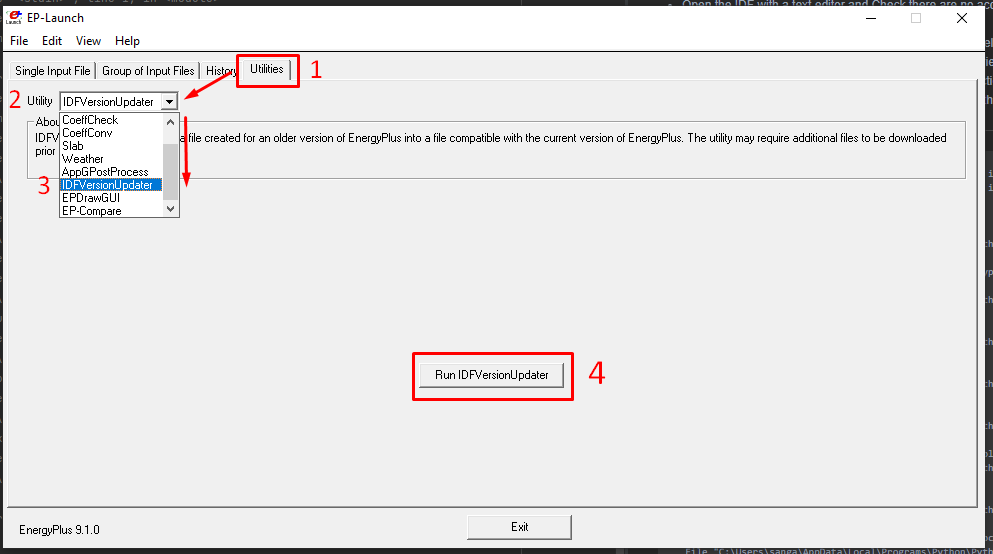
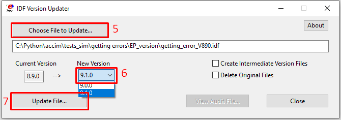
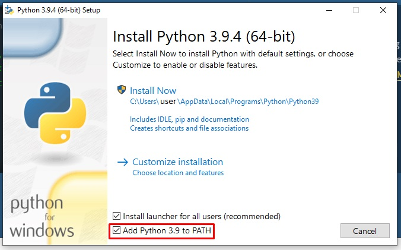
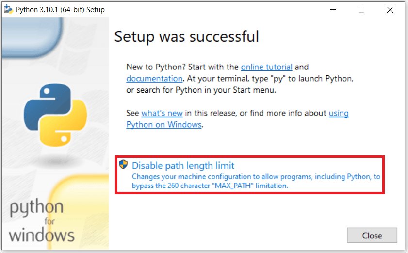

# 5. Troubleshooting

## 5.1 Errors you might get

Below you can see a few errors you might get when using accim:

---

`ModuleNotFoundError: No module named 'geopy'`

`rename_epw_files` (module `accim.data.preprocessing`) uses the package `geopy`, which is installed with accim since version 0.7.8. If you use an earlier version, or `geopy` was removed, open cmd and enter:

`pip install geopy`

If the missing module is another one, reinstall accim, so that its dependencies are installed: `pip install --upgrade accim`.

---

`UnicodeEncodeError: 'latin-1' codec can't encode character '\u0144' in position  123174: ordinal not in range(256)`

This error means that there are some unconventional characters within the model. To amend this problem, try the following:

-   Open the IDF with a text editor and Check there are no accents or other unconventional characters such as ‘ñ’. For example, you can try replacing all instances of ‘á’ with ‘a’.
-   If it doesn’t work and you are using Designbuilder to model the building, then you can try opening a new file, then importing the building geometry to the new file, exporting only libraries used from the old model (it is recommended to carefully check that all inherent data, from schedules to profiles, constructions and materials within these libraries are in English), and finally importing these to the new model and assigning them to the relevant objects as needed.

---

```
this node -WINDOWPROPERTY:SHADINGCONTROL-is not present in base dictionary
this node -WINDOWPROPERTY:SHADINGCONTROL-is not present in base dictionary
1 <class 'int'> None <class 'NoneType'>
Traceback (most recent call last):
  File "<stdin>", line 1, in <module>
  File "C:\Users\<user>\AppData\Local\Programs\Python\Python39\lib\site-packages
\accim\sim\accis.py", line 138, in addAccis
    z = accim_Main.accimJob(filename_temp=file, ScriptType=ScriptType, EnergyPl
us_version=EnergyPlus_version, verboseMode=verboseMode)
  File "C:\Users\<user>\AppData\Local\Programs\Python\Python39\lib\site-packages
\accim\sim\accim_Main.py", line 66, in __init__
    self.idf0 = IDF(fname1)
  File "C:\Users\<user>\AppData\Local\Programs\Python\Python39\lib\site-packages
\eppy\modeleditor.py", line 548, in __init__
    self.read()
  File "C:\Users\<user>\AppData\Local\Programs\Python\Python39\lib\site-packages
\eppy\modeleditor.py", line 672, in read
    readout = idfreader1(
  File "C:\Users\<user>\AppData\Local\Programs\Python\Python39\lib\site-packages
\eppy\idfreader.py", line 307, in idfreader1
    bunchdt = makebunches_alter(data, commdct, theidf, block)
  File "C:\Users\<user>\AppData\Local\Programs\Python\Python39\lib\site-packages
\eppy\idfreader.py", line 109, in makebunches_alter
    bobj = makeabunch(commdct, obj, obj_i, block=block)
  File "C:\Users\<user>\AppData\Local\Programs\Python\Python39\lib\site-packages
\eppy\idfreader.py", line 68, in makeabunch
    extlst = extension_of_extensible(commdct[obj_i], block[obj_i], n)
  File "C:\Users\<user>\AppData\Local\Programs\Python\Python39\lib\site-packages
\eppy\idfreader.py", line 332, in extension_of_extensible
    n = n // ext
TypeError: unsupported operand type(s) for //: 'int' and 'NoneType'
```

If you get an error similar to the one above, you are probably trying to run `addAccis()` with an IDF whose EnergyPlus version is 8.9 or older. To solve this problem, you need to update the IDF’s EnergyPlus version to 9.1 or later; it is recommended to update it to the latest version supported by accim (25.2). To do so, you need to run EP-Launch, go to the Utilities tab, look for and select IDFversionUpdater; run IDFVersionUpdater; then choose the file to update, select the new version and finally update file.



*Troubleshooting_IDFversion_01*



*Troubleshooting_IDFversion_02*

You can also update the IDF from Python with `accim.utils.update_idf_version()`, which runs the transition programs of EnergyPlus one version after another. The target version of EnergyPlus must be installed in its default folder. Give `output_idf_name`; otherwise, the input file is overwritten:

```python
from accim.utils import update_idf_version
update_idf_version(
    input_idf_path='old_model.idf',
    ep_version_target='25.2',
    output_idf_name='model_v{version}.idf',
)
```

---

`ValueError: 8.9 is not a valid EnergyPlus_version.`

`addAccis()` accepts `EnergyPlus_version` values from ‘9.1’ to ‘25.2’, or ‘auto’, which reads the version of each IDF. For an IDF of another version, update it as explained above.

---

`EnergyPlus Terminated--Error(s) Detected`, without an `.err` file

EnergyPlus stops in this way when the path of one of its output files reaches 260 characters, the limit of Windows. The names of the files generated by accim are long, so run the simulations in a folder with a short path (for instance, `C:\sims`), and keep the argument `out_dir` of the parametric simulations short.

---

## 5.2 General recommendations

When you install Python on Windows, tick the option ‘Add python.exe to PATH’ (‘Add Python to PATH’ in older installers). Otherwise, the terminal won’t be able to find python and pip, and you won’t be able to use accim from it.



*Troubleshooting_Path*

Also, once you have installed Python, you should also disable the path length limit:



*Troubleshooting_Disable_length_limit*
