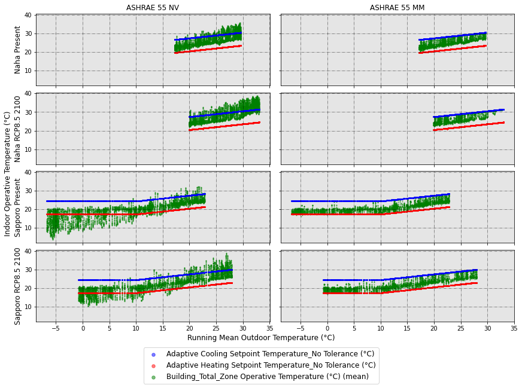

.. accim documentation master file, created by
   sphinx-quickstart on Wed Jun 21 09:57:31 2023.
   You can adapt this file completely to your liking, but it should at least
   contain the root `toctree` directive.

Welcome to accim |version|'s documentation!
===========================================

accim (Adaptive-Comfort-Control-Implemented Model) is a Python package for EnergyPlus building
energy models. It transforms models with fixed setpoint temperatures into models with adaptive
setpoint temperatures, which follow the outdoor temperature as an adaptive thermal comfort model
does, by adding the Adaptive-Comfort-Control-Implementation Script (ACCIS) to the IDF files.

The figure below shows the aim of adaptive setpoint temperatures: keeping the hourly indoor
temperatures within the adaptive comfort zone. It plots the hourly operative temperature (green)
against the running mean outdoor temperature, with the adaptive cooling (blue) and heating (red)
setpoints of ASHRAE 55, for two cities in the present and in 2100. On the left, the simulation
results of a naturally ventilated building; on the right, the same building in mixed-mode
operation with adaptive setpoint temperatures.

With accim you can:

- apply the adaptive setpoint temperatures of the predefined comfort models (international,
  regional and local) or of a custom model, with air-conditioning, natural ventilation or
  mixed-mode operation (:doc:`3_quick tutorial`, :doc:`4_detailed use`);
- apply setpoints based on the adaptive predicted mean vote (aPMV)
  (:doc:`jupyter_notebooks/example_apmv_setpoints_paper/using_apmv_setpoints`);
- rename the weather files, run the simulations and make tables and figures of the results
  (How-to Guides);
- run parametric studies, sensitivity analyses and multi-objective optimisations of these controls
  (:doc:`parametric_and_optimisation`).

If you are new to accim, start with :doc:`1_requirements`, :doc:`2_installation` and
:doc:`3_quick tutorial`.

.. toctree::
   :maxdepth: 7
   :caption: User guide:

   1_requirements.md
   2_installation.md
   3_quick tutorial.md
   4_detailed use.md
   5_troubleshooting.md
   6_citation.md
   7_credits.md

.. toctree::
   :maxdepth: 7
   :caption: How-to Guides:

   jupyter_notebooks/addAccis/using_addAccis
   jupyter_notebooks/rename_epw_files/using_rename_epw_files
   jupyter_notebooks/runEp/using_runEp
   jupyter_notebooks/Table/using_Table
   jupyter_notebooks/full_example_IBPSA/full_example_IBPSA
   jupyter_notebooks/research_paper_case_study/research_paper_case_study.ipynb
   jupyter_notebooks/example_apmv_setpoints_paper/using_apmv_setpoints.ipynb

.. toctree::
   :maxdepth: 2
   :caption: Parametric simulation and optimisation:

   parametric_and_optimisation
   jupyter_notebooks/parametric_and_optimisation_examples/index
   hourly_plotting
   filter_output_csvs
   checkpoint_integrity

.. toctree::
   :maxdepth: 7
   :caption: API Reference:

   api/modules

.. toctree::
   :maxdepth: 7
   :caption: Documentation for previous versions:

   8_pdfs_for_prev_versions.md

Indices and tables
==================

* :ref:`genindex`
* :ref:`modindex`
* :ref:`search`
