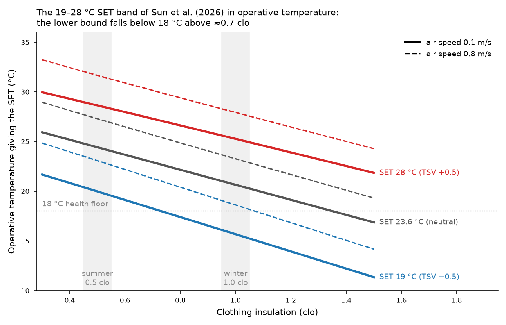

# accim — Propuesta: consignas basadas en la adaptación al clima interior (Bloque F) — v02

Fecha: 2026-11-10 (v02, mismo día: incorpora las decisiones del autor a las siete preguntas de la §6 de v01; los prompts de F1 y F2 quedan cerrados y listos para Copilot). Autor del borrador: asistente, para revisión de Daniel Sánchez-García. Complementa `PROPUESTAS_MEJORAS_post_1.1.0_v03.md` (en adelante *v03*): no sustituye A6 (consignas por SET*), lo desarrolla y lo convierte en un bloque propio. Convenciones de v03: prosa en castellano, identificadores y Erl en inglés, un bloque "Prompt para Copilot" por propuesta, afirmaciones etiquetadas **[verificado: fuente, página/figura]**, **[decisión de diseño]**, **[inferido]** o **[no disponible]**.

---

## 0. Respuesta corta a las tres preguntas

1. **¿En qué se basa el modelo de Sun, Brager y Schiavon (2026)?** En el SET (Standard Effective Temperature). El modelo es `TSV = 0.11·SET − 2.6`, obtenido por inferencia causal (variable instrumental) sobre la ASHRAE Global Thermal Comfort Database II, y la "zona de confort adaptativo interior" es **19–28 °C SET** para TSV = ±0.5, independiente del tipo de acondicionamiento y de la temperatura exterior **[verificado: Sun 2026, §4.3 y Fig. 7a]**.
2. **¿Se puede calcular el SET en EnergyPlus?** Sí, como **variable de salida**: `Zone Thermal Comfort Pierce Model Standard Effective Temperature [C]`, que exige seleccionar `Pierce` entre los *Thermal Comfort Model Type* del objeto `People` **[verificado: Input Output Reference 25.2, §1.14.2.2.34 y nota al pie de la lista de salidas]**. EnergyPlus **no** tiene ningún termostato que controle sobre el SET (solo `ThermostatSetpoint:ThermalComfort:Fanger:*`, sobre el PMV) **[verificado: Energy+.idd 25.2, v03 §12.4]**. Para usarlo como consigna hay que invertirlo: calcular la temperatura (operativa o de aire) que produce el SET objetivo con la humedad, velocidad del aire, clo y met del momento, y escribirla en el termostato vía EMS, que es lo que accim ya hace con las temperaturas adaptativas. El SET de EnergyPlus es el de Gagge et al. (1986) (dos nodos de Pierce); el de ASHRAE 55 / `pythermalcomfort` es una implementación distinta del mismo modelo y la diferencia numérica hay que cuantificarla antes de mezclar ambas **[inferido; tarea E-F1 más abajo]**.
3. **¿Qué propongo?** Un bloque F con tres piezas: **F1** el modelo "SET causal" de Sun et al. como nuevo `ComfStand`, con consignas que son la inversión del SET y, por tanto, derivan con la vestimenta dinámica (A5) y con la velocidad del aire; **F2** una **limitación de la velocidad de cambio de cualquier consigna** respecto a la historia térmica interior ("nudging": media móvil de la temperatura operativa interior en horas ocupadas, con una deriva máxima en K/día), que es la traducción operativa de la hipótesis de Parkinson, de Dear y Brager (2020) y la única forma coherente de aplicar la adaptación interior sin que la consigna se realimente a sí misma; **F3** indicadores de salida (SET, TSV causal, horas dentro de la zona causal, horas de sobreenfriamiento) y un diseño paramétrico para el artículo de validación. La sección 6 recoge las decisiones del autor (10/11/2026) sobre lo que los artículos no cierran.

---

## 1. Qué dicen las fuentes leídas

### 1.1 Parkinson, de Dear y Brager (2020), *Nudging the adaptive thermal comfort model*, Energy and Buildings 206, 109559 **[verificado: PDF en Mendeley library]**

- Replican el procedimiento de de Dear y Brager (1998) sobre la Database II: 60 321 registros de oficinas, 135 edificios inferidos (107 con regresión significativa), temperatura de aire interior como variable independiente, temperatura media mensual exterior como métrica exterior **[§2.2]**.
- **Temperatura neutra frente a temperatura exterior media mensual (Fig. 4):** AC `Tn = 21 + 0.122·Tout` (R² 0.30); MM `Tn = 19.5 + 0.242·Tout` (R² 0.53); NV `Tn = 19.7 + 0.282·Tout` (R² 0.44). Por regiones (Fig. 5): AC occidental `21.1 + 0.096·Tout`, AC asiático `25.2 + 0.0096·Tout` (R² 0.0007); NV occidental `19.3 + 0.267·Tout`, NV asiático `19.1 + 0.341·Tout`.
- **Temperatura neutra frente a temperatura media interior del edificio (Fig. 6):** AC `Tn = 1.06 + 0.951·Tin` (R² 0.96); MM `Tn = 2.91 + 0.879·Tin` (R² 0.97); NV `Tn = 2.23 + 0.897·Tin` (R² 0.98). Es la evidencia central: "the neutral temperature for a group of building occupants is generally close to the mean indoor temperature measured inside their building", sin diferencia entre AC, MM y NV ni entre Occidente y Asia **[§3.1.3]**. Los autores advierten que la relación plana de los AC con Tout puede deberse a que los AC apenas exploran temperaturas interiores distintas de 22–24 °C, no a que sus ocupantes no se adapten **[§4.1]**.
- **Vestimenta frente a temperatura interior (Fig. 9):** AC `clo = 1.39 − 0.0299·Tin` (R² 0.05); MM `1.6 − 0.0343·Tin` (R² 0.19); NV `2.04 − 0.0543·Tin` (R² 0.57); medias 0.67 / 0.70 / 0.74 clo.
- **SET neutro frente a Tout (Fig. 10; 46 280 registros, 97 edificios):** AC `SETn = 25.3 − 0.0068·Tout` (R² 0.002, n. s.); MM `22.6 + 0.16·Tout` (R² 0.35); NV `22.3 + 0.183·Tout` (R² 0.39). Pasar de temperatura de aire a SET reduce la pendiente NV de 0.28 a 0.18: "approximately one third of the adaptive comfort effect can be accounted for by heat balance parameters" (velocidad del aire, clo, humedad); el resto son expectativas, oportunidades adaptativas e historia de exposición **[§3.2.4]**.
- **Nudges propuestos:** (i) +1 K (Occidente) / +2 K (Asia) opcionales en la ordenada del modelo NV; (ii) admitir el modelo adaptativo en edificios MM; (iii) en AC, consignas de verano 24–27 °C (zona 0.5 clo de ASHRAE 55 a 50 % HR y < 0.2 m/s) y, sobre todo, **subir las consignas de forma incremental "spread out over a couple of weeks"** en lugar de un salto de ~5 K, para dar tiempo a los mecanismos adaptativos **[§4.3.2]**. Citan 7–15 % de ahorro anual de HVAC por cada grado de ampliación de la banda muerta (Hoyt et al.) **[§1, Fig. 1]**.

### 1.2 Sun, Brager y Schiavon (2026), *Development of an indoor adaptive thermal comfort model using the causal diagram method*, Energy and Buildings 370, 118097 **[verificado: PDF en Mendeley pendiente 2, S0378778826011576]**

- Hipótesis: la adaptación la impulsan las condiciones interiores a las que el ocupante está expuesto la mayor parte del tiempo, no el clima exterior ni el tipo de refrigeración **[Abstract, §3.2]**. Datos: Database II v2.1, 809 edificios, > 100 000 registros, 106 171 TSV **[§3.1, §4.1]**.
- Método: diagrama causal; el tipo de acondicionamiento (C) es un *collider* entre Tout y TSV, por lo que analizar NV y AC por separado introduce correlaciones espurias ("partially artificial scissors") **[§3.1, §5.1]**. Como el efecto de SET sobre TSV (a2) no es identificable directamente (bucle de realimentación SET↔TSV y confusores no medidos), usan Tout como **variable instrumental**: `a2 = â3/â1`, con â1 la pendiente de SET sobre Tout y â3 la de TSV sobre Tout, ambas con todos los edificios juntos **[§4.1–4.3, ecs. 1–9]**.
- **Resultados (Fig. 6, Tout = temperatura media mensual exterior):** SET frente a Tout: NV `0.51·Tout + 14.9` (R² 0.80), AC `0.02·Tout + 23.2` (R² 0.02), todos `0.26·Tout + 19.1` (R² 0.31) → â1 = 0.26. TSV frente a Tout: NV `0.09·Tout − 1.66` (R² 0.53), AC `−0.03·Tout + 0.66` (R² 0.19), todos `0.03·Tout − 0.49` (R² 0.07) → â3 = 0.03.
- **Modelo causal (Fig. 7a):** `TSV = 0.11·SET − 2.6` (R² 0.6, p = 0.05). Con TSV = ±0.5, **zona 19–28 °C SET**, "7 °C wider than the one calculated using the PMV model (between 24 °C and 26 °C)". Comprobación propia: 0.03/0.26 = 0.115; b2 = −0.49 − 0.03·19.1/0.26 = −2.69; SET neutro = 2.6/0.11 = 23.6 °C; límites 19.1 y 28.2 °C **[cálculo propio a partir de los coeficientes de las figuras]**. Las regresiones correlacionales clásicas (Fig. 7b) dan NV `0.16·SET − 3.9` (R² 0.53) y AC `0.12·SET − 2.9` (R² 0.07, n. s.).
- Uso propuesto por los autores: "the lower and upper bounds of the causal comfort zone can be used as the heating and cooling setpoints on thermostats" y, en diseño, para evaluar el confort en simulación **[§4.3, último párrafo]**. Reconocen que el camino `Tout←Z→A→O→SET→TSV` queda abierto por falta de datos sobre oportunidades adaptativas **[§4.3, Apéndice]**.
- **Limitaciones que afectan a su uso como consigna [inferido a partir del texto]:** (a) la pendiente 0.11 K⁻¹ procede del cociente de dos pendientes con R² 0.31 y 0.07 y el propio ajuste se reporta con p = 0.05; (b) es un modelo de **población a largo plazo** ("if we deliberately operate the indoor environment at specific SET values for a long time"), no de respuesta instantánea; (c) el modelo es **estático en SET**: la adaptación conductual (clo, velocidad del aire, humedad) ya está dentro del índice, y la psicológica/fisiológica, dentro de la pendiente; (d) el artículo no fija met, clo ni velocidad del aire para traducir SET a temperatura: eso lo tiene que decidir quien lo aplique; (e) una banda de 9 K es ancha porque la pendiente es plana; con TSV = ±0.5 el límite inferior (19 °C SET) queda muy por debajo de cualquier norma en invierno (véase §2.3).

### 1.3 Evidencia complementaria leída

- **Sun, Schiavon, Brager, Yan y Parkinson (2025)**, *Causal effects estimation: using natural experiments…*, Indoor Environments 2, 100080 **[verificado: PDF en Mendeley pendiente 2, abstract]**: regresión en discontinuidad en el río Huai; la calefacción urbana causa +4.3 °C de temperatura operativa media interior y +0.6 de TSV medio. Cociente 0.6/4.3 = 0.14 K⁻¹ **[cálculo propio]**, del mismo orden que el 0.11 K⁻¹ del modelo causal: la sensibilidad a largo plazo del voto a la temperatura interior es unas tres veces menor que la del PMV en cámara.
- **Wu, Jiang, Liu, Li y Kosonen (2024)**, Energy and Built Environment 5, 455–463 **[verificado: PDF en Mendeley library, §3.1.2]**: en cámara, la temperatura neutra de sujetos con historia NV sigue la temperatura de aire con pendiente 0.737 (R² 0.98); en los sujetos con historia AC, 0.439 en verano y 0.287 en invierno; en invierno los AC muestran menor adaptación al frío. Es decir, la historia interior reciente modula cuánto se adapta cada grupo.
- **Shao et al. (2026)**, Building and Environment, 114437 **[verificado: PDF en Mendeley pendiente 2, abstract y conclusiones]**: 30 sujetos, rampa 25→29 °C a 4 K/h; la expectativa (decirles que la temperatura subirá) empeora sensación y satisfacción sin cambiar la fisiología; el PMV sigue prediciendo bien la satisfacción en rampas moderadas. Relevante para F2: la deriva debe ser lenta y, en operación real, no anunciada como "subida".
- **Rupp, Kim, Toftum, Brager y de Dear (2025)**, *Ten questions… mixed-mode*, Building and Environment, 113490 **[verificado: PDF en Mendeley library]**: en modo activo, un edificio MM debería apuntar a la parte alta de la banda adaptativa en refrigeración y a la baja en calefacción, para minimizar el gradiente interior-exterior. Es exactamente lo que accim hace con ComfMod; el documento sirve de respaldo de autoridad.
- **Schweiker (2022)** (ATHB con Trm; ya resumido en memoria del proyecto y en v03 A4) y **Parkinson, Schiavon, de Dear y Brager (2021)** (*Overcooling of offices…*, Sci. Rep. 11) refuerzan el argumento del sobreenfriamiento, pero no aportan coeficientes nuevos para las consignas.

### 1.4 No disponibles (no leídos; conviene descargarlos antes del artículo)

Luo et al. 2016 (10.1016/j.buildenv.2016.01.005, migrantes y exposición interior fría); Ning et al. 2016 (10.1016/j.apenergy.2016.08.157, historia térmica a largo plazo); Song et al. 2020 (10.1016/j.buildenv.2020.106990, proceso dinámico de adaptación: es la referencia que podría dar la **constante de tiempo** de F2); Hassani et al. 2024 (10.1016/j.buildenv.2024.111900, historia térmica a largo plazo en mayores); de Dear, Xiong, Kim y Cao 2020 (10.1016/j.enbuild.2020.109893, revisión); Kent et al. 2023 (10.1016/j.buildenv.2023.110674, oficina ZEB en Singapur con ventiladores y consigna alta); Miller et al. 2021 (ventiladores escalonados con AC, citado como [67] en Sun 2026); Muhammad et al. 2026 (10.1080/23744731.2026.2697659, historia térmica en oficinas AC de Abuja). **[no disponible]**

---

## 2. Qué cambia para la tesis de accim

### 2.1 La hipótesis de accim, reformulada con la evidencia nueva

accim parte de que los ocupantes de espacios acondicionados también se adaptan y de que, por tanto, los límites adaptativos sirven como consignas. Parkinson 2020 (Fig. 6) y Sun 2026 dicen algo más preciso: **el motor de la adaptación es la exposición interior**; la temperatura exterior funciona en los modelos adaptativos como *proxy* de la temperatura interior en edificios permeables. Consecuencias:

1. Una consigna que sigue a la temperatura exterior (ASHRAE 55, EN 16798-1, modelos regionales) **es legítima en un edificio acondicionado en la medida en que modela la exposición interior**: al aplicarla, la temperatura interior pasa a seguir la estacionalidad exterior, y es esa exposición la que produce la adaptación. La premisa de accim no es "los ocupantes se adaptan a Tout" sino "los ocupantes se adaptan a lo que accim les hace vivir dentro". Esto es defendible con Parkinson 2020 §4.1 y Sun 2026 §3.2.
2. La misma evidencia impone una **restricción de velocidad**: la adaptación tarda días–semanas (Parkinson 2020 §4.3.2 habla de "a couple of weeks" para ~5 K; Song 2020 lo cuantifica pero no está disponible). Una consigna adaptativa que salta 2–3 K de un día para otro porque la media móvil exterior cruza un umbral de temporada, o porque cambia la categoría, no está respaldada. De ahí F2.
3. Un modelo **estático en SET** (Sun 2026) no contradice a los modelos adaptativos: la parte conductual de la adaptación (clo, velocidad del aire) está dentro del SET, de modo que al invertirlo con vestimenta dinámica (A5, Schiavon y Lee 2013 a partir de la temperatura exterior de las 6 h) y con ventiladores en temporada cálida, la consigna en temperatura operativa **deriva estacionalmente por mecanismo, no por regresión**. Es un modelo adaptativo "mecanicista" complementario al estadístico, y accim puede ofrecer ambos.

### 2.2 Qué modelos ya existentes de accim quedan tocados

- `ComfStand 2` (ASHRAE 55) y `1` (EN 16798-1): sin cambios de ecuación; F2 les añade un limitador opcional de deriva.
- `apply_apmv_setpoints` / `apply_epmv_setpoints` (A1–A3): el aPMV con λ y el ePMV con *e* son correcciones psicológicas al PMV; el modelo de Sun es la alternativa empírica a largo plazo. En el artículo conviene compararlos (sección 5).
- A5 (vestimenta dinámica y clo/met por estación): es prerrequisito de F1, porque sin clo variable el modelo SET da consignas constantes todo el año.
- A6 (SET*, PPD, cooling effect, prioridad P2 en v03): F1 lo absorbe y le da la base científica que le faltaba; la vía (b) de A6 (hook del backend API con `pythermalcomfort.models.set_tmp` y bisección) es la que se recomienda.
- B5 (suelo sanitario de calefacción): pasa a ser obligatorio cuando se usa F1, por §2.3.

### 2.3 El límite inferior del modelo SET no sirve como consigna de calefacción sin un suelo

Inversión de la banda 19 / 23.6 / 28 °C SET a temperatura operativa (ta = tr) con `pythermalcomfort 4.8.1` (`set_tmp`, SET de ASHRAE 55; bisección sobre la temperatura) **[cálculo propio; tabla completa en `set_band_to_equivalents.csv`]**:

| Caso (met, clo, v, HR) | To para SET 19 | To para SET 23.6 | To para SET 28 |
|---|---|---|---|
| Verano 1.1 met, 0.5 clo, 0.1 m/s, 50 % | 20.0 | 24.4 | 28.6 |
| Verano 1.1 met, 0.5 clo, 0.1 m/s, 70 % | 19.8 | 24.0 | 27.5 |
| Verano 1.1 met, 0.5 clo, 0.6 m/s (ventilador) | 22.6 | 26.8 | 31.2 |
| Verano 1.1 met, 0.5 clo, 1.0 m/s (ventilador) | 23.4 | 27.6 | 32.0 |
| Entretiempo 1.1 met, 0.7 clo, 0.1 m/s, 50 % | 18.3 | 22.9 | 27.3 |
| Invierno 1.1 met, 1.0 clo, 0.1 m/s, 40 % | 15.8 | 20.8 | 25.8 |
| Invierno 1.2 met, 1.0 clo, 0.1 m/s, 40 % | 15.2 | 20.3 | 25.4 |
| Invierno 1.2 met, 1.3 clo, 0.1 m/s, 40 % | 12.4 | 17.8 | 23.1 |



Lecturas: (i) el límite superior en verano (28.6 °C a 0.5 clo sin ventilador; 31–32 °C con 0.6–1.0 m/s) es comparable al límite superior de ASHRAE 55 al 80 % con Trm 30 °C (30.6 °C) o de EN 16798-1 cat. II con Trm 25 °C (30.05 °C) **[fórmulas de v03 §11.5]**, con la diferencia de que no depende de Tout; (ii) el límite inferior cae por debajo del suelo sanitario de 18 °C (Jevons 2016, síntesis del artículo de frío) a partir de **0.73 clo** a 0.1 m/s, y da 15.8 °C con 1.0 clo: **no es aceptable como consigna de calefacción**; (iii) el SET neutro de 23.6 °C corresponde a 24.4 °C operativos en verano y 20.8 °C en invierno, es decir, el modelo de Sun reproduce de forma mecanicista la práctica de "24–27 °C en verano, 20–22 °C en invierno". Nótese que el SET neutro de los ocupantes de edificios AC en Parkinson 2020 (Fig. 10) es 25.3 °C, 1.7 K más alto que el 23.6 °C del modelo causal, porque aquellos están adaptados a su propio sobreenfriamiento **[inferido]**.

---

## 3. SET en EnergyPlus 25.2 **[verificado en Engineering Reference §19.1.4 e Input Output Reference §1.14.2]**

- Modelo: Pierce de dos nodos (Gagge et al. 1970, 1986; Fountain y Huizenga 1997). "SET* is the dry-bulb temperature of a hypothetical environment at 50% relative humidity for subjects wearing clothing that would be standard for the given activity in the real environment", con la misma temperatura de piel, humedad de piel y pérdida de calor que en el ambiente real **[Eng. Ref. §19.1.4, p. 1567]**. Coeficiente convectivo `hc = 8.6·v^0.53` con v mínimo 0.137 m/s, y `hc = 5.66·(met − 0.85)^0.39` si met > 0.9, tomando el mayor **[ecs. 19.27–19.28]**.
- Salidas: `Zone Thermal Comfort Pierce Model Standard Effective Temperature [C]`, `… Pierce Model Standard Effective Temperature PMV []` (PMV* calculado con SET*, ec. 19.41), `… Pierce Model Effective Temperature PMV []`, `… Pierce Model Thermal Sensation Index []` (TSENS) y `… Pierce Model Discomfort Index []` (DISC). Solo se publican si `People` incluye `Pierce` en sus *Thermal Comfort Model Type* **[IO Ref. §1.14.2.2.34]**.
- Entradas que lo gobiernan: los mismos schedules de `People` que el Fanger (actividad, trabajo, velocidad del aire, clo y su método de cálculo; v03 §12.1), la humedad relativa de la zona y la temperatura radiante media según *Mean Radiant Temperature Calculation Type*.
- No existe `ThermostatSetpoint:ThermalComfort:Pierce`. Las únicas vías son (a) Erl: lazo sobre el SET del paso anterior, `T_sp = T_sp_prev + k·(SET_target − SET_prev)` saturado; retardo de un paso y riesgo de oscilación con humedad o velocidad variables (v03 A6a); (b) backend API: en el *calling point* de cada paso, leer `Zone Air Relative Humidity`, `Zone Mean Radiant Temperature` (o aproximar tr = ta), clo y met efectivos, velocidad del aire del schedule, y resolver por bisección la temperatura de aire cuyo SET es el objetivo; escribir esa temperatura en el schedule del termostato que accim ya actúa. Exacto y sin retardo; necesita `pythermalcomfort` (extra `accim[comfort]`, como A4) **[decisión de diseño; v03 A4/A6]**.
- Consistencia entre implementaciones: la salida Pierce de E+ y `set_tmp` de `pythermalcomfort` no tienen por qué coincidir al décimo de grado (coeficientes convectivos, área corporal, eficiencia de permeación, límite de velocidad 0.137 m/s). Antes de usar F1 en un artículo, **tarea E-F1**: simular un caso con `Pierce` activado y comparar hora a hora el SET de E+ con el SET recalculado en Python a partir de las mismas salidas (Ta, Tr, HR, v, clo, met); documentar la diferencia media y máxima en `notes/decisions.md` **[inferido; sin verificar]**.

---

## 4. Propuestas (Bloque F — adaptación al clima interior)

### F1. Modelo "SET causal" de Sun et al. (2026) como consigna (P1)

**Base [verificado: Sun 2026 Fig. 7a].** `TSV = a2·SET + b2`, con `a2 = 0.11`, `b2 = −2.6`. Consignas: `SET_cool = (TSV_max − b2)/a2`, `SET_heat = (TSV_min − b2)/a2`. Con TSV = ±0.5: 28.2 y 19.1 °C (los autores redondean a 28 y 19).

**Diseño.**
- Nuevo `ComfStand 24` en `accim/sim/standards.py` (el 23 está reservado a `JPN Aqilah2025`, v03 B4) con etiqueta `INT Sun2026 SET` y dos *comfort modes*: `SET band` (consignas = inversión de SET_cool / SET_heat) y `SET neutral ± offset` (consigna = inversión de 23.6 °C SET con un `offset` simétrico en K SET, para estudios paramétricos).
- Anchura de TSV por el argumento `tsv_limit`: 0.5 por defecto (único valor publicado); 0.7 y 1.0 admitidos como **extrapolación lineal**, con aviso; `CAT` 80 y 90 se mapean ambos a 0.5 **[decisión del autor, §6.2]**.
- Inversión del SET → temperatura de aire de consigna con el backend API (`comfort_hooks.py`, misma infraestructura que A4): entradas por zona y paso: HR de la zona, Tr según `tr_mode = 'zone'` (por defecto) `| 'equal_air'`, v del schedule de `People` (los ventiladores se representan en ese schedule, como en Kent 2023 y Miller 2021; sin parámetro propio, §6.5), clo según A5 (`set_clothing_method`: schedule, por estación o `DynamicClothingModelASHRAE55`), met del schedule de actividad. Bisección en [10, 40] °C con tolerancia 0.05 K; el resultado se recorta con `CustAST_ACSTaul/all` y `AHSTaul/all` como hoy.
- **Suelo sanitario opcional** (B5): `heating_floor` por defecto 18 °C sobre el límite inferior, con aviso si la inversión da menos (ocurre con clo > 0.73 a 0.1 m/s); `heating_floor=None` lo desactiva **[decisión del autor, §6.3]**.
- Backend IDF (sin API): vía Erl A6a como degradación documentada; no implementar en la primera iteración (anotar en `TODO.md`).
- Salidas: SET de E+ (requiere añadir `Pierce` al `People`, como `_update_fanger_object` hace con Fanger), SET recalculado por accim, TSV causal (`0.11·SET − 2.6`), horas con SET dentro de la banda, PMV y PMV* para comparar (D1/D2).

**Prompt para Copilot (F1).**
```text
Implement the causal SET comfort model of Sun, Brager and Schiavon (2026), Energy and Buildings 370, 118097 (TSV = 0.11*SET - 2.6; comfort zone 19-28 C SET for TSV = +/-0.5; neutral SET 23.6 C), as a new comfort standard of accim, following the common header of notes/PROPUESTAS_MEJORAS_post_1.1.0_v03.md section 10.3. The design decisions below were taken by the author on 2026-11-10 (notes/PROPUESTA_ADAPTACION_INTERIOR_v02.md section 6): copy them into notes/decisions.md and do not reopen them.
Decisions: ComfStand 24, label 'INT Sun2026 SET', title '24 = INT Sun, Brager & Schiavon 2026 (causal SET band)', two comfort modes: 'SET band' (heating/cooling setpoints = inversion of SET_heat/SET_cool) and 'SET neutral +/- offset' (inversion of 23.6 C SET +/- an offset in K of SET). Argument tsv_limit, default 0.5; 0.7 and 1.0 accepted with a logged warning that they are a linear extrapolation of the published model (SET = (+/-tsv_limit + 2.6)/0.11); CAT 80 and 90 both map to tsv_limit 0.5. Argument heating_floor, default 18.0 C, applied to the heating setpoint after the inversion (clip and warn), disabled with None. Argument tr_mode: 'zone' (default; zone mean radiant temperature from the output variable 'Zone Mean Radiant Temperature') or 'equal_air' (tr = air temperature). The air speed, clothing insulation and metabolic rate are read from the schedules of the People object (clothing via set_clothing_method of A5); no new air-speed argument.
Scope: (1) register the standard in accim/sim/standards.py; (2) add a hook for the EnergyPlus API backend (accim/sim/comfort_hooks.py, extra accim[comfort] with pythermalcomfort) that, at each timestep and for each target zone, reads the zone relative humidity, the mean radiant temperature according to tr_mode, the clothing insulation, the metabolic rate and the air speed, and solves by bisection (10-40 C, tolerance 0.05 K) the air temperature whose SET (pythermalcomfort.models.set_tmp) equals the SET setpoint; write it to the setpoint schedules that accim already actuates, then apply the existing CustAST_ACSTaul/all and AHSTaul/all limits and the heating_floor; (3) add 'Pierce' to the Thermal Comfort Model Types of the People objects and request the output variable 'Zone Thermal Comfort Pierce Model Standard Effective Temperature'; (4) report per zone the SET computed by accim, the causal TSV (0.11*SET - 2.6) and the occupied hours inside the band; (5) the IDF-only backend is out of scope for this commit: add a TODO.md entry (P2) for the Erl proportional-loop fallback of v03 A6a; (6) tests: a unit test of the inversion against set_tmp (SET of the solution within 0.05 K of the target for 0.5 and 1.0 clo, 0.1 and 0.8 m/s, 40 and 70 % RH), a test that heating_floor clips 15.8 C to 18.0 C at 1.0 clo, 1.1 met, 0.1 m/s, 40 % RH, and a short simulation test with the sample IDF that compares EnergyPlus's Pierce SET with accim's SET hour by hour and records the mean and maximum difference in notes/decisions.md (measure it; do not assume a tolerance).
Constraints: nothing invented; coefficients only from the paper cited above; anything you cannot do goes to TODO.md; any genuinely new question goes to notes/questions.md. One commit, then push.
```

### F2. Limitador de deriva de la consigna por historia térmica interior ("nudging") (P1)

**Base [verificado: Parkinson 2020 Fig. 6 y §4.3.2; Shao 2026; Wu 2024].** La neutralidad sigue la temperatura interior media con pendiente ≈ 0.9–0.95, pero la adaptación necesita tiempo; un cambio brusco produce quejas y la expectativa de "subida" empeora el voto. Parkinson recomienda escalones incrementales repartidos en un par de semanas para ~5 K, es decir **≈ 0.3–0.5 K/día** **[cálculo propio a partir de su texto; no dan la cifra]**.

**Diseño.**
- Variable de estado por zona `T_rm_in` = media móvil exponencial diaria de la temperatura operativa interior **en horas ocupadas**: `T_rm_in(d) = (1 − α_in)·T_occ_mean(d−1) + α_in·T_rm_in(d−1)`, con `α_in` configurable (0.8 por analogía con EN 16798-1 equivale a una constante de tiempo de unos 4.5 días; 0.9, unos 9.5 días) **[decisión de diseño, §6]**. Se calcula sin `TrendVariable`: acumuladores Erl (`sum_T_occ_<z>`, `n_occ_<z>`) actualizados cada paso con ocupación > 0 y volcados al cambiar `DayOfYear`; funciona en los dos backends.
- Regla: la consigna aplicada es la consigna objetivo de cualquier `ComfStand` (adaptativo, aPMV, SET causal…) recortada a la ventana `[T_rm_in − δ_heat, T_rm_in + δ_cool]`, o bien limitada en pendiente `|T_sp(d) − T_sp(d−1)| ≤ r_max` (K/día). Las dos formas se ofrecen; la segunda es más simple de explicar y la primera es la que modela "adaptarse a la exposición". Parámetros nuevos del paramétrico: `drift_mode` (por defecto `None`; `'rate'` recomendado, 0.5 K/día), `max_drift_rate`, `alpha_indoor` (0.8), `delta_cool`, `delta_heat` (1.0 K) **[valores en §6.6]**.
- Inicialización: `T_rm_in` al inicio del periodo de simulación. Opciones: el valor de la consigna estática de referencia (p. ej. 22/24 °C), el valor de la consigna objetivo del primer día, o un valor dado por el usuario; resuelto en §6.6: primer día ocupado sin límite (`'rate'`) o limitador inactivo hasta acumular un día ocupado (`'window'`), con `initial_T_rm_in` opcional.
- Interacción con el modo de ventilación natural (`VentCtrl`, `MixedMode`): las horas en modo ventilado también cuentan como exposición; no hay motivo para excluirlas.
- Salida: `T_rm_in` por zona, consigna objetivo y consigna aplicada, "horas con recorte activo".

**Prompt para Copilot (F2).**
```text
Add to accim an optional limiter of the setpoint drift based on the indoor thermal history, after Parkinson, de Dear and Brager (2020), Energy and Buildings 206, 109559 (occupants adapt to the mean indoor temperature they are exposed to, Fig. 6; setpoint changes should be spread over days to weeks, section 4.3.2). Follow the common header of notes/PROPUESTAS_MEJORAS_post_1.1.0_v03.md section 10.3. The design decisions below were taken by the author on 2026-11-10 (notes/PROPUESTA_ADAPTACION_INTERIOR_v02.md section 6): copy them into notes/decisions.md and do not reopen them.
Decisions: argument drift_mode with default None (limiter off: the IDF and the results of every existing ComfStand must be identical to the current ones). drift_mode='rate': |setpoint(d) - setpoint_applied(d-1)| <= max_drift_rate, default 0.5 K/day; on the first occupied day the target is applied without limit and from then on the state is the applied setpoint of the previous day. drift_mode='window': the target setpoint is clipped to [T_rm_in - delta_heat, T_rm_in + delta_cool], defaults delta_cool = delta_heat = 1.0 K, where T_rm_in is the exponentially weighted daily running mean of the zone operative temperature during occupied hours, T_rm_in(d) = (1 - alpha_indoor)*T_occ_mean(d-1) + alpha_indoor*T_rm_in(d-1), alpha_indoor default 0.8; the limiter is inactive until one full occupied day has been accumulated and T_rm_in starts with the mean of that day; initial_T_rm_in (default None) overrides that start. The limiter applies to the heating and the cooling setpoints of any ComfStand (adaptive, PMV-derived and the SET model of ComfStand 24).
Scope: (1) per-zone Erl accumulators sum_T_occ_<zone> and n_occ_<zone>, updated every timestep with occupancy > 0 and flushed at the change of DayOfYear, without TrendVariable so that the API backend also runs them; (2) the two limiter modes inserted after the setpoint computation of each ComfStand and before the existing clipping to CustAST limits; (3) arguments drift_mode, max_drift_rate, alpha_indoor, delta_cool, delta_heat, initial_T_rm_in in the setpoint functions, in parameters.py and in params_dicts.py; (4) outputs per zone: T_rm_in, target setpoint, applied setpoint, occupied hours with the limiter active; (5) tests: a regression test that with drift_mode=None the generated IDF is byte-identical to the current one for the sample model; an Erl-level test that T_rm_in matches a pandas computation on the hourly output; a test that with drift_mode='rate' and a 5 K step of the target the applied setpoint reaches the target after 10 days at 0.5 K/day.
Constraints: nothing invented; anything you cannot do goes to TODO.md; any genuinely new question goes to notes/questions.md. One commit, then push.
```

### F3. Indicadores y diseño del estudio de validación (P2)

- `Table` (D1/D2): columnas `SET`, `PMV_SET` (de E+), `TSV_causal`, `hours_in_causal_band`, `T_rm_in`, y un indicador de **sobreenfriamiento** (horas ocupadas con temperatura operativa por debajo de la consigna de calefacción de referencia o, siguiendo Parkinson 2021, por debajo de 22 °C en temporada de refrigeración) **[decisión de diseño]**.
- Indicador "neutralidad por exposición" (Parkinson Fig. 6, AC): `Tn_exp = 1.06 + 0.951·T_rm_in`; solo como diagnóstico, nunca como consigna, porque es autorreferente (la consigna fija la exposición y la exposición fija la neutralidad). Horas con `|To − Tn_exp| > 2.5 K` como medida de disconfort "esperado" **[inferido]**.
- Estudio paramétrico para el artículo (todo con accim + pyfwg, presente y 2050/2080): (i) referencia estática PMV (24–26 / 20–22 °C); (ii) ASHRAE 55 y EN 16798-1 cat. II como hoy; (iii) F1 con clo fijo por estación; (iv) F1 con clo dinámico (A5) y `air_speed_cooling` ∈ {0.1, 0.6, 1.0} m/s; (v) (ii) y (iv) con F2, `max_drift_rate` ∈ {0.25, 0.5, 1.0, ∞} K/día. Métricas: energía de calefacción y refrigeración, horas fuera de banda por modelo, distribución del SET y del PMV, horas de sobreenfriamiento, y la **sensibilidad del ahorro a la velocidad de deriva**, que es el resultado nuevo que ningún artículo anterior de accim ha dado. Climas: los habituales del grupo (Sevilla y el conjunto de ciudades de los artículos de calor), más uno húmedo (la humedad es donde el SET se separa de la temperatura operativa).
- Coautoría: Ruiji Sun (Nottingham Ningbo), Stefano Schiavon y Gail Brager (CBE) son los autores naturales del modelo F1; Thomas Parkinson (Sídney) y Richard de Dear, de F2. Encaja con el objetivo del proyecto de replicar los estudios con los autores de los modelos.

---

## 5. Orden de implementación sugerido

1. **E-F1** (comparación SET de E+ frente a `pythermalcomfort`): medio día de simulación; condiciona la tolerancia de F1.
2. **F2** antes que F1: es independiente del SET, se aplica a todos los modelos existentes y es la pieza con más valor argumental para la premisa de accim.
3. **F1** sobre A4/A5 (requiere el extra `accim[comfort]`).
4. **F3** y el paramétrico.

---

## 6. Decisiones tomadas por el autor (10 de noviembre de 2026) **[decisión de diseño]**

Respuestas de Daniel Sánchez-García a las siete preguntas de v01; donde delegó ("haz lo que consideres mejor") se indica el valor elegido por el asistente y su motivo, para que el autor pueda corregirlo.

1. **Número y etiqueta.** `ComfStand 24`, etiqueta `INT Sun2026 SET`, título `24 = INT Sun, Brager & Schiavon 2026 (causal SET band)`. El autor pidió "el siguiente disponible en la serie de los 20": el 23 está reservado en v03 (B4, `JPN Aqilah2025`) y en `COPILOT_BRIEF_v1.2.0_v01.md`, y los ≥ 100 para los modelos externos de B3, así que el libre es el 24. "INT" es el prefijo del catálogo para los modelos no ligados a un país (`INT EN16798`, `INT ASHRAE55`, `INT ISO7730`); el modelo de Sun procede de la Database II global, luego entra en ese grupo.
2. **Anchuras de TSV.** Sí: argumento `tsv_limit`, por defecto 0.5 (único valor publicado); 0.7 y 1.0 admitidos, con aviso en el log y en la documentación de que son extrapolación lineal del modelo (`SET = (±tsv_limit + 2.6)/0.11`). Para ComfStand 24 la `CAT` de accim se mapea así: 80 → 0.5, 90 → 0.5 (misma banda; no hay equivalente publicado), y los valores 0.7/1.0 solo por `tsv_limit` explícito.
3. **Límite inferior.** Suelo sanitario de 18 °C, **opcional**: argumento `heating_floor`, por defecto 18.0 (activo, porque la inversión de SET 19 °C da 15.8 °C a 1.0 clo), desactivable con `heating_floor=None`. Si el autor prefiere que por defecto esté desactivado, basta cambiar el valor por defecto; la interpretación "activo por defecto, desactivable" es del asistente.
4. **Temperatura radiante en la inversión.** Elegible por el usuario con `tr_mode`: `'zone'` (temperatura radiante media de la zona, salida `Zone Mean Radiant Temperature`) o `'equal_air'` (tr = ta). **Por defecto `'zone'`**: es coherente con el SET que publica el propio EnergyPlus (modelo Pierce, que usa la Tr de la zona) y con el hecho de que el termostato controla la temperatura de aire, de modo que la incógnita de la bisección es ta con la Tr real de la zona; `'equal_air'` reproduce la tabla de la §2.3 y es útil para comprobaciones.
5. **Velocidad del aire.** Se delega en el schedule de velocidad del aire del objeto `People` (ventiladores: schedule con valores altos en temporada de refrigeración). F1 no añade parámetro propio; el paramétrico puede variar ese schedule con los parámetros personales de C1.
6. **F2 (valores elegidos por el asistente).** `drift_mode` por defecto `None` (desactivado; véase 7). Cuando se activa: modo por defecto `'rate'` con `max_drift_rate = 0.5` K/día (Parkinson 2020 §4.3.2: ~5 K repartidos "over a couple of weeks" → 0.36–0.5 K/día; se toma el extremo rápido para no penalizar en exceso el ahorro; es parámetro del paramétrico). Modo `'window'`: `alpha_indoor = 0.8` (misma constante que la media móvil de EN 16798-1, τ ≈ 4.5 días) y `delta_cool = delta_heat = 1.0` K. Inicialización: en `'rate'`, el primer día ocupado aplica la consigna objetivo sin límite y a partir de ahí el estado es la consigna aplicada del día anterior; en `'window'`, el limitador queda inactivo hasta acumular un día ocupado completo y `T_rm_in` arranca con la media de ese día; `initial_T_rm_in` permite fijarlo a mano. Motivo: reproducible, sin depender de los días de *warm-up* de EnergyPlus y sin introducir un valor arbitrario.
7. **Activación por defecto.** Solo bajo petición (`drift_mode=None`): los resultados de los modelos existentes no cambian y los artículos publicados siguen siendo reproducibles.

Las preguntas quedan cerradas; Copilot debe copiarlas en `notes/decisions.md` al implementar (están incluidas en los prompts de la §4) y no reabrirlas en `notes/questions.md`.

---

## 7. Hoja de fórmulas (todas **[verificado]** salvo indicación)

- Sun 2026: `SET = â1·Tout + b̂1`, `â1 = 0.26`, `b̂1 = 19.1`; `TSV = â3·Tout + b̂3`, `â3 = 0.03`, `b̂3 = −0.49`; `a2 = â3/â1 = 0.11`; `b2 = b̂3 − â3·b̂1/â1 = −2.6`; `TSV = 0.11·SET − 2.6`; `SET(TSV) = (TSV + 2.6)/0.11` → 19 °C (−0.5), 23.6 °C (0), 28 °C (+0.5). Tout: temperatura media mensual exterior del aire.
- Sun 2025: efecto causal de la calefacción urbana: +4.3 °C de To media, +0.6 de TSV; 0.14 K⁻¹ **[cálculo propio]**.
- Parkinson 2020: Fig. 4 `Tn = 21 + 0.122·Tout` (AC), `19.5 + 0.242·Tout` (MM), `19.7 + 0.282·Tout` (NV); Fig. 6 `Tn = 1.06 + 0.951·Tin` (AC), `2.91 + 0.879·Tin` (MM), `2.23 + 0.897·Tin` (NV); Fig. 9 `clo = 1.39 − 0.0299·Tin` (AC), `1.6 − 0.0343·Tin` (MM), `2.04 − 0.0543·Tin` (NV); Fig. 10 `SETn = 25.3 − 0.0068·Tout` (AC), `22.6 + 0.16·Tout` (MM), `22.3 + 0.183·Tout` (NV). Tin: media de la temperatura de aire interior del edificio durante la campaña.
- Wu 2024: `dTn/dTa` = 0.737 (historia NV, todas las estaciones), 0.439 (AC, verano), 0.287 (AC, invierno).
- F2 (propuesta): `T_rm_in(d) = (1 − α_in)·T_occ_mean(d−1) + α_in·T_rm_in(d−1)`; `T_sp,app = min(max(T_sp,target, T_rm_in − δ_heat), T_rm_in + δ_cool)` o `T_sp,app(d) = T_sp,app(d−1) + clip(T_sp,target − T_sp,app(d−1), −r_max, +r_max)`. Constante de tiempo de la media exponencial diaria: `τ ≈ −1/ln(α_in)` días (0.8 → 4.5 d; 0.9 → 9.5 d) **[cálculo propio]**.
- EnergyPlus Pierce: `hc = max(8.6·v^0.53, 5.66·(met − 0.85)^0.39)`, v ≥ 0.137 m/s; `PMV_SET = (0.303·e^(−0.036·M) + 0.028)·(H − L_SET*)` (ec. 19.41).

## 8. Archivos de apoyo de esta propuesta

- `attachments/set_band_vs_clo.png` y `set_band_vs_clo.csv`: temperatura operativa que produce SET 19 / 23.6 / 28 °C para clo 0.30–1.50 y v = 0.1 y 0.8 m/s (1.1 met, 50 % HR, ta = tr), `pythermalcomfort 4.8.1`.
- `set_band_to_equivalents.csv`: la tabla de §2.3.
